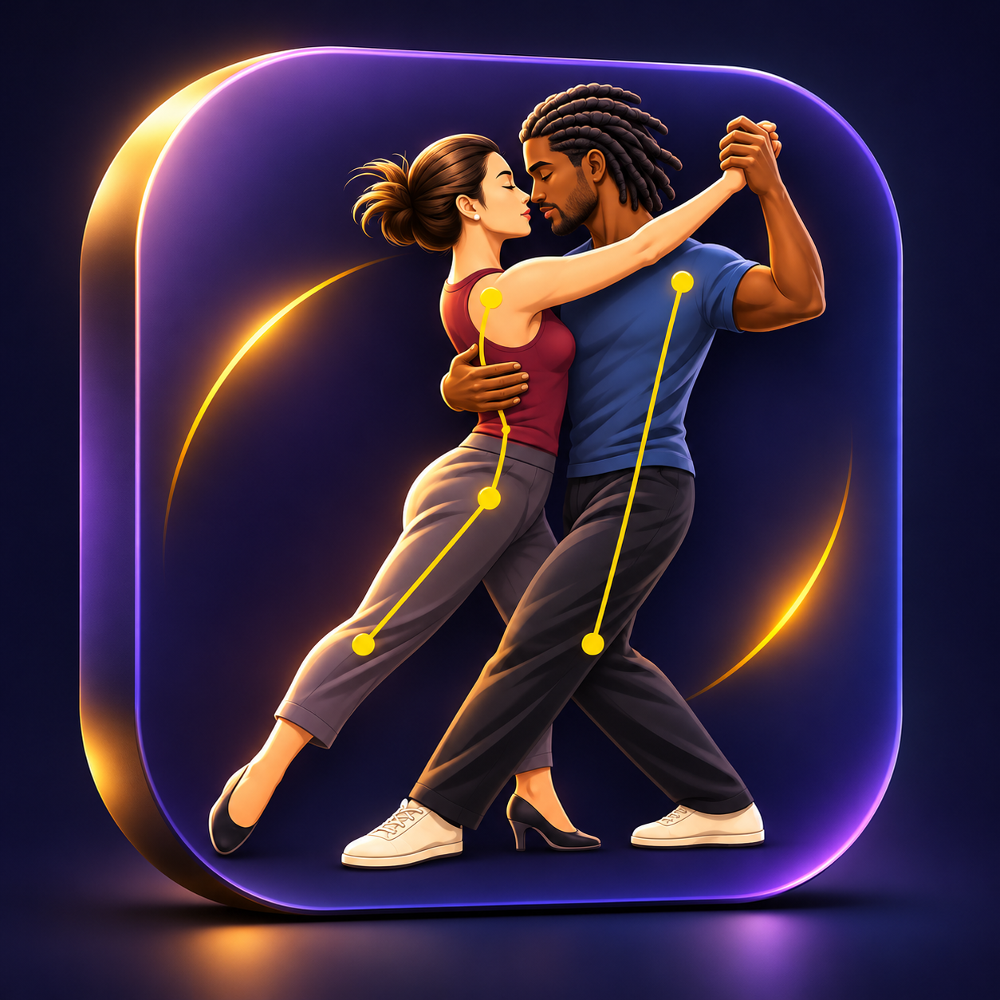

# TangoPostureOpenCommunity

<p align="center"></p>

Open-source Argentine Tango movement and posture analysis desktop coach and research tool built with Python, PySide6 (Qt 6), MediaPipe Pose, and OpenCV. Built for dancers, teachers, and movement researchers, with a focus on community-driven development and objective feedback.

Practice and pose analysis run locally without an account or API key after installation and pose-model setup. Optional post-run report interpretation connects to your configured local or reachable [Ollama](https://ollama.com) server.

> **Disclaimer:** Experimental movement observation, not medical assessment or a judgement of artistic tango quality.

---

## Key Features

1. **Dual-Engine Solo & Couple Analysis (`src/tango_posture/engines/`)**
   - Supports solo dancer practice/calibration and couple tracking (`num_poses=2`), Leader/Follower role recognition with hysteresis, and Closed vs. Open embrace classification.
2. **All-Angle Calibration & 360° Pivot / Side-Step Support (`allow_all_angles = true`)**
   - Calibrate and practice facing the camera, in side-on profile, or across side steps, ochos, and 360° pivots using central spine axis tracking with visible-side fallback.
3. **Posture & Alignment Metrics**
   - Monitors head horizontal alignment (`head_neutral_offset`, `head_down_angle`), camera-distance-invariant shoulder tension, closed-embrace knee flexion, torso axis tilt, and hip offset.
4. **Reference Recordings (`.tpr`) & Calibration Profiles (`.tpc`)**
   - Guided camera self-calibration, explicit metric-by-metric range approval, measurement normalization, and repeatable camera checks.
5. **Argentine Tango 8-Beat Musical Phrase Tracker**
   - Live microphone 8-beat phrase detection (`1..8` beat counter with silence gating) and optional offline video soundtrack beat extraction.
6. **Portable Practice Archives (`.tp`), Review, Analytics & AI Coach**
   - Saves numbered recordings, overlays, reports, and indexed analytics in `.tp` archives, with synchronized side-by-side comparison, SQLite session exports, and optional Ollama report explanations.

---

## Repository Structure

```text
TangoPostureOpenCommunity/
├── src/                  # Application source code (tango_posture package)
├── tests/                # Unit, integration, and headless Qt tests
├── examples/             # Example TOML configurations and synthetic session fixtures
├── assets/               # Logos, audio, model manifest, user manuals, and third-party notices
├── scripts/              # Desktop entry points, icon generation, smoke tests, and packaging specs
├── .github/workflows/    # CI/CD checks and cross-platform desktop release automation
├── README.md             # Community introduction
├── LICENSE               # Apache License 2.0
├── CONTRIBUTING.md       # Contribution guidelines
├── CODE_OF_CONDUCT.md    # Community standards
├── SECURITY.md           # Vulnerability reporting policy
├── CHANGELOG.md          # Release history
└── pyproject.toml        # Project metadata, dependencies, and build configuration
```

---

## Quick Start

### Option 1: Pre-built Desktop Installers (Experimental)

When available, download the macOS Apple Silicon `.dmg`, Windows x64 `.exe` installer, or Linux x64 `.tar.gz` bundle from [GitHub Releases](https://github.com/TangoMovementLabs/TangoPostureOpenCommunity/releases), and verify its checksum against `SHA256SUMS.txt`.

> Builds are currently unsigned (and macOS builds are not notarized). Only install builds you trust after verifying `SHA256SUMS.txt`. See [Installation & System Requirements Guide](assets/docs/INSTALLATION_GUIDE.md) for platform instructions and Gatekeeper/SmartScreen notes.

### Option 2: Source Installation with `uv`

Requires **Python 3.11 (`>=3.11,<3.12`)** and [uv](https://github.com/astral-sh/uv):

```bash
git clone https://github.com/TangoMovementLabs/TangoPostureOpenCommunity.git
cd TangoPostureOpenCommunity

uv python install 3.11
uv sync --frozen
uv run tango-posture models fetch
uv run tango-posture qt
```

`uv run tango-posture`, `uv run tango-posture gui`, and `uv run tango-posture qt` all launch the PySide6 Qt desktop interface.

For headless CLI practice or offline video analysis:

```bash
uv run tango-posture --config examples/default.toml run --camera 0 --side left --facing right
uv run tango-posture --troubleshoot qt
```

---

## Documentation & Examples

- **Complete User & Technical Manual:** [assets/docs/TANGO_POSTURE_GUIDE.md](assets/docs/TANGO_POSTURE_GUIDE.md) (also built into the in-app **Help & Guide** screen)
- **Installation & Camera Compatibility Guide:** [assets/docs/INSTALLATION_GUIDE.md](assets/docs/INSTALLATION_GUIDE.md)
- **Solo & Couple Metrics Manual:** [assets/docs/SOLO_AND_COUPLE_METRICS_MANUAL.html](assets/docs/SOLO_AND_COUPLE_METRICS_MANUAL.html)
- **Configuration & Synthetic Fixtures:** [examples/README.md](examples/README.md) and [examples/default.toml](examples/default.toml)
- **Model Manifest & Checksums:** [assets/model_manifest.json](assets/model_manifest.json)

---

## Verification & Quality Checks

```bash
uv run --frozen ruff check src tests
uv run --frozen mypy src
QT_QPA_PLATFORM=offscreen uv run --frozen pytest -q
uv build
```

---

## Community & Governance

- [Contributing Guide](CONTRIBUTING.md)
- [Code of Conduct](CODE_OF_CONDUCT.md)
- [Security Policy](SECURITY.md)
- [Changelog](CHANGELOG.md)
- [License (Apache-2.0)](LICENSE) and [Third-Party Notices](assets/notices/THIRD_PARTY_NOTICES.md)
