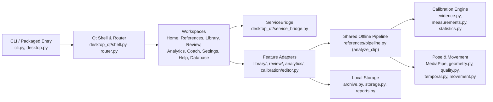

# Tango Posture Coach Manual

**Offline-first Argentine Tango posture and movement analysis · Qt Desktop Edition**

Tango Posture Coach is a local Python desktop companion for observing posture alignment, movement placements, and turns in Argentine Tango practice videos. It runs MediaPipe Pose estimation locally on recorded video clips and compares confidence-qualified measurements against calibration ranges that you inspect and approve.

> **Experimental movement observation, not medical assessment or a judgement of artistic tango quality.** The software measures 2D image-plane projections of estimated body landmarks and heuristic movement cues. It cannot measure physical force, partner connection, anatomical joint torque, or artistic musicality, and it cannot replace a teacher's eye.

## Start here: reading measurements without a technical background

Documentation reviewed against the working tree on **17 November 2026**. Numerical examples below are invented teaching examples, not results from a recorded dancer. Existing uncommitted application changes are included in the source review; this documentation update does not change application behavior.

A **landmark** is a dot the detector places on a body part. A **metric** is a number calculated from those dots. A **trace** is that number plotted over time. An **event** is a moment such as an apparent foot contact. A **summary** combines several samples or events. None is a grade for your dancing.

Read a result in this order: **which dancer → what was measured → unit and sign → usable coverage → number of examples → video at that moment**. A missing value is not zero. A smooth drawing can contain estimated joints even where a measurement is unavailable.

| Term | Plain meaning | Example |
| --- | --- | --- |
| Degrees (`deg`, `°`) | An angle | 0° is the stated reference direction; 10° is a small tilt away from it. |
| Milliseconds (`ms`) | Thousandths of a second | 150 ms = 0.15 seconds. At 30 frames/s, a frame lasts about 33 ms; decimal output does not establish millisecond accuracy. |
| Torso lengths | Image distance divided by a reference torso length | 20 pixels / 100 pixels = 0.20 torso lengths. This is not 20 cm. |
| Coverage | Fraction of sampled frames meeting a particular measurement's gates | 80 usable pair-hip frames / 100 sampled frames = 80%. It is not 80% accuracy, and frame coverage is not necessarily time coverage. |
| Median | Middle of sorted values | For 50, 100, 300 ms, median = 100 ms. |
| IQR | 75th percentile minus 25th percentile; spread of the middle half | For 0, 100, 200, 300, 400 ms, IQR = 300 − 100 = 200 ms. Smaller means more consistent, not necessarily better. |
| Count | Number actually used | One lag gives IQR 0 in this implementation; that does not establish repeatable timing. |
| Baseline change | Current summary minus the selected example-passage summary | Median tilt 8° versus baseline 5° gives +3°. It compares clip median with baseline median, not first frame with last frame. |
| Measured | Computed from eligible observations | Still depends on estimated landmark locations and camera view. |
| Estimated | A detector suggestion | An apparent foot contact needs checking in the video. |
| User confirmed | A person marked or accepted an event | Confirmation records review, not physical ground truth. |
| Unavailable / UNKNOWN | Insufficient usable evidence | A hidden shoulder can prevent torso tilt even while hip travel is available. |

For a first review, choose a short clip with a fixed camera, verify the dancer identities, inspect coverage, and review just one question. For example: “Do our starts occur at similar times?” Compare repeated passages filmed from a similar view before interpreting a trend.

## Every solo posture metric, with an example

These are the eight calibration metrics and four coaching traces. Similar names do not make their values interchangeable. A range you approve is a comparison choice, not a universal ideal posture.

| Metric | What the number means | Worked example and interpretation |
| --- | --- | --- |
| `head_pitch` | Ear-to-nose pitch relative to image horizontal, using the head helper's facing/front-view handling; raw angle without neutral subtraction | −12° means the nose is below the helper's horizontal reference. This can reflect camera angle and anatomy as well as movement. |
| `head_forward` | Ear displacement forward of shoulder, perpendicular to trunk, divided by torso length; positive follows configured facing | Forward displacement 12 px / torso 120 px = +0.10. It does not mean the head moved 10 cm. |
| `head_inclination` | Shoulder-to-ear direction relative to the trunk | A 10° value means the head segment inclines 10° toward the configured forward side relative to the trunk. |
| `shoulder_clearance` | Vertical ear-to-shoulder gap divided by the helper's anatomical scale | Gap 24 px / scale 30 px = 0.80. Smaller means less visible clearance, not a direct muscle-tension measurement. |
| `hip_offset` | Signed hip displacement from the ankle-to-head reference line, divided by that line's length | A posterior offset of 8 px / axis 400 px = +0.02. The corresponding unsmoothed percent is 2%. |
| `torso_axis_tilt` | Unsigned tilt from vertical of hip-midpoint to shoulder-midpoint line | A line leaning 8° left or right gives magnitude 8°. Requires both hips and shoulders. |
| `trunk_inclination` | Signed trunk angle from vertical with configured facing | A 6° lean toward the selected facing direction gives +6°. It may use different torso landmarks from the midpoint metric. |
| `knee_flexion` | Bend of the least-bent qualifying knee, subject to visibility tie-breaking | Interior joint angle 170° means 180 − 170 = 10° flexion. If reliable knees bend 10° and 25°, normally 10° is reported. |
| `head_angle` | Head pitch after subtracting `head_neutral_offset` | Raw −20° minus neutral −12° = −8°. Do not compare −8° directly with a raw `head_pitch` range. |
| `shoulder_elev_pct` | Reduction in clearance relative to effective neutral clearance | Neutral 1.0, current 0.8: 100 × (1.0 − 0.8) / 1.0 = 20% raised. This is a geometry proxy. |
| `knee_bend_deg` | Smoothed knee bend trace | A brief jump from 10° to 30° is softened over time; the smoothed trace need not equal the raw sample. |
| `axis_curve_smoothed` | Smoothed hip-offset percentage | Raw offset 0.02 corresponds to 2% before smoothing. Despite the name, this is not a measurement of spinal curvature. |

**Other observations:** an embrace label comes from an arm-compactness heuristic; a leader/follower label comes from arm geometry. Neither proves a social role or physical connection. A high-ankle cue compares visible lift with body scale and configured tempo rules. Changing camera angle can change these observations without changing the movement itself.

## Couple metrics: a practical guide with worked examples

### First identify A and B

A and B are tracking identities, not automatic proof of leader and follower. Confirm the same person keeps each label, especially when partners overlap or swap screen positions. A camera cut or uncertain identity interrupts usable motion segments. Rotating the camera, zooming, or walking toward it changes the image projection.

Couple outputs cover five groups: **coordination, step/music timing, transitions, posture, and turns**. Inspect those groups separately. There is no validated overall “connection” or “tango quality” score.

### 1. Travel and coordination: who starts, slows, and settles first?

The program projects hip travel onto one chosen direction and divides by a fixed torso scale. A user-drawn direction can set that axis; otherwise the dominant observed travel direction is inferred. Positive velocity follows that axis; negative velocity goes the other way. A curve around the room cannot be fully described by one straight axis.

| Output | Meaning | Example |
| --- | --- | --- |
| `velocity_a`, `velocity_b` | Signed hip travel per second, in each dancer's fixed torso lengths | A moves 40 px in one second with 100 px torso scale: approximately +0.40 torso lengths/s during steady motion. Actual velocity uses a local regression, not just two endpoints. |
| `velocity_pair` | Signed travel of the two-hip midpoint, divided by fixed pair scale | Pair midpoint travels 30 px/s with 120 px scale: +0.25 pair torso lengths/s. It is not simply the mean of independently normalized A/B velocities. |
| `start_lag_ms` | Median matched start time B minus start time A | A starts at 2.00 s and B at 2.15 s: +150 ms; B starts later. |
| `slow_lag_ms` | Same signed difference for slowing events | B slows at 4.90 s, A at 5.00 s: −100 ms; B slows earlier. |
| `settle_lag_ms` | Same signed difference for settling below the stop threshold | Both settle at 6.00 s: 0 ms for that matched pair. |
| `{start,slow,settle}_paired_count` | Number of matched A/B event pairs | Three A starts matched to three B starts gives 3, not 6. |
| `{start,slow,settle}_unpaired_count` | Unmatched events across both dancers | Two unmatched A starts and one unmatched B start gives 3. This may mean missing detection, not missing coordination. |

Starts and settles require speed threshold crossings and persistence. Slowing uses a reduction from the running median of active speeds. Motion already underway when the clip begins may have no start event. Events pair by nearest time within the configured pairing window, one-to-one, without crossing an intervening recorded break. Pairing does not prove cause and effect or that A “led” B.

For lags +100, +150, +200 ms, median = +150 ms and IQR = 50 ms. The sign describes order; the spread describes consistency. Deliberate timing differences can be part of the dance. With no matched pairs, the lag is unavailable.

### 2. Steps and music: when did the visible contact occur?

An automatic **contact** is an apparent foot placement inferred from movement and settling. Video does not measure weight transfer or floor force. Soundtrack beats are estimates unless manually supplied or confirmed. Confirm the intended musical pulse before judging offsets.

| Output | Meaning | Example |
| --- | --- | --- |
| `contact_count` (A or B) | Number of contact events | 8 apparent contacts can include detector mistakes; replay them. |
| `matched_count` | Contacts assigned a nearest musical target | 8 contacts with targets can yield 8 matches. Current code has no maximum distance gate, so a match alone does not prove closeness. |
| `beat_offset_ms` / `median_beat_offset_ms` | Contact time minus nearest target time, individually / median | Contact 10.10 s, target 10.00 s → +100 ms (later). Contact 9.90 s → −100 ms (earlier). |
| `iqr_beat_offset_ms` | Middle-half spread of contact offsets | Offsets −100, 0, 100, 200, 300 ms → IQR 200 ms. |
| `beat_fraction` / `median_beat_fraction` | Offset divided by target interval | +100 ms with a 500 ms interval → +0.20. With half-beat subdivision (250 ms), the same offset → +0.40. |

Beat subdivision inserts targets between beats; beat offset shifts the whole target grid. Manual beats take precedence when supplied. Starts can also carry per-event beat offsets, but step summaries aggregate contacts. No usable target means no numeric beat offset, even if contacts exist. Whenever confirmed and estimated contacts or beats coexist, the step summary reports `mixed` rather than `user_confirmed`; inspect `status_counts` and individual events to verify what was reviewed.

### 3. Transitions: what happened while slowing or changing direction?

| Output | Meaning | Example |
| --- | --- | --- |
| `secondary_speed_peaks` | Count of sustained speed rises during evaluated transition windows (excluding matching planned settling/pause marks), deduplicated per episode | Pair speed falls to 0.10 then rises to 0.30 torso lengths/s for at least `persistence_s`: rise 0.20 with observed elapsed support. Single-frame spikes at the end of a window do not trigger. |
| `unintended_reversals` | Sustained reversals relative to the local motion phase's pre-slowing travel direction, excluding matching planned-reversal marks | Travel changes direction for at least `persistence_s` inside an unbroken segment. “Unintended” means unannotated here; the software cannot know intention. |
| `planned_pauses`, `planned_reversals`, `settling_steps` | Counts of user-supplied marks | Marking a deliberate settling step helps distinguish it from an unexplained speed rise. Counts record annotations, not independent confirmation. |
| Transition `coverage` & `evaluated_window_count` | Mean usable pair-hip frame fraction across inspected windows and count of windows meeting coverage + elapsed-support gates | Two windows with 80% and 100% coverage give mean 90% and `evaluated_window_count = 2`. |
| Transition `status` | Evidence state from evaluated windows (`measured`, `mixed`, `estimated`, or `unavailable`) | If `evaluated_window_count == 0`, `status` is `unavailable` and unintended counts are blank/`None` instead of a misleading `0`. |

Windows run from slowing to a later settle (or a bounded fallback end), or around planned transition marks when no slow event occurred. Each window is partitioned into unbroken eligible intervals (splitting on cuts, occlusion, or gaps exceeding `max_observation_gap_s`), cues require full elapsed support reaching `tk + persistence_s`, and stable episode IDs prevent overlapping windows from double-counting the same rise or reversal. For a plain-English walkthrough of the P1 reliability fixes, see [the P1 Data-Trust Manual for Dummies](P1_DATA_TRUST_MANUAL_FOR_DUMMIES.md).

### 4. Posture: the two axes and the line between their midpoints

An **axis** here is a drawn line. It is not a measured balance axis or centre of mass. Couple torso signs are **screen-based**: shoulders right of hips means positive tilt; left means negative. This differs from solo facing-relative trunk inclination.

| Output | Meaning | Example |
| --- | --- | --- |
| `torso_tilt_a`, `torso_tilt_b` | Signed hip-to-shoulder angle from image vertical | A +10°, B −10° means their axes lean opposite screen directions. |
| `couple_midpoint_tilt` | Tilt of line joining the average hip position to average shoulder position | With equal torso lengths and symmetric +10°/−10° tilts, midpoint tilt is 0°. It can hide individual lean; inspect A and B too. In general it is not the arithmetic mean of angles. |
| `torso_separation` | Absolute shortest angular difference between torso tilts | +10° and −10° → 20°. +10° and +15° → 5°. It is not the distance between partners or embrace openness. |
| `head_pitch_a`, `head_pitch_b` | Head helper output with configured neutral offset subtracted | Raw −20° minus neutral −12° → −8°. Despite these names, couple values are neutral-adjusted, unlike solo calibration `head_pitch`. |
| `torso_tilt_pearson_r` | Correlation of simultaneous A/B tilt changes, from −1 to +1 | A [0,1,2], B [10,11,12] → +1, despite a constant 10° difference. B [12,11,10] → −1. |

Correlation asks whether the two traces rise and fall together. It does not measure equal angles, timing lag, connection, or dance quality. Near zero means little linear association, not “no coordination.” It requires at least three aligned valid samples; if either trace is constant, it is unavailable (`zero_variance`), not zero. Alignment tolerance is 0.0001 s; it does not search for delayed matching motion.

Each angle summary includes `median_deg`, `iqr_deg`, `baseline_change_deg`, `sample_count`, `coverage`, and `status`. Baseline change needs at least three finite samples in selected baseline passages. Example: clip median separation 12°, baseline median 8° → +4°. A small IQR can mean stable projection, but cannot establish good posture.

Coverage is reported separately for A/B hips, torsos and heads, and for pair hips and torsos. If A torso coverage is 90% and B is 80%, pair coverage is their simultaneous usable overlap, not automatically 85% or 72%. Hidden shoulders can leave hip travel available while midpoint tilt and separation disappear.

### 5. Turns: duration, exit timing, and annotations

| Output | Meaning | Example |
| --- | --- | --- |
| `turn_count` | Number of assembled turns, including enabled automatic suggestions | Two marked turns plus one non-overlapping suggestion → 3; inspect provenance. |
| `median_turn_duration_s`, `iqr_turn_duration_s` | Median and middle-half spread of end minus start | Start 3.0 s, end 4.2 s → duration 1.2 s. |
| `median_exit_minus_turn_end_ms`, `iqr_exit_minus_turn_end_ms` | Exit time minus turn-end time, summarized over matched exits | Exit 4.4 s after end 4.2 s → +200 ms. Exit 4.0 s → −200 ms. |
| `overlap_count` | Turns whose matched exit happens before turn end | The −200 ms example contributes one overlap. This is a temporal label, not an error verdict. |
| `pivot_behavior_a`, `pivot_behavior_b`, `embrace_opening` | Human annotations attached to turns | “Stepping pivot” or a description of opening records the reviewer’s observation; no physical embrace-opening angle is calculated here. |

A missing exit makes exit timing unavailable, not zero. Automatic suggestions come from per-dancer pivot candidates. When a summary combines suggestions with confirmed turns, the turn summary displays `mixed` evidence (alongside `status_counts`) rather than claiming `user_confirmed`. Turn assembly associates `turn_start`, `turn_end`, and `exit` by persistent `turn_id` and matching `subject` (`A`, `B`, or explicit shared `pair`), warns on mismatched or ambiguous overlapping legacy sequences, and preserves unmatched markers for correction.

### A complete couple example

In a 10-second clip, 240 of 300 frames have both hips usable: pair-hip coverage is 80%. A starts at 2.00 s; B at 2.12 s, so lag is +120 ms. Their torso medians are +8° and −6°; a frame with those values has 14° separation. A contact at 3.10 s against a 3.00 s beat gives +100 ms, or +0.20 of a 500 ms target interval. A turn from 5.00 to 6.50 s lasts 1.50 s; an exit at 6.40 s gives −100 ms and an overlap.

These observations support specific replay questions: “Did B begin later?”, “Were we leaning in opposite screen directions?”, “Was the early exit intentional?” They do not support “our connection was 80%” or “this turn was wrong.”

## Movement, music, and quality fields beyond the posture charts

| Field family | How to read it | Example |
| --- | --- | --- |
| Step `time`, `frame`, `side` | Candidate placement timestamp, frame index, left/right foot | Frame 30 at steady 30 frames/s is about 1 s; use saved timestamps for variable-rate clips. |
| Step `x/y`, `hx/hy`, `tx/ty`, `ax/ay` | Image-pixel centre, heel, toe and ankle positions | x=200 locates the footprint horizontally; it is not distance travelled. |
| Step `angle_deg`, `length_px` | Heel-to-toe image direction and visible foot length | 40 px is foot projection length, not stride length. Image y points downward in these footprint coordinates. |
| Step `confidence`, pivot `quality` | Landmark-based detector quality summaries | 0.9 is not a calibrated 90% probability of a correct contact or pivot. |
| Pivot `net_rotation_deg`, `mean_rate_deg_s` | Estimated heading change and change per second across the detected interval | About 60° over 0.5 s gives about 120°/s. Trimming and endpoint handling can affect displayed interval arithmetic. |
| Pivot `direction`, `support_side` | Detector clockwise/anticlockwise convention and relatively stationary foot proxy | `left` means left foot met an anchoring rule, not that weight was proven to be on it. |
| BPM, beat count, phrase count | Estimated tempo and soundtrack counters | 120 BPM means one nominal beat every 0.5 s. Counted phrases are detector groupings, not proof of musical phrasing. |
| `% in range`, `% pending`, `% out of range` | Comparison states after temporal filtering | Pending means a threshold crossing has not yet lasted long enough. Inspect unavailable coverage separately; percentages are not a dance score. |
| Normalized measurement | A value transformed using a selected calibration/normalization profile | A value on a reference scale is not automatically interchangeable with raw degrees; inspect the selected transform and unit. |

Formula sources: `geometry.py`, `metrics.py`, `calibration/measurements.py`, `movement.py`, and `couple/measurements.py`. For implementation limitations and proposed fixes, read [the technical debt audit](TECHNICAL_DEBT_AND_REDESIGN.md).

---

## Quick Contents

1. [Quick Start & Desktop Workspaces](#1-quick-start-desktop-workspaces)
2. [Posture Metrics, Geometry & Mathematical Reference](#2-posture-metrics-geometry-mathematical-reference)
3. [Calibration Workflow & Profile Editor Guide](#3-calibration-workflow-profile-editor-guide)
4. [Tracking Engine, Temporal Smoothing & Movement Analysis](#4-tracking-engine-temporal-smoothing-movement-analysis)
5. [Settings explained](#settings-explained)
6. [Architecture, Storage, Troubleshooting & Glossary](#6-architecture-storage-troubleshooting-glossary)

---

## 1. Quick Start & Desktop Workspaces

### What Tango Posture Coach Does

A practical self-review question is:

> *"During this dance passage, how do my head, shoulders, torso, hips, and knees behave relative to the reference ranges I approved for this view and dancer?"*

Tango Posture Coach answers that question in three stages:

1. **Import & Analyze Video (`.tpr` / `.tp`)**: Import a local video clip in **Library**. MediaPipe extracts pose landmarks per frame without mutating the original video, and packages a self-contained ZIP archive containing the raw clip, optional annotated layers, report metadata, and raw measurement observations.
2. **Approve Calibration Ranges (`.tpc`)**: Open a replayable **Reference (`.tpr`)** in **Library**, select the dancer track and representative example passages, inspect the median and distribution, and save an approved **Calibration Profile (`.tpc`)** with explicit `Min` / `Max` bounds per metric and camera view.
3. **Review, Inspect Insights, & Compare in Analytics**:
   - In **Review**, play back synchronized video and overlays, pick any `.tpc` calibration profile, inspect frame-by-frame alignment banners and insights, compare two clips side by side, or re-run offline pose analysis with a different model or quality filter.
   - In **Analytics**, plot all **12 posture metrics** over time for any `.tpr` reference or `.tp` recording, overlay a `.tpc` profile or Settings default range (`Min`, `Max`, `Ref`), inspect hysteresis states (`% in range`, `% pending`, `% out of range`), click any point to seek in Review, and export charts as `.png`, `.svg`, `.csv`, or `.json`.

### Posture Limit Precedence

Where do limits come from when evaluating a recording?

| Context | Source of posture limits | Behavior for unapproved / missing metrics |
| --- | --- | --- |
| **Review** with a selected `.tpc` calibration profile | The selected profile's approved `min` and `max` bounds per metric | Metrics absent from the profile display **Not in profile**. Frames failing landmark/view quality show **Not measured** (`UNKNOWN`). Legacy threshold settings never fill gaps. |
| **Review** with *No calibration (visuals only)* | None | Skeleton, pink torso axis, pivot rings, and fading step footprints render without deviation banners or posture alerts, even if *Calibration defaults* are populated in Settings. |
| **Analytics** with a selected `.tpc` profile | The profile's approved bounds (`Min`, `Max`, `Ref` median) | Evaluates hysteresis states using `smoothing`, `entry_duration`, and `clear_duration`. Shows *All-angle fallback* if recording camera view differed from the profile's approved view. |
| **Analytics** with *Settings default ranges* | Built-in or configured `calibration_defaults.<metric>` intervals | Compares time series against Settings ranges and reference midpoints. |
| **CLI / Offline Fallback Analysis** without a profile | Legacy Settings thresholds (`head_down_angle`, `shoulder_raise_threshold`, `closed_embrace_min_knee_bend`, `axis_curve_entry`) | Evaluates descriptive fallback frame traces saved in `analytics_XX.json`. |

### Desktop Navigation & Workspaces

All desktop workflows run inside one Qt (`PySide6`) window with a left navigation rail:

#### Home

- Displays a quick overview of the offline analysis setup (active data directory, selected MediaPipe model variant, recent practice and reference archives) and shortcuts to **Library**, **Manage References (Calibration Profiles)**, and **Review**.

#### Calibration Profiles (`References`)

Opened from **Home → Manage References**:

- Lists saved `.tpc` calibration profiles and legacy neutral baselines in a clean split table + card layout.
- Displays profile provenance, creation date (`dd/mm/yyyy hh:mm`), model hash compatibility, approved metric ranges, and camera view tags (`side`, `front`, `all`).
- **Match Camera Settings** copies the capture configuration (`side`, `facing`, `capture_profile`, `allow_all_angles`) from the selected profile into your active session config without altering saved archives.
- **Open Library** jumps to **Library** to create or edit profiles from `.tpr` recordings.

#### Library

Manages your local `.tp` (practice recordings), `.tpr` (replayable references), and `.tpc` (calibration profiles):

- **Search, Filter & Sort**: Filter by archive type (`All types`, `References (.tpr)`, `Calibrations (.tpc)`, `Practices (.tp)`) and sort by `Date created (newest/oldest)` (`dd/mm/yyyy hh:mm`) or `Name (A–Z / Z–A)`.
- **Import & Analyze Video…**:
  - Accepts local files (`.mp4`, `.mov`, `.m4v`, `.avi`, `.mkv`, `.webm`) up to **2 GB**, trimmed to a configurable clip range `[in, out)` up to **120 seconds**.
  - Check **Import as reference** to package a `.tpr` reference archive (default), or uncheck it to create a `.tp` practice archive.
  - Original media files are never overwritten or moved; clip timestamps are rebased consistently inside the archive.
- **Archive Actions**:
  - **Review**: Opens `.tp` or `.tpr` directly in **Review**.
  - **Promote to Reference**: Copies a `.tp` practice segment into a standalone `.tpr` reference archive while preserving the original practice file.
  - **Create calibration**: Launches the **Calibration Editor** on a `.tpr` archive to approve metrics into a new `.tpc` profile.
  - **Profile details**: Opens a structured summary modal for a `.tpc` profile showing capture context, provenance, and all approved bounds. Includes **Edit calibration…** (re-opens the source `.tpr` in the Calibration Editor preloaded with the profile's existing bounds and selections so you can add missing metrics or adjust limits) and **Use as Settings defaults**.
  - **Rename** / **Delete**: Rename updates the display name inside metadata; confirmed Delete moves the archive to the system Trash via `QFile.moveToTrash`.

#### Review

Detailed playback and frame inspection for any `.tp` or `.tpr` archive:

- **Video Playback**: Plays the **Raw video** directly with live dynamic overlays controlled via **Overlay layers**.
- **Playback Transport**: Play/Pause, `-1 frame`, `+1 frame`, timeline scrubbing, and playback speed control.
- **Dynamic Visual Layers**:
  - **Skeleton**: Confidence-colored joint dots (green = reliable, orange = low confidence) with optional display-only gap interpolation.
  - **Torso axis**: Solid pink shoulder-midpoint-to-hip-midpoint axis line plus dashed cyan image-vertical reference.
  - **Pivot rings**: Perspective ellipse centered at the hip midpoint during detected turns, with a clockwise/anticlockwise directional arrow.
  - **Step footprints**: Heel-to-toe left/right floor markers fading smoothly over `replay_step_history_seconds` (pauses when playback pauses).
- **Calibration Comparison & `This frame` Insights**:
  - Choose a `.tpc` profile from **Calibration profile** (or *No calibration (visuals only)*).
  - The top banner summarizes frame status (**Green**: within approved bounds; **Amber**: `Not measured` / quality gate blocked; **Red**: confirmed deviation beyond `entry_duration`).
  - Each row in `This frame` reports its numerical value, approved `[min, max]` interval, and a status indicator. **Why `Not measured` appears**: either a required landmark fell below confidence/visibility floors, the dancer rotated outside the metric's approved view (`side` vs `front`), multiple people were detected, or a segment was shorter than `min_torso` / `min_head`. **Why `Not in profile` appears**: that `.tpc` file did not approve that metric yet—use **Edit calibration…** in Library to add it.
- **Analyze posture & movement**: Re-runs offline pose inference (`lite`, `full`, or `heavy` chosen in Settings) and movement detection on up to 120 seconds of the opened clip, atomically updating cached `analytics_XX.json`, reports, and overlay members while preserving the raw clip. Uses **Cancel analysis** to abort safely without losing prior archive data.
- **Open Comparison…**: Opens a second replayable archive side by side, synchronized by elapsed clip time.
- **Report Tab & AI Coach Link**: View the generated Markdown report; click archived timestamp links to jump straight to that frame, or click **Open Report in AI Coach**.

#### Analytics

Archive-driven quantitative charting and comparison across the entire clip:

- **Pick Archive (`.tpr` or `.tp`)**: Choose any Library archive recording (or browse with **Open .tp / .tpr…**), regardless of whether a SQLite session entry exists.
- **Calibration Line Reference**: Pick **No calibration reference**, **Settings default ranges**, a saved `.tpc` profile, a legacy calibration, or load an external `.tpc` via **Open .tpc…**.
- **All 12 Metric Charts**:
  - Displays all **8 Calibration Range Metrics** (`head_pitch`, `head_forward`, `head_inclination`, `shoulder_clearance`, `hip_offset`, `torso_axis_tilt`, `trunk_inclination`, `knee_flexion`) and all **4 Frame Coaching Metrics** (`head_angle`, `shoulder_elev_pct`, `knee_bend_deg`, `axis_curve_smoothed`).
  - Overlays green dashed `Min` / `Max` calibration bounds and blue `Ref` midpoint lines on each chart and highlights hysteresis state coverage (`% in range`, `% pending`, `% out of range`).
  - **Interactive Seeking**: Click any chart point to open **Review** directly at that timestamp.
- **Export Charts to Files**:
  - Click **Export Chart…** on an individual metric card to export `.png`, `.svg`, `.csv`, or `.json`.
  - Click **Export All Charts…** in the toolbar to batch-export every populated metric chart in your chosen format into a destination folder.

#### AI Coach (Optional Ollama Commentary)

- Connects only when you click **Check Ollama** or **Analyze Selected Report** against your configured Ollama URL (default `http://127.0.0.1:11434`).
- Sends only the sanitized Markdown report text (never raw video or images) up to `ollama_max_report_chars`.
- Saves completed interpretations alongside the report inside the archive as `.analysis-*.json`, pinned to the report SHA-256 hash, model name, and prompt instructions.

#### Settings & Database Maintenance

- **Settings**: Organizes engine-scoped settings and **8 Calibration defaults rows** across tabs. Click **▸ Explanation & example** beside any setting (or **Expand All Guides**) to read what the parameter controls and view a concrete numerical example. Changes apply when you save via **Apply & Save settings.toml**, **Export TOML…**, **Import TOML…**, or **Reset Defaults**.
- **Database maintenance**: Performs explicit, user-confirmed cleanup of the local SQLite database (`tango.sqlite3`) without touching `.tp`, `.tpr`, or `.tpc` archives.

---

## 2. Posture Metrics, Geometry & Mathematical Reference

### Retained MediaPipe Landmarks & Coordinate Systems

MediaPipe Pose Landmarker detects 33 landmarks per person. Tango Posture Coach names and stores the **19 landmarks** relevant to posture, embrace, and footwork:

| Group | Retained Landmarks | Primary Consumers |
| --- | --- | --- |
| **Head** | `nose`, `left_ear`, `right_ear` | Head pitch, head-forward offset, head inclination, shoulder scale fallbacks, hip-offset head endpoint |
| **Torso & Arms** | `left_shoulder`, `right_shoulder`, `left_elbow`, `right_elbow`, `left_wrist`, `right_wrist` | Trunk inclination, pink torso axis (`torso_axis_tilt`), shoulder clearance, embrace ratio, Leader/Follower arm heuristics |
| **Pelvis & Legs** | `left_hip`, `right_hip`, `left_knee`, `right_knee`, `left_ankle`, `right_ankle` | Core torso length (`min_torso`), hip midpoint, 3D hip yaw (pivots), knee flexion, hip offset, slow-tango lift |
| **Feet** | `left_heel`, `right_heel`, `left_foot_index`, `right_foot_index` | Offline step placement (`movement.py`) and rendered floor footprints |

The full **33-point MediaPipe Pose Landmarker** index map (`0–32`, verified in `pose/constants.py` and `pose/mediapipe_backend.py`):

| Index | MediaPipe Landmark | Status in TangoPosture | Role / Notes |
| --- | --- | --- | --- |
| `0` | `nose` | Retained | Head pitch, hip-offset head proxy, framing check |
| `1` | `left_eye_inner` | Ignored | Extra face landmark discarded at extraction |
| `2` | `left_eye` | Ignored | Extra face landmark discarded at extraction |
| `3` | `left_eye_outer` | Ignored | Extra face landmark discarded at extraction |
| `4` | `right_eye_inner` | Ignored | Extra face landmark discarded at extraction |
| `5` | `right_eye` | Ignored | Extra face landmark discarded at extraction |
| `6` | `right_eye_outer` | Ignored | Extra face landmark discarded at extraction |
| `7` | `left_ear` | Retained | Head pitch, head-forward, head inclination, shoulder clearance |
| `8` | `right_ear` | Retained | Head pitch, head-forward, head inclination, shoulder clearance |
| `9` | `mouth_left` | Ignored | Extra face landmark discarded at extraction |
| `10` | `mouth_right` | Ignored | Extra face landmark discarded at extraction |
| `11` | `left_shoulder` | Retained | Torso axis, trunk inclination, shoulder clearance, embrace/role |
| `12` | `right_shoulder` | Retained | Torso axis, trunk inclination, shoulder clearance, embrace/role |
| `13` | `left_elbow` | Retained | Leader/Follower role, embrace geometry, overlay skeleton |
| `14` | `right_elbow` | Retained | Leader/Follower role, embrace geometry, overlay skeleton |
| `15` | `left_wrist` | Retained | Leader/Follower arm posture, embrace compactness |
| `16` | `right_wrist` | Retained | Leader/Follower arm posture, embrace compactness |
| `17` | `left_pinky` | Ignored | Extra hand landmark discarded at extraction |
| `18` | `right_pinky` | Ignored | Extra hand landmark discarded at extraction |
| `19` | `left_index` | Ignored | Extra hand landmark discarded at extraction |
| `20` | `right_index` | Ignored | Extra hand landmark discarded at extraction |
| `21` | `left_thumb` | Ignored | Extra hand landmark discarded at extraction |
| `22` | `right_thumb` | Ignored | Extra hand landmark discarded at extraction |
| `23` | `left_hip` | Retained | Core torso scale (`min_torso`), hip offset, 3D pivot yaw, knee flexion |
| `24` | `right_hip` | Retained | Core torso scale (`min_torso`), hip offset, 3D pivot yaw, knee flexion |
| `25` | `left_knee` | Retained | Knee flexion angle, closed-embrace knee check |
| `26` | `right_knee` | Retained | Knee flexion angle, closed-embrace knee check |
| `27` | `left_ankle` | Retained | Knee flexion, hip-offset ankle endpoint, framing, steps |
| `28` | `right_ankle` | Retained | Knee flexion, hip-offset ankle endpoint, framing, steps |
| `29` | `left_heel` | Retained | Offline step placement & floor footprint overlays |
| `30` | `right_heel` | Retained | Offline step placement & floor footprint overlays |
| `31` | `left_foot_index` | Retained | Offline step toe point & floor footprint direction/length |
| `32` | `right_foot_index` | Retained | Offline step toe point & floor footprint direction/length |

**Coordinate transformation**: Normalized MediaPipe image coordinates `(x_norm, y_norm) in [0, 1]` are multiplied by the actual decoded video dimensions `(width, height)` before any angle or length computation so non-square aspect ratios never distort angles:

```text
p = (x_norm * image_width, -y_norm * image_height)    # x rightwards, y upwards (pixel units)
```

Separate MediaPipe **world coordinates** (`world_poses`) supply metric 3D estimates (`x, y, z`) used strictly for horizontal pelvis yaw heading during pivot analysis.

### The 8 Range Calibration Metrics (`METRIC_DETAILS`)

These eight metrics are approved in `.tpc` profiles, configurable under **Calibration defaults**, and plotted as primary cards in **Analytics**:

| Metric Key | UI Label | Unit | Required Landmarks & Formula Summary |
| --- | --- | --- | --- |
| `head_pitch` | Head pitch (ear-to-nose) | `degrees` | Raw head-helper pitch relative to horizontal, with facing-independent horizontal distance and a front-view ear-span fallback. Zero = level helper reference; no neutral offset is subtracted. |
| `head_forward` | Head-forward offset | `torso_lengths` | Forward projection of the shoulder-to-ear vector `h = E - S` onto trunk normal `n = f * (t_y, -t_x)`, divided by torso length `L = length(S - H)`: `dot(h, n) / L`. Positive values indicate the ear lies farther toward `facing`. |
| `head_inclination` | Head inclination | `degrees` | Angle of shoulder-to-ear vector `h` relative to trunk vector `t = (S - H) / L`: `degrees(atan2(dot(h, n), dot(h, t)))`. |
| `shoulder_clearance` | Ear-to-shoulder clearance | `normalized_clearance` | Minimum vertical gap `gap = (shoulder.y - ear.y) * H` across usable sides divided by anatomical reference scale `S`. Smaller values mean the shoulder sits closer to the ear. |
| `hip_offset` | Hip offset from ankle-to-head axis | `axis_lengths` | Signed perpendicular displacement of the hip behind the straight line connecting ankle to back-of-head proxy, normalized by ankle-to-head length. |
| `torso_axis_tilt` | Torso axis tilt (pink line) | `degrees` | Unsigned image-plane tilt magnitude from vertical of the line joining hip midpoint `(L_hip + R_hip)/2` to shoulder midpoint `(L_shoulder + R_shoulder)/2`. Requires both shoulders and both hips. |
| `trunk_inclination` | Trunk inclination | `degrees` | Signed image-plane angle between hip-to-shoulder trunk vector `t` and vertical: `degrees(atan2(f * t_x, t_y))`. |
| `knee_flexion` | Least-bent reliably visible knee | `degrees` | For each qualifying leg: `interior = degrees(acos(clamp(dot(u, v) / (|u| * |v|), -1, 1)))` with `u = hip - knee` and `v = ankle - knee`, converted to flexion `max(0, 180 - interior)`. Uses the smaller (straightest) bend unless tie-broken toward the camera-facing leg. |

### The 4 Frame Coaching Traces (`FRAME_METRICS`)

Offline analysis also records descriptive frame-level traces shown in **Review → Insights** and as the remaining 4 charts in **Analytics**:

| Trace Key | Label | Unit | Difference from Calibration Counterpart |
| --- | --- | --- | --- |
| `head_angle` | Head alignment | `degrees` | Subtracts `head_neutral_offset` (default `-12.0 deg`) from raw ear-to-nose pitch when comparing against legacy `head_down_angle` (`-15.0 deg`). Approved `head_pitch` uses raw degrees directly. |
| `shoulder_elev_pct` | Shoulder height | `% raised` | Converts raw clearance `C` into elevation `%` relative to adaptive/neutral baseline `B = max(shoulder_baseline_clamp_floor, effective_neutral)`: `100 * (B - C) / B`. |
| `knee_bend_deg` | Knee bend | `degrees` | Smoothed per-frame knee flexion using `overlay_smoothing` (falling back to `smoothing`, clamped to `min_filter_time_constant`). |
| `axis_curve_smoothed` | Torso / hip offset | `%` | Percent expression (`100 * offset`) of posterior hip offset smoothed for legacy fallback `axis_curve_entry` / `axis_curve_clear` triggers. |

### Knee & Shoulder Calculation Details (Configurable Helper Rules)

Unlike opaque black-box heuristics, all geometric helpers expose their thresholds directly in **Settings → Head & shoulders** and **Settings → Embrace & knees**:

- **Knee visibility & segment guards**: Both hip-to-knee (`u`) and ankle-to-knee (`v`) must measure at least `knee_min_segment_px` (`10.0 px`), and hip/knee/ankle landmarks must meet both the strict `confidence` gate (in approved profiles) and `knee_visibility_floor` (`0.35`).
- **Knee tie-break rule**: Normally the least-bent qualifying leg is reported (`min(left_bend, right_bend)`). However, if the opposite leg's minimum visibility drops below `knee_tiebreak_other_max_vis` (`0.60`) and the preferred `side` is at least `knee_tiebreak_min_advantage` (`0.15`) more visible, the preferred side wins instead of letting a noisy occluded back leg dominate.
- **Shoulder reference scale hierarchy (`S`)**:
  1. Primary candidate: largest `shoulder_ear_hip_scale_factor * vertical_ear_hip_px` (`0.26 * dy`) among usable sides with `ear_hip_dy > shoulder_min_ear_hip_px` (`20.0 px`).
  2. Fallback candidates (used only when no primary candidate qualifies; largest wins):
     - `shoulder_nose_ear_scale_factor * dist(nose, ear)` (`0.68`)
     - `shoulder_ear_ear_scale_factor * |left_ear.x - right_ear.x|` (`0.65`)
     - `shoulder_width_scale_factor * |left_shoulder.x - right_shoulder.x|` (`0.28`)
  3. Scale floor: if `S < shoulder_min_ref_scale_px` (`8.0 px`), clearance is marked unavailable rather than dividing by near-zero noise.
- **Adaptive fallback shoulder baseline**: During fallback movement/import runs without a `.tpc` profile, up to `shoulder_adaptive_max_samples` (`600`) relaxed clearances inside `[shoulder_adaptive_min_clearance, shoulder_adaptive_max_clearance]` (`[0.65, 1.50]`) are collected; once `shoulder_adaptive_min_samples` (`15`) qualify, baseline `B` adapts to `max(shoulder_neutral_clearance, percentile(samples, shoulder_adaptive_percentile))` (default `75th` percentile), never falling below `shoulder_baseline_clamp_floor` (`0.20`). Fallback hysteresis clears at `max(shoulder_recovery_min_pct, shoulder_recovery_ratio * shoulder_raise_threshold)`.

### Role & Embrace Heuristics

- **Leader / Follower arm pattern (`detect_role`)**: Examines wrist, elbow, and shoulder geometry to classify `LEADER`, `FOLLOWER`, or `NONE`, gated by `role_assign_ms` (`300 ms`) persistence to assign and `role_hold_ms` (`5000 ms`) retention across turns.
- **Closed / Open embrace (`embrace_closed_threshold`)**: Computes a normalized arm-compactness ratio (`<= 0.72` -> `CLOSED EMBRACE`, `> 0.72` -> `OPEN EMBRACE`), stabilized with a `0.15s` exponential filter, a `±0.025` deadband, and `embrace_hysteresis_seconds` (`1.0s`).

---

## 3. Calibration Workflow & Profile Editor Guide

Creating or editing a `.tpc` profile separates **example evidence selection** from **range approval**:

1. **Create a replayable reference (`.tpr`)**:
   - In **Library**, import a local video with **Import as reference** checked, or select an existing `.tp` practice recording and click **Promote to Reference**.
   - Ensure the reference clip contains raw `measurement_poses` (if missing from an older file, open it in **Review** and run **Analyze posture & movement** first).
2. **Launch the Calibration Editor**:
   - From **Library**, click **Create calibration** on a `.tpr` archive — or open an existing `.tpc` profile's **Profile details** dialog and click **Edit calibration…** to add additional metrics or refine existing ranges.
3. **Select and verify the dancer track**:
   - Click on the target dancer in the preview. Spatial association links frames using reliable hip centers (requiring distance `< 0.15` normalized coordinates, separation from any second candidate `> 0.03`, and gaps `<= max_gap`).
   - Ambiguity, occluded hips, or long gaps end the active track cleanly so the editor never silently jumps to a partner or bystander. Use **Select dancer / restart track here** to confirm identity after an occlusion, then click **Save dancer selection in reference (.tpr)**.
4. **Work through metrics step by step (`Head → Shoulders → Hips → Torso → Knees`)**:
   - **Select camera view policy**: Choose `side` (`view_width <= max_view_width`, default `0.45`), `front` (`view_width > max_view_width`), or `all`. Note that even in `all` mode, strict landmark quality checks (`confidence`, `min_torso`, `min_head`) still apply, and `torso_axis_tilt` always requires both shoulders and both hips.
   - **Mark example passages**: Drag or scrub passages representative of the movement you want to model (e.g., quiet standing vs solo walking).
   - **Inspect statistics & extremes**: Click **Suggest middle 80% of examples** (uses configurable `calibration_suggest_lower_pct = 10%` and `calibration_suggest_upper_pct = 90%`, requiring at least `calibration_min_usable_samples = 2` finite samples and positive reliable duration). Inspect the shaded timeline, median (`Ref`), and extreme frames.
   - **Approve or skip**: Edit `Lower` and `Upper` explicitly and click **Approve metric** (or **Skip / remove metric** to exclude it).
5. **Save & optionally copy to Settings defaults**:
   - Click **Save approved .tpc profile** with a unique profile name (saving creates a distinct profile rather than overwriting unrelated ones).
   - Optionally click **Use approved ranges as Settings defaults…** if you want the same `[min, max, view]` limits pre-loaded under *Settings default ranges* in **Analytics** and Settings.

> **Why did Review report `Not measured` vs `Not in profile`?**
> - **Not in profile**: That metric was skipped or not yet approved when the `.tpc` file was created. Open the profile details in **Library** and click **Edit calibration…** to approve and save that metric.
> - **Not measured**: The metric IS in the profile, so Review checks quality and camera-view gates frame by frame. A transient hidden ear, a side-vs-front camera view mismatch (`max_view_width`), two people entering the frame, or short limb projections can mark individual frames `UNKNOWN` (*Not measured*). Importantly, Review also applies temporal persistence (`entry_duration` default `1.5s`, `clear_duration` default `0.75s`) so momentary frame boundary crossings stay amber/muted rather than flashing false red alerts.

### Solo Camera Self-Calibration (`Calibration` menu)

1. **Camera placement & setup**:
   - Open **Calibration** from the sidebar (or **Open Calibration** from **Home**) and click **New solo camera calibration…**.
   - Place the camera level at practice height and step back until your head and shoes fit in frame. Keep the camera fixed when switching between front and side views.
   - Select your camera device, verify the recorded side and facing direction (**in the recorded image**, even if preview mirroring is enabled), toggle **Speak instructions** if desired, and click **Start camera preview**.
   - **Begin** unlocks once one dancer is cleanly tracked with full-body head and ankle/shoe landmarks.
2. **Sample guided instructions**:
   - *Front hold A*: "Turn to the camera in your ready-to-walk stance."
   - *Front hold B*: "Relax, then turn to the camera in the same stance."
   - *Side hold A*: "Turn left so you are side-on to the camera."
   - *Side hold B*: "Turn right so you are side-on to the camera."
   - *Solo walking (2 passes)*: "Turn left so you are side-on to the camera, then take up to four natural tango steps across the frame, keeping your shoes visible. Stop at the end." / "Turn right so you are side-on to the camera, then take up to four natural tango steps across the frame, keeping your shoes visible. Stop at the end."
3. **Individual measurement checks & saving**:
   - After standing holds complete, you can run optional **neutral A → changed A → neutral B → changed B** checks (e.g., gentle shoulder raise, gaze drop, knee straighten) to qualify metrics for live feedback, record **Solo walking**, or review and save **Front**, **Side**, and **Solo walking · Side** profiles atomically.
   - Use **Check with camera…** on any saved `.tpc` profile in **Calibration** to verify or re-check it against a live camera.

---

## 4. Tracking Engine, Temporal Smoothing & Movement Analysis

### Models, Verification & Offline Cache

Three MediaPipe Pose Landmarker `.task` variants are selectable in **Settings → Files → Offline analysis model** (`analysis_model`):

- **`lite`** (default): Fastest processing (`models/pose_landmarker_lite.task`, pinned and SHA-256 verified against `models/manifest.json`).
- **`full`** and **`heavy`**: Higher capacity landmark estimators cached under `<data_dir>/models/` (or reused if already present in `models/`). Missing variants download once with progress and atomic SHA-256 verification before local offline execution.
- Changing `analysis_model` does **not** alter existing `.tp` or `.tpr` archives until you explicitly re-run **Analyze posture & movement** in Review. Comparison profiles check model hash compatibility.

### Strict Quality Gates vs Helper Visibility Floors

A frame observation must satisfy multiple gates before producing an approved range sample:

1. **Single-person check**: Exactly 1 pose returned by MediaPipe (unless multi-pose tracking is resolved via saved dancer selection in `.tpr` analysis).
2. **Landmark reliability (`quality.py`)**: Finite coordinates inside `[0, 1]` and both visibility and presence `>= confidence` (default `0.70`).
3. **Framing geometry**: Projected torso height `>= min_torso` (`0.12` of image height), shoulder-to-ear height `>= min_head` (`0.04`), plus nose and at least one ankle visible for core pipeline metrics.
4. **View width (`max_view_width`)**: Ratio `max(shoulder_width, hip_width) / torso_length` distinguishes `side` (`<= 0.45`) from `front` (`> 0.45`) view policies.

Helper traces (`knee_bend_deg`, `shoulder_elev_pct`) also expose configurable helper floors (`knee_visibility_floor = 0.35`, `shoulder_visibility_floor = 0.50`) for descriptive overlays when strict approval checks aren't gating them.

### Temporal Smoothing, Gaps & Display Interpolation

To separate stable posture trends from single-frame detector jitter without hiding missing evidence:

- **Exponential Moving Average (EMA)**:
  ```text
  alpha = 1 - exp(-dt / tau)
  filtered_t = filtered_{t-1} + alpha * wrapped_diff(raw_t, filtered_{t-1})
  ```
  - Approved-range evaluation and **Analytics** use `tau = smoothing` (default `0.25s`).
  - Descriptive frame traces use `tau = max(min_filter_time_constant, overlay_smoothing or smoothing)` (default floor `0.0001s`).
  - Any timestamp gap larger than `max_gap` (default `0.5s`) resets filter continuity cleanly.
- **Display-Only Joint Interpolation (`replay_joint_interpolation`, `replay_joint_max_gap`)**:
  - Fills visual skeleton gaps between reliable bracketing frames (`linear` or `quadratic` with linear fallback up to `3.0s`; `0` disables filling).
  - **Display-completion boundary**: Review gap filling populates drawing data (`display_poses`) rather than measurement inputs. This does not guarantee that all upstream observations are fresh detections: close-embrace split-pose propagation currently lacks explicit origin metadata. See the technical debt audit.

### Hysteresis State Machine (`Evaluator`)

Every evaluated metric transitions across four explicit states in `temporal.py`:

| State | Meaning |
| --- | --- |
| `WITHIN_REFERENCE` | Smoothed observation lies inside `[lower, upper]` (or recovered for `clear_duration`). |
| `PENDING` | Smoothed observation left `[lower, upper]`, accumulating time toward `entry_duration` (`1.5s`). Returning inside resets the pending timer without raising a red alert. |
| `DEVIATION` | Out-of-range excursion persisted continuously for `entry_duration`. Stays active until an in-range recovery persists continuously for `clear_duration` (`0.75s`). Recorded onset timestamp backdates to when `PENDING` began. |
| `UNKNOWN` | Quality, view, or landmark gate failed on this frame. Missing frames immediately close/suspend pending or active continuity rather than fabricating inside/outside scores. |

### Offline Movement Engine (`movement.py`): Steps & Pivots

When analyzing a clip in Library or Review, `movement.py` detects **step placements** and **pivots** in pure Python/NumPy using normalized body-scale units:

- **Body Scale & Scene-Cut Guards**: Estimates median projected body scale (at least `max(20 px, 8% image height)` smoothed over a 9-frame median). Scale jumps `> 0.65` or hip displacements `> max(55% width, 3.2 body scales)` reset foot trackers cleanly at camera cuts.
- **Step Placement State Machine (`INITIAL -> ANCHORED -> MOVING -> SETTLING -> ANCHORED`)**:
  - Requires ankle, heel, and foot-index landmarks (`heel` + `foot_index` center formula `0.45 * heel + 0.45 * toe + 0.10 * ankle`).
  - A moving foot must slow down and cluster within `0.045` body scales for `>= 0.10s`, travel at least `0.075` body scales at center (`>= 0.065` at both heel and toe unless exceeding `0.20` swivel override), show leg extension `>= 0.78` of standing length, stay within `0.14` relative airborne lift of the opposite foot, and clear `0.25s` debounce.
  - Confirmed footprints render on the floor in Review and fade out linearly over `replay_step_history_seconds` (default `5.0s`) of replay media time.
- **Pivot Detection (3D Hip Yaw + Stable Support Anchor)**:
  - Computes pelvis yaw from `world_poses` in the horizontal X/Z plane: `heading = atan2(right_hip.z - left_hip.z, right_hip.x - left_hip.x)`, unwraps across `±180°`, and smooths (`0.10s`).
  - Enters a pivot inside windows of `0.35s–0.80s` showing `>= 20 deg` net rotation, mean entry rate `>= 30 deg/s`, limited opposite motion (`<= 0.22`), and a stable support foot within `0.18` body scales.
  - Exits/trims below `14 deg/s` / `12 deg/s` and draws a perspective ellipse around the hip midpoint with a clockwise/anticlockwise directional tangent arrow.

---

## Settings explained

All **72 settings** in `SETTING_MAP` and all **8 Calibration defaults rows** are editable in **Settings** (`settings.toml`) and exportable/importable as TOML preset files.

| Action | Behavior |
| --- | --- |
| **Apply & Save settings.toml** | Validates all inputs, confirms overwrite of `settings.toml` in the current working directory, writes it atomically, and notifies active screens. |
| **Export TOML…** | Applies valid edits and saves a standalone preset TOML containing current settings and `[calibration_defaults]`. |
| **Import TOML…** | Loads and validates a TOML preset file into the UI. Switching `analysis_model` or pose filters still requires clicking **Analyze posture & movement** in Review to regenerate cached results. |
| **Reset Defaults** | Restores factory defaults from `Config()` and disables `[calibration_defaults]` without deleting `.tp`, `.tpr`, or `.tpc` archives. |

### Quick Reference Table

| Setting | Group | Summary |
| --- | --- | --- |
| `side` | Camera & view | Anatomical side selected for side-view measurements (`left` or `right`). |
| `facing` | Camera & view | Direction faced in the original, unmirrored image (`left` or `right`). |
| `capture_profile` | Camera & view | Identifier string stored with capture metadata to tag camera setups. |
| `allow_all_angles` | Camera & view | Enables the experimental multi-angle path using shoulder/hip midpoints and usable alternate sides. |
| `model_path` | Files | Path to the pinned MediaPipe Lite `.task` model file (checksum verified). |
| `analysis_model` | Files | Offline MediaPipe Pose variant for Library and Review analysis (`lite`, `full`, or `heavy`). |
| `data_dir` | Files | Base folder containing `practice/`, `references/`, `calibrations/`, cached `models/`, and `tango.sqlite3`. |
| `confidence` | Quality & calibration | Minimum landmark visibility and presence required by strict quality checks (`0`–`1`, default `0.70`). |
| `min_torso` | Quality & calibration | Minimum projected shoulder-to-hip torso length as a fraction of image height (default `0.12`). |
| `min_head` | Quality & calibration | Minimum projected shoulder-to-ear segment as a fraction of image height (default `0.04`). |
| `max_view_width` | Quality & calibration | Projected body-width-to-torso-length boundary separating `side` (`<=`) from `front` (`>`) views (default `0.45`). |
| `calibration_suggest_lower_pct` | Quality & calibration | Lower percentile proposed by the Calibration Editor's middle-range suggestion (default `10.0%`). |
| `calibration_suggest_upper_pct` | Quality & calibration | Upper percentile proposed by the Calibration Editor's middle-range suggestion (default `90.0%`). |
| `calibration_min_usable_samples` | Quality & calibration | Minimum usable samples required in selected passages before summarizing a calibration metric (default `2`). |
| `smoothing` | Tracking | EMA time constant in seconds for metric evaluation and Analytics comparisons (default `0.25s`). |
| `overlay_smoothing` | Tracking | EMA time constant in seconds for descriptive frame traces and legacy overlay smoothing (default `0.20s`). |
| `min_filter_time_constant` | Tracking | Safety floor time constant in seconds clamped onto descriptive knee/shoulder filters (default `0.0001s`). |
| `entry_duration` | Tracking | Continuous out-of-range duration in seconds required before confirming a deviation event (default `1.5s`). |
| `clear_duration` | Tracking | Continuous in-range recovery duration in seconds required before closing an active deviation (default `0.75s`). |
| `max_gap` | Tracking | Maximum timestamp gap in seconds treated as continuous tracking before resetting filters (default `0.5s`). |
| `head_neutral_offset` | Head & shoulders | Neutral pitch offset subtracted from raw ear-to-nose pitch in fallback cues (default `-12.0 deg`). |
| `head_down_duration` | Head & shoulders | Persistence in seconds before triggering the fallback downward-head cue (default `3.0s`). |
| `head_down_angle` | Head & shoulders | Corrected ear-to-nose pitch boundary in degrees for the fallback downward-head cue (default `-15.0 deg`). |
| `shoulder_tension_duration` | Head & shoulders | Persistence in seconds before triggering the fallback shoulder-elevation cue (default `1.0s`). |
| `shoulder_raise_threshold` | Head & shoulders | Fallback shoulder elevation percentage boundary above relaxed baseline (default `10.0%`). |
| `shoulder_neutral_clearance` | Head & shoulders | Starting relaxed ear-to-shoulder clearance baseline ratio for fallback cues (default `1.05`). |
| `shoulder_visibility_floor` | Head & shoulders | Minimum landmark visibility checked inside the shoulder clearance geometry helper (default `0.50`). |
| `shoulder_ear_hip_scale_factor` | Head & shoulders | Primary normalization multiplier on vertical ear-to-hip pixel distance (default `0.26`). |
| `shoulder_min_ear_hip_px` | Head & shoulders | Minimum vertical ear-to-hip pixels required before falling back to head/shoulder scales (default `20.0 px`). |
| `shoulder_nose_ear_scale_factor` | Head & shoulders | Fallback scale multiplier applied to 2D nose-to-ear pixel distance (default `0.68`). |
| `shoulder_ear_ear_scale_factor` | Head & shoulders | Fallback scale multiplier applied to horizontal ear-to-ear pixel distance (default `0.65`). |
| `shoulder_width_scale_factor` | Head & shoulders | Fallback scale multiplier applied to horizontal shoulder-to-shoulder pixel distance (default `0.28`). |
| `shoulder_min_ref_scale_px` | Head & shoulders | Minimum reference scale `S` in pixels required to report valid shoulder clearance (default `8.0 px`). |
| `shoulder_baseline_clamp_floor` | Head & shoulders | Minimum floor clamped onto effective neutral shoulder clearance `B` (default `0.20`). |
| `shoulder_adaptive_max_samples` | Head & shoulders | Maximum qualifying relaxed-clearance samples retained for the adaptive baseline window (default `600`). |
| `shoulder_adaptive_min_samples` | Head & shoulders | Minimum qualifying samples required before the adaptive percentile activates (default `15`). |
| `shoulder_adaptive_min_clearance` | Head & shoulders | Lower raw clearance ratio admitted into the adaptive baseline window (default `0.65`). |
| `shoulder_adaptive_max_clearance` | Head & shoulders | Upper raw clearance ratio admitted into the adaptive baseline window (default `1.50`). |
| `shoulder_adaptive_percentile` | Head & shoulders | Percentile of qualifying adaptive samples compared against starting neutral clearance (default `75.0%`). |
| `shoulder_recovery_min_pct` | Head & shoulders | Minimum percentage floor for fallback shoulder elevation recovery hysteresis (default `4.0%`). |
| `shoulder_recovery_ratio` | Head & shoulders | Fraction of `shoulder_raise_threshold` used as the fallback shoulder recovery boundary (default `0.65`). |
| `role_assign_ms` | Embrace & knees | Continuous milliseconds an arm pattern must persist before assigning `LEADER` / `FOLLOWER` (default `300 ms`). |
| `role_hold_ms` | Embrace & knees | Milliseconds a confirmed role label is held across occlusion before resetting to `NONE` (default `5000 ms`). |
| `embrace_closed_threshold` | Embrace & knees | Compactness threshold separating `CLOSED EMBRACE` (`<=`) from `OPEN EMBRACE` (default `0.72`). |
| `embrace_hysteresis_seconds` | Embrace & knees | Hysteresis persistence in seconds before switching between `OPEN` and `CLOSED` embrace (default `1.0s`). |
| `closed_embrace_min_knee_bend` | Embrace & knees | Minimum knee flexion angle in degrees for the fallback straight-knee cue (default `8.0 deg`). |
| `knee_straight_duration` | Embrace & knees | Persistence in seconds before triggering the fallback straight-knee cue (default `1.0s`). |
| `knee_recovery_margin` | Embrace & knees | Margin in degrees added to `closed_embrace_min_knee_bend` to clear the fallback knee cue (default `2.5 deg`). |
| `knee_visibility_floor` | Embrace & knees | Helper landmark visibility floor checked for hip, knee, and ankle in knee geometry (default `0.35`). |
| `knee_min_segment_px` | Embrace & knees | Minimum pixel length required for both thigh and shin segments before computing knee angle (default `10.0 px`). |
| `knee_tiebreak_other_max_vis` | Embrace & knees | Far-leg visibility ceiling below which the preferred-side knee tie-break can override `min(...)` (default `0.60`). |
| `knee_tiebreak_min_advantage` | Embrace & knees | Minimum visibility advantage required for the preferred leg to win the knee tie-break (default `0.15`). |
| `axis_curve_entry` | Torso & hip offset | Fallback posterior hip-offset ratio starting a pending `AxisCurveTracker` event (default `0.06`). |
| `axis_curve_clear` | Torso & hip offset | Lower posterior hip-offset recovery ratio required to clear an active fallback event (default `0.035`). |
| `axis_curve_duration` | Torso & hip offset | Persistence in seconds above `axis_curve_entry` before confirming the fallback event (default `1.5s`). |
| `axis_curve_clear_duration` | Torso & hip offset | Persistence in seconds below `axis_curve_clear` before closing the fallback event (default `0.75s`). |
| `axis_neutral_offset` | Torso & hip offset | Baseline offset subtracted from raw ankle-to-head hip offset in fallback tracking (default `0.0`). |
| `slow_tango_max_bpm` | Slow tango | Maximum tempo in BPM at which the fallback slow-tango ankle-lift cue can operate (default `115.0`). |
| `ankle_high_lift_ratio` | Slow tango | Vertical ankle separation relative to estimated leg length treated as high lift (default `0.06`). |
| `max_consecutive_high_ankle_steps` | Slow tango | Consecutive qualifying high-lift steps required before triggering the lift cue (default `2`). |
| `tango_bpm` | Music | Fallback tempo in BPM supplied when no analyzed soundtrack tempo is present (default `120.0`). |
| `replay_step_history_seconds` | Replay movement | Media-time window in seconds over which floor step footprints fade out (default `5.0s`). |
| `replay_joint_interpolation` | Replay movement | Display-only Review skeleton gap filling method (`linear` or `quadratic`). |
| `replay_joint_max_gap` | Replay movement | Maximum bracketed gap duration in seconds filled visually in Review (`3.0s`; `0` disables). |
| `replay_recovery_auto` | Replay movement | Automatically runs display-only backward pose recovery on short lower-limb dropouts during analysis (default disabled). |
| `replay_recovery_max_gap_s` | Replay movement | Maximum lower-limb dropout duration in seconds considered for backward tracking recovery (`0.05`–`2.00s`, default `0.75s`). |
| `replay_recovery_context_s` | Replay movement | Context window duration in seconds included before and after each gap for backward inference (`0.10`–`2.00s`, default `0.50s`). |
| `replay_pivot_interpolation_max_gap_s` | Replay movement | Maximum leg-joint gap in seconds filled by visual interpolation inside a pivot (`0.00`–`1.00s`, default `0.20s`). |
| `replay_show_recovered_joints` | Replay movement | Default display toggle showing recovered backward-pass and interpolated joints on Review skeletons (default enabled). |
| `replay_recovery_budget_s` | Replay movement | Maximum cumulative seconds of recovery windows processed automatically per clip (`1.0`–`60.0s`, default `12.0s`). |
| `ollama_base_url` | Review & Ollama | URL of the local or reachable Ollama HTTP endpoint (default `http://127.0.0.1:11434`). |
| `ollama_model` | Review & Ollama | Installed Ollama language-model tag requested for report commentary (default `llama3.2`). |
| `ollama_timeout` | Review & Ollama | Maximum wait in seconds for an Ollama generation response (default `120.0s`). |
| `ollama_temperature` | Review & Ollama | Sampling variation requested from the Ollama model (`0`–`2`, default `0.2`). |
| `ollama_num_ctx` | Review & Ollama | Language-model prompt/report context capacity in tokens (default `16384`). |
| `ollama_num_predict` | Review & Ollama | Maximum generated response length in tokens (default `2048`). |
| `ollama_max_report_chars` | Review & Ollama | Maximum character length of report text forwarded to Ollama (default `40000`). |
| `ollama_instruction` | Review & Ollama | Prompt instruction appended when asking AI Coach to summarize a report. |

---

### Camera & view settings

### Measurement side - `side`

**Default:** `left`; choices `left`, `right`.

The anatomical side preferred by side-dependent geometry. This is the dancer's
left/right, not the screen's. Some helpers can use another usable side.

**Example:** if the dancer's right ear/shoulder/hip chain is the reliably visible
one, choose `right` before producing reference evidence and matching analysis.
An existing reference editor restores its cached capture settings; changing this
dropdown does not relabel an already cached reference.

### Facing direction - `facing`

**Default:** `right`; choices `left`, `right`.

Direction faced in the original image, used to interpret signed forward/posterior
measurements. It is not a request to flip the video.

**Example:** a dancer facing screen-left should use `left`. Leaving `right`
can reverse the interpretation of a signed offset. Reanalyze matching evidence
after correcting the setup rather than compensating with wider posture limits.

### Capture setup name - `capture_profile`

**Default:** `default`.

An identifier stored with capture metadata. It describes the setup; it does not
change the camera or landmarks.

**Example:** use `studio-side-a` for new evidence from one arrangement and
`studio-front-b` for another. These names help distinguish saved setups.
Renaming the setting does not rotate existing footage or update cached metadata.

### Allow all angles - `allow_all_angles`

**Default:** disabled.

Selects the more permissive core measurement path, which can use shoulder/hip
midpoints or usable alternative sides. It does not invent hidden joints.
Approved metrics still enforce their own `side`, `front` or `all` view.

**Example:** enabling it can let core geometry survive a usable front-facing
passage that the strict side-view path rejects. A metric approved only for
`side` will still be unavailable outside its approved view.

### Files settings

### Lite model file - `model_path`

**Base default:** `models/pose_landmarker_lite.task`; packaged paths can differ.

Location of the pinned Lite model. The selected file must pass checksum
verification. This does not turn a Lite model into Full or Heavy.

**Example:** with Offline analysis model set to `lite`, select an existing,
verified Lite `.task` file with **Browse...** to reuse it. Renaming a Heavy file
to the Lite filename fails verification. Missing offline models are downloaded
when no local candidate file exists. A corrupt cached candidate raises a
verification error rather than silently triggering another download.

### Offline analysis model - `analysis_model`

**Default:** `lite`; choices `lite`, `full`, `heavy`.

Selects the MediaPipe variant used by new Library/Review analysis. Existing
local assets are verified and reused; missing assets download and are cached.

**Example:** switch from `lite` to `full`, then explicitly reanalyze a recording.
Compare its dots and processing time on the same passage. Merely changing the
selector leaves saved results unchanged. Calibration and comparison evidence
must have compatible model identities.

### Data folder - `data_dir`

**Base default:** `data`.

Base location for app data and practice artifacts. Packaged startup can supply
a different path. This is not the destination of every Save/Export action.

**Example:** changing from `data` to `sessions-b` can show an empty Library
because it now searches another location. It does not delete the old archives.
The **Apply & Save settings.toml** destination remains the working directory.

### Quality & calibration settings

These settings determine whether evidence is usable, not whether posture is
correct. Approved posture limits are configured in `.tpc` profiles or Calibration defaults.

### Minimum landmark confidence - `confidence`

**Default:** `0.70`; allowed `0` to `1`.

Strict app-side checks require finite coordinates, in-image positions, and
sufficient visibility and presence. Some descriptive/movement helpers have
their own thresholds.

**Example:** a point with visibility `0.65` and presence `0.95` fails a `0.70`
strict gate but passes a `0.60` gate if the other checks pass. Lowering the
setting admits weaker evidence; it does not make the dot more accurate.

### Min torso - `min_torso`

**Default:** `0.12`; positive fraction of image height.

Minimum projected shoulder-to-hip length for core geometry. This does not
control every helper independently.

**Example:** in a 480-pixel-high video, the minimum is `57.6` pixels. A
50-pixel torso fails this check. Reducing the setting to `0.10` changes the
minimum to 48 pixels, but improving framing is preferable to admitting tiny,
uncertain body segments.

### Min head - `min_head`

**Default:** `0.04`; positive fraction of image height.

Minimum core shoulder-to-ear segment, **not the whole head**. It qualifies
head-forward/head-inclination evidence; the ear-to-nose pitch helper has
separate guards.

**Example:** at 480 pixels high, the minimum is `19.2` pixels. A 17-pixel
segment is unavailable for those core head metrics. A value of `0.03` lowers
the minimum to `14.4` pixels. Failure does not automatically invalidate every
other metric or the whole calibration.

### Max view width - `max_view_width`

**Default:** `0.45`; positive ratio.

Separates the projected side/front view policies. Side requires a usable ratio
at or below the boundary; front requires one above it. `all` skips this split,
not landmark-quality checks.

**Example:** a usable ratio of `0.48` fails a side-approved metric at `0.45`
but can pass that view gate at `0.50`. The same change can make it fail a
front-approved metric. Check the actual viewpoint before changing this boundary.

### Suggested lower percentile (%) - `calibration_suggest_lower_pct`

**Default:** `10%`; from `0` up to below the upper suggested percentile.

Lower percentile proposed when clicking the suggestion button in the Calibration
editor. It does not restrict manually entered bounds.

**Example:** across 100 sorted samples from a balanced standing passage, `10%`
proposes the 10th sample as the minimum limit instead of the single lowest
outlier. Setting `5%` widens the suggested lower bound to cover 95% at the bottom.

### Suggested upper percentile (%) - `calibration_suggest_upper_pct`

**Default:** `90%`; above the lower suggested percentile up to `100%`.

Upper percentile proposed when clicking the suggestion button in the Calibration
editor. Pair it with `calibration_suggest_lower_pct` (default 10th to 90th =
middle 80%).

**Example:** with `10%` lower and `90%` upper on a steady walking clip, the
editor proposes the middle 80% of eligible values; setting `20%` and `80%`
narrows the suggested proposal to the middle 60%.

### Minimum usable calibration samples - `calibration_min_usable_samples`

**Default:** `2`; integer `2` or greater.

Minimum finite, reliable samples required inside selected passages before the
Calibration editor summarizes a metric for approval.

**Example:** in a short 30 FPS clip where only `4` frames pass quality checks,
a minimum of `2` allows summarizing and approving the passage, whereas raising
it to `10` rejects that sparse clip and asks for more reliable frames.

### Tracking settings

These controls smooth numbers and time events. Set acceptable posture ranges
in the selected calibration or Calibration defaults, not in this tab.

### Measurement smoothing (seconds) - `smoothing`

**Default:** `0.25`; positive time constant.

Makes evaluated values respond gradually. Higher values smooth more but follow
changes more slowly.

**Example:** after a sudden change, over `0.1` seconds a `0.25`-second filter
moves about 33% toward the new value; a `0.50`-second filter moves about 18%.
This is not a fixed video delay and does not change raw cached landmarks.

### Overlay smoothing - `overlay_smoothing`

**Default:** `0.20`; zero or greater.

Current offline processing uses this for some descriptive head/shoulder/knee
values. It is not the control for Review's same-frame skeleton or interpolation.
Some descriptive filters use Measurement smoothing when this is zero.

**Example:** changing `0.20` to `0.10` makes applicable descriptive values
follow a change faster, with more possible jitter. Setting zero does not remove
every filter. Reanalyze to regenerate stored descriptive results.

### Minimum filter time constant (seconds) - `min_filter_time_constant`

**Default:** `0.0001` seconds; positive.

Safety floor clamped onto the exponential smoothing time constant for
descriptive knee and shoulder filters (`max(min_filter_time_constant, overlay_smoothing or smoothing)`),
preventing division by zero when smoothing is very small or zero.

**Example:** with default `0.0001`, if both Overlay smoothing and Measurement
smoothing were set near `0.00005`, the descriptive knee/shoulder filter uses
`0.0001` seconds. Raising it to `0.05` guarantees at least `50 ms` smoothing.

### Entry duration - `entry_duration`

**Default:** `1.5 seconds`; positive.

Time a continuous evaluated excursion must persist before confirming an event.
It does not change the acceptable range.

**Example:** a `0.4`-second excursion outside approved bounds does not confirm
at `1.5`, but can at `0.3` if valid observations remain continuous. Raising
the duration to `2.0` ignores more brief excursions and confirms later.

### Clear duration - `clear_duration`

**Default:** `0.75 seconds`; positive.

Time recovery must persist before an active event clears.

**Example:** returning inside an approved interval for `0.4` seconds is not
enough at `0.75`; returning for `0.8` seconds can clear it when observations
qualify. At `0.25`, the same event can clear sooner.

### Max gap - `max_gap`

**Default:** `0.5 seconds`; positive.

Continuity/reset limit for applicable tracking and evaluation paths. Missing
raw measurements still become UNKNOWN.

**Example:** a `0.7`-second observation gap exceeds `0.5`, so the applicable
filter/event continuity resets. Increasing to `0.8` permits that timestamp gap
but does not fill missing joints. The calibration editor uses the gap policy
saved with its reference; changing current Settings alone does not replace it.

### Head & shoulders settings

These are **fallback descriptive controls and shared geometric helper parameters**.
Approved `.tpc` ranges and Settings default intervals govern range evaluation
when active; missing metrics never fall back to these legacy limits.

### Head neutral offset - `head_neutral_offset`

**Default:** `-12 degrees`.

Subtracted from raw ear-to-nose pitch for the corrected fallback cue.

**Example:** raw pitch `-12` minus offset `-12` gives corrected zero.
Changing the offset to `-8` gives `-4`; changing it to `-16` gives `+4`.
Approved `head_pitch` instead compares the raw angle without this subtraction.

### Head down duration - `head_down_duration`

**Default:** `3 seconds`; positive.

Persistence required for the fallback downward-head warning.

**Example:** corrected pitch below its limit for two seconds does not confirm
this warning at `3`. Setting the duration to `1` makes a qualifying two-second
passage long enough. Approved-range events use Tracking's Entry duration.

### Head down angle limit (degrees) - `head_down_angle`

**Default:** `-15 degrees`; must remain negative.

Boundary for corrected fallback ear-to-nose pitch.

**Example:** corrected pitch `-12` does not cross a `-15` limit, but does cross
`-10`. Changing to `-20` tolerates more downward pitch. The duration must also
qualify before a warning; this setting does not move a selected profile's bounds.

### Shoulder tension duration - `shoulder_tension_duration`

**Default:** `1 second`; positive.

Persistence before the fallback shoulder-elevation banner. The name does not
mean that muscle tension is measured.

**Example:** a `0.6`-second qualifying elevation does not confirm at `1`,
but can at `0.5`. Increasing to `2` ignores more brief changes. Raw clearance
and approved clearance bounds are unchanged.

### Shoulder tension limit (%) - `shoulder_raise_threshold`

**Default:** `10%`; positive.

Boundary for computed fallback elevation relative to effective neutral
clearance. This is a percentage, not the approved clearance ratio.

**Example:** computed elevation `12%` exceeds a `10%` limit, but not `15%`.
Lowering the limit to `6%` admits more warning candidates. Persistence and
recovery rules still apply.

### Shoulder neutral clearance - `shoulder_neutral_clearance`

**Default:** `1.05`; positive.

Starting fallback baseline for `100 * (baseline - raw clearance) / baseline`.
The helper clamps its effective baseline to at least `0.20`; offline processing
can also adapt it from qualifying observations.

**Example:** at raw clearance `0.95`, a baseline of `1.00` gives `5%` elevation,
while `1.10` gives about `13.6%`. Raising the baseline can therefore make warning
more likely without moving any dot. It does not change raw approved clearance.

### Shoulder helper visibility floor - `shoulder_visibility_floor`

**Default:** `0.50`; from `0` to `1`.

Minimum landmark visibility checked inside the shoulder clearance geometry helper
for ear, shoulder, hip, and nose points, alongside any stricter approval mask.

**Example:** if an occluded ear has visibility `0.45`, it is excluded at `0.50`;
lowering the helper floor to `0.40` lets fallback/descriptive shoulder estimates
read that point (unless the stricter approval `confidence` mask rejects it).

### Shoulder ear-to-hip scale factor - `shoulder_ear_hip_scale_factor`

**Default:** `0.26`; positive multiplier.

Primary normalization factor multiplying vertical ear-to-hip pixel height to
compute the reference scale `S = factor * ear_hip_dy` for shoulder clearance.

**Example:** when vertical ear-to-hip distance is `200` pixels, `0.26` produces a
`52`-pixel reference scale `S`; a `52`-pixel shoulder/ear gap gives raw clearance
`1.0`. Setting `0.25` gives `S = 50` px and ratio `1.04` for the same pixel gap.

### Shoulder min ear-to-hip height (px) - `shoulder_min_ear_hip_px`

**Default:** `20.0` pixels; positive.

Minimum vertical ear-to-hip pixel separation required for a side's primary torso
scale candidate to qualify before falling back to head/shoulder-width scales.

**Example:** in a very small distant crop where vertical ear-to-hip distance is
only `18` pixels, `20.0` skips the primary torso scale and uses head/shoulder
fallbacks instead; setting `15.0` keeps the primary torso scale active there.

### Shoulder fallback nose-ear scale factor - `shoulder_nose_ear_scale_factor`

**Default:** `0.68`; positive multiplier.

Fallback reference scale multiplier applied to the 2D pixel distance between
nose and ear when no primary ear-to-hip candidate qualifies.

**Example:** with hips out of frame and nose-to-ear distance `50` pixels, `0.68`
yields fallback reference scale `S = 34` pixels. Adjusting to `0.70` gives `35`
pixels to calibrate head-scale continuity for that camera angle.

### Shoulder fallback ear-ear scale factor - `shoulder_ear_ear_scale_factor`

**Default:** `0.65`; positive multiplier.

Fallback reference scale multiplier applied to horizontal pixel distance between
left and right ears when both ears are usable and no primary torso scale qualifies.

**Example:** if horizontal ear-to-ear width is `60` pixels in a tight upper-body
shot, `0.65` gives candidate scale `39` pixels (competing with the other fallback
candidates, largest wins). Changing to `0.60` yields `36` pixels.

### Shoulder fallback width scale factor - `shoulder_width_scale_factor`

**Default:** `0.28`; positive multiplier.

Fallback reference scale multiplier applied to horizontal pixel distance between
left and right shoulders when no primary torso scale qualifies.

**Example:** if shoulder-to-shoulder width is `140` pixels with hips cropped out,
`0.28` yields `39.2` pixels as a fallback scale candidate; `0.30` yields `42.0` px.

### Shoulder min reference scale (px) - `shoulder_min_ref_scale_px`

**Default:** `8.0` pixels; positive.

Minimum selected reference scale `S` in pixels required to compute normalized
shoulder clearance (`ear_to_shoulder_dy / S`); smaller scales return unavailable.

**Example:** if the subject is far away and `S` drops to `6.5` pixels, clearance
is reported unavailable at `8.0` rather than dividing by near-zero noise. Lowering
to `5.0` permits small distant shots at higher sensitivity to pixel jitter.

### Shoulder baseline clamp floor - `shoulder_baseline_clamp_floor`

**Default:** `0.20`; positive ratio.

Minimum floor applied to the effective neutral clearance `B = max(floor, neutral_clearance)`
when computing fallback shoulder elevation percentage `100 * (B - C) / B`.

**Example:** even if neutral clearance is set very low (say `0.15`), `0.20`
prevents division by near-zero by clamping `B = 0.20`. Keeping defaults near `1.05`
never hits this floor unless configured lower.

### Adaptive baseline max samples - `shoulder_adaptive_max_samples`

**Default:** `600`; integer `1` or greater.

Maximum number of qualifying relaxed-clearance samples stored for the adaptive
neutral shoulder baseline window during fallback analysis.

**Example:** at 30 FPS, `600` samples equals about 20 seconds of qualifying frames
before the window stops appending new samples. Raising to `900` collects over 30s.

### Adaptive baseline min samples - `shoulder_adaptive_min_samples`

**Default:** `15`; integer from `1` up to `shoulder_adaptive_max_samples`.

Minimum qualifying relaxed-clearance samples required before the adaptive
percentile replaces/raises the starting neutral shoulder clearance baseline.

**Example:** for the first `14` qualifying frames at default `15`, fallback
elevation uses `shoulder_neutral_clearance` (`1.05`). On frame `15`, the `75th`
percentile enters (`max(start, percentile)`). Setting `30` waits twice as long.

### Adaptive baseline min clearance - `shoulder_adaptive_min_clearance`

**Default:** `0.65`; positive ratio below `shoulder_adaptive_max_clearance`.

Lowest raw clearance ratio `C` admitted into the adaptive relaxed-clearance
sample window, filtering out already-tense/shrugged frames from the baseline.

**Example:** a shrugged frame with raw clearance `0.55` is rejected from the
baseline window at `0.65`, avoiding teaching the baseline that tense shoulders
are "neutral". Lowering to `0.55` would admit tighter anatomy frames.

### Adaptive baseline max clearance - `shoulder_adaptive_max_clearance`

**Default:** `1.50`; positive ratio above `shoulder_adaptive_min_clearance`.

Highest raw clearance ratio `C` admitted into the adaptive baseline window,
rejecting outlier/elongated landmark spikes from raising the neutral baseline too high.

**Example:** an anatomical outlier spike of `1.65` is skipped at `1.50` so it
does not inflate the baseline. Raising to `1.80` accommodates dancers with unusually
long measured ear-to-shoulder clearance.

### Adaptive baseline percentile (%) - `shoulder_adaptive_percentile`

**Default:** `75%`; above `0` up to `100%`.

Percentile of collected qualifying relaxed-clearance samples compared against
the starting neutral clearance (`max(start, percentile)`).

**Example:** given 20 qualifying samples between `0.90` and `1.30`, `75%` takes
the 75th percentile (~`1.20`) so a naturally relaxed baseline wins over `1.05`.
Lowering to `50%` uses the median instead of the upper quartile.

### Shoulder recovery min floor (%) - `shoulder_recovery_min_pct`

**Default:** `4.0%`; zero or greater.

Minimum percentage floor used in the fallback shoulder tension hysteresis
recovery boundary `max(floor, shoulder_recovery_ratio * shoulder_raise_threshold)`.

**Example:** if `shoulder_raise_threshold` is reduced to `5%` with `0.65` ratio
(`3.25%`), the `4.0%` floor keeps the clear boundary at `4.0%` unless lowered.

### Shoulder recovery threshold ratio - `shoulder_recovery_ratio`

**Default:** `0.65`; above `0` up to `1.0`.

Fraction of `shoulder_raise_threshold` used as the fallback shoulder recovery
boundary (hysteresis band) once a shoulder warning has started.

**Example:** at default `10%` raise threshold and `0.65` ratio, the warning starts
at `10%` and clears once elevation drops below `max(4.0, 6.5) = 6.5%`. Setting
`0.80` narrows the hysteresis band so recovery occurs at `8.0%`.

### Embrace & knees settings

Role/embrace recognition runs independently of the source of posture limits.
The knee-geometry controls apply to both fallback cues and `knee_flexion` helper masks.

### Role assign ms - `role_assign_ms`

**Default:** `300 milliseconds`; zero or greater.

Required persistence of a matching arm pattern before assigning its role label.
It is not person-identity tracking.

**Example:** a pattern visible for `0.2` seconds is too brief at `300 ms`,
but can qualify at `100 ms` once the update timestamps permit assignment.
Increasing to `600 ms` makes assignment slower and more resistant to brief noise.

### Role hold ms - `role_hold_ms`

**Default:** `5000 milliseconds`; zero or greater.

How long a confirmed role label can remain after the matching pattern disappears.

**Example:** after a turn hides the pattern for two seconds, a `5000 ms` hold
can retain the previous label; a `1000 ms` hold releases it sooner. A retained
label is history, not fresh evidence that the arms remain in that position.

### Embrace closed threshold - `embrace_closed_threshold`

**Default:** `0.72`; greater than zero and at most one.

Boundary on a heuristic openness score, not physical partner distance.
The recognizer also applies smoothing, a switching band and persistence.

**Example:** an initial smoothed score of `0.70` falls on the CLOSED side of
`0.72`, but the OPEN side of `0.65`. Raising the threshold makes CLOSED more
likely for a fixed score. State changes still depend on the recognizer's timing.

### Embrace hysteresis seconds - `embrace_hysteresis_seconds`

**Default:** `1 second`; zero or greater.

Persistence before switching between OPEN and CLOSED once the switching
conditions qualify.

**Example:** a candidate lasting `0.4` seconds is too brief at `1.0`, but can
switch at `0.3`. A longer duration gives steadier but later labels; it does not
change the measured knee angle or approve a calibration range.

### Closed embrace min knee bend - `closed_embrace_min_knee_bend`

**Default:** `8 degrees`; zero or greater.

Minimum projected knee flexion for the fallback straight-knee cue. Despite
its historical name, older offline fallback scoring was not CLOSED-gated.

**Example:** a measured/smoothed bend of `6` is below `8`, so it can start a
warning candidate; at a minimum of `5`, it does not. Raising the minimum to `12`
requires more bend. Do not bend to satisfy an arbitrary software example.

### Knee straight duration - `knee_straight_duration`

**Default:** `1 second`; positive.

Persistence required for the fallback straight-knee banner.

**Example:** a qualifying straight-looking interval of `0.7` seconds does not
confirm at `1.0`, but can at `0.5`. A selected/default approved knee range uses
Tracking's event timing instead.

### Knee recovery margin (degrees) - `knee_recovery_margin`

**Default:** `2.5` degrees; zero or greater.

Hysteresis margin added above `closed_embrace_min_knee_bend` to form the
fallback straight-knee clear boundary (`min_knee_bend + margin`).

**Example:** with `closed_embrace_min_knee_bend = 8.0` and margin `2.5`, a
straight-knee warning starts below `8.0°` and only clears once knee bend exceeds
`10.5°`. Raising margin to `4.0` requires `12.0°` bend before clearing.

### Knee helper visibility floor - `knee_visibility_floor`

**Default:** `0.35`; from `0` to `1`.

Minimum landmark visibility checked inside the knee flexion geometry helper for
hip, knee, and ankle joints, alongside any stricter approval `confidence` mask.

**Example:** if a dancer's trailing ankle dips to visibility `0.40`, it qualifies
at `0.35` in descriptive knee overlays (when approval mask isn't stricter);
raising this floor to `0.55` drops noisy low-visibility legs sooner.

### Knee min segment length (px) - `knee_min_segment_px`

**Default:** `10.0` pixels; positive.

Minimum pixel length required for both the hip-to-knee (`u`) and ankle-to-knee (`v`)
segments before computing the knee interior angle.

**Example:** if foreshortening or a tiny subject shrinks the shin segment to `8`
pixels, `10.0` rejects that leg rather than outputting unstable `atan/acos` angles.
Lowering to `6.0` accepts smaller distant subjects at higher angular noise risk.

### Knee tie-break other-leg max visibility - `knee_tiebreak_other_max_vis`

**Default:** `0.60`; from `0` to `1`.

Maximum visibility of the occluded/far leg below which the preferred-side knee
tie-break rule can override `min(near_bend, far_bend)`.

**Example:** when both legs qualify (`left` `0.90` vis at `14°` bend; `right`
`0.50` vis at `3°`), `right < 0.60` permits selecting `left` (`14°`) instead of
being misled by the noisy occluded leg. Lowering to `0.45` keeps `min(...)` active.

### Knee tie-break min visibility advantage - `knee_tiebreak_min_advantage`

**Default:** `0.15`; from `0` to `1`.

Minimum visibility advantage (`preferred_vis - other_vis >= advantage`) required
for the preferred camera-facing side to win the knee tie-break.

**Example:** with preferred leg vis `0.72` and other leg `0.55` (difference `0.17`),
`0.15` triggers preferring the camera-facing leg (provided other < `0.60`), whereas
`0.25` keeps reporting the smaller bend across both legs.

### Torso & hip offset settings

These fallback controls concern hip displacement from the ankle-to-head
line. **They are not pink torso-line tilt settings.**

### Axis curve entry - `axis_curve_entry`

**Default:** `0.06`; positive ratio.

Posterior corrected hip-offset boundary for starting a fallback event candidate.

**Example:** corrected deviation `0.07` exceeds `0.06`, but not `0.08`.
Raising entry tolerates more displacement; lowering it detects smaller changes.
The ratio is not degrees. Approved `hip_offset` uses its native bounds instead.

### Axis curve clear - `axis_curve_clear`

**Default:** `0.035`; nonnegative and below entry.

Recovery boundary for the active fallback hip-offset event.

**Example:** smoothed corrected deviation `0.03` is below `0.035`, allowing
clearing to begin. At a clear threshold of `0.02`, it must recover farther.
Keep clear below entry; the two thresholds have different jobs.

### Axis curve duration - `axis_curve_duration`

**Default:** `1.5 seconds`; positive.

Persistence above the fallback hip-offset entry threshold before confirmation.

**Example:** a one-second qualifying excursion does not confirm at `1.5`,
but can at `0.5`. It does not alter the hip-offset ratio or the timing of
approved-range metrics.

### Axis curve clear duration - `axis_curve_clear_duration`

**Default:** `0.75 seconds`; positive.

Persistence of recovery before the fallback hip-offset event clears.

**Example:** `0.5` seconds below the recovery threshold is insufficient at
`0.75`, but can clear at `0.3`. Increasing this setting keeps the event active
through more brief recoveries without moving either threshold.

### Axis neutral offset - `axis_neutral_offset`

**Default:** `0.0`.

Neutral value subtracted from raw hip offset for fallback corrected deviation.

**Example:** raw `0.05` minus neutral `0.02` gives corrected `0.03`.
Neutral `-0.01` instead gives `0.06`. This shifts the fallback cue, not the hip,
and does not change the approved raw `hip_offset` measurement.

### Slow tango settings

This is a fallback ankle-height/consecutive-step cue, separate from offline
footprint placement and pivot detection. It does not create uncalibrated Review alerts.

### Slow tango max BPM - `slow_tango_max_bpm`

**Default:** `115 BPM`; positive and at most `240`.

This setting exists **once** in the app. It is the maximum tempo at which the
slow-tango lift cue can operate, not the current/fallback tempo itself.

**Example:** with a supplied tempo of `110 BPM`, a `115` cutoff allows the cue
to operate if ankle evidence and high-step conditions qualify. At `120 BPM`,
that cutoff disables the cue. Raising the cutoff to `125` admits `120 BPM`.
This does not change playback speed or the separate footprint detector.

### Ankle high lift ratio - `ankle_high_lift_ratio`

**Default:** `0.06`; greater than zero and at most one.

Vertical ankle separation considered high relative to estimated leg length.
Internal step-start/end boundaries are also derived from this value.

**Example:** with a 300-pixel estimated leg length, `0.06` corresponds to an
18-pixel threshold, while `0.08` corresponds to 24 pixels. A 21-pixel separation
is above the first but below the second. This is projected separation, not
certified floor clearance in centimetres.

### Max consecutive high ankle steps - `max_consecutive_high_ankle_steps`

**Default:** `2`; integer at least one.

Consecutive qualifying high steps needed for the lift alert.

**Example:** at `2`, the alert can appear during the second qualifying high
step; at `3`, it waits for another. A qualifying low step can reset the streak.
The BPM gate must also permit the cue, and hidden feet can make it unavailable.

### Music settings

This tab contains only the fallback tempo.

### Fallback tempo (BPM) - `tango_bpm`

**Default:** `120 BPM`; greater than `20` and at most `240`.

Tempo supplied when analysis has no soundtrack BPM. Current Library/Review
analysis disables soundtrack analysis and does not show fallback lift alerts.
It is **not another copy of the slow-tango cutoff**.

**Example:** the defaults supply `120 BPM` against a `115 BPM` slow-tango
cutoff, so that lift cue is inactive. Setting the fallback to `105 BPM` makes
the BPM gate pass; an alert still needs qualifying high steps. Enter a tempo
appropriate to the clip rather than lowering it just to force an alert.

### Replay movement settings

### Replay step history seconds - `replay_step_history_seconds`

**Default:** `5 seconds`; allowed `0.5` to `30`.

Media-time window over which observed step footprints fade out.

**Example:** increasing to `10` shows a longer trail during playback or
scrubbing; reducing to `2` leaves fewer recent footprints visible. It does
not create/delete steps or change their stored timestamps.

### Review joint interpolation - `replay_joint_interpolation`

**Default:** `linear`; choices `linear`, `quadratic`.

Display-only filling of bracketed gaps between reliable joint observations.
Quadratic attempts a curve using another sample and falls back to linear
when unsuitable.

**Example:** for a joint seen before and after a short gap, `linear` moves it
along the direct path between those observations. `quadratic` can curve that
path. Neither guarantees the actual hidden motion or supplies scoring evidence.

### Maximum joint gap to fill (seconds; 0 disables) - `replay_joint_max_gap`

**Default:** `3 seconds`; zero or greater.

Maximum separation of bracketing usable observations for drawing interpolation.
It is different from Tracking's continuity limit.

**Example:** endpoints separated by `0.4` seconds can be filled at `0.5`,
but not at `0.2`. Setting zero disables filling. Increasing to `3` bridges
longer, more uncertain intervals; there is no indefinite edge extrapolation.

### Recover short tracking gaps during analysis - `replay_recovery_auto`

**Default:** disabled (`false`).

When enabled, Library and Review analysis automatically run a bounded backward
inference pass across short lower-limb dropouts (especially during pivots) to
populate display-only skeleton estimates. Measured posture metrics, calibration
approvals, and step/pivot counts still depend exclusively on forward
observations.

**Example:** keep `false` when you want fastest default analysis and run
**Recover tracking…** manually on specific pivots in Review, or enable `true`
to inspect recovered leg trajectories immediately after analyzing clips with
frequent turns.

### Maximum recoverable gap - `replay_recovery_max_gap_s`

**Default:** `0.75 seconds`; allowed `0.05` to `2.00`.

Maximum elapsed duration in seconds of a lower-limb landmark dropout eligible
for offline backward tracking recovery. Longer dropouts require manual
**Recover tracking…** inspection and are not filled blindly.

**Example:** a `0.45s` far-leg occlusion during an ocho pivot qualifies under
`0.75s`, whereas a `1.4s` walk off-camera is skipped during automatic recovery.

### Context on each side - `replay_recovery_context_s`

**Default:** `0.50 seconds`; allowed `0.10` to `2.00`.

Context duration included before the start and after the end of a gap window
when decoding frames in reverse. A clean post-gap anchor segment seeds the
fresh backward detector so MediaPipe stabilizes before re-entering the pivot.

**Example:** for a gap spanning `2.00s` to `2.40s`, setting `0.50s` decodes
and runs backward inference from `2.90s` back to `1.50s`, clipped to shot cuts.

### Maximum interpolated leg gap during a pivot - `replay_pivot_interpolation_max_gap_s`

**Default:** `0.20 seconds`; allowed `0.00` to `1.00`.

Tighter visual interpolation limit applied to leg joints during pivot/recovery
intervals when both forward and backward passes still miss a landmark. This
avoids sweeping unrealistic straight-line leg shortcuts across long turns.

**Example:** if forward and backward passes leave a `0.50s` pivot ankle gap,
`0.20s` leaves those frames unresolved rather than drawing a misleading
half-second chord across the body; increasing to `0.35s` permits short
sub-gaps within that limit.

### Show estimated joints - `replay_show_recovered_joints`

**Default:** enabled (`true`).

Controls the default state of Review's **Show estimates** layer toggle. Dashed
lines mark backward-recovered bones and dotted lines mark interpolated bones.

**Example:** disable this default if you prefer Review to open showing strictly
forward observations unless you toggle **Show estimates** back on.

### Automatic recovery budget - `replay_recovery_budget_s`

**Default:** `12.0 seconds`; allowed `1.0` to `60.0`.

Maximum cumulative duration of prioritized recovery windows processed
automatically on a single clip. Windows intersecting detected pivots are
processed before non-pivot gaps.

**Example:** on a clip containing fifteen `1.5s` windows, a `12.0s` budget
recovers the highest-priority pivot windows first and reports remaining gaps as
skipped rather than blocking analysis indefinitely.

### Analysis settings (Single, Couple & Auto mode)

These settings govern `Auto` opening-window classification, two-dancer 1-to-1
gated tracking, display-only per-track interpolation, and Couple coordination,
transition, and turn thresholds. **Changing these parameters applies to future
runs** and does not alter previously saved archives.

Practical tuning recipes:
- **120 s clip with an 8 s walk-in before dancing**: the default `10.0 s`
  opening window catches `2 s` of dancing and `8 s` of setup. Increase
  `dancer_analysis.auto_detection_window_s` to `15.0–20.0 s` or trim `clip_in`
  to start after the walk-in; do not lower `primary_coverage_min` blindly.
- **Background dancers or mirror reflections in a studio**: select an explicit
  image region (`analysis_region`) or click your target dancer, or tighten
  `dancer_analysis.brief_second_max_s` / `together_max_hip_separation_torso_lengths`
  so an unrelated distant bystander does not look like a co-moving partner.
- **Close-embrace rotational drills with frequent arm crossings**: reduce
  `dancer_analysis.display_interpolation_max_gap_s` slightly if visual bridging
  is too loose, keep `dancer_analysis.identity_margin_torso_lengths` near `0.15`
  (or raise slightly to avoid false swaps during tight pivots), and confirm
  reacquisition anchors if a partner leaves frame cleanly for > `max_observation_gap_s`.

### Default dancer mode - `dancer_analysis.default_dancer_mode`

**Default:** `auto`; choices `auto`, `single`, `couple`.

Default dancer mode preselected across **Analysis**, **Library → Import &
Analyze Video…**, and **Review**.

**Example:** set `couple` when every imported practice recording is a two-dancer
drill and you never need `Auto` opening-window checks. Keep `auto` when mixing
solo exercises and partner drills.

### Auto detection window (seconds) - `dancer_analysis.auto_detection_window_s`

**Default:** `10.0 seconds`; positive.

Duration from `clip_in` inspected by `Auto` mode over `[clip_in, min(clip_in + window, clip_out))`
before deciding `Single`, `Couple`, or `Needs selection`. Increasing inspects
more of the opening before deciding; decreasing decides earlier.

**Example:** on a `120 s` recording with an `8 s` walk-in before partner
movement begins, increasing from `10.0 s` to `18.0 s` captures `10 s` of active
couple dancing instead of resolving to `Needs selection`.

### Primary coverage minimum - `dancer_analysis.primary_coverage_min`

**Default:** `0.60`; greater than `0` up to `1.0`.

Minimum fraction of the opening window with eligible observations for the
primary dancer. Increasing makes `Auto` stricter against gaps or occlusions;
decreasing accepts more fragmented opening footage.

**Example:** in a `10.0 s` window, at least `6.0 s` (`0.60`) of eligible primary
observations is needed. Lowering to `0.50` accepts `5.0 s` when setup stalls.

### Primary minimum duration (seconds) - `dancer_analysis.primary_duration_min_s`

**Default:** `2.0 seconds`; positive.

Absolute floor of eligible primary-subject seconds inside the opening window,
preventing tiny trimmed fragments from auto-classifying as `Single` or `Couple`.

**Example:** a `3.0 s` clip with `0.80` coverage has `2.4 s >= 2.0 s` and
qualifies; a `2.0 s` clip with `0.70` coverage yields `1.4 s < 2.0 s` and asks
`Needs selection`.

### Second dancer joint coverage minimum - `dancer_analysis.second_joint_coverage_min`

**Default:** `0.45`; greater than `0` up to `1.0`.

Minimum fraction of the opening window where *both* tracked dancers (`A` and
`B`) have valid 1-to-1 associated observations to qualify as `Couple`.

**Example:** in a `10.0 s` window, `4.5 s` (`0.45`) of joint coverage qualifies.
Increasing to `0.60` rejects clips where the partner is mostly behind the leader.

### Second dancer sustained span (seconds) - `dancer_analysis.second_sustained_min_s`

**Default:** `1.5 seconds`; positive, strictly above `brief_second_max_s`.

Longest continuous paired span without a break greater than `max_observation_gap_s`
required before `Auto` considers the second person a partner rather than transient.

**Example:** a `2.0 s` sustained paired embrace qualifies under `1.5 s`, whereas
someone walking through frame for `0.9 s` falls short and triggers `Needs selection`
if above `brief_second_max_s`.

### Brief second coexistence max (seconds) - `dancer_analysis.brief_second_max_s`

**Default:** `0.5 seconds`; zero or greater, strictly below `second_sustained_min_s`.

Total duration a second person may briefly appear in a solo clip without
blocking `Single` auto-classification.

**Example:** a bystander crossing behind a solo dancer for `0.4 s` still resolves
cleanly to `Single`; raising to `0.8 s` tolerates slower walk-throughs, while
lowering to `0.2 s` sends borderline clips to `Needs selection`.

### Co-movement minimum span (seconds) - `dancer_analysis.together_min_s`

**Default:** `0.4 seconds`; positive.

Minimum cumulative or continuous span where both tracked dancers move coherently
in the same region (both above `stop_speed`, within hip separation limit, and
aligned within `together_direction_cosine_min`) to confirm `Couple` rather than an
unrelated bystander.

**Example:** two partners travelling together for `0.6 s` exceed `0.4 s` and
qualify as `Couple`; two spectators standing across the studio do not.

### Co-movement max hip separation (torso lengths) - `dancer_analysis.together_max_hip_separation_torso_lengths`

**Default:** `2.0 torso lengths`; positive.

Maximum projected distance between Dancer A and Dancer B hip midpoints
normalized by fixed pair torso length for qualifying as moving together.

**Example:** open-embrace practice with hip centers `1.2` torso lengths apart
passes `2.0`; a background student `3.5` torso lengths away in a studio mirror is
excluded from co-movement.

### Co-movement direction cosine min - `dancer_analysis.together_direction_cosine_min`

**Default:** `0.5`; allowed `-1.0` to `1.0` (`cos(60°)`).

Minimum cosine similarity between Dancer A and Dancer B velocity vectors to count
as travelling coherently together in `Auto` detection.

**Example:** moving along nearly the same line (`cos ≈ 0.95`) passes `0.5`; someone
walking perpendicularly across behind the soloist (`cos ≈ 0.0`) fails `0.5`.

### Identity max innovation (torso lengths) - `dancer_analysis.identity_max_innovation_torso_lengths`

**Default:** `0.75 torso lengths`; positive.

Gating radius around each track's predicted hip midpoint used by the 1-to-1
two-dancer tracker when associating per-frame detections.

**Example:** lowering to `0.45` prevents distant spurious mirror detections from
hijacking an occluded track; raising to `1.0` allows faster frame-to-frame motion
at lower frame rates.

### Identity assignment margin (torso lengths) - `dancer_analysis.identity_margin_torso_lengths`

**Default:** `0.15 torso lengths`; zero or greater.

Required cost advantage of the best A/B pose assignment over the swapped
alternative; tighter crossings below this margin are marked unavailable instead of
guessing or trusting detector array index order.

**Example:** during a tight close-embrace cross where the swapped assignment cost
differs by only `0.05`, the frame is marked unavailable rather than risking a swap.

### Max observation gap (seconds) - `dancer_analysis.max_observation_gap_s`

**Default:** `0.20 seconds`; positive.

Maximum elapsed time between consecutive valid observations before continuous
spans and centred velocity windows break cleanly.

**Example:** at 30 FPS a `0.10 s` drop bridges inside `0.20 s`, while a `0.35 s`
turn-away breaks the regression velocity window rather than spanning across the blind gap.

### Display interpolation max gap (seconds) - `dancer_analysis.display_interpolation_max_gap_s`

**Default:** `0.13 seconds`; zero or greater.

Maximum per-track gap linearly filled in `Display-only` dashed overlay rendering.
**Never** enters raw velocity, contact, angle, or coverage measurements.

**Example:** a 2-frame (`0.067 s`) shoulder flicker is drawn smoothly with dashed
segments under `0.13 s`, while a `0.30 s` occlusion stays hidden visually and unavailable.

### Velocity regression half-window (seconds) - `dancer_analysis.velocity_filter_window_s`

**Default:** `0.15 seconds`; positive.

Half-width `h` of the centred symmetric regression window `[t - h, t + h]`
requiring at least 3 samples and support on both sides of `t`.

**Example:** widening to `0.25 s` smooths high-frequency detector noise at the
cost of rounding sharp acceleration corners; `0.10 s` sharpens onset timing.

### State persistence (seconds) - `dancer_analysis.persistence_s`

**Default:** `0.15 seconds`; positive.

Duration a `start`, `slow`, or `settle` speed condition (or secondary speed peak /
direction reversal) must stay sustained to register an event.

**Example:** a `0.07 s` single-frame jitter spike above `start_speed` is ignored;
lowering to `0.08 s` catches snappier micro-impulses at higher false-positive risk.

### Event pairing window (seconds) - `dancer_analysis.pairing_window_s`

**Default:** `0.50 seconds`; positive.

Maximum time difference `|t_B - t_A|` allowed when pairing corresponding Dancer A
and Dancer B onset, slowing, or settle events in the same drill phase.

**Example:** A starting at `1.22 s` and B starting at `1.32 s` pairs with lag
`+100 ms`; an isolated false event `0.8 s` away stays unpaired rather than mismatching.

### Travel start speed (torso lengths/s) - `dancer_analysis.start_speed`

**Default:** `0.20 torso lengths/s`; positive, strictly above `stop_speed`.

Speed magnitude along the travel axis that signals motion onset (`start` / `restart`).

**Example:** raising to `0.30` requires brisker walk departure before marking onset;
lowering to `0.15` triggers earlier on gentle weight-transfer walks.

### Travel stop speed (torso lengths/s) - `dancer_analysis.stop_speed`

**Default:** `0.10 torso lengths/s`; non-negative, strictly below `start_speed`.

Speed magnitude ceiling below which a dancer is classified as settled (`settle`).

**Example:** slight post-stop postural breathing (`0.05` torso lengths/s) stays
settled under `0.10`; tightening to `0.05` delays settled onset until nearly still.

### Slowing drop fraction - `dancer_analysis.slowing_fraction`

**Default:** `0.25`; greater than `0` and below `1.0`.

Fractional deceleration below the travelling phase's steady median speed
required to mark a `slow` event.

**Example:** if steady walk speed is `0.80` torso lengths/s, slowing below
`0.60` (`1 - 0.25`) triggers deceleration onset.

### Transition minimum coverage - `dancer_analysis.transition_min_coverage`

**Default:** `0.75`; greater than `0` up to `1.0`.

Minimum fraction of measured frames where both dancers' hip midpoints are visible
within a transition window to summarize smoothness cues.

**Example:** if partner occlusion leaves only `0.62` valid pair coverage in a
transition window, secondary peak and reversal metrics report `Unavailable`.

### Secondary speed peak rise (pair torso lengths/s) - `dancer_analysis.secondary_speed_rise`

**Default:** `0.12 pair torso lengths/s`; positive.

Minimum rebound speed rise above the local minimum after slowing starts required to
flag a secondary speed peak cue.

**Example:** a smooth monotonic settle has zero rebound; a choppy late recovery
step rebounding `+0.18` pair torso lengths/s exceeds `0.12` and is flagged.

### Analyze soundtrack beats by default - `dancer_analysis.analyze_soundtrack`

**Default:** disabled (`false`).

Controls whether new runs extract estimated beat candidates from the video
soundtrack automatically for Step Timing alignment.

**Example:** enable when analyzing studio videos with clear tango music; keep off
for silent technique drills or when using manually placed beats in Review.

### Suggest turn markers automatically - `dancer_analysis.auto_turn_suggestions`

**Default:** disabled (`false`).

Generates estimated `turn_start` / `turn_end` candidates when sustained paired
rotation cues appear; otherwise turns are annotated explicitly in Review.

**Example:** keep `false` for pure linear walking drills or enable `true` to
pre-populate editable turn markers on giro/ocho exercises.

### Couple calibration smoothing (seconds) - `dancer_analysis.calibration_smoothing_s`

**Default:** `0.25 seconds`; non-negative.

Smoothing time constant for couple charts compared against approved calibration ranges.

**Example:** set `0.25 s` for steady torso-axis trend evaluation without hiding sustained tilts.

### Couple calibration entry duration (seconds) - `dancer_analysis.calibration_entry_duration_s`

**Default:** `1.5 seconds`; non-negative.

Duration a couple metric must stay outside an approved range before raising a deviation alert.

**Example:** `1.5 s` avoids flagging momentary weight transfers as posture deviations.

### Couple calibration clear duration (seconds) - `dancer_analysis.calibration_clear_duration_s`

**Default:** `0.75 seconds`; non-negative.

Duration a couple metric must remain back inside an approved range before clearing an alert.

**Example:** `0.75 s` ensures the couple has truly re-stabilized before clearing the cue.

### Couple axis smoothing (seconds) - `dancer_analysis.axis_smoothing_s`

**Default:** `0.25 seconds`; non-negative.

Zero-phase EMA smoothing time constant for couple torso-axis tilt and separation curves in Analytics.

**Example:** increase to `0.35 s` to reduce high-frequency frame jitter on noisy footage.

### Couple overlay smoothing (seconds) - `dancer_analysis.overlay_smoothing_s`

**Default:** `0.20 seconds`; non-negative.

Smoothing time constant for rendered couple torso-axis lines during Review playback.

**Example:** `0.20 s` keeps torso axis lines steady while remaining responsive during pivots.

### Couple axis bridge max gap (seconds) - `dancer_analysis.axis_bridge_max_gap_s`

**Default:** `0.25 seconds`; positive.

Maximum dropout gap linearly bridged across couple axis curves and overlays for display.

**Example:** `0.25 s` bridges a 5–7 frame occlusion without inventing long missing segments.

### Couple overlay min landmark visibility - `dancer_analysis.overlay_min_landmark_visibility`

**Default:** `0.50`; `0.0` to `1.0`.

Minimum landmark visibility threshold required to draw couple overlay markers.

**Example:** `0.50` hides occluded shoulder/hip markers rather than drawing unreliable lines.

### Duplicate pose max distance (torso lengths) - `dancer_analysis.duplicate_pose_max_distance_torso_lengths`

**Default:** `0.18 torso lengths`; positive.

Maximum median joint separation below which a redundant duplicate detection on the same person is suppressed.

**Example:** `0.18` suppresses overlapping ghost detections without merging two distinct partners.

### Fixed scale minimum ratio - `dancer_analysis.fixed_scale_min_ratio`

**Default:** `0.45`; `0.0` to `1.0`.

Minimum observed-to-fixed torso length ratio allowed for couple torso measurement eligibility.

**Example:** `0.45` rejects severely foreshortened detections that distort normalized metrics.

### Fixed scale maximum ratio - `dancer_analysis.fixed_scale_max_ratio`

**Default:** `2.20`; above `1.0`.

Maximum observed-to-fixed torso length ratio allowed for couple torso measurement eligibility.

**Example:** `2.20` rejects sudden scale spikes caused by background detections.

### Shot-cut max frame gap (seconds) - `dancer_analysis.shot_cut_max_frame_gap_s`

**Default:** `1.50 seconds`; positive.

Frame-to-frame time gap ceiling above which couple tracking inserts a shot-cut break.

**Example:** `1.50 s` prevents linking dancers across edited video cuts.

### Shot-cut jump (torso lengths) - `dancer_analysis.shot_cut_jump_torso_lengths`

**Default:** `1.50 torso lengths`; positive.

Minimum hip displacement jump that triggers a couple tracking shot-cut break.

**Example:** `1.50` resets tracking if the camera cuts to a different angle.

### Turn exit match window (seconds) - `dancer_analysis.turn_exit_match_window_s`

**Default:** `3.00 seconds`; positive.

Maximum time window around turn end for pairing a couple turn exit marker.

**Example:** `3.00 s` pairs delayed exit transitions with the preceding giro or ocho.

### Close-embrace max tilt (degrees) - `dancer_analysis.close_embrace_max_tilt_deg`

**Default:** `25.0 degrees`; `0.0` to `90.0`.

Maximum individual torso tilt accepted when splitting a merged close-embrace detection.

**Example:** `25.0°` keeps split close-embrace torsos physically plausible.

### Couple axis max separation (metres) - `dancer_analysis.couple_axis_max_separation_m`

**Default:** `1.0 metres`; positive.

Estimated horizontal separation between Dancer A and Dancer B (assuming `0.50 m` per torso length) above which the shared Couple midpoint axis line is hidden, leaving only individual dancer lines.

**Example:** `1.0 m` hides the shared midpoint axis when partners walk apart in soltada while keeping it visible in close and open embrace.

### Couple axis rejoin separation (metres) - `dancer_analysis.couple_axis_rejoin_separation_m`

**Default:** `0.80 metres`; positive, at most `couple_axis_max_separation_m`.

Hysteresis threshold below which the shared Couple midpoint axis line reappears once partners move back closer together.

**Example:** `0.80 m` prevents the shared midpoint line from flickering on and off around `1.0 m`.

### Pose origin policy - `dancer_analysis.pose_origin_policy`

**Default:** `"measured_only"`; options `"measured_only"`, `"allow_propagated_estimates"`.

Controls whether translated close-embrace propagated poses are excluded from measured Couple metrics (`"measured_only"`) or included strictly as estimated samples (`"allow_propagated_estimates"`).

**Example:** `"measured_only"` keeps measured coverage grounded in detected and crop-split frames while still rendering display overlays on propagated frames.

### Solo camera calibration settings

### Speak calibration instructions - `solo_camera.speak_instructions`

**Default:** `true`.

Speaks guided solo camera calibration prompts aloud when speech synthesis is available.

**Example:** disable for silent practice; on-screen instructions still guide every phase.

### Stable time before hold (seconds) - `solo_camera.stable_time_s`

**Default:** `0.75 seconds`; positive.

Seconds the requested view and steady pose must hold after the prompt before capture starts.

**Example:** `0.75 s` ensures you have finished turning before recording begins.

### Settle drift limit (torso lengths) - `solo_camera.settle_drift_torso_lengths`

**Default:** `0.05 torso lengths`; positive.

Maximum torso midpoint drift allowed during the settle window before re-arming.

**Example:** `0.05` allows natural breathing while catching large weight shifts.

### Hold capture window (seconds) - `solo_camera.hold_window_s`

**Default:** `2.5 seconds`; positive.

Maximum elapsed capture duration of a standing calibration hold attempt.

**Example:** `2.5 s` gives enough samples for a reliable median and P10–P90 spread.

### Minimum usable hold time (seconds) - `solo_camera.min_usable_hold_s`

**Default:** `2.0 seconds`; positive, at most `hold_window_s`.

Minimum cumulative usable seconds required per metric to accept a hold or walking pass.

**Example:** `2.0 s` out of `2.5 s` requires at least 80% valid tracking coverage.

### Maximum usable gap (seconds) - `solo_camera.max_usable_gap_s`

**Default:** `0.20 seconds`; positive, smaller than `hold_window_s`.

Maximum gap between adjacent usable observations (capped by `max_gap`) that still earns duration.

**Example:** `0.20 s` prevents long tracking dropouts from counting toward hold time.

### Front-view width margin (torso lengths) - `solo_camera.front_view_width_margin`

**Default:** `0.10 torso lengths`; non-negative.

Buffer above `max_view_width` required before accepting a front-view hold.

**Example:** `0.10` creates a buffer zone so oblique three-quarter poses prompt you to turn squarely.

### Retry hint delay (seconds) - `solo_camera.retry_hint_delay_s`

**Default:** `8.0 seconds`; positive.

Seconds spent waiting for the requested view or pose before surfacing an actionable hint.

**Example:** after `8.0 s` without a clear view, the guide suggests adjusting framing or lighting.

### Camera stall timeout (seconds) - `solo_camera.camera_stall_timeout_s`

**Default:** `3.0 seconds`; positive.

Seconds without a new delivered camera frame before reporting a stalled camera.

**Example:** `3.0 s` triggers **Camera stopped responding** with a **Retry camera** option.

### Walking take limit (seconds) - `solo_camera.walking_take_limit_s`

**Default:** `8.0 seconds`; positive.

Maximum capture duration in seconds for a single solo walking pass.

**Example:** `8.0 s` caps a 4-step studio walk across the frame while allowing earlier **End take**.

### Review & Ollama settings

Ollama is optional report commentary, not the pose tracker or calibration
evaluator. Report text is sent to the configured server only on explicit user action.

### Ollama server address - `ollama_base_url`

**Default:** `http://127.0.0.1:11434`.

Address of the Ollama service, not a pose-model download location.

**Example:** use the default for a server on the same machine at port 11434.
If you deliberately run it locally at port 11435, use
`http://127.0.0.1:11435`. Changing the address does not start the server.

### Ollama model - `ollama_model`

**Default:** `llama3.2`; nonempty text.

Language model requested from Ollama. This does not select MediaPipe.

**Example:** choose an installed model name such as `llama3.2`. A name that
is unavailable on that server produces a request error; changing it to a
larger language model does not improve joint coordinates.

### Ollama timeout - `ollama_timeout`

**Default:** `120 seconds`; positive and at most `1800`.

Maximum wait for a model request.

**Example:** a request taking 150 seconds can time out at `120`; a `180`
timeout permits waiting longer. This does not make generation faster.
Reducing to `30` fails sooner when the service is slow.

### Response variation - `ollama_temperature`

**Default:** `0.2`; allowed `0` to `2`.

Requested variation in generated language.

**Example:** changing from `0.2` to `0.8` can produce more variable wording
for the same report. Setting zero requests less variation, not guaranteed
accuracy or deterministic behaviour on every server.

### Model context size (tokens) - `ollama_num_ctx`

**Default:** `16384`; integer `1024` to `131072`.

Requested language-model context capacity. Tokens are text units, not frames.

**Example:** reducing to `8192` requests less context capacity and can reduce
resource demand, but leaves less room for the prompt/report. Increasing to
`32768` requests more capacity if the server/model supports it.

### Maximum response length (tokens) - `ollama_num_predict`

**Default:** `2048`; integer `128` to `16384`.

Maximum requested generated response length, not an exact output length.

**Example:** setting `512` asks for a shorter generation budget than `2048`.
A model may still stop before either maximum. Increasing it permits a longer
answer and potentially more generation time.

### Maximum report length (characters) - `ollama_max_report_chars`

**Default:** `40000`; at least `1000`.

Budget for report text included for commentary, not the amount of raw video
analyzed.

**Example:** a 30000-character report fits a `40000` budget. At `10000`,
the supplied report content is limited and can omit useful context. Increasing
context tokens is not the same as increasing this character budget.

### Analysis focus - `ollama_instruction`

**Default:** explain supported observations and suggest three focused practice
exercises.

Additional instruction accompanying the report.

**Example:** enter "Summarize observable changes and identify unavailable
measurements." This requests different commentary; it does not change
numeric limits, run new video inference or make medical assessments valid.

### Measurement normalization (Review)

**Location:** **Settings -> Review & Ollama -> Measurement normalization** (also reachable via **Measurement normalization settings…** in **Review**).

Measurement normalization adds an optional, per-metric additive offset (`reference_scale_raw = observed_raw + offset`, wrapped modulo `360°` onto `[-180°, 180°)` for cyclic metrics `head_inclination` and `trunk_inclination`) before `Evaluator` temporal smoothing during offline **Review** comparisons. Approved `.tpc` bounds remain untouched on the reference scale, and source media, cached landmarks, and saved Markdown reports are never modified.

**Important — neutral baseline vs. posture habits:** Use measurement normalization **only** to remove a verified camera-angle, lens, clothing, or teacher-vs-student anatomical baseline difference observed during aligned neutral holds. Never normalize away genuine student posture habits (such as habitual forward head or dropped chin). Each pair is explicitly scoped to one calibration profile (`.tpc`) and one practice/reference recording (`Apply this adjustment in Review`), while unconfigured comparisons continue to show `Original calibration scale · no adjustment applied`.

**Worked example (Matched holds & Review):**
Suppose a student compares a practice clip against an approved **Head pitch** range of `1.0°` to `5.0°`:
1. Select a separate neutral **Fit hold** on both recordings: reference Fit hold median is `3.0°` and practice Fit hold median is `7.0°`, yielding signed offset `−4.0°`.
2. Select a non-overlapping neutral **Check hold** on both recordings: reference Check hold median is `3.2°` and practice Check hold median is `7.4°`. Applying `−4.0°` gives corrected check `7.4° + (−4.0°) = 3.4°`, an error of `0.2°` (within the default `1.0°` maximum verification error -> `Verified on check hold`).
3. In the Settings preview row, entering raw `8.0°` (or clicking **Use current Review frame**) maps to `4.00°` inside `1.0..5.0°`, whereas raw `11.0°` maps to `7.00°` outside `1.0..5.0°`.
4. In **Review**, frame `8.0°` feeds `4.0°` into the temporal `Evaluator` (shown as `Raw 8.0° · Adjustment −4.0° · Reference scale 4.0°` and `Used for assessment (smoothed)`), producing `WITHIN_REFERENCE`.

**Safety gates & recheck (`Needs recheck`):**
- Matched holds require separate, non-overlapping Fit and Check windows meeting **Minimum valid frames** (`8`), **Minimum hold coverage** (`0.60`), and **Maximum verification error** (`1.0`).
- Applicability binds to profile bounds digest, measurement settings fingerprint, raw media SHA-256, and landmark frame fingerprints: renaming an archive file preserves normalization automatically, whereas reanalyzing landmarks, editing profile bounds, or changing measurement settings triggers `Needs recheck` (leaving original calibration scale in Review until rechecked).
- **Adjustment unavailable:** If an offset would shift a bounded or unsigned metric outside its physical domain (such as `knee_flexion < 0°`, `knee_flexion > 180°`, or `shoulder_clearance < 0`), Review marks the frame `Unavailable · Not applied` and evaluates the unadjusted observation instead.
- Saved Markdown reports and **AI Coach** always reflect the original unadjusted analysis scale and display a notice banner when viewed alongside normalized Review comparisons.

### Calibration defaults rows

Each row in `[calibration_defaults]` has **Use**, minimum, maximum and applicable view (`side`, `front`, `all`).
Minimum must not exceed maximum, and endpoints are included. In **Analytics**,
selecting *Settings default ranges* plots these enabled intervals as reference bands.
Use **Use as Settings defaults** in Library or the Calibration Editor to copy
a profile's approved bounds, units, and views here without altering saved archives.

### Head pitch (ear-to-nose) - `head_pitch`

**Unit:** degrees; raw ear-to-nose image angle.

**Example:** enable a deliberately chosen interval `-20` to `-5`: raw `-12`
is inside, raw `-25` is outside. Lowering the minimum to `-30` admits `-25`.
The fallback neutral offset is not subtracted from these values.

### Head-forward offset - `head_forward`

**Unit:** torso lengths; signed torso-relative forward ear displacement.

**Example:** with a range `-0.02` to `0.06`, a value of `0.08` is outside.
Raising the maximum to `0.10` admits it. This changes an approved native
interval, not a change-from-baseline threshold.

### Head inclination - `head_inclination`

**Unit:** degrees; shoulder-to-ear orientation relative to the torso.

**Example:** a chosen interval `-5` to `10` accepts `7` but rejects `12`.
Raising the maximum to `15` admits `12`. This is not horizontal ear-to-nose
pitch or lateral head roll.

### Ear-to-shoulder clearance - `shoulder_clearance`

**Unit:** normalized clearance; smaller generally means shoulder nearer ear.

**Example:** a range `0.85` to `1.15` rejects `0.80`. Lowering the minimum
to `0.75` admits that smaller clearance. These values are not elevation
percentages or a left/right shoulder-height comparison.

### Hip offset from ankle-to-head axis - `hip_offset`

**Unit:** axis lengths; signed raw projected hip offset.

**Example:** a range `-0.02` to `0.04` rejects `0.05`. Raising the maximum
to `0.06` admits it. The fallback neutral offset is not subtracted here.
This is not pelvic rotation or an actual balance measurement.

### Torso axis tilt (pink line) - `torso_axis_tilt`

**Unit:** degrees; absolute midpoint-torso tilt from image vertical.

**Example:** a range `0` to `8` accepts a tilt magnitude of `6` and rejects
`10`. Raising the maximum to `12` admits `10`; raising the minimum to `2`
would also reject upright zero. Both shoulders and hips must be reliable.

### Trunk inclination - `trunk_inclination`

**Unit:** degrees; signed core torso orientation.

**Example:** a range `-4` to `6` rejects `-7`. Lowering the minimum to `-8`
admits it. The landmark/sign rules differ from the pink-axis magnitude;
do not copy one metric's limits into the other.

### Least-bent reliably visible knee - `knee_flexion`

**Unit:** degrees; zero is straight in the projected geometry.

**Example:** with an interval `5` to `25`, a bend of `12` is inside and `3`
is outside. Raising the minimum to `15` also rejects `12`; raising the maximum
permits more bend. These examples are not instructions to force a knee angle.

---

## 6. Architecture, Storage, Troubleshooting & Glossary

### Software Architecture & Component Ownership

The desktop application runs in one Python (`3.11+`) Qt (`PySide6`) process without requiring an external web backend or account:



Key module boundaries:

| Area | Owning Modules | Responsibility |
| --- | --- | --- |
| **Launch & Config** | `cli.py`, `desktop.py`, `troubleshoot.py`, `config.py`, `domain.py` | Validated Pydantic TOML configuration, core immutable/domain dataclasses, `PoseEstimator` protocol, opt-in `--troubleshoot` low-level telemetry |
| **Desktop Shell & Screens** | `desktop_qt/shell.py`, `router.py`, `service_bridge.py`, `desktop_qt/screens/*` | Navigation rail, stacked screens, reusable `MetricChart` (`desktop_qt/components/metric_chart.py`), background worker coordination |
| **Calibration Engine** | `calibration/models.py`, `archives.py`, `evidence.py`, `measurements.py`, `statistics.py`, `baseline.py` | Version-2 `.tpc` range profiles, dancer spatial association, raw per-view measurements, passage percentiles |
| **Offline Analysis & Replay** | `references/pipeline.py`, `coach.py`, `archives.py`, `movement.py`, `replay.py`, `overlay.py` | Clip decoding, MediaPipe inference, cached frame analytics, step/pivot detection, video playback/rendering |
| **Help & Tutorial Renderer** | `tutorial_rendering.py`, `desktop_qt/screens/help.py` | Converts this manual (`docs/TANGO_POSTURE_GUIDE.md` -> packaged `TANGO_POSTURE_MANUAL.md`) to searchable HTML with `#setting-...` targets |
| **Persistence & AI Coach** | `archive.py`, `storage.py`, `reports.py`, `ollama.py` | Atomic ZIP archive contracts (`.tp`, `.tpr`, `.tpc`), SQLite version-1 schema, Markdown report generation, optional Ollama client |

### Archive Formats & Privacy

| File / Directory | Purpose & Contents |
| --- | --- |
| `practice/<name>.tp` | Self-contained ZIP archive storing raw video (`video_XX.mp4`), rendered overlay (`overlay_XX.mp4`), floor lines video, `analytics_XX.json`, Markdown `report_XX.md`, metadata, and manifest. |
| `references/<name>.tpr` | Replayable reference video ZIP storing raw media, cached raw `measurement_poses`, movement data, and saved dancer selection metadata. |
| `calibrations/<name>.tpc` | Lightweight version-2 approved range ZIP (`profile.json` + manifest) storing explicit metric bounds (`lower`, `upper`), `view`, `unit`, approved passages, and model/capture identity. |
| `<data_dir>/tango.sqlite3` | Optional SQLite v1 session metadata database. Portable `.tp`, `.tpr`, and `.tpc` archives work independently of `tango.sqlite3`. |
| `logs/troubleshoot_<UTC>_pid<PID>.log` | Created only when launched with `--troubleshoot`, `troubleshoot`, or `TANGOPOSTURE_TROUBLESHOOT=1` (defaults to `./logs/` in CLI mode or `<data_dir>/logs/` in packaged desktop mode, overrideable via `--log-dir`). Stores timestamped diagnostics locally on disk; never transmitted anywhere. |

**Offline & Privacy**: Pose estimation, calibration, video playback, and analytics operate 100% locally on disk. Network access is requested *only* when you start analysis with a missing `full`/`heavy` MediaPipe model (downloaded once and SHA-256 verified) or when you explicitly click **Check Ollama** / **Analyze Selected Report** in **AI Coach**. Source code is licensed under [Apache-2.0](../LICENSE); see [Third-Party Notices](../THIRD_PARTY_NOTICES.md) and `docs/licenses/` for dependency terms.

### Troubleshooting by Symptom

| Symptom | Likely Cause | Next Action |
| --- | --- | --- |
| **`Not in profile`** displayed in Review Insights or Analytics | The selected `.tpc` calibration skipped or did not include that metric | Open **Library**, open **Profile details** for that `.tpc`, click **Edit calibration…**, approve the missing metric, and save. |
| **`Not measured`** (`UNKNOWN`) shown on frames where dancer is visible | Required landmarks failed `confidence`, torso/head fell below `min_torso` / `min_head`, two poses were detected, or dancer turned out of `side` / `front` view | Inspect skeleton dot colors (orange = low confidence). Re-check `facing`, `side`, and `max_view_width`, or switch metric view to `all` when appropriate. |
| Changing **`analysis_model`** (`lite` -> `heavy`) had no visible effect in Review | Changing Settings does not rewrite already cached `analytics_XX.json` | Click **Analyze posture & movement** in **Review** to re-run pose inference on the clip. |
| Skeleton draws continuously through an occlusion while score shows **Not measured** | `replay_joint_interpolation` fills display dots visually up to `replay_joint_max_gap`, but measurement/calibration logic never consumes synthetic joints | Set `replay_joint_max_gap = 0` temporarily to inspect exact raw detector dropouts. |
| Overlay colors or text don't react when toggling layers in Review | You are viewing the **Annotated overlay** stream whose pixels are already baked into the video | Switch stream selector to **Raw video** so Review renders dynamic layers live. |
| Footprints missing in Review during walking steps | Heel or forefoot landmarks cropped/occluded, travel below `0.075` body scales, or camera cut interrupted tracking | Ensure full body and shoes stay comfortably in frame with contrast against the floor; use `full` or `heavy` model if feet jitter. |
| Calibration comparison rejected in Review as incompatible | Source model hash mismatch or legacy/display-only pose cache | Re-analyze the video and reference with the same `analysis_model` and create/update a compatible `.tpc` profile. |

### Low-Level Diagnostics Log (`--troubleshoot`)

When debugging camera stalls, MediaPipe detection dropouts, audio/beat issues, Qt display scaling, or crashes, launch TangoPosture with **`--troubleshoot`** (or the **`troubleshoot`** subcommand):

```bash
# Launch the Qt desktop UI with low-level telemetry enabled
uv run tango-posture --troubleshoot
uv run tango-posture troubleshoot

# Or attach --troubleshoot to any CLI subcommand / custom log directory
uv run tango-posture --troubleshoot --log-dir logs sessions list
uv run tango-posture --troubleshoot run --camera 0 --side left --facing right

# Environment variable equivalent (works for both CLI and packaged desktop launches)
TANGOPOSTURE_TROUBLESHOOT=1 uv run tango-posture qt
```

In packaged desktop builds (`TangoPosture` on macOS/Windows/Linux), you can also pass `--troubleshoot`, `troubleshoot`, and optional `--log-dir <path>` directly to the executable (on macOS: `open -a TangoPosture --args --troubleshoot`). Unexpected desktop arguments continue to be rejected.

**Per-execution log output (`logs/troubleshoot_YYYYMMDD_HHMMSS_ffffff_pid<PID>.log`):**
- Defaults to `./logs/` for CLI/source launches and `<data_dir>/logs/` for packaged desktop launches; zero runtime instrumentation overhead is installed when troubleshooting is off.
- Every line records an exact UTC ISO-8601 timestamp, monotonic offset (`+  0.000000s`), severity level, thread name/ID, and subsystem tag:
  - **`system.specs`**: OS/kernel, CPU/RAM/disk, macOS `sysctl`/`system_profiler` cameras/audio/displays, macOS TCC camera & microphone permissions, Python executable/paths, CLI `argv`, and sanitized environment variables.
  - **`python.packages` & `python.import`**: Exact `name==version` of all installed Python distributions plus live module import timings (`elapsed_ms`).
  - **`config.*`**: Initial `Config` JSON snapshot and every live update applied from **Settings**.
  - **`cv2.*` / `camera.cv2.*` / `video.cv2.*`**: OpenCV build info and verbose backend logs, `VideoCapture` opens/backends/`CAP_PROP_*` properties, per-frame read timings/shapes/mean sample brightness/dropped frames/stalls, and `VideoWriter` frame stats.
  - **`mediapipe.*`**: `PoseLandmarker` model path, byte size, delegate/options, per-frame `detect_for_video`/`detect` inference latency, pose/world-pose counts, landmark visibility stats, and key coordinates.
  - **`audio.sd.*`**: `sounddevice`/PortAudio versions, audio input devices, `InputStream` setup, and non-blocking queued callback/overflow telemetry.
  - **`qt.*`, `ui.*`, `py.*`, `stderr`, crashes & `runtime.heartbeat`**: Qt message handler, `QScreen` & `QMediaDevices` state, every menu/screen route entered (`ui.route`, `ui.screen`), submenus/tabs (`ui.submenu`, `ui.menu.action`, `ui.menubar`, `ui.tab`), buttons/checkboxes/combos/sliders/list items clicked (`ui.button`, `ui.combo`, `ui.input`, `ui.slider`, `ui.item`), windows/dialogs opened & closed (`ui.window`), keyboard shortcuts (`ui.shortcut`, `ui.key`), root Python `DEBUG` logs, warnings, uncaught thread/main exceptions, `faulthandler`, and a 5-second memory/CPU/thread/GC heartbeat.

### Glossary

- **`WITHIN_REFERENCE` / `PENDING` / `DEVIATION` / `UNKNOWN`**: The four temporal states produced by `Evaluator`. `PENDING` buffers brief excursions shorter than `entry_duration` (`1.5s`); `DEVIATION` persists until recovery lasts `clear_duration` (`0.75s`).
- **Raw `measurement_poses` vs `display_poses`**: `measurement_poses` are unsmoothed landmarks directly from MediaPipe used for calibration and comparison; `display_poses` hold interpolated visual points rendered only during Review playback.
- **`entry_duration` & `clear_duration`**: Persistence filters preventing transient single-frame noise from triggering or prematurely clearing posture events.
- **Projected 2D ratio vs Physical Units**: Ratios like torso lengths (`head_forward`), axis lengths (`hip_offset`), and normalized clearances divide pixel distances by body segments in the image plane rather than inferring centimetres in 3D space.

Helpful links: [Project README](../README.md) · [Model manifest](../models/manifest.json) · [Default configuration](../configs/default.toml)
