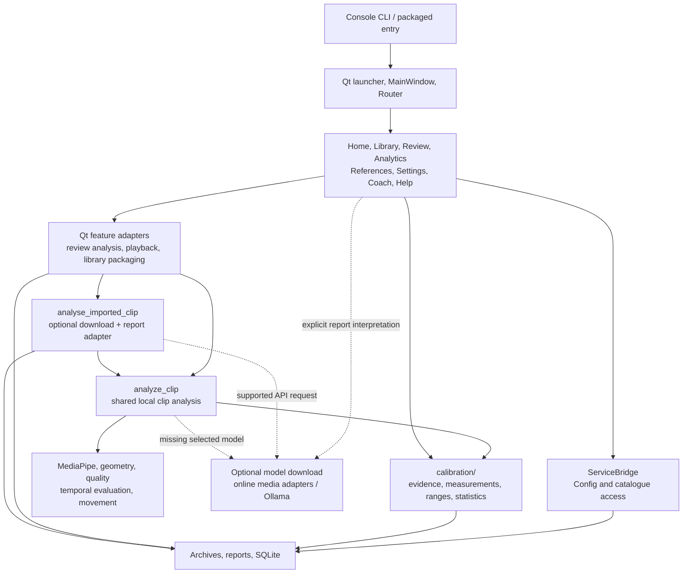
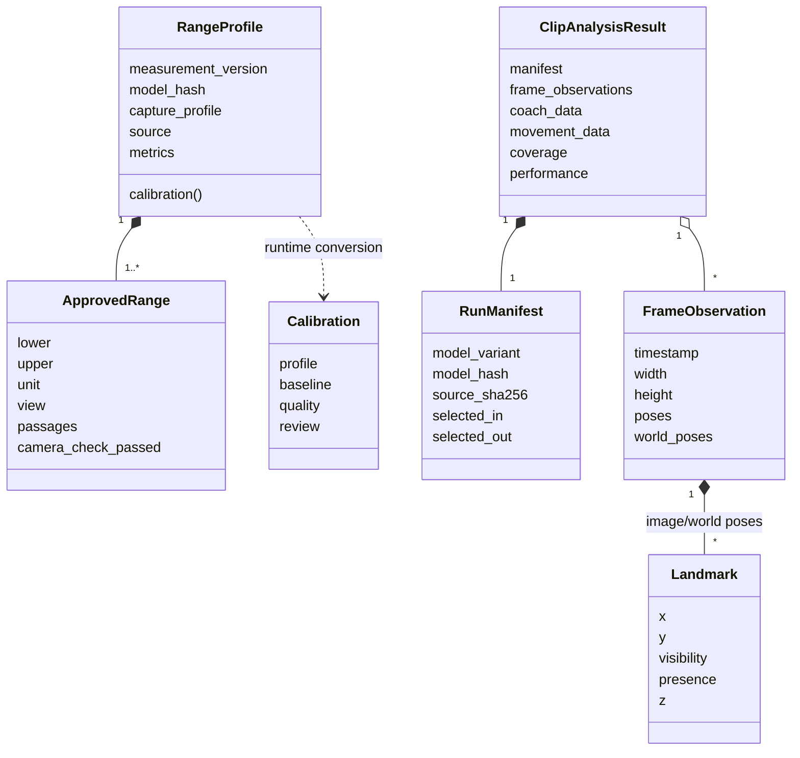
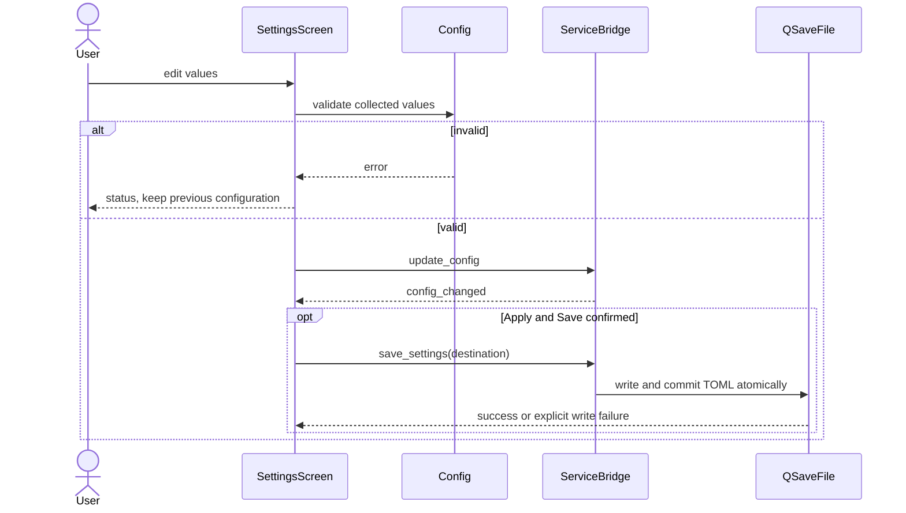
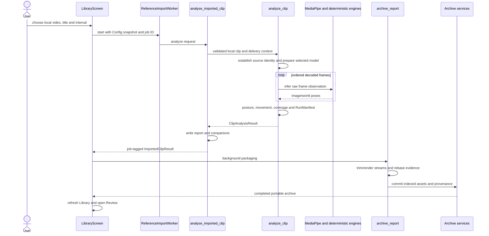
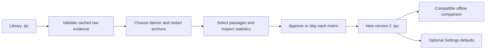
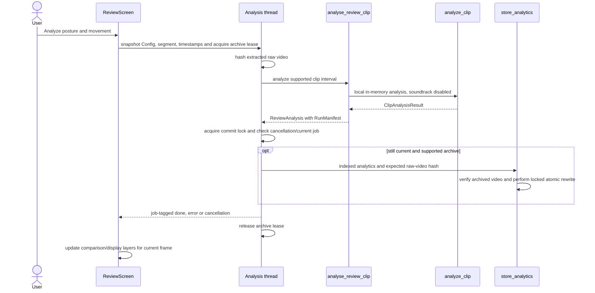
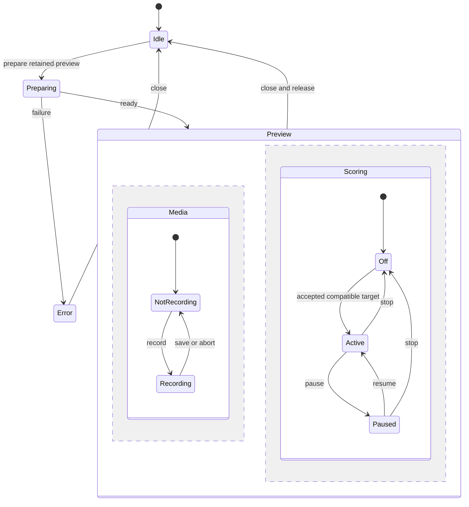
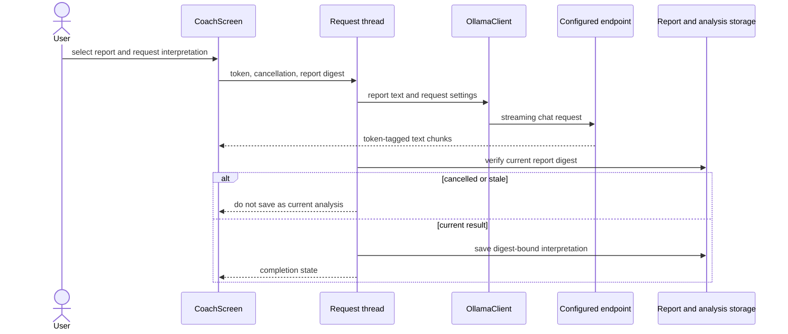

# TangoPosture architecture and developer workflows

Canonical repository: [TangoMovementLabs/TangoPosture](https://github.com/TangoMovementLabs/TangoPosture).

This document describes the implemented application: its entry points, module
ownership, data contracts, background jobs, persistence and extension points.
It is a map for maintaining the code, not a proposal for a replacement design.

The current Qt shell is **offline-first**. Library imports local video; Review
analyzes and compares recordings; the calibration editor approves ranges from
reference evidence. Camera/practice engines still exist, but their presence in
the source tree does not mean they are reachable from the current desktop
navigation.

For user-facing instructions, see:

- [General manual](TANGO_POSTURE_GUIDE.md).
- [Calibration guide](CALIBRATION_BEGINNERS_GUIDE.md).
- [Settings guide](SETTINGS_BEGINNERS_GUIDE.md).
- [Tracking-engine guide](TRACKING_ENGINE_BEGINNERS_GUIDE.md).

For proposed cleanup and future refactoring on top of this baseline, see the
[Technical debt and redesign proposal](TECHNICAL_DEBT_AND_REDESIGN.md).

Some companion guides describe retained camera workflows. Use the reachability
table below and the actual shell/router as the authority for current desktop
entry points.

## Contents

1. [Runtime scope and entry points](#1-runtime-scope-and-entry-points)
2. [Components and dependency boundaries](#2-components-and-dependency-boundaries)
3. [Source ownership map](#3-source-ownership-map)
4. [Domain records and analysis results](#4-domain-records-and-analysis-results)
5. [Evidence, coordinates and time](#5-evidence-coordinates-and-time)
6. [Configuration and model lifecycle](#6-configuration-and-model-lifecycle)
7. [Library import and packaging](#7-library-import-and-packaging)
8. [Calibration and comparison policy](#8-calibration-and-comparison-policy)
9. [Review, playback and reanalysis](#9-review-playback-and-reanalysis)
10. [Movement and presentation](#10-movement-and-presentation)
11. [Persistence and archive integrity](#11-persistence-and-archive-integrity)
12. [Concurrency and resource ownership](#12-concurrency-and-resource-ownership)
13. [Retained practice and camera services](#13-retained-practice-and-camera-services)
14. [Analytics and optional report interpretation](#14-analytics-and-optional-report-interpretation)
15. [Packaging and release boundaries](#15-packaging-and-release-boundaries)
16. [Making and verifying changes](#16-making-and-verifying-changes)

## 1. Runtime scope and entry points

### One desktop process, local processing

The main application is a Python process with a PySide6/Qt event loop. It uses
in-process services, Python threads, Qt signals, queues and local files.
It does not require an application server, account, mandatory cloud inference,
browser frontend or Tk fallback.

OpenCV handles video IO and image operations. MediaPipe supplies pose estimates.
NumPy supports numerical work. Pydantic validates configuration and approved
range profiles. SQLite supports retained session persistence.

Optional network operations are described separately; local processing does not
mean every configurable endpoint or import operation is offline.

### Entrypoints

| Entrypoint | Current behaviour | Owner |
| --- | --- | --- |
| `tango-posture` | Defaults to the Qt GUI | [cli.py](../src/tango_posture/cli.py) |
| `tango-posture gui` / `tango-posture qt` | Launches the same Qt application | [desktop_qt/main.py](../src/tango_posture/desktop_qt/main.py) |
| Packaged desktop executable | Selects its application-data working directory and bundled Lite model, then launches Qt | [desktop.py](../src/tango_posture/desktop.py) |
| `tango-posture run ...` | Executes the retained capture/practice engine, including supported file/headless modes | [app.py](../src/tango_posture/app.py) |
| `tango-posture models fetch` | Explicitly installs/verifies the Lite model | [models.py](../src/tango_posture/models.py) |
| `sessions list`, `sessions export`, `calibrations list` | Local storage commands | [cli.py](../src/tango_posture/cli.py), [storage.py](../src/tango_posture/storage.py) |

The packaged launcher rejects ordinary command-line arguments; its special
`--smoke-test` path verifies packaged resources and inference. Do not treat
packaged startup and the console CLI as interchangeable configuration loaders.

### Current desktop reachability

The shell constructs nine stacked workspaces. Eight appear in its rail; the
References workspace is reached through Home instead.

| Capability | Current desktop access | Retained implementation distinction |
| --- | --- | --- |
| Home | Rail | Shows offline-analysis setup and recent practices |
| Library | Rail; Home > Open Library | Local file import, portable files, promotion, calibration creation |
| Review | Rail; Library recording; Analytics seek | Playback, dynamic overlays, explicit reanalysis and comparison |
| Analytics | Rail | Read-only projection of saved archive evidence |
| AI Coach | Rail; Review report action | Explicit optional report interpretation |
| Settings | Rail | Shared configuration, including fields for retained services |
| Help & Guide | Rail | Renders the bundled general manual |
| Database maintenance | Rail | Explicit, confirmed cleanup of the configured SQLite database only |
| Calibration Profiles / References | Home > Manage References | Inspect saved profiles, Match Camera Settings, Open Library |
| Live Practice | No route in the current shell/router | Screen and worker remain in source; CLI capture remains available |
| Guided camera calibration / Check camera | No current Library/References entry action | Guided dialog, repeat-check logic and approval fields remain implemented |
| YouTube/Facebook download/import | No current local-import dialog field | URL/download adapters and worker APIs remain implemented |
| Migrate Legacy data | No current action | Do not reintroduce a migration button from old documentation |

Verify navigation in [shell.py](../src/tango_posture/desktop_qt/shell.py),
[router.py](../src/tango_posture/desktop_qt/router.py),
[home.py](../src/tango_posture/desktop_qt/screens/home.py),
[library.py](../src/tango_posture/desktop_qt/screens/library.py) and
[references.py](../src/tango_posture/desktop_qt/screens/references.py).

Some retained labels mention practice/camera operations. A label, configuration
field or importable class is not evidence that a shell route exists.

## 2. Components and dependency boundaries



The diagram shows collaboration, not an exhaustive Python import graph.
The Qt packaging adapter currently owns some substantial media orchestration;
the repository is not a perfectly isolated ports-and-adapters implementation.

### Boundaries to preserve

1. **Widgets versus algorithms.** Keep pose geometry, quality checks, range
   statistics, temporal evaluation and archive contracts out of screen layout
   code. Workers report results; they do not manipulate widgets.
2. **Analysis versus delivery.** The shared local analyzer returns structured
   results. The import adapter writes reports; the Review adapter returns
   in-memory data. Do not make Review generate temporary reports/databases just
   to recover results that the analyzer already provides.
3. **Evidence versus presentation.** Raw poses are measurement input.
   Coordinate smoothing, mirroring and gap filling are not new observations.
4. **Reference versus calibration.** A reference is replayable source evidence.
   A calibration profile is an explicitly approved set of ranges with provenance
   and applicability. They are different files and lifecycles.
5. **Observation versus evaluation.** A measured angle is not automatically a
   posture score. Model identity, quality, selected limits, view and applicable
   camera approval determine whether evaluation is allowed.
6. **Archive versus database.** Portable replay and archive Analytics must not
   require the originating SQLite database.
7. **Deterministic analysis versus generated commentary.** Frame insights,
   steps, pivots and approved-range evaluation do not call Ollama.

The [contracts package](../src/tango_posture/contracts/) contains typed command,
event and query records. It is not a running message broker, HTTP service or
universal command bus. Current execution also uses direct calls, domain
dataclasses, dictionaries, Qt signals and job-tagged tuples.

## 3. Source ownership map

Paths are relative to [src/tango_posture/](../src/tango_posture/).

| Area | Main owners | Responsibility |
| --- | --- | --- |
| Launch | [cli.py](../src/tango_posture/cli.py), [desktop.py](../src/tango_posture/desktop.py), [desktop_qt/main.py](../src/tango_posture/desktop_qt/main.py) | Console/package setup, QApplication, splash |
| Desktop composition | [shell.py](../src/tango_posture/desktop_qt/shell.py), [router.py](../src/tango_posture/desktop_qt/router.py) | Navigation, workspace construction, route payload delivery |
| Shared desktop services | [service_bridge.py](../src/tango_posture/desktop_qt/service_bridge.py) | Config notifications, archive/profile catalogues, Settings-default copy |
| Screens and components | [screens/](../src/tango_posture/desktop_qt/screens/), [components/](../src/tango_posture/desktop_qt/components/) | Widgets, controls, video stages, reusable MetricChart |
| Configuration and records | [config.py](../src/tango_posture/config.py), [domain.py](../src/tango_posture/domain.py) | Validated Settings, pose/quality/calibration/event records |
| Local clip analysis | [references/pipeline.py](../src/tango_posture/references/pipeline.py), [results.py](../src/tango_posture/references/results.py) | Shared analyzer, report-producing adapter, typed results/provenance |
| Source acquisition | [references/links.py](../src/tango_posture/references/links.py), [downloads.py](../src/tango_posture/references/downloads.py), [video.py](../src/tango_posture/references/video.py), [worker.py](../src/tango_posture/references/worker.py) | URL/provenance rules, optional download, probing/decoding, cancellation |
| Cached frame insights | [references/coach.py](../src/tango_posture/references/coach.py), [coverage.py](../src/tango_posture/references/coverage.py), [companions.py](../src/tango_posture/references/companions.py) | Deterministic posture layers, coverage and report companion IO |
| Reference media | [references/archives.py](../src/tango_posture/references/archives.py), [comparison.py](../src/tango_posture/references/comparison.py) | Promotion/provenance, lower-level anchored comparison/relinking |
| Calibration | [calibration/](../src/tango_posture/calibration/) | Models, archives, raw evidence, measurements, readiness and statistics |
| Calibration UI | [editor.py](../src/tango_posture/desktop_qt/calibration/editor.py), [guided.py](../src/tango_posture/desktop_qt/calibration/guided.py) | Reachable reference editor; retained guided camera dialog |
| Model execution | [models.py](../src/tango_posture/models.py), [pose/](../src/tango_posture/pose/) | Verified assets, MediaPipe adapter, named points, display interpolation |
| Measurement/evaluation | [geometry.py](../src/tango_posture/geometry.py), [metrics.py](../src/tango_posture/metrics.py), [quality.py](../src/tango_posture/quality.py), [temporal.py](../src/tango_posture/temporal.py) | Geometry, quality gates, filters and event persistence |
| Offline movement | [movement.py](../src/tango_posture/movement.py) | Foot placements, pivots, validation, floor/ring/footprint rendering |
| Review adapters | [review/analysis.py](../src/tango_posture/desktop_qt/review/analysis.py), [review/playback.py](../src/tango_posture/desktop_qt/review/playback.py) | In-memory reanalysis adapter, owned readers/archive/timeline |
| Library packaging | [library/archives.py](../src/tango_posture/desktop_qt/library/archives.py) | Clip rendering, frame rebasing, portable-file assembly |
| Saved Analytics | [analytics/data.py](../src/tango_posture/desktop_qt/analytics/data.py) | Read-only saved-data projection |
| Persistence | [archive.py](../src/tango_posture/archive.py), [storage.py](../src/tango_posture/storage.py), [review.py](../src/tango_posture/review.py), [reports.py](../src/tango_posture/reports.py) | ZIP contracts, SQLite sessions, report metadata/AI companions, Markdown |
| Capture/practice | [app.py](../src/tango_posture/app.py), [capture.py](../src/tango_posture/capture.py), [practice.py](../src/tango_posture/practice.py), [session.py](../src/tango_posture/session.py) | Retained live/file orchestration, mailbox display, scoring, recording |
| Camera worker/state | [practice/worker.py](../src/tango_posture/desktop_qt/practice/worker.py), [core/session_state.py](../src/tango_posture/core/session_state.py) | Retained QThread adapter and immutable control-state transitions |
| Audio | [beat.py](../src/tango_posture/beat.py), [references/soundtrack.py](../src/tango_posture/references/soundtrack.py) | Live music helpers and optional offline soundtrack analysis |
| Replay/drawing | [replay.py](../src/tango_posture/replay.py), [overlay.py](../src/tango_posture/overlay.py) | Video readers/writers and common overlay primitives |
| Optional language model | [ollama.py](../src/tango_posture/ollama.py), [screens/coach.py](../src/tango_posture/desktop_qt/screens/coach.py) | HTTP protocol versus UI request lifecycle |
| Help | [tutorial_rendering.py](../src/tango_posture/tutorial_rendering.py), [screens/help.py](../src/tango_posture/desktop_qt/screens/help.py) | Markdown rendering, search and setting targets |

### Relocated modules

The old monolithic names are not compatibility shims:

| Old location | Current location |
| --- | --- |
| `calibration.py` | [calibration/baseline.py](../src/tango_posture/calibration/baseline.py) |
| `range_profiles.py` | [calibration/](../src/tango_posture/calibration/) |
| `reference_import.py` | [references/](../src/tango_posture/references/) and [calibration/readiness.py](../src/tango_posture/calibration/readiness.py) |
| `reference_archives.py` | [references/archives.py](../src/tango_posture/references/archives.py) |
| Flat Qt calibration/practice/review/library/analytics helper modules | Corresponding feature packages under [desktop_qt/](../src/tango_posture/desktop_qt/) |

Import the owning module. If moving code again, update production imports,
tests and module-qualified monkeypatch targets together. Do not import a chart
from an unrelated screen when a reusable component already exists.

## 4. Domain records and analysis results

### Core records

| Record | Purpose |
| --- | --- |
| `Landmark` | x/y, optional visibility, presence and predicted z |
| `FrameObservation` | Timestamp, dimensions, image poses and separate world poses |
| `QualityResult` | Validity plus an explicit reason and optional view width |
| `MetricObservation` | Timestamped values/quality and view information |
| `Calibration` | Existing runtime baseline/target envelope and identity |
| `Passage` | Validated example interval |
| `ApprovedRange` | Bounds, unit, view, passages, statistics and camera-check flag |
| `RangeProfile` | Versioned approved metric set, model/capture identity and provenance |
| `DeviationEvent` | Onset, detection time, peak, end and end reason |

`RangeProfile.calibration()` embeds its serialized profile in
`Calibration.review["range_profile"]`. This lets the session/storage system
recognize approved ranges without inventing a second SQLite calibration schema.



### Three important offline result types

[references/results.py](../src/tango_posture/references/results.py) separates:

- **RunManifest:** frozen record of model variant/hash, metric identity, capture
  setup, source hash/name, dimensions, selected interval and execution metadata.
- **ClipAnalysisResult:** in-memory analysis output, including frame evidence,
  posture/movement data, coverage, soundtrack summary and optional session
  results.
- **ImportedClipResult:** delivery result with report/metadata/companion paths,
  source information and optional online provenance.

`analyze_clip` is also exported as `analyse_clip`. `analyse_imported_clip` is a
different adapter, not merely a spelling alias.

Frozen dataclasses prevent field reassignment; their nested dictionaries/lists
are not recursively immutable. Snapshot configuration and copy mutable payloads
where an asynchronous consumer needs isolation.

The analyzer performs IO: decoding, hashing, model lookup and possibly model
download. "In-memory result" means it does not itself require report files or a
temporary database. It is not a pure mathematical function, and an explicitly
supplied Storage can receive applicable session writes.

## 5. Evidence, coordinates and time

### Raw and derived pose layers

| Field/layer | Intended use | Invariant |
| --- | --- | --- |
| `measurement_poses` | Raw cached detector evidence | Required for approved calibration/comparison |
| `poses` | Historical display-smoothed layer | Not a substitute for raw evidence |
| `display_poses` | Derived Review gap-filled drawing | Must not contribute synthetic scoring coverage |
| `world_poses` | Model-estimated 3D geometry | Not calibrated room/floor coordinates |

The backend retains 19 named landmarks from MediaPipe's 33-point output.
Image x/y are normalized. Drawing converts them to pixels. Model depth/world
estimates are distinct from image geometry and are not physical ground truth.

The strict [quality helper](../src/tango_posture/quality.py) requires finite,
in-image x/y and usable visibility/presence. Older descriptive helpers and
offline movement have different local policies; there is no universal
confidence gate governing every line and label.

### Display changes must not rewrite evidence

Review interpolation is bracketed, 2D and display-only:

- Linear by default; optional quadratic with linear fallback.
- Default maximum gap 3 seconds; zero disables filling.
- No extrapolation at clip edges.
- Segment breaks for ambiguous multiperson or invalid/nonincreasing timing.
- Filled display points do not supply detector confidence or depth evidence.

Live coordinate smoothing is separate. Its output can trail current pixels;
Review therefore prefers same-frame raw evidence plus its derived interpolation
instead of reusing a causally delayed display skeleton.

### Time domains

| Time domain | Owner/use |
| --- | --- |
| Source presentation time | Video probing and ordered clip decoding |
| Clip-local time | Selected excerpt and packaged recording |
| Observation time | Timestamped raw measurements and temporal evaluation |
| Frame-index/FPS time | Offline movement event basis |
| Monotonic capture/processing time | Retained live engine and latency measurements |
| GUI playback time | Reader/timer transport and synchronization |

Do not silently substitute one for another.

The MediaPipe VIDEO adapter uses strictly increasing detector milliseconds:
`max(previous_ms + 1, round(timestamp * 1000))`. It preserves the original
observation timestamp separately.

Packaging rebases source frame keys, cuts and movement events into the selected
clip's frame indices. Stored timestamps also matter for recordings with pauses
or timing gaps. Review warns and uses an FPS timeline when stored timestamps do
not match the video frame count; timestamp-dependent navigation must not claim
precision that the fallback cannot support.

## 6. Configuration and model lifecycle

### Configuration flow

[Config](../src/tango_posture/config.py) validates values with Pydantic,
rejecting unknown keys and invalid/nonfinite values. Entry/clear ordering,
calibration durations and default metric units have explicit validation.

Settings builds 11 groups from `SETTING_GROUPS`, plus the generated
**Calibration defaults** tab. Grouped fields include retained camera/music
options; exposing them does not create corresponding desktop routes.



Important semantics:

- **Apply & Save settings.toml:** atomic save followed by applying the new
  configuration. Desktop startup reloads that file from its working directory;
  an explicit `--config` takes precedence for the source CLI.
- **Settings TOML:** exports registered editable fields plus Calibration defaults,
  not the complete internal Config model. Old baseline-only controls and the
  three legacy per-metric entry/clear pairs are absent from Settings/templates/new
  exports; older files remain loadable for retained baseline code. Preserve an
  original legacy file if its nondefault baseline parameters are still needed.
  Camera device/resolution/mirroring and microphone/automatic-recording controls
  are also absent from current Settings and new exports. Their backend fields
  remain for retained-service compatibility. The Music tab's fallback tempo is
  still used by current offline processing and is distinct from the slow-tango
  lift ceiling.
- **Apply & Save settings.toml:** confirms the resolved working-directory path,
  applies first, then saves. A save error can leave valid new settings applied
  but unsaved.
- **Use as Settings defaults:** copies approved bounds/units/views into a
  replacement default-range set. It saves successfully before publishing the
  new configuration.
- **Export TOML:** applies valid edits and writes to the chosen destination.
- **Import TOML:** validates a chosen file before publishing it.
- **Reset Defaults:** resets current configuration, not archives/saved files.

The save destination is not derived from `data_dir`. Ordinary startup does not
implicitly load every file named settings.toml; use CLI `--config` before the
subcommand or the desktop import action.

Analysis jobs receive configuration snapshots. `config_changed` refreshes
relevant current UI/comparison layers but does not mutate an in-flight job's
snapshot or rewrite archived raw evidence.

### Model preparation

[models.py](../src/tango_posture/models.py) and the packaged
[manifest](../src/tango_posture/model_manifest.json) own supported variants,
filenames, source URLs and pinned checksums.

Offline `analysis_model` is `lite`, `full` or `heavy`, default Lite.
The retained live/guided backend uses Lite.

Before offline download, resolution checks known candidates in order:

1. The selected variant's primary destination: configured `model_path` for Lite,
   or the data-directory model cache for Full/Heavy.
2. The data-directory model cache.
3. The configured model file's directory.
4. The working directory's models folder.

The first existing candidate must verify. A corrupt file is an explicit error,
not permission to choose another variant or overwrite it silently.
Valid local files are reused in place; there is no whole-disk discovery.

Missing selected weights download in the analysis job to a temporary file,
with progress and cooperative cancellation. Verification precedes replacement
of the destination. Temporary download files are cleaned on exit.

The backend explicitly uses CPU, VIDEO running mode and up to two poses.
Two-pose detection is not stable person identity or two-person scoring.
Changing today's selected model does not update old caches; rerun analysis.

## 7. Library import and packaging

The reachable UI is **Library > Import & Analyze Video...**, which opens a
local-file picker and a title/start/end dialog. The selected interval is limited
to 120 seconds. Source validation/probing also enforces applicable media limits.

**Import as reference** selects `.tpr`; otherwise the result is a `.tp`.
The original video is not modified in place.



### Shared analyzer

`analyze_clip` probes/validates the interval, checks analysis readiness, hashes
the source, resolves the selected model, and decodes the chosen frames once.

It retains raw observations and reuses them for deterministic posture helpers
and `analyse_movement_observations`. The shared route passes movement
`sample_stride=1`; it is not the standalone sampled scanner.

`analysis_mode="movement"` does not require an approved calibration.
The lower-level posture mode can use a reference or accepted baseline interval.
Do not confuse that API capability with the current Library dialog's choices.

Soundtrack analysis is optional at the service level. Current Library import
and Review reanalysis explicitly disable it.

### Delivery and packaging adapters

`analyse_imported_clip` adds optional online acquisition/provenance and report,
metadata and coaching/movement companions around the shared analyzer.
It retains storage-related compatibility behaviour; Review deliberately calls
the in-memory analyzer through its own adapter instead.

`archive_report` reads those companions, renders raw/overlay/floor-lines media,
and packages indexed evidence. It copies/rebases frame keys and movement data,
updates clipped-media hashes, and retains original source provenance separately.

Analysis completion and archive commit are separate phases. Cancellation or an
error must not be presented as a completed Library import before packaging
finishes.

### Catalogue operations

Library combines case-insensitive name search with `.tp`, `.tpr`, `.tpc` or
all-types filtering.

- **Rename:** updates the persisted display name, not the physical filename.
- **Delete:** asks for confirmation, then uses instance `QFile.moveToTrash`
  under the archive lock. Failure is reported; imported originals are not
  recursively deleted.
- **Promote to Reference:** creates a separate `.tpr` from a recording/excerpt,
  carrying/rebasing available evidence and preserving the source.
- **Create calibration:** opens the shared editor for a `.tpr`.
- **Profile details / Use as Settings defaults:** operate on profile-only files.

Promotion is not calibration approval. A replayable reference does not become
a scoring target merely because its extension changed.

## 8. Calibration and comparison policy

### From evidence to an approved profile



[CalibrationEditor](../src/tango_posture/desktop_qt/calibration/editor.py)
opens reference media plus validated raw evidence. Its core services are:

- [evidence.py](../src/tango_posture/calibration/evidence.py): cache identity,
  dimensions/timing/raw-pose validation and conservative spatial association.
- [measurements.py](../src/tango_posture/calibration/measurements.py): native
  metric values with confidence/view rules.
- [statistics.py](../src/tango_posture/calibration/statistics.py): passage
  summaries, coverage, distributions and retained guided repeat checks.
- [archives.py](../src/tango_posture/calibration/archives.py): profile persistence.

The editor does not rerun inference. It derives statistics from cached raw
observations and uses Review's skeleton interpolation and cached movement
renderers for preview. Interpolation does not alter range evidence. If movement
data is absent, the editor requests analysis in Review.

Dancer association uses reliable hip centres, a strict nearest-distance limit
below 0.15, separation from a second candidate above 0.03, and the cached gap
limit. Loss/ambiguity ends a segment; there is no silent switch to another
person. Explicit restart anchors require user confirmation of linked identity.

Users select example passages separately from acceptable bounds. The median,
p10/p90 and middle-80-percent suggestion describe selected evidence, not correct
tango technique. The chart shades selected passages and draws both editable
limits across its full timeline. Angular wrap handling is metric-specific.

Saving rechecks source archive identity, confirmed dancer selection and at
least one approved metric. It creates a distinctly named profile rather than
overwriting an existing one.

### Registered range metrics

| Key | Label | Unit |
| --- | --- | --- |
| `head_pitch` | Head pitch (ear-to-nose) | degrees |
| `head_forward` | Head-forward offset | torso_lengths |
| `head_inclination` | Head inclination | degrees |
| `shoulder_clearance` | Ear-to-shoulder clearance | normalized_clearance |
| `hip_offset` | Hip offset from ankle-to-head axis | axis_lengths |
| `torso_axis_tilt` | Torso axis tilt (pink line) | degrees |
| `trunk_inclination` | Trunk inclination | degrees |
| `knee_flexion` | Least-bent reliably visible knee | degrees |

The pink axis measures absolute projected shoulder-midpoint-to-hip-midpoint
tilt from image vertical. It requires both shoulders and both hips.
It is distinct from trunk inclination and the older `axis_curve_*` hip-offset
controls. It is not a spine-curvature or balance measurement.

Approved head pitch uses the raw ear-to-nose angle, shoulder clearance a native
ratio, and hip offset a raw signed ratio. Do not reuse older neutral-adjusted
overlay values or warning percentages as their approved-range units.

### Target precedence

| Situation | Evaluation source |
| --- | --- |
| Selected approved profile | Its approved metrics/ranges only |
| No profile, nonempty Calibration defaults | Enabled default ranges only |
| Neither | Applicable older Settings-based descriptive/threshold behaviour |

Missing, skipped or unapproved metrics do not fall back to older warning
thresholds when a profile/default-range set is active. Invalid/incompatible
selected evidence is an error, not permission to silently use Settings.

Unknown measurements remain unknown regardless of how permissive the limits
are.

### Offline comparison versus retained live approval

Review comparison applies compatible raw evidence, model/measurement identity,
side/facing/view rules and approved bounds. It does not grant camera approval.
Compatible video-derived profiles can be compared without being live-scoring
targets.

The retained live Session only constructs range evaluators for metrics whose
`camera_check_passed` flag is true. Its guided workflow requires repeatability
evidence plus explicit approval; copying bounds to Settings does not transfer
that approval.

The camera dialog/check machinery remains in source, but the current shell
does not expose it through Library or References. Document a restored entry
point explicitly if one is added; do not imply that changing a profile flag is
a supported substitute.

## 9. Review, playback and reanalysis

### Ownership and transport

[ReviewPlayback](../src/tango_posture/desktop_qt/review/playback.py) owns readers,
the opened archive and extracted media. The Review screen owns transport
controls, layer selection, current comparison state and job presentation.

The UI selects Library archives with recording segments; profile-only `.tpc`
files are excluded. Lower-level replay helpers also retain standalone
video/report capabilities, which do not imply an additional visible file-import
workflow.

Streams include available raw, overlay and floor-lines variants. Play, pause,
frame stepping, speed and scrubbing operate on the selected reader/timeline.
Report timestamp links seek that recording, not an arbitrary matching filename.

### Explicit reanalysis



The Review adapter calls `analyze_clip` directly; it does not round-trip through
`analyse_imported_clip`, temporary reports or an import database.
Current UI analysis uses up to the supported 120-second interval from the
opened raw clip.

The worker holds an archive lease so navigating away cannot delete extracted
input while inference still uses it. Cancellation and the active job identifier
are checked under the commit lock before persistence. `expected_video_sha256`
prevents committing results against different archived raw media.

Results update the selected recording's indexed analytics. They do not rewrite
raw video, automatically approve calibration, or rerender every baked overlay
stream.

### Dynamic layers and comparison

The **Calibration profile** picker builds derived comparisons from raw cached
evidence. **No calibration (visuals only)** renders the skeleton, pivots and
footprints without posture alerts, even when Settings defaults are enabled.
Movement-only imports retain raw measurements but do not generate coaching
alerts. An incompatible calibration reports the error and keeps skeleton
tracking visible without displaying cached fallback messages.

Dynamic skeletons use same-frame raw poses with optional display-only gap
filling. Numeric comparison and coverage do not consume those synthetic joints.
Old display-only caches can render but need reanalysis for approved comparison.

An overlay stream already contains painted pixels; a new selector cannot remove
them. Review requires raw/source media for dynamic tracking and comparison.

**Open Comparison** owns a second playback instance. It synchronizes by elapsed
playback time, not semantic movement alignment. The lower-level anchored
comparison API is separate.

Exports write chosen replay/layer output without replacing original archive
media. Navigating away releases playback resources, cancels analysis and retains
the path needed to reopen; it is not just hiding an indefinitely active reader.

## 10. Movement and presentation

[movement.py](../src/tango_posture/movement.py) contains both detection and
drawing helpers. It is a module, not a package or external service.

### Detection

- **Scale/continuity:** estimates projected body scale and detects excessive
  image/scale jumps.
- **Steps:** per-foot INITIAL/ANCHORED/MOVING/SETTLING state machines require
  usable ankle/heel/toe geometry, travel, settling and applicable extension/lift
  checks.
- **Pivots:** predicted horizontal hip direction, angular unwrapping,
  rate/rotation windows and stable projected foot-anchor evidence.

The shared analyzer reuses decoded raw observations. The separate
`scan_video_movement` API can sample around a target rate with stride rounding;
its default 15-FPS target does not govern every Qt analysis.

The lower-level movement coordinator has its own single-worker bounded queue.
It is not the universal job system for the Library and Review screens.

Internal `DETECTOR_CONFIG` values are not desktop Settings fields. Overrides
alter the detector fingerprint; cache validation expects supported detector
semantics. Do not add a GUI tuning field without updating call sites,
provenance and compatibility rules.

### Presentation

Floor grids are decorative image-space geometry, not calibrated floor
reconstruction. Rings additionally need per-frame hip geometry; an existing
pivot event can temporarily have no drawable ring.

Footprints use saved placement geometry and fade over media time according to
`replay_step_history_seconds`. Layer checkboxes change rendering, not stored
event counts.

Hip-display interpolation within movement uses its own short gap policy,
separate from Review joint interpolation. General Mirror is not a universal
replay transformation; inspect the actual renderer arguments.

Step placement is not force/contact sensing. Pivot support labels are projected
stability heuristics, not measurements of weight bearing.

## 11. Persistence and archive integrity

### Portable file contracts

| Format | Meaning | Important compatibility distinction |
| --- | --- | --- |
| `.tp` | Practice archive; version-1 ZIP manifest and indexed segments | Can contain multiple recordings |
| `.tpr` | Replayable reference; version-1 ZIP, kind reference | Includes source/excerpt provenance in `reference.json` |
| Version-2 `.tpc` | Approved range profile | `profile.json`, ranges/provenance/checks; no recording segments |
| Version-1 `.tpc` | Legacy baseline recording | Remains readable; not identical to a profile-only archive |

A recording can have members such as:

```text
manifest.json
video_00.mp4
overlay_00.mp4
lines_00.mp4
report_00.md
report_00.metadata.json
analytics_00.json
movement_00.v1.json
```

The manifest and available evidence are authoritative. Not every archive has
every optional stream/companion. Subsequent recordings use indices `01`, `02`,
and so on. A profile instead stores its profile payload, and a reference adds
its reference descriptor.

Saved AI interpretations are report-digest-bound companions, not replacements
for numerical analytics.

### Integrity and lifetime rules

[archive.py](../src/tango_posture/archive.py) owns shared locking, validation,
extraction and replacement:

- Validate archive/member paths before extraction, including traversal,
  absolute/backslash paths, duplicate names and symlinks.
- Serialize mutation with per-path reentrant locks.
- Attempt advisory file locking where `fcntl` is available; this is not a
  universal distributed/cross-process transaction system.
- Write completed replacement archives before atomic replacement.
- Retry applicable Windows replacement interference.
- Check expected source/member hashes for operations that supply them.

`PracticeArchive` extracts into an owned temporary directory. `acquire()` adds a
lease; `close()` releases one. Cleanup happens only when the last lease closes.
Every worker retaining an extracted input beyond the caller's lifetime must
release its lease in `finally`.

An atomic archive replacement does not make an entire multi-step import one
database transaction. Distinguish preparation, report creation, media rendering
and final archive commit.

### SQLite and reports

[Storage](../src/tango_posture/storage.py) opens `tango.sqlite3` under its supplied
data directory and manages schema-version-1 calibrations, sessions, observations
and events. It supports retained practice/session writes and export.

The [Database maintenance screen](../src/tango_posture/desktop_qt/screens/database.py)
inspects `<config.data_dir>/tango.sqlite3` without creating a missing database.
It requires an acknowledgement, the exact phrase `DELETE ALL DATA`, and a final
default-No confirmation. No automatic backup is created. The shell blocks cleanup
while Library import/packaging/promotion or Review analysis is active, and the
screen rechecks that guard and the configured target after the confirmation.
Other app/CLI processes must be stopped by the user.

The maintenance functions in [storage.py](../src/tango_posture/storage.py) require
schema version 1 and use a `BEGIN IMMEDIATE` transaction with foreign keys enabled.
They count and delete events and observations before sessions and calibrations,
verify all four tables are empty, and roll back on failure. The database, schema,
indexes and schema version remain; no archive, profile, video or report files
are removed. Inspection uses a read-only connection; cleanup requires an existing
file. Unsupported schemas, lock conflicts and other errors are reported explicitly.

Portable playback and archive Analytics use selected archive evidence rather
than requiring that database. Some lower-level Analytics APIs can read a local
database snapshot; they are not the current workspace's archive-only contract.

Markdown reports, metadata and coaching/movement companions remain separate
delivery artifacts until packaging. Source hashes, archived clip hashes, report
digests and mutable display names have different meanings; do not substitute
one for another.

## 12. Concurrency and resource ownership

| Owner | Execution/communication | Lifetime and stale-work rules |
| --- | --- | --- |
| Qt launcher, shell, screens | GUI event loop, signals and route payloads | Widgets stay on GUI thread |
| Library analysis | `ReferenceImportWorker`, Python thread, job-tagged events | Cooperative cancel; ignore mismatched job IDs |
| Library packaging/promotion | Python thread, cancellation event, polled queue | Show completion only after commit; bounded shutdown join |
| Review reanalysis | Python thread, job ID, event queue, commit lock | Config snapshot, archive lease, cancellation/current-job commit check |
| Database cleanup | Python thread, result queue and GUI poll timer | Application-modal non-cancellable progress; join on shutdown; SQLite commit or rollback |
| Review playback/comparison | GUI timers and owned local readers | Close/release on replacement, hide or error |
| Coach request | Python thread and token-tagged Qt signals | Cancel/stale response is not saved; HTTP timeout bounds blocked IO |
| Retained practice worker | QThread around `Application` | Opens/closes its own Storage and engine resources |
| Retained camera capture | Producer thread and one-frame queue | Replace stale queued images rather than accumulating backlog |
| Retained inference | One executor worker | No unlimited per-exposure inference queue |
| Retained preview display | Latest-image mailbox plus lossless control/result queues | Dropping an obsolete preview does not drop a save notification |

### Cancellation is cooperative

Setting an event does not instantly stop a blocked decoder, inference call or
HTTP read. Workers check at supported boundaries. Shutdown uses the owning
implementation's cleanup/join policy; a bounded join is not proof every worker
has already terminated.

Job IDs/request tokens protect UI selection state. They are not substitutes for
archive hashes or commit locking. Review uses both UI freshness and persistence
identity checks.

### Startup and presentation ownership

The launcher creates/reuses QApplication and schedules the splash completion
with a three-second Qt timer. It does not sleep the GUI thread.

The shell owns a reused modeless About dialog and stacked workspaces.
Help renders the general manual with section navigation/search.
Image buffers crossing into Qt use copied QImages so the underlying OpenCV
array cannot be freed while Qt still displays it.

## 13. Retained practice and camera services

This section documents existing engines for maintainers. It does **not** describe
a current Live Practice rail entry.

### Capture and session orchestration

`Application` coordinates capture, Lite inference, raw measurements, display,
optional recording/audio, event tracking and storage.

Camera capture favours fresh frames with a one-slot queue. File capture decodes
sequentially and handles timing fallback/errors explicitly.
Display smoothing is separate from measurement evidence.

The retained Qt `PracticeScreen` uses immutable
[session-state transitions](../src/tango_posture/core/session_state.py) to govern
controls. `Application` and `Session` still own their own runtime lifecycles;
that state model is not a universal authority over every engine variable.



Recording and scoring are independent. Scoring pause does not pause the video.
Stop/save finalizes current output; abort concerns unsaved work, not previously
committed archive recordings.

`Session` evaluates approved, camera-checked ranges or legacy baselines as
appropriate. The timestamp-driven evaluator smooths numbers and requires entry/
clear persistence. Missing raw evidence becomes UNKNOWN and breaks event
continuity; increasing `max_gap` does not authorize synthetic observations.

Older role/embrace/lift trackers have different state-retention policies.
Do not generalize the generic evaluator's missing-value behaviour to every
helper.

### Guided camera evidence

The retained guided dialog runs the practice worker in temporary storage,
collects raw observations and records neutral/change/return/repetition holds.
It shares the reference approval editor rather than implementing a second
range schema.

Repeat checks evaluate usable coverage, change relative to within-hold spread,
direction agreement and return consistency. The dialog supports an additional
walking drill for that context. These are engineering repeatability checks, not
validation of technique or anatomy.

Current shell removal does not erase the file format's camera-check fields or
the scoring engine's approval requirements.

### Audio and automatic recording

The retained practice engine can use live microphone evidence to start/stop
song recordings after configured music/silence delays, bounded by the recording
cap. A synthetic tempo clock is not evidence of audible music.

Audio availability/muxing remains platform-dependent. Current offline
Library/Review calls disable soundtrack analysis, and Qt Review playback is
video-only. The inactive `replay_audio` and `replay_auto_analyse_movement`
controls are absent from Settings and new TOML exports. Config accepts those
keys only for older-file compatibility; neither enables playback audio or
queues automatic analysis.

## 14. Analytics and optional report interpretation

### Portable Analytics

[AnalyticsScreen](../src/tango_posture/desktop_qt/screens/analytics.py) projects
persisted `.tp` recording data through
[analytics/data.py](../src/tango_posture/desktop_qt/analytics/data.py).
It does not rerun pose inference or reopen the originating session database.

Charts split at null observations/long gaps. Duration/coverage semantics come
from the relevant persisted observations/summaries, not an assumption that
sample counts equal valid time. Stored frame measurements are not relabelled
as calibrated scores.

Chart/event selection routes an archive path, segment index and timestamp to
Review. If no archived frame supports that time, report the limitation rather
than seeking a different recording.

### Explicit Ollama interpretation

[CoachScreen](../src/tango_posture/desktop_qt/screens/coach.py) owns selection,
request state, streaming display, cancellation and exports.
[OllamaClient](../src/tango_posture/ollama.py) owns HTTP/protocol handling.



Loading a report does not call an LLM. Requests send report text, not video.
Generated output does not approve ranges, alter events or execute app actions.

Saved interpretations include the report digest, model, endpoint, instruction,
timestamp, text and completion state. Reopening associates matching-digest
responses, not merely matching filenames.

### Network boundaries

| Boundary | Trigger | Data involved |
| --- | --- | --- |
| Model setup | CLI fetch or missing selected offline weights during analysis | Pinned public model assets |
| Online source adapters | Explicit supported API/worker call; not current local-import UI | Validated source URL and downloaded media/provenance |
| Ollama | Explicit connection/model/interpretation action | Requests and report text sent to configured endpoint |

The default Ollama address is loopback, but users can configure a remote
server. "Local by default" is not a guarantee about every configured endpoint.
Online media adapters may need external yt-dlp availability; source support in
code is not a bundled download UI or a guarantee of upstream availability.

## 15. Packaging and release boundaries

[pyproject.toml](../pyproject.toml) defines the console entry, dependencies,
Python support and Hatch wheel resources. The current supported Python range
is 3.11 (`>=3.11,<3.12`).

The wheel includes the logo and general manual under package resource names.
The separate architecture/beginner guides are repository documentation; do not
assume they are automatically embedded in Help.

[TangoPosture.spec](../packaging/TangoPosture.spec) builds the packaged desktop
with PyInstaller, including MediaPipe assets, the verified Lite model, logo,
manual, metadata and notices. Tk modules are explicitly excluded.

[The desktop workflow](../.github/workflows/desktop-release.yml) runs checks on
macOS and Windows. Release/manual-dispatch builds prepare resources, fetch the
verified Lite model, build macOS arm64/Windows x64 artifacts and run installed
smoke checks. Publishing waits for checks/builds and attaches installers plus
checksums. Release tags are checked against the package version.

The packaged smoke path checks Qt construction, resources, checksum and blank
frame inference. It is not a real-camera/microphone or real-dancer acceptance
test.

The packaged launcher changes to a per-user application-support directory.
Relative database/media/model/settings paths therefore resolve differently
from a source checkout launched at the repository root.

## 16. Making and verifying changes

### Change-location guide

| Requirement | Start with | Preserve |
| --- | --- | --- |
| Add/restore desktop workflow | Shell/router and owning screen | Explicit reachability, shutdown and cancellation ownership |
| Add Settings field | Config, descriptions, grouped UI and actual consumer | Validation, TOML round trip, run snapshots |
| Change range metric | Calibration models/measurements/statistics and comparison consumers | Native units, version/compatibility, raw evidence rules |
| Add analysis result | Shared analyzer and result records, then delivery adapters | Review's in-memory path; import reporting remains separate |
| Change pose model handling | Model manifest/resolver/backend | Pinned variant verification, cache provenance, explicit failure |
| Change step/pivot logic | Movement detector and validator | Fingerprint/version/timing compatibility and focused examples |
| Fix visual dropout | Correct renderer/interpolator or raw-quality producer | Synthetic display data must not become measurement evidence |
| Change archive mutation | Shared archive helpers and owning feature adapter | Locking, atomic replacement, member/hash checks |
| Change replay timing | Playback and shared replay helpers | Source/clip/frame time distinctions and warnings |
| Add Analytics chart | Saved-data projection and MetricChart | No hidden inference or invented coverage |
| Change AI interpretation | Ollama protocol plus Coach lifecycle | Explicit requests, token/digest checks, no action execution |

Avoid creating a second analysis pipeline for a new button. Prefer the shared
analyzer and a narrow adapter. Conversely, do not claim a retained API is
reachable until its shell route and lifecycle actually exist.

### Focused verification

Use the smallest existing tests that exercise the changed behaviour:

| Area | Existing tests |
| --- | --- |
| Shared analyzer, import/provenance | [test_reference_import.py](../tests/unit/test_reference_import.py), [test_library.py](../tests/qt/test_library.py), [test_review_playback.py](../tests/qt/test_review_playback.py) |
| Pose/models/capture | [test_models.py](../tests/unit/test_models.py), [test_capture.py](../tests/unit/test_capture.py), [test_geometry_quality.py](../tests/unit/test_geometry_quality.py) |
| Ranges/calibration | [test_range_profiles.py](../tests/unit/test_range_profiles.py), [test_temporal_calibration.py](../tests/unit/test_temporal_calibration.py), [test_calibration_editor.py](../tests/qt/test_calibration_editor.py) |
| Pink axis | [test_torso_axis.py](../tests/unit/test_torso_axis.py) |
| Movement/interpolation | [test_movement.py](../tests/unit/test_movement.py), [test_pose_interpolation.py](../tests/unit/test_pose_interpolation.py) |
| Archives and reports | [test_archive.py](../tests/unit/test_archive.py), [test_reference_archives.py](../tests/unit/test_reference_archives.py), [test_review.py](../tests/unit/test_review.py) |
| Settings/navigation | [test_settings.py](../tests/unit/test_settings.py), [test_shell.py](../tests/qt/test_shell.py) |
| Analytics/Coach | [test_analytics.py](../tests/qt/test_analytics.py), [test_coach.py](../tests/qt/test_coach.py), [test_ollama.py](../tests/unit/test_ollama.py) |
| Retained practice/session | [test_practice_worker.py](../tests/qt/test_practice_worker.py), [test_session_state.py](../tests/unit/test_session_state.py), [integration/](../tests/integration/) |
| Manual rendering/setting targets | [test_tutorial.py](../tests/unit/test_tutorial.py) |

From the repository root, broader existing checks are:

```bash
uv run --frozen ruff check src tests
uv run --frozen mypy src
QT_QPA_PLATFORM=offscreen uv run --frozen pytest -q
git diff --check
```

These are verification commands, not a claim that every suite was run when
this document was rewritten. Avoid hard-coded historical test counts or
packaging-success claims that become stale after the next change.

For documentation changes, check local links/heading anchors and relevant
rendering tests. For runtime changes, test the actual required output and error
paths, especially cancellation, missing evidence, stale jobs and persistence.

### Acceptance limits

Automated tests do not establish camera/microphone behaviour on every machine,
long-session stability, native accessibility, correct installers on every host,
cross-camera comparability or anatomical validity.

Real footage review should distinguish raw landmark quality, coverage,
measurement units, selected target policy and display-only estimation.
Repeatability is not biomechanical validity. Projected posture/movement metrics
are not medical assessment, force sensing or judgement of artistic tango.
