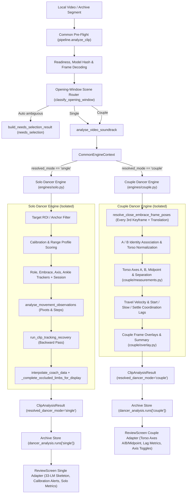
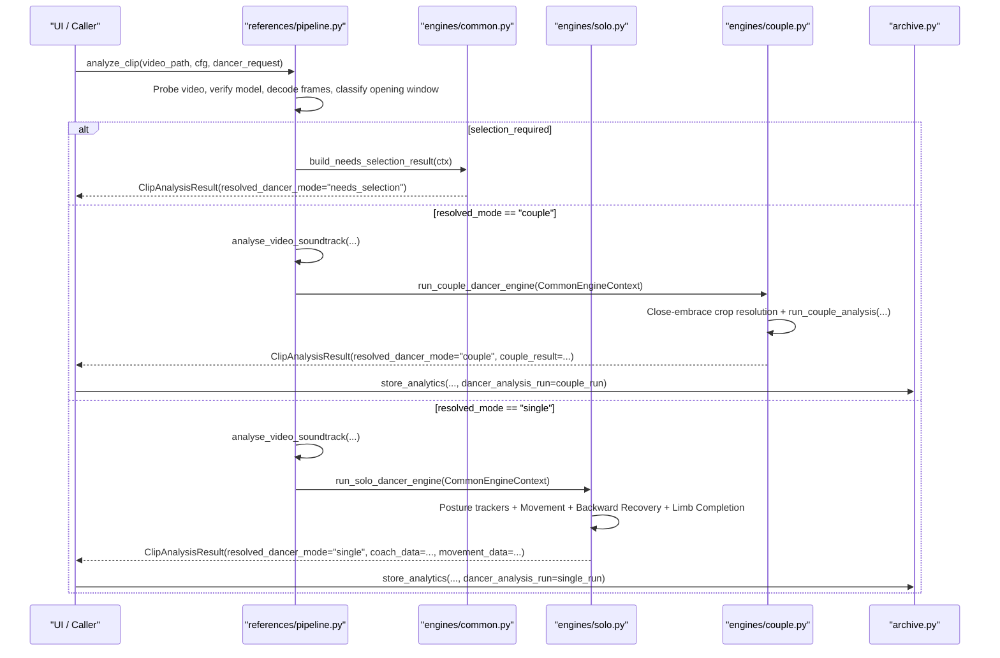

# TangoPosture Dual-Engine Architecture & Re-engineering Report

## 1. Executive Summary

Historically, TangoPosture grew by layering **Couple analysis** hooks onto an originally single-dancer pipeline (`analyze_clip` in `src/tango_posture/references/pipeline.py`, `ReviewScreen` in `src/tango_posture/desktop_qt/screens/review.py`, and `SettingsScreen` in `src/tango_posture/desktop_qt/screens/settings.py`). That shared monolith introduced cross-engine regressions:

- Couple runs inherited single-dancer 33-landmark skeletons, posture coaching tables, and Solo movement logic.
- Solo runs suffered from Couple multi-pose heuristics, strict 0.20s pivot interpolation clamps, and false shot-cut splits.
- Engine-specific settings were scattered across flat tabs mixing Single, Couple, and shared parameters.

To eliminate this coupling permanently, the analysis architecture is now re-engineered into **two completely segregated execution engines** over a **Common Infrastructure Core**:

1. **Common Core (`engines/common.py`, pre-flight in `pipeline.py`, `archive.py`, `soundtrack.py`)** — video probing, model verification, frame decoding, optional Auto opening-window classification, soundtrack beat extraction, and persisted `.tpr` / `.tp` archive versioning (`dancer_analysis.runs["single"]` and `dancer_analysis.runs["couple"]`).
2. **Solo Dancer Engine (`src/tango_posture/engines/solo.py`)** — full 33-landmark pose tracking, optional target anchoring, camera/range calibration, temporal posture coaching (head alignment, shoulder clearance, knee flexion, hip-torso curve, slow-tango ankle lifts), pivot & step detection, offline backward gap recovery, and topological limb gap completion.
3. **Couple Dancer Engine (`src/tango_posture/engines/couple.py` + `src/tango_posture/couple/`)** — two-dancer & close-embrace pose resolution, persistent Dancer A / Dancer B identity tracking, per-dancer torso axes, Couple midpoint torso axis, torso separation, travel-axis projection, center-of-mass velocity regression, start/slow/settle coordination lags, transitions, and turns.

---

## 2. Target & Implemented System Architecture

### Dispatch Sequence Between Common Core and Segregated Engines

---

## 3. Engine Specifications & Strict Isolation Contracts

### 3.1 Common Core (`src/tango_posture/engines/common.py`)
- **`CommonEngineContext`**: Immutable dataclass transferring pre-flight probe info, `Config`, model asset path and SHA-256 hash, clip `[clip_in, clip_out)` bounds, decoded frames, opening-window observations, soundtrack summary, and `AutoDecisionResult`.
- **`extract_soundtrack_beat_timestamps`**: Shared helper turning per-frame soundtrack beat state transitions into ordered beat timestamps used by both Solo tempo gating and Couple step/musical-target timing.
- **`build_needs_selection_result`**: Standard early exit when `Auto` mode detects ambiguous multi-person footage without forcing either engine.

### 3.2 Solo Dancer Engine (`src/tango_posture/engines/solo.py`)
- **Entry point**: `run_solo_dancer_engine(ctx, *, reference=..., calibration_interval=..., storage=..., estimator_factory=..., progress_callback=..., cancel_check=..., recover_tracking=..., build_coach_frame_entry=...) -> ClipAnalysisResult`
- **Responsibilities**:
  - Optional ROI/anchor isolation (`extract_single_target_observations`) only when explicitly requested.
  - Full-body posture metrics (`measure` / `measure_profile`), optional calibration generation (`calibrate`), and temporal alert state machines (`RoleTracker`, `EmbraceTracker`, `AxisCurveTracker`, `AnkleStepTracker`, `Session`).
  - Solo movement & footwork analysis (`analyse_movement_observations` in `src/tango_posture/movement.py`) detecting giros/pivots, steps, and true scene cuts.
  - Two-tier occlusion recovery preserving strict measurement isolation (`measurement_poses` never mutated):
    1. Optional offline backward pass (`run_clip_tracking_recovery` in `src/tango_posture/pose/recovery.py`).
    2. Always-on display layer completion (`interpolate_coach_data` + `_complete_occluded_limbs_for_display` in `src/tango_posture/references/coach.py`), filtering false scale-jump cuts, removing the 0.20s pivot clamp, blending anatomically valid low-confidence MediaPipe predictions, and propagating parent-relative offsets in topological joint order.
- **Forbidden**: Must never read or draw `couple_analysis` / `couple_result` overlays or emit Couple midpoint/separation series.

### 3.3 Couple Dancer Engine (`src/tango_posture/engines/couple.py` + `src/tango_posture/couple/`)
- **Entry point**: `run_couple_dancer_engine(ctx, *, estimator_factory=..., progress_callback=..., cancel_check=...) -> ClipAnalysisResult`
- **Responsibilities**:
  - Close-embrace dual-crop extraction (`resolve_close_embrace_frame_poses`) every 3rd keyframe with `(dx, dy)` torso translation propagation on intermediate frames.
  - Couple axis & coordination pipeline (`run_couple_analysis` in `src/tango_posture/couple/measurements.py`):
    - Individual torso axes (`tilt_a_deg`, `tilt_b_deg`) from mid-hip `H` to mid-shoulder `S`.
    - Couple midpoint torso axis (`couple_midpoint_tilt_deg`) from pair hip midpoint `0.5 * (H_A + H_B)` to pair shoulder midpoint `0.5 * (S_A + S_B)`.
    - Angular torso separation (`torso_separation_deg = abs(tilt_a - tilt_b)`).
    - Travel-axis projection, velocity regression, and coordination lags (`start_lag_ms`, `slow_lag_ms`, `settle_lag_ms`), transition smoothness, and turn detection.
  - Purpose-built visualization (`render_couple_frame_overlay` in `src/tango_posture/couple/overlay.py`): draws only Dancer A/B torso crossbars and axes, vertical dashed references, dashed hip/shoulder bridges, Couple midpoint axis, separation angle, ankle markers, and event cues.
- **Forbidden**: Must never draw the Solo 33-landmark green `CONNECTIONS` skeleton, run Solo `pose_recovery`, run Solo `calibrate`/posture coaching alerts, or overwrite an existing Solo run in `dancer_analysis.runs["single"]`.

---

## 4. Reorganized Settings Architecture (Common / Single / Couple)

`SETTING_GROUPS` and `SETTING_ENGINE_SCOPES` in `src/tango_posture/config.py`, together with the scope filter bar in `SettingsScreen` (`src/tango_posture/desktop_qt/screens/settings.py`), organize all **102 editable TOML parameters** and **2 Single-dancer UI tools** across **15 tabs** partitioned cleanly into three engine scopes:

| Engine Scope | Tab Count | Tabs & Ownership |
| :--- | :---: | :--- |
| **Common (Both Engines)** | 4 | `Common · Files / Models` (3 keys) `Common · Scene Routing` (10 keys) `Common · Detection / Music` (5 keys) `Common · Review / Ollama` (8 keys) |
| **Single Dancer Engine** | 9 | `Single · Camera / View` (4 keys) `Single · Quality / Calibration` (6 keys) `Single · Temporal / Smoothing` (4 keys) `Single · Head / Shoulders` (21 keys) `Single · Embrace / Knees` (11 keys) `Single · Torso / Footwork` (8 keys) `Single · Replay / Recovery` (9 keys) `Measurement normalization` (UI calibration offset panel) `Calibration defaults` (UI metric range defaults) |
| **Couple Dancer Engine** | 2 | `Couple · Tracking / Interpolation` (4 keys) `Couple · Axes / Coordination` (9 keys) |

`SettingsScreen` exposes interactive scope toggle buttons (`All`, `Common (Both Engines)`, `Single Dancer Engine`, `Couple Dancer Engine`) via `set_engine_scope(...)`, dynamically filtering visible tabs while keeping full TOML import/export compatibility (`SETTING_MAP` unchanged).

---

## 5. Technical Debt Audit: Resolved vs. Proposed Next-Phase Re-engineering

### 5.1 Technical Debt Resolved in This Iteration

| Area | Debt Before | Resolution Applied | Current State |
| :--- | :--- | :--- | :--- |
| **Engine Monolith** | `references/pipeline.py` was ~1,566 lines mixing pre-flight decode, Solo trackers, and Couple close-embrace logic inside `analyze_clip`. | Extracted `src/tango_posture/engines/` (`common.py`, `couple.py`, `solo.py`, `__init__.py`). `pipeline.py` is now `716` lines. | Clean orchestration and explicit `CommonEngineContext` boundary. |
| **Single Limb Gaps** | `interpolate_coach_data` clamped pivot gaps to `0.20s`, respected false scale-jump cuts, left boundary/low-conf limbs hidden, and skipped runs when backward recovery was off. | Added `_filter_true_cut_positions`, removed pivot clamp on display interpolation, added `_complete_occluded_limbs_for_display`, and enabled `interpolate_coach_data` unconditionally in `solo.py` and `render_review_overlays`. | `0` missing `CONNECTIONS` edges across all 4 Solo archives (`1,868` total frames). |
| **Audio-Mux Truncation** | `save_overlay_video` passed `-shortest` to `ffmpeg` with `-c:a aac`, clipping frame 440 (`440 -> 439`) and failing overlay validation. | Removed `-shortest` in `src/tango_posture/replay.py`. | Exact frame count preserved (`440/440`). |
| **Settings Organization** | 14 flat tabs mixed Single, Couple, and shared keys; `Analysis` mixed Auto scene detection with Couple coordination. | Reorganized into 15 tabs under `SETTING_ENGINE_SCOPES` (`Common`, `Single`, `Couple`) + interactive scope filter bar in `SettingsScreen`. | 100% TOML key parity (`102` settings) + clear engine scoping. |
| **Repo Lint & Typing Debt** | 55 `ruff check` issues (mostly `pose/recovery.py`, `test_pose_recovery.py`, `test_review_playback.py`) and 3 `mypy` union-attr errors in `pose/recovery.py`. | Fixed all unused imports, loop-variable bindings, comprehension types, narrowing guards, and import sorting. | `uv run ruff check src tests` (`0` errors); `mypy src/tango_posture` (`0` errors across `116` files). |

### 5.2 Proposed Next-Phase Re-engineering Roadmap

While the core engines, Settings, lint, and static types are clean, a size/complexity audit of the repository identifies five concrete architectural improvements recommended for subsequent iterations:

1. **Decompose `ReviewScreen` (`src/tango_posture/desktop_qt/screens/review.py` — 3,411 lines)**
   - **Problem**: `ReviewScreen` currently acts as video player, timeline scrubber controller, Solo calibration comparator, Couple annotation/turn editor, and metric inspector in one class.
   - **Proposal**: Split into `desktop_qt/review/` presenters:
     - `SoloReviewPresenter` (calibration combo, normalization banner, 33-LM overlay layers, posture alerts)
     - `CoupleReviewPresenter` (Dancer A/B/Midpoint checkboxes, turn/transition table, annotation undo stack, CSV export)
     - `ReviewPlaybackController` (stream switching, timer loop, video export)
     leaving `ReviewScreen` as a thin shell (~500 lines) binding the active presenter based on `active_mode`.

2. **Modularize Oversized Single-File Domains**
   - **`src/tango_posture/pose/recovery.py` (`1,985` lines)** -> Split into `pose/recovery/` (`windows.py`, `spool.py`, `reconcile.py`, `schema.py`).
   - **`src/tango_posture/movement.py` (`1,886` lines)** -> Split into `movement/` (`pivots.py`, `steps.py`, `overlay.py`, `validation.py`).
   - **`src/tango_posture/references/coach.py` (`1,687` lines)** -> Split display limb completion (`display_completion.py`), range comparison (`comparison.py`), and frame HUD rendering (`hud_overlay.py`).
   - **`src/tango_posture/couple/measurements.py` (`1,559` lines)** -> Separate `axes.py`, `kinematics.py`, `coordination.py`, and `turns.py`.
   - **`src/tango_posture/desktop_qt/screens/analytics.py` (`1,359` lines)** -> Separate Solo timeseries charts vs. Couple coordination/lag charts into dedicated widgets.

3. **Archive Schema v2: Remove Dummy Solo Shells from Couple Archives**
   - **Problem**: `archive.py` and `render_review_overlays` still expect top-level `coach_data["frames"]` and `movement_data` dicts, forcing `run_couple_dancer_engine` to allocate empty `poses=[]` shells per frame.
   - **Proposal**: Introduce optional `analytics_schema_version = 2` where `runs["couple"]` validates against `frame_timestamps` and `couple_result` alone without needing placeholder Solo structures.

4. **Single-Pass Multi-Pose Pre-Flight for Explicit Couple Runs**
   - **Problem**: When `requested_mode == "couple"` explicitly (or after Auto resolves `"couple"`), pre-flight runs `MediaPipeEstimator` first, and then `run_couple_dancer_engine` re-iterates video frames via `PoseLandmarker` for close-embrace splitting.
   - **Proposal**: Pass a pooled frame image cache or configure the initial pre-flight estimator directly with the Couple close-embrace resolver when `requested_mode == "couple"`, cutting Couple clip analysis time roughly in half.

5. **Scoped TOML Persistence Without Breaking Existing Configs**
   - **Problem**: In `Config` / `DancerAnalysisConfig`, Couple settings and Common scene-routing settings still share `[dancer_analysis]` in `settings.toml`, while Solo settings sit at top level.
   - **Proposal**: Support structured `[engine.common]`, `[engine.solo]`, and `[engine.couple]` TOML tables in `config.py` with automatic flat-key migration on `load(...)` so `settings.toml` stays human-readable while preserving backward compatibility with existing config files.
