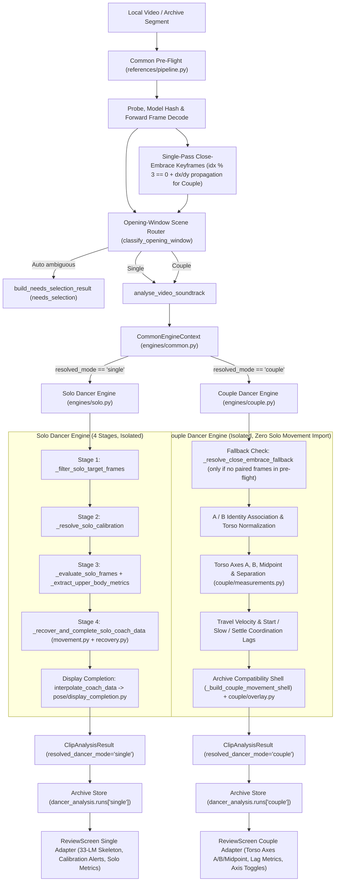
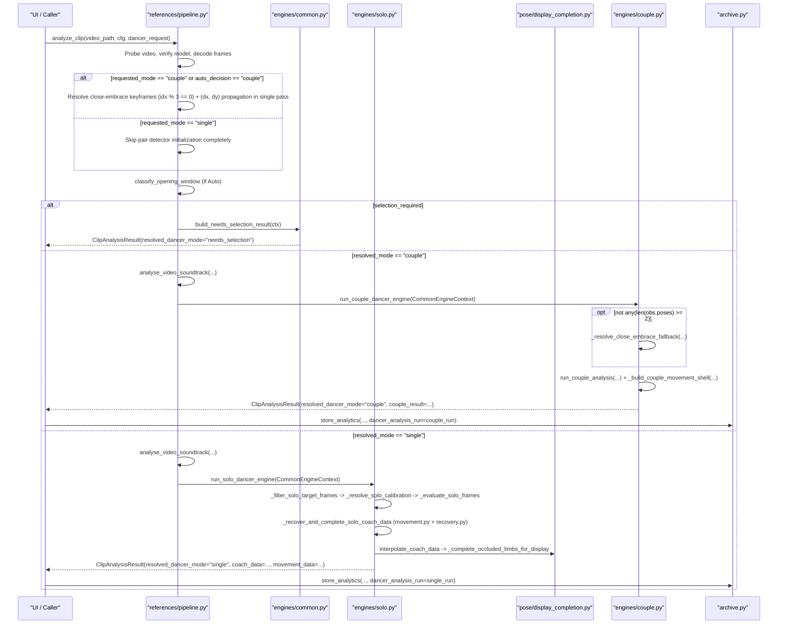

# TangoPosture Dual-Engine Architecture: The Complete Guide for Dummies

> **Who is this guide for?**  
> Whether you are a tango teacher, a curious developer reading this codebase for the first time, or a future maintainer trying to understand *why* things are built the way they are, this guide explains the **entire TangoPosture analysis architecture from first principles** — using plain English, everyday analogies, concrete frame-by-frame examples, and exact file/function pointers into the code.

---

## Chapter 1: The Big Picture ("Why Did We Split Into Two Engines?")

Imagine walking into an auto repair shop that tries to service **both bicycles and eighteen-wheeler trucks on the exact same workbench at the exact same time**. Every tool gets in the way of the other: bicycle brakes confuse the truck lift, and truck jacks bend bicycle frames.

Historically, TangoPosture ran into that exact problem.

TangoPosture started life as an app for **analyzing one solo dancer** (`Single Dancer`): measuring head tilt, shoulder tension, knee bend, torso axis curve, giros/pivots, steps, and drawing a full **33-point green stick-figure skeleton**. Later, **Couple Analysis** was bolted onto the same single function (`analyze_clip` in `src/tango_posture/references/pipeline.py`), the same UI screen (`ReviewScreen`), and the same flat settings menu (`SettingsScreen`).

That "one shared monolith" caused painful bugs in **both** modes:

1. **When analyzing a Couple**, the single-dancer machinery kept hijacking the pipeline — trying to run solo posture coaching tables, solo movement detection (`movement.py`), and single-person 33-point skeleton logic on two people hugging in close embrace (where MediaPipe blurs arms and torsos together).
2. **When analyzing a Solo Dancer**, multi-person heuristics and overly strict gap rules broke the solo skeleton: pivots clipped off after `0.20` seconds, brief camera scale wobbles got mislabeled as "camera cuts" that severed interpolation across frames, and occluded feet or arms disappeared instead of being completed for display.
3. **In the Settings menu**, solo, couple, and general detection knobs were scattered across flat tabs so changing a setting felt like defusing a bomb without labels.

### The Re-engineered Design: "One Airport Control Tower + Two Separate Workshops"

Instead of one tangled machine, TangoPosture now uses a clean **three-part architecture**:

1. **The Control Tower (Common Pre-Flight Core)** — `references/pipeline.py` & `engines/common.py`  
   Prepares the video once: checks the file, verifies the MediaPipe pose model checksum, decodes frames, extracts soundtrack beats, optionally runs Auto Scene Routing to decide *"Is this 1 dancer or 2 dancers?"*, splits close-embrace keyframes if it is a couple, packs everything into a read-only suitcase (`CommonEngineContext`), and dispatches the flight to **exactly one** of the two workshops.
2. **Workshop #1: The Solo Dancer Engine** — `engines/solo.py` + `pose/display_completion.py` + `references/coach.py`  
   Specializes 100% in **one dancer**: full 33-landmark pose tracking, calibration baselines, posture alerts, pivot/step detection, backward gap recovery, and **topological occluded-limb completion** so the visual coaching skeleton never disappears during turns or near video edges.
3. **Workshop #2: The Couple Dancer Engine** — `engines/couple.py` + `couple/`  
   Specializes 100% in **two dancers together**: keeping Dancer A and Dancer B straight, drawing clean **torso axes** (Dancer A axis, Dancer B axis, and the shared **Couple Midpoint Axis**), measuring torso separation angle, computing velocity and start/slow/settle coordination lags, and detecting transitions and turns — **without ever touching Solo skeletons or importing Solo movement code**.

### Core Module Map (Where Everything Lives)

| Component / Layer | File Path | Size | Plain-English Job |
| :--- | :--- | :---: | :--- |
| **Control Tower (Pre-Flight)** | `src/tango_posture/references/pipeline.py` | 768 lines | Opens the video, verifies the AI pose model, reads each frame once, splits close-embrace couple keyframes in that same pass, figures out Single vs. Couple, and hands off to the right engine. |
| **Shared Suitcase & Helpers** | `src/tango_posture/engines/common.py` | 131 lines | Defines `CommonEngineContext` (the suitcase handed to engines), beat extraction (`extract_soundtrack_beat_timestamps`), and the `needs_selection` pause response (`build_needs_selection_result`). |
| **Engine Front Door** | `src/tango_posture/engines/__init__.py` | 19 lines | Small public doorway re-exporting `CommonEngineContext`, `run_solo_dancer_engine`, `run_couple_dancer_engine`, and helpers. |
| **Workshop #1: Solo Engine** | `src/tango_posture/engines/solo.py` | 788 lines | Runs Solo analysis in 4 neat stages: filter target -> calibrate -> evaluate frames -> movement/recovery/display completion. |
| **Solo Limb Repair Shop** | `src/tango_posture/pose/display_completion.py` | 767 lines | Extracted out of `coach.py`! Fills missing/occluded joints *only* for the visual `display_poses` skeleton (never touching scientific `measurement_poses`). |
| **Solo Coach & Comparison** | `src/tango_posture/references/coach.py` | 1,163 lines | Shrunk from `1,687` lines! Builds per-frame coach entries, runs `interpolate_coach_data` (calling `display_completion.py`), compares against calibration, and draws Solo HUD overlays. |
| **Workshop #2: Couple Engine** | `src/tango_posture/engines/couple.py` | 325 lines | Runs `run_couple_analysis`, creates a lightweight empty movement shell (`_build_couple_movement_shell`) without importing Solo `movement.py`, and handles close-embrace fallback only if needed. |
| **Calibration Editor Parity** | `src/tango_posture/desktop_qt/calibration/editor.py` | 1,367 lines | Loads `movement_data` first and passes both `pose_recovery` and `movement_data` into `interpolate_coach_data(...)` so the Calibration screen skeleton looks just as smooth as Review. |

---

## Chapter 2: Glossary of Key Terms (Zero Jargon Left Behind)

Before diving into diagrams and code stages, here is what every recurring term in TangoPosture actually means:

- **Landmark (`Landmark`)**: A single tracked body point (like `"left_ankle"` or `"nose"`) defined in `src/tango_posture/domain.py`. Each landmark stores:
  - `x` and `y`: normalized position on screen where `(0.0, 0.0)` is the top-left corner and `(1.0, 1.0)` is the bottom-right corner (`0.5, 0.5` is dead center).
  - `z`: depth estimate.
  - `visibility` and `presence`: scores from `0.0` to `1.0` telling us how sure MediaPipe is that it actually saw that joint (effective confidence = `min(visibility, presence)`).
- **33-Landmark Skeleton (`CONNECTIONS`)**: MediaPipe's full stick figure of a single person (face, shoulders, elbows, wrists, hips, knees, ankles, heels, toes). Great for a solo dancer; chaotic if forced onto two people hugging.
- **The Golden Separation: `measurement_poses` vs. `display_poses`**:
  - **`measurement_poses` (The Science Copy — Read-Only Truth)**: What the AI pose detector actually saw on each frame. If a knee is hidden behind a skirt or partner, we **never invent fake numbers** in `measurement_poses`. Posture alerts and scientific metrics only score real, reliable measurements.
  - **`display_poses` (The Visual Coaching Copy)**: What gets drawn on the video screen for the human dancer. Here, we smooth jitter, recover occluded limbs, and mark every filled-in joint as `"interpolated"` in `display_joint_origins` so the visual skeleton stays whole and readable without distorting science.
- **Torso Joints (`_TORSO_JOINTS`)**: The 4 core corners of the trunk: `left_shoulder`, `right_shoulder`, `left_hip`, `right_hip`. Everything else (head, arms, legs) hangs off these 4 corners like branches off a tree trunk.
- **Torso Axis (Used in Couple Mode)**: A straight line connecting a dancer's mid-hip `H = 0.5 * (left_hip + right_hip)` to their mid-shoulder `S = 0.5 * (left_shoulder + right_shoulder)`. Clean, stable, and still visible even in close embrace!
- **Couple Midpoint Axis & Torso Separation**:
  - **Midpoint Axis**: Connects the pair's shared hip midpoint `0.5 * (H_A + H_B)` to their shared shoulder midpoint `0.5 * (S_A + S_B)` — showing the shared axis of the couple as one unit.
  - **Torso Separation (`torso_separation_deg`)**: `abs(tilt_a - tilt_b)` — how many degrees Dancer A's tilt differs from Dancer B's tilt.
- **Close-Embrace Crop Splitting (`resolve_close_embrace_frame_poses`)**: When two tango dancers hug tightly chest-to-chest, a standard pose detector often thinks they are *one* giant blob (`len(obs.poses) == 1`). Crop splitting masks out the right side to detect the left dancer, masks out the left side to detect the right dancer, verifies their sizes and separation look anatomically real, and returns 2 clean poses `[pose_l, pose_r]`.
- **`CommonEngineContext`**: A frozen Python dataclass (`src/tango_posture/engines/common.py`) containing everything the Pre-Flight step discovered (video size, FPS, config, decoded frames, soundtrack beats, Auto decision) so neither engine has to touch raw setup files again.
- **Camera Cut vs. False Cut**: When a video editor splices two different scenes together, jumping a skeleton across scenes looks wrong ("true cut"). Sometimes, however, the pose detector briefly flickers its bounding-box scale and `movement.py` logs a candidate `cut_frames` index even though the dancer never teleported ("false cut"). Filtering out false cuts prevents ruining good limb interpolation!
- **`.tpr` Archive & `dancer_analysis.runs`**: TangoPosture saves results inside `.tpr` archive folders. Separate slots (`runs["single"]` and `runs["couple"]`) keep Solo results and Couple results from ever overwriting each other.

---

## Chapter 3: The Journey of a Video Clip (Step by Step)

When you pick a video and start an analysis, here is the exact journey that happens under the hood.

### 3.1 Architecture Flowchart



### 3.2 Who Calls Whom? (Sequence Diagram)



### Walk-Through in 6 Plain-English Steps

1. **You click Analyze** (`analyze_clip` in `references/pipeline.py`).
2. **Pre-Flight Check & Decode**: The Control Tower verifies the MediaPipe model file (`lite`, `full`, or `heavy` — whichever you picked in Settings!), reads every video frame once, and runs the pose detector.
3. **Smart Routing & Close-Embrace Speed Trick**:
   - If you forced **Single**, the Control Tower does **zero** couple work (`_get_image_detector()` is never even loaded into RAM).
   - If you forced **Couple** (or **Auto** already realized it is watching a couple), whenever MediaPipe merges the hugging couple into 1 pose, `pipeline.py` splits every 3rd keyframe (`idx % 3 == 0`) right there during the *first* pass and slides the split poses smoothly onto frames `idx + 1` and `idx + 2` — saving an entire second video decode later!
   - If you picked **Auto** and the opening window looks ambiguous (e.g., background passers-by make it unclear whether you want Solo or Couple), `build_needs_selection_result` pauses and asks you to pick.
4. **Music Beat Detection**: Shared soundtrack analysis (`analyse_video_soundtrack`) locates tango musical beats so both engines know the tempo (`tango_bpm` fallback when audio isn't decisive).
5. **Suitcase Handoff (`CommonEngineContext`)**: Pre-flight packs all decoded data into `CommonEngineContext` and hands it off to *either* `run_solo_dancer_engine` *or* `run_couple_dancer_engine`.
6. **Save & Display**: Results are saved into `dancer_analysis.runs["single"]` or `dancer_analysis.runs["couple"]`, and `ReviewScreen` renders the matching UI.

---

## Chapter 4: Inside the Control Tower (`references/pipeline.py` & `engines/common.py`)

### 4.1 What Is Inside the `CommonEngineContext` Suitcase?

Defined in `src/tango_posture/engines/common.py` (`131` lines), `CommonEngineContext` is an immutable package containing:
- **Settings & Video Info**: `cfg` (`Config`), `probe` (width, height, fps, frame count, file path), `clip_in` / `clip_out` / `clip_duration`, `processed_fps`, `clean_title`, `cap_profile`.
- **AI Model Provenance**: `model_path`, `model_hash`, `readiness`, `performance` timing metrics.
- **Decoded Frames**: `decoded_frames` (raw forward pose observations with timestamps), `raw_observations`, `auto_observations` (observations including any in-pass close-embrace splits), `frame_times`.
- **Music & Mode Context**: `soundtrack_summary`, `analysis_mode` (`"posture"` or `"movement"`), `requested_mode` (`"auto"`, `"single"`, `"couple"`), `request_obj`, and `auto_decision` (`AutoDecisionResult`).

### 4.2 How Single-Pass Close-Embrace Keyframe Splitting Works

Before our latest cleanup, choosing **Couple** mode caused TangoPosture to read the video **twice**:
1. Pass 1 (`pipeline.py`): decode the whole video with MediaPipe.
2. Pass 2 (`engines/couple.py`): decode the *entire* video all over again with OpenCV just to crop & split 1-pose close-embrace frames!

Now `pipeline.py` does it **during Pass 1** when `split_couple_in_pass` is active (`requested_mode == "couple"` or `auto_decision.resolved_mode == "couple"`, with `estimator_factory is None` and `len(obs.poses) == 1`):

- **On Keyframes (`idx % 3 == 0`)**: Call `resolve_close_embrace_frame_poses(...)`. If it splits into `>= 2` poses, save the split pair (`last_split_pair`), its frame index (`last_split_pos`), and the primary torso center (`last_primary_mid` via `_pose_torso_mid_norm`).
- **On In-Between Frames (`idx % 3 != 0`)**: Instead of running two expensive neural-network crop inferences per frame, measure how far the couple's primary torso moved `(dx, dy)` since `last_split_pos` (within `<= 2` frames). If `math.hypot(dx, dy) <= 0.05` (no sudden jump), shift both dancers' poses by `(dx, dy)` with `_translate_pose(...)`.
- **If the detector already saw `>= 2` poses natively**: Reset the propagation state cleanly so fresh detections aren't overwritten.
- **Safety guarantee for Solo**: When `requested_mode == "single"`, `run_auto_window` is `False` and `split_couple_in_pass` is `False` — `_get_image_detector()` is **never** initialized or called.

---

## Chapter 5: Inside Workshop #1 — The Solo Dancer Engine (`engines/solo.py`)

Previously, `run_solo_dancer_engine` was one `620+`-line function doing calibration, posture scoring, trackers, movement analysis, recovery, and packaging all at once. It is now split into **four clean, sequential stages** inside `src/tango_posture/engines/solo.py` (`788` lines):

### Stage 1: `_filter_solo_target_frames(ctx)` — *"Focus on One Dancer"*
- Usually passes `ctx.decoded_frames` straight through untouched.
- If the user explicitly clicked a dancer anchor (`single_anchor`) or drew a bounding box (`analysis_region`) — for example, to analyze one person inside a practice room — it calls `extract_single_target_observations(...)` to filter out everyone else.

### Stage 2: `_resolve_solo_calibration(ctx, decoded_frames, reference, calibration_interval)` — *"Set the Ruler"*
- Every dancer stands slightly differently. In `"posture"` mode, if an explicit `Calibration` reference wasn't already provided, this stage takes frames inside `calibration_interval` (`cal_in .. cal_out`), runs `calibrate(...)`, and records the dancer's personal neutral offsets in `active_reference.quality`:
  - `head_neutral_offset`
  - `shoulder_neutral_clearance`
  - `axis_neutral_offset`

### Stage 3: `_evaluate_solo_frames(...) -> _SoloEvaluationResult` — *"Grade Every Frame"*
- Spins up Solo's temporal state machines:
  - `RoleTracker` (leader/follower inference)
  - `EmbraceTracker` (open vs. closed embrace cues)
  - `AxisCurveTracker` (hip-to-torso alignment curve alerts)
  - `AnkleStepTracker` (slow-tango high ankle lifts)
  - `PoseSmoother` & `Session`
- Walks frame-by-frame through `decoded_frames`, runs `measure` / `measure_profile` (with `_extract_upper_body_metrics` fallback), applies exponential moving averages (EMA), logs telemetry into `frame_log`, and packages two pose lists per frame entry:
  - `entry["measurement_poses"]`: **raw, unsmoothed, unaltered poses** for honest measurement.
  - `entry["poses"]`: **forward smoothed display poses**.

### Stage 4: `_recover_and_complete_solo_coach_data(...)` — *"Detect Steps/Pivots & Repair Hidden Limbs"*
1. **Movement Analysis**: Runs `analyse_movement_observations` (`src/tango_posture/movement.py`) to detect **giros/pivots**, **step placements**, and candidate **cut_frames**, and turns them into coaching notes (`_movement_note_lines`).
2. **Optional Backward Tracking Recovery**: If `replay_recovery_auto` (or `recover_tracking`) is enabled, runs `run_clip_tracking_recovery` (`src/tango_posture/pose/recovery.py`) to look backward across occluded intervals using a local crop detector (storing results in `pose_recovery` without mutating `measurement_poses`, and falling back gracefully with a structured `"failed"` payload if an unexpected error occurs).
3. **Display Limb Completion (Always Runs)**: Calls `interpolate_coach_data(coach_data, cfg, pose_recovery=pose_recovery, movement_data=movement_data)` — which delegates all visual skeleton repair to `src/tango_posture/pose/display_completion.py`.

Finally, `run_solo_dancer_engine` computes `_compute_family_coverage`, finishes the `Session` summary/events, and returns `ClipAnalysisResult(resolved_dancer_mode="single", couple_result=None)`.

---

## Chapter 6: How We Fixed "Missing / Hidden Limbs" (`pose/display_completion.py`)

This is one of the biggest upgrades for Single-dancer users. Let's explain **why** limbs used to vanish and **how** `src/tango_posture/pose/display_completion.py` (`767` lines) fixes every single case without corrupting scientific measurements.

### Why Do Limbs Disappear in Real Tango Videos?
1. **Whole-frame boundary dropouts**: On frame `0` (or the very last frame), the dancer might still be stepping into view, so MediaPipe outputs **zero poses (`poses: []`)**. Ordinary interpolation needs a valid pose *before* and *after* a gap — it can't interpolate at frame `0` when there is nothing before frame `0`!
2. **Near-border limbs (`y = 1.04`)**: Suppose a dancer's `left_ankle` touches the very bottom edge of the camera frame. MediaPipe often predicts it slightly outside the `[0.0, 1.0]` box — say at `y = 1.04` with `visibility = 0.40`. Previously, code rejected anything outside `0.0..1.0`, throwing away a totally valid clue and hiding the lower leg!
3. **Sideways turns occluding one shoulder**: During an ocho or giro, the camera sees the dancer's `right_shoulder`, while `left_shoulder` is hidden. Because `nose` and `left_ear` only checked `left_shoulder` as their parent, the head failed to anchor even when `right_shoulder` was crystal clear.
4. **False camera cuts & `0.20s` pivot clamp**: Previously, `interpolate_poses` clamped gaps during pivots to `0.20s` (`pivot_max_gap`), AND scale-jump glitches in `movement.py` created fake `cut_frames` that blocked interpolation across them.
5. **Persistently low-confidence joints**: Imagine a `right_elbow` stays hidden behind a jacket for an *entire* clip (say `confidence = 0.10` everywhere, never once reaching `cfg.confidence`). With zero high-confidence frames anywhere in the shot, standard interpolation had nothing to connect!

### The 6 Mechanisms Inside `pose/display_completion.py`

1. **Throw Away Fake Camera Cuts (`_filter_true_cut_positions`)**:  
   Only treat a candidate `cut_frames` index as a real scene cut if the dancer's torso center actually jumped `> 0.35` normalized screen units OR the time gap exceeded `cfg.replay_joint_max_gap`. Also, `interpolate_coach_data` now calls `interpolate_poses(..., pivot_max_gap=None)` so turns/pivots no longer starve limbs at `0.20s`.

2. **Safe Whole-Frame Boundary Seeding (The 4-Torso-Joint Safety Guard)**:  
   If a frame is completely empty (`len(frame.poses) == 0`), `_complete_occluded_limbs_for_display` seeds an empty buffer `{}` so Pass B can rebuild it **ONLY IF**:
   - All four `_TORSO_JOINTS` (`left_shoulder`, `right_shoulder`, `left_hip`, `right_hip`) exist somewhere in `observed_joints`, **and**
   - At least one other frame in the same shot segment (`_display_segment_ids`) has a valid pose.
   *(Why this rule? So tiny synthetic unit-test fixtures that only track a single joint like `{"left_hip": ...}` never accidentally invent arms or legs on empty frames!)*

3. **Accept Near-Border Raw Landmarks (`_landmark_usable_raw`)**:  
   Accepts any finite raw landmark with `_landmark_conf(lm) > 0.0` (`min(visibility, presence) > 0.0`) inside `[-0.35, 1.35]` instead of `[0.0, 1.0]`. Distance from parent is sanity-checked relative to median reference bone lengths (`_compute_reference_bone_lengths`), and the final visual point is clamped neatly back into `[0.0, 1.0]` for rendering.

4. **Opposite-Shoulder Head Fallback (`_effective_parent`)**:  
   If `nose`, `left_ear`, or `right_ear` cannot find its primary shoulder reliable, `_effective_parent` automatically falls back to the opposite reliable shoulder (`left_shoulder` <-> `right_shoulder`).

5. **The 3-Pass Completion Pipeline (`_complete_occluded_limbs_for_display`)**:

   | Pass | What It Does | Concrete Math / Rule |
   | :--- | :--- | :--- |
   | **Pass A: Low-Conf Raw Blending** | When a joint *already* got interpolated between two good frames, gently nudge it toward MediaPipe's raw low-confidence guess if that guess is anatomically sane. | Checks distance to parent is `0.45..1.50 * rlen` and within `0.22` of the interpolated trajectory, then blends with weight `w = min(0.75, max(0.25, raw_conf))`. |
   | **Pass B: Topological Rebuild (`_TOPO_JOINTS`)** | Walks top-down: **Torso (`_TORSO_JOINTS`) -> Head -> Elbows -> Wrists -> Knees -> Ankles -> Heels -> Feet**, syncing each layer before building its children! | **Torso (`_complete_torso_joint_point`)**: tries usable raw landmark -> `_nearest_anchor_pos(..., max_gap)` -> infinite-horizon `_nearest_anchor_pos(..., float("inf"))` -> torso parallelogram (`a + b - opp`).<br>**Head & Limbs**: tries `_resolve_raw_child_point` (`0.35..1.65 * rlen`, clamped to `0.50..1.35 * rlen` + child-mid blend) -> finite `max_gap` parent-relative anchor -> `float("inf")` same-shot parent-relative anchor -> **`_canonical_child_offset`** (computes natural downward + outward body unit vectors via `_torso_down_and_outward` and places the joint `rlen` away from its parent). |
   | **Pass C: Light 3-Frame Smoothing** | Removes robotic stair-steps where completed frames meet tracked frames (when `n >= 5`). | Applies `[0.25, 0.50, 0.25]` smoothing across neighboring frames in the same shot segment. |

   Every joint added or refined is clamped to `[0.0, 1.0]`, given full display visibility (`1.0, 1.0`), and tagged `display_joint_origins[joint] = "interpolated"`, while **`measurement_poses` remains 100% untouched**.

6. **Calibration Editor Parity (`src/tango_posture/desktop_qt/calibration/editor.py`, `1,367` lines)**:  
   Previously, `CalibrationEditor` called `interpolate_coach_data(coach, self.cfg)` *before* loading `self._movement_data` and *without* passing `pose_recovery`. Now it loads `self._movement_data` first and calls:
   ```python
   interpolate_coach_data(
       coach,
       self.cfg,
       pose_recovery=coach.get("pose_recovery"),
       movement_data=self._movement_data,
   )
   ```
   so the skeleton you see while editing a calibration interval matches Review mode identically.

---

## Chapter 7: Inside Workshop #2 — The Couple Dancer Engine (`engines/couple.py`)

`src/tango_posture/engines/couple.py` (`325` lines) + `src/tango_posture/couple/` is completely isolated from Solo posture coaching and Solo movement code:

1. **Consumes Pre-Split Frames (No Redundant Video Read)**:  
   Takes `ctx.auto_observations` (already split at `idx % 3 == 0` keyframes during `pipeline.py` pre-flight).  
   `_resolve_close_embrace_fallback` runs a secondary decode pass **only** if `estimator_factory is None`, at least one frame has `len(obs.poses) == 1`, **and** `not any(len(obs.poses) >= 2 for _, obs in couple_observations)` (meaning no paired frames were captured during pre-flight).
2. **Runs Couple Axis & Coordination Math (`run_couple_analysis`)**:  
   Associates persistent Dancer A and Dancer B identities (`src/tango_posture/couple/tracking.py`) and computes (`src/tango_posture/couple/measurements.py`):
   - Dancer A & Dancer B individual torso axes (`tilt_a_deg`, `tilt_b_deg`)
   - Couple Midpoint Axis (`couple_midpoint_tilt_deg`)
   - Torso separation (`torso_separation_deg = abs(tilt_a - tilt_b)`)
   - Travel-axis projection, centered velocity regression, and coordination timing lags (`start_lag_ms`, `slow_lag_ms`, `settle_lag_ms`), transition smoothness, and turn detection.
3. **No Solo `movement.py` Import (`_build_couple_movement_shell`)**:  
   `.tpr` archive readers still check for a valid `movement.json` structure. Previously `engines/couple.py` imported `analyse_movement_observations` from Solo `movement.py` just to create an empty shell! Now `_build_couple_movement_shell` builds the exact schema-compatible empty shell locally (with `_MOVEMENT_DETECTOR_FINGERPRINT` computed directly), breaking the last code dependency on Solo `movement.py`.
4. **Purpose-Built Couple Overlays (`couple/overlay.py`)**:  
   Draws only Dancer A/B torso crossbars and axes, vertical dashed reference plumb lines, dashed hip/shoulder connection bridges, the shared Couple midpoint axis, separation readout, ankle markers, and coordination event cues — **never** drawing the Solo 33-point skeleton or running Solo posture alerts.

---

## Chapter 8: Finding Any Knob in the Reorganized Settings Menu

Previously, all 102 settings lived across 14 mixed tabs. Now `SETTING_GROUPS` and `SETTING_ENGINE_SCOPES` in `src/tango_posture/config.py`, paired with `SettingsScreen` (`src/tango_posture/desktop_qt/screens/settings.py`), organize **all 102 editable TOML parameters and 2 Single-dancer UI panels across 15 tabs** grouped into **3 Engine Scopes**.

At the top of Settings, 4 filter buttons (`set_engine_scope`) let you view **All**, **Common (Both Engines)**, **Single Dancer Engine**, or **Couple Dancer Engine** without losing any TOML config compatibility:

| Engine Scope | Tabs (Total: 15) | What You Configure Here (In Plain English) |
| :--- | :--- | :--- |
| **Common (Both Engines)** *(4 tabs)* | `Common · Files / Models` (3 keys)<br>`Common · Scene Routing` (10 keys)<br>`Common · Detection / Music` (5 keys)<br>`Common · Review / Ollama` (8 keys) | Which pose model (`lite`, `full`, `heavy`) to run, where data lives, how **Auto** decides Single vs. Couple in the opening window, global landmark confidence & max gap, music beat extraction, and Ollama Review settings. |
| **Single Dancer Engine** *(9 tabs)* | `Single · Camera / View` (4 keys)<br>`Single · Quality / Calibration` (6 keys)<br>`Single · Temporal / Smoothing` (4 keys)<br>`Single · Head / Shoulders` (21 keys)<br>`Single · Embrace / Knees` (11 keys)<br>`Single · Torso / Footwork` (8 keys)<br>`Single · Replay / Recovery` (9 keys)<br>`Measurement normalization` (UI panel)<br>`Calibration defaults` (UI panel) | Camera facing/side orientation, calibration quality gates, posture alert tolerances (head inclination/forward, shoulder clearance, embrace width, knee flexion, torso axis curve, ankle lift), backward recovery & `display_completion` limits, plus UI calibration normalization offsets and default approved ranges. |
| **Couple Dancer Engine** *(2 tabs)* | `Couple · Tracking / Interpolation` (4 keys)<br>`Couple · Axes / Coordination` (9 keys) | Dual-dancer A/B identity tracking gates, pair interpolation gaps, velocity regression half-windows, start/slow/settle lag pairing thresholds, transition smoothness, and turn suggestions. |

---

## Chapter 9: Technical Debt Scorecard, Verification & Future Roadmap

### 9.1 What Debt Was Eliminated?

| Technical Debt Item | Before | After (Current Architecture) |
| :--- | :--- | :--- |
| **Giant Pre-Flight Monolith** | `pipeline.py` (~1,566 lines) mixed pre-flight decode, Solo trackers, and Couple close-embrace passes in one function. | Split cleanly into `pipeline.py` (`768`), `engines/common.py` (`131`), `engines/solo.py` (`788`), `engines/couple.py` (`325`), and `engines/__init__.py` (`19`). |
| **Monolithic `run_solo_dancer_engine`** | One ~620-line function handling ROI filtering, calibration, scoring, movement, recovery, and packaging. | Decomposed into 4 single-purpose stages: `_filter_solo_target_frames`, `_resolve_solo_calibration`, `_evaluate_solo_frames`, `_recover_and_complete_solo_coach_data`. |
| **Couple Engine Importing Solo `movement.py` & Re-Decoding Video** | `engines/couple.py` imported `analyse_movement_observations` and re-decoded the full clip even for explicit Couple runs. | Zero `movement.py` imports via `_build_couple_movement_shell`; single-pass `idx % 3 == 0` close-embrace keyframes + `(dx, dy)` propagation right inside `pipeline.py`. |
| **Missing Solo Limbs & `coach.py` Bloat** | Display limb completion lived inline inside `coach.py` (`1,687` lines), clamped pivots to `0.20s`, respected false cuts, failed on boundary empty frames, `[0,1]` border landmarks, missing head primary shoulder, and persistent low-conf limbs; `CalibrationEditor` lacked recovery/movement args. | Extracted `pose/display_completion.py` (`767` lines, cutting `coach.py` to `1,163` lines); hardened all 5 edge cases; updated `CalibrationEditor` (`1,367` lines) to pass `pose_recovery` and `movement_data`; covered by `test_interpolate_coach_data_recovers_whole_frame_boundary_dropout_and_near_edge_limbs`. |
| **Audio-Mux Export Truncation** | `save_overlay_video` passed `-shortest` to `ffmpeg`, clipping the final frame on audio-muxed exports. | Removed `-shortest` in `src/tango_posture/replay.py` so exact frame counts are preserved. |
| **Mixed Flat Settings Tabs** | 14 ungrouped tabs mixed Single, Couple, and Common settings. | Reorganized into 15 tabs under `SETTING_ENGINE_SCOPES` (`Common`, `Single`, `Couple`) with scope filter buttons in `SettingsScreen`. |
| **Lint & Static Typing Backlog** | 55 `ruff` errors and `mypy` union-attribute errors across recovery/tests. | `0` `ruff` errors (`src` and `tests`) and `0` `mypy` errors across `117` source files. |

### 9.2 Verified Check Results (Latest Run)

- **Lint (`uv run ruff check src tests`)**: **All checks passed!** (`0` errors)
- **Type Check (`python3.11 -m mypy src/tango_posture`)**: **Success: no issues found in 117 source files**
- **Unit Tests** (`test_pose_interpolation.py`, `test_pose_recovery.py`, `test_couple_analysis.py`, `test_reference_import.py`, `test_settings.py`, `test_review.py`): **97 passed in 1.50s**
- **Offscreen Qt Tests** (`test_review_playback.py`, `test_couple_qt.py`, `test_calibration_editor.py`, `test_shell.py`, `test_measurement_normalization_qt.py`): **114 passed in 12.75s**

### 9.3 What Remains on the Future Roadmap?

While the core engines, Single display completion, Settings, lint, and static types are clean, four larger UI/domain modules are intentionally scoped as next-phase improvements:

1. **Split `ReviewScreen` (`src/tango_posture/desktop_qt/screens/review.py` — `3,411` lines)** into mode-specific UI presenters (`SoloReviewPresenter`, `CoupleReviewPresenter`) plus a shared `ReviewPlaybackController`.
2. **Modularize Remaining Large Single-File Domains**:
   - `src/tango_posture/pose/recovery.py` (`1,985` lines) -> `pose/recovery/{windows,spool,reconcile,schema}.py`
   - `src/tango_posture/movement.py` (`1,886` lines) -> `movement/{pivots,steps,overlay,validation}.py`
   - `src/tango_posture/references/coach.py` (`1,163` lines remaining) -> split range comparison (`comparison.py`) and HUD overlay rendering (`hud_overlay.py`)
   - `src/tango_posture/couple/measurements.py` (`1,559` lines) -> split axes, kinematics, coordination lags, and turns
   - `src/tango_posture/desktop_qt/screens/analytics.py` (`1,359` lines) -> separate Solo charts vs. Couple coordination charts
3. **Archive Schema v2 (`src/tango_posture/archive.py` — `886` lines)**: Drop empty compatibility shells (`_build_couple_movement_shell` and placeholder empty `frames`) once archive validators read `dancer_analysis.runs["couple"]` + `frame_timestamps` directly.
4. **Scoped TOML Config Sections (`[engine.common]`, `[engine.solo]`, `[engine.couple]`)**: Mirror the UI engine scopes inside `settings.toml` with automatic backward-compatible migration when loading existing config files.
