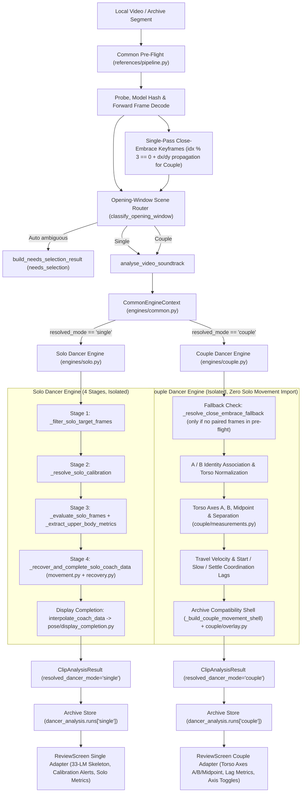
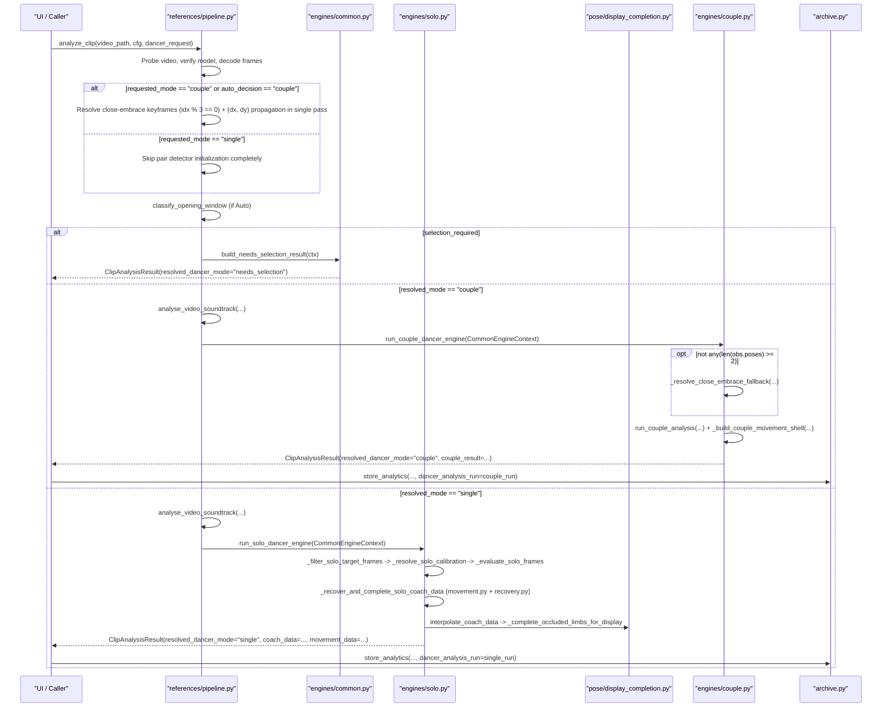

# TangoPosture Dual-Engine Architecture & Re-engineering Report

## 1. Executive Summary & Core Module Inventory

Historically, TangoPosture grew by layering **Couple analysis** hooks onto an originally single-dancer pipeline (`analyze_clip` in `src/tango_posture/references/pipeline.py`, `ReviewScreen` in `src/tango_posture/desktop_qt/screens/review.py`, and `SettingsScreen` in `src/tango_posture/desktop_qt/screens/settings.py`). That shared monolith introduced cross-engine regressions and technical debt:

- Couple runs inherited Single-dancer 33-landmark skeletons, Solo posture coaching tables, Solo `movement.py` analysis calls, and duplicate full-video close-embrace passes.
- Single-dancer runs suffered from Couple multi-pose heuristics, a `0.20s` pivot interpolation clamp, false shot-cut splits, and unrecovered whole-frame boundary dropouts, near-edge landmarks, opposite-shoulder head occlusions, and persistently low-confidence limb joints.
- Engine-specific settings were scattered across flat tabs mixing Common, Single, and Couple parameters.

The analysis stack is now re-engineered into **two completely segregated execution engines** over a **Common Infrastructure Core**, supported by a dedicated **Single Display Limb Completion** module:

| Component / Layer | Module Path | Lines | Primary Responsibility |
| :--- | :--- | :---: | :--- |
| **Common Pre-Flight & Dispatcher** | `src/tango_posture/references/pipeline.py` | 768 | Video probing, model verification, frame decoding, opening-window scene routing, soundtrack extraction, single-pass Couple close-embrace keyframe resolution, and engine dispatch. |
| **Common Engine Contracts** | `src/tango_posture/engines/common.py` | 131 | `CommonEngineContext`, `extract_soundtrack_beat_timestamps`, and `build_needs_selection_result`. |
| **Engine Package Facade** | `src/tango_posture/engines/__init__.py` | 19 | Re-exports `CommonEngineContext`, engine runners, and shared helpers. |
| **Solo Dancer Engine** | `src/tango_posture/engines/solo.py` | 788 | Modular 4-stage Solo execution (`_filter_solo_target_frames`, `_resolve_solo_calibration`, `_evaluate_solo_frames`, `_recover_and_complete_solo_coach_data`). |
| **Couple Dancer Engine** | `src/tango_posture/engines/couple.py` | 325 | Couple axis/coordination execution (`run_couple_dancer_engine`), `_build_couple_movement_shell` (zero `movement.py` imports), and `_resolve_close_embrace_fallback`. |
| **Single Display Completion** | `src/tango_posture/pose/display_completion.py` | 767 | Topological occluded-limb completion, whole-frame boundary dropout recovery, `-0.35..1.35` near-edge raw landmark clamping, opposite-shoulder head fallback, infinite same-shot anchoring, and canonical anatomical offsets. |
| **Solo Coach & Comparison** | `src/tango_posture/references/coach.py` | 1,163 | Reduced from `1,687` lines; per-frame coach entries, `interpolate_coach_data` delegating display completion to `pose/display_completion.py`, calibration range comparison, and Solo HUD overlays. |
| **Calibration Editor** | `src/tango_posture/desktop_qt/calibration/editor.py` | 1,367 | Loads `movement_data` before running `interpolate_coach_data(..., pose_recovery=coach.get("pose_recovery"), movement_data=self._movement_data)` for Solo skeleton parity with Review. |

---

## 2. System Architecture & Sequence Diagrams

### 2.1 Component & Data-Flow Architecture

### 2.2 Dispatch & Execution Sequence

---

## 3. Detailed Engine & Display Completion Specifications

### 3.1 Common Core & Pre-Flight (`engines/common.py` + `references/pipeline.py`)
- **`CommonEngineContext` (`src/tango_posture/engines/common.py`, `131` lines)**: Immutable hand-off dataclass carrying video probe metadata, `Config`, verified model path and SHA-256 hash, virtual clip `[clip_in, clip_out)` bounds, decoded frames, opening-window observations (`auto_observations`), soundtrack summary, and `AutoDecisionResult`.
- **Shared utilities**: `extract_soundtrack_beat_timestamps` produces ordered beat timestamps consumed by both Solo ankle/tempo gating and Couple step/musical-target timing; `build_needs_selection_result` provides the standardized early exit when Auto scene routing finds ambiguous footage.
- **Single-pass pre-flight in `analyze_clip` (`src/tango_posture/references/pipeline.py`, `768` lines)**:
  - When `requested_mode == "couple"` or once `auto_decision.resolved_mode == "couple"` during forward decoding (`estimator_factory is None` and `len(obs.poses) == 1`), `pipeline.py` resolves close-embrace keyframes (`idx % 3 == 0`) via `resolve_close_embrace_frame_poses` and propagates `(dx, dy)` torso translations (`hypot(dx, dy) <= 0.05` using `_pose_torso_mid_norm` and `_translate_pose`) on intermediate frames (`idx % 3 != 0`) within the single forward decode pass.
  - When `requested_mode == "single"`, neither the auto-window detector nor the close-embrace split runs, ensuring `_get_image_detector()` is never initialized for Solo clips.

### 3.2 Solo Dancer Engine (`src/tango_posture/engines/solo.py` — `788` lines)
- **Entry point**: `run_solo_dancer_engine(ctx, *, reference=..., calibration_interval=..., storage=..., estimator_factory=..., progress_callback=..., cancel_check=..., recover_tracking=..., build_coach_frame_entry=...) -> ClipAnalysisResult`
- **Stage breakdown**:
  1. **`_filter_solo_target_frames(ctx)`**: Applies `extract_single_target_observations` only when an explicit target `single_anchor` or `analysis_region` is supplied.
  2. **`_resolve_solo_calibration(ctx, decoded_frames, reference, calibration_interval)`**: Resolves an existing calibration reference or computes one from `calibration_interval` (`calibrate`), capturing median `head_neutral_offset`, `shoulder_neutral_clearance`, and `axis_neutral_offset` quality metadata.
  3. **`_evaluate_solo_frames(...) -> _SoloEvaluationResult`**: Runs per-frame posture evaluation (`measure` / `measure_profile`, `_extract_upper_body_metrics`), EMA smoothing, `RoleTracker`, `EmbraceTracker`, `AxisCurveTracker`, `AnkleStepTracker`, `PoseSmoother`, `Session`, and `coach_entry_builder`, producing raw `measurement_poses` and forward `poses`.
  4. **`_recover_and_complete_solo_coach_data(...)`**: Runs Solo pivot/step analysis (`analyse_movement_observations` in `src/tango_posture/movement.py`), attaches movement coach notes, optionally executes offline backward tracking recovery (`run_clip_tracking_recovery` in `src/tango_posture/pose/recovery.py`), and always invokes `interpolate_coach_data` for display limb completion.
- **Isolation contract**: Never initializes Couple close-embrace detectors, reads or renders `couple_analysis` / `couple_result`, or emits Couple midpoint/separation series.

### 3.3 Dedicated Display Limb Completion (`pose/display_completion.py` + `coach.py` + `calibration/editor.py`)
- **`src/tango_posture/pose/display_completion.py` (`767` lines)** cleanly isolates Single display completion from `src/tango_posture/references/coach.py` (`1,163` lines, reduced from `1,687` lines):
  - **Shot-cut & interval alignment**: `_filter_true_cut_positions` keeps only camera cuts backed by torso displacement `> 0.35` or time gap `> cfg.replay_joint_max_gap`; `interpolate_coach_data` invokes `interpolate_poses` with `pivot_max_gap=None`.
  - **Whole-frame dropout seeding**: Seeds empty `poses: []` frames (`pose_buffers[pos] = {}`) only when all four `_TORSO_JOINTS` appear in `observed_joints` and the contiguous shot segment (`_display_segment_ids`) contains at least one valid pose—recovering clip-boundary dropouts while leaving minimal single-joint synthetic fixtures untouched.
  - **Near-edge raw landmark acceptance**: `_landmark_usable_raw` accepts finite non-zero-confidence raw landmarks in `[-0.35, 1.35]` across Pass A (low-conf blend with bracketed interpolation), Pass B torso completion, and `_resolve_raw_child_point` (anatomical clamping relative to parent + child midpoint guidance), before clamping display outputs to `[0.0, 1.0]`.
  - **Opposite-shoulder head fallback**: `_effective_parent` falls back to the opposite visible shoulder (`left_shoulder` <-> `right_shoulder`) for `nose`, `left_ear`, and `right_ear` when the primary shoulder is unavailable.
  - **Multi-tier completion & smoothing**: `_complete_occluded_limbs_for_display` runs Pass A (bracketed blend), Pass B topological completion via `_complete_torso_joint_point` (raw -> `max_gap` anchor -> `float("inf")` same-shot anchor -> torso parallelogram) and child limb completion (raw -> `max_gap` anchor -> `float("inf")` same-shot anchor -> `_canonical_child_offset`), and Pass C 3-frame smoothing on completed limbs.
- **Measurement isolation & Calibration Editor parity**: Raw `measurement_poses` remain strictly immutable. In `src/tango_posture/desktop_qt/calibration/editor.py` (`1,367` lines), `CalibrationEditor` loads `self._movement_data` first and calls `interpolate_coach_data(coach, self.cfg, pose_recovery=coach.get("pose_recovery"), movement_data=self._movement_data)`, matching Review skeleton fidelity.

### 3.4 Couple Dancer Engine (`src/tango_posture/engines/couple.py` — `325` lines + `src/tango_posture/couple/`)
- **Entry point**: `run_couple_dancer_engine(ctx, *, estimator_factory=..., progress_callback=..., cancel_check=...) -> ClipAnalysisResult`
- **Execution flow**:
  - Consumes `ctx.auto_observations` (already split in-pass by `pipeline.py` for explicit or Auto-resolved Couple clips). `_resolve_close_embrace_fallback` re-iterates video frames for dual-crop splitting (`idx % 3` keyframes + `(dx, dy)` translation propagation) **only** when `estimator_factory is None`, at least one single-pose frame exists, and `not any(len(obs.poses) >= 2 for _, obs in couple_observations)`.
  - Generates an archive-compatible empty movement metadata payload locally via `_build_couple_movement_shell` (computing `_MOVEMENT_DETECTOR_FINGERPRINT` directly, with **zero imports from `movement.py`**).
  - Executes `run_couple_analysis` (`src/tango_posture/couple/measurements.py`) for Dancer A/B torso axes (`tilt_a_deg`, `tilt_b_deg`), Couple midpoint axis (`couple_midpoint_tilt_deg`), angular torso separation (`torso_separation_deg`), travel-axis projection, velocity regression, `start_lag_ms` / `slow_lag_ms` / `settle_lag_ms`, transitions, and turns, rendered exclusively by `render_couple_frame_overlay` (`src/tango_posture/couple/overlay.py`).
- **Isolation contract**: Must never import `movement.analyse_movement_observations`, draw the Solo 33-landmark `CONNECTIONS` skeleton, run Solo `pose_recovery` or `calibrate`/posture coaching alerts, or overwrite `dancer_analysis.runs["single"]`.

---

## 4. Reorganized Settings Architecture (`Common` / `Single` / `Couple`)

`SETTING_GROUPS` and `SETTING_ENGINE_SCOPES` in `src/tango_posture/config.py`, together with the scope filter bar in `SettingsScreen` (`src/tango_posture/desktop_qt/screens/settings.py`), organize all **102 editable TOML parameters** and **2 Single-dancer UI tools** across **15 tabs** partitioned cleanly into three engine scopes:

| Engine Scope | Tab Count | Tabs & Ownership |
| :--- | :---: | :--- |
| **Common (Both Engines)** | 4 | `Common · Files / Models` (3 keys) `Common · Scene Routing` (10 keys) `Common · Detection / Music` (5 keys) `Common · Review / Ollama` (8 keys) |
| **Single Dancer Engine** | 9 | `Single · Camera / View` (4 keys) `Single · Quality / Calibration` (6 keys) `Single · Temporal / Smoothing` (4 keys) `Single · Head / Shoulders` (21 keys) `Single · Embrace / Knees` (11 keys) `Single · Torso / Footwork` (8 keys) `Single · Replay / Recovery` (9 keys) `Measurement normalization` (UI calibration offset panel) `Calibration defaults` (UI metric range defaults) |
| **Couple Dancer Engine** | 2 | `Couple · Tracking / Interpolation` (4 keys) `Couple · Axes / Coordination` (9 keys) |

`SettingsScreen` exposes interactive scope toggle buttons (`All`, `Common (Both Engines)`, `Single Dancer Engine`, `Couple Dancer Engine`) via `set_engine_scope(...)`, dynamically filtering visible tabs while keeping full TOML import/export compatibility (`SETTING_MAP` unchanged).

---

## 5. Technical Debt Audit, Verification & Next-Phase Roadmap

### 5.1 Technical Debt Resolved

| Area | Debt Before | Resolution Applied | Current Verified State |
| :--- | :--- | :--- | :--- |
| **Engine Monolith & Cross-Coupling** | `references/pipeline.py` (~1,566 lines) mixed pre-flight, Solo trackers, and Couple logic; `engines/solo.py` held a ~620-line `run_solo_dancer_engine` monolith; `engines/couple.py` imported Solo `movement.analyse_movement_observations` and ran a redundant second video pass on Couple runs. | Extracted `src/tango_posture/engines/` (`common.py`, `solo.py`, `couple.py`, `__init__.py`); decomposed `solo.py` into `_filter_solo_target_frames`, `_resolve_solo_calibration`, `_evaluate_solo_frames`, `_recover_and_complete_solo_coach_data`; replaced `movement.py` import in `couple.py` with `_build_couple_movement_shell`; moved Couple close-embrace keyframes (`idx % 3 == 0` + `(dx, dy)` propagation) into `pipeline.py` forward decode. | Strict engine isolation, single-pass Couple pre-flight, zero Solo `movement.py` imports in `couple.py`, zero pair-detector initialization in `single` mode. |
| **Single Limb Gaps & Display Extraction** | `interpolate_coach_data` clamped pivot gaps to `0.20s`, split on false cuts, left boundary/near-edge/head/never-reliable limbs hidden, and lived inline inside `coach.py` (`1,687` lines); `CalibrationEditor` omitted `pose_recovery` & `movement_data`. | Extracted `src/tango_posture/pose/display_completion.py` (`767` lines, shrinking `coach.py` to `1,163` lines); added `_TORSO_JOINTS`-gated whole-frame seeding, `-0.35..1.35` raw border acceptance, `_effective_parent` opposite-shoulder head fallback, infinite same-shot anchor + `_canonical_child_offset`, and full metadata forwarding in `calibration/editor.py` (`1,367` lines). | Covered by `test_interpolate_coach_data_recovers_whole_frame_boundary_dropout_and_near_edge_limbs`; raw `measurement_poses` untouched. |
| **Audio-Mux Truncation** | `save_overlay_video` passed `-shortest` to `ffmpeg` with `-c:a aac`, truncating final exported frames. | Removed `-shortest` in `src/tango_posture/replay.py`. | Exact source frame count preserved in muxed exports. |
| **Settings Organization** | 14 flat tabs mixed Common, Single, and Couple keys. | Reorganized into 15 tabs under `SETTING_ENGINE_SCOPES` (`Common`, `Single`, `Couple`) + interactive scope filter bar in `SettingsScreen`. | 100% TOML key parity (`102` settings) across all 3 scopes. |
| **Lint & Static Typing** | 55 `ruff check` issues and `mypy` union-attr errors across recovery/tests. | Fixed all unused imports, loop bindings, narrowing guards, and import sorting. | `uv run ruff check src tests` (`0` errors); `mypy src/tango_posture` (`0` errors across `117` source files). |

### 5.2 Latest Verification Snapshot

- **Lint**: `uv run ruff check src tests` — **All checks passed!**
- **Static Type Check**: `python3.11 -m mypy src/tango_posture` — **Success: no issues found in 117 source files**.
- **Unit Test Suites** (`test_pose_interpolation.py`, `test_pose_recovery.py`, `test_couple_analysis.py`, `test_reference_import.py`, `test_settings.py`, `test_review.py`): **97 passed in 1.50s**.
- **Offscreen Qt Suites** (`test_review_playback.py`, `test_couple_qt.py`, `test_calibration_editor.py`, `test_shell.py`, `test_measurement_normalization_qt.py`): **114 passed in 12.75s**.

### 5.3 Remaining Next-Phase Re-engineering Roadmap

While both engines, Single display limb completion, Settings, lint, and static types are clean, a size/complexity audit of the repository identifies four remaining architectural improvements for future iterations:

1. **Decompose `ReviewScreen` (`src/tango_posture/desktop_qt/screens/review.py` — `3,411` lines)**
   - **Problem**: `ReviewScreen` acts as video player, timeline scrubber controller, Solo calibration comparator, Couple annotation/turn editor, and metric inspector in one class.
   - **Proposal**: Split into `desktop_qt/review/` presenters (`SoloReviewPresenter`, `CoupleReviewPresenter`, `ReviewPlaybackController`), leaving `ReviewScreen` as a thin shell binding the active presenter to `active_mode`.

2. **Modularize Remaining Oversized Domain Modules**
   - **`src/tango_posture/pose/recovery.py` (`1,985` lines)** -> Split into `pose/recovery/` (`windows.py`, `spool.py`, `reconcile.py`, `schema.py`).
   - **`src/tango_posture/movement.py` (`1,886` lines)** -> Split into `movement/` (`pivots.py`, `steps.py`, `overlay.py`, `validation.py`).
   - **`src/tango_posture/references/coach.py` (`1,163` lines remaining)** -> Split calibration range comparison (`comparison.py`) and frame HUD overlay rendering (`hud_overlay.py`).
   - **`src/tango_posture/couple/measurements.py` (`1,559` lines)** -> Separate `axes.py`, `kinematics.py`, `coordination.py`, and `turns.py`.
   - **`src/tango_posture/desktop_qt/screens/analytics.py` (`1,359` lines)** -> Separate Solo timeseries charts vs. Couple coordination/lag charts into dedicated widgets.

3. **Archive Schema v2 (`src/tango_posture/archive.py` — `886` lines): Remove Dummy Solo Shells from Couple Archives**
   - **Problem**: `archive.py` and `render_review_overlays` still expect top-level `coach_data["frames"]` and `movement_data` dicts, requiring `run_couple_dancer_engine` to populate empty compatibility shells via `_build_couple_movement_shell`.
   - **Proposal**: Introduce optional `analytics_schema_version = 2` where `runs["couple"]` validates against `frame_timestamps` and `couple_result` natively without placeholder Solo structures.

4. **Scoped TOML Persistence Without Breaking Existing Configs**
   - **Problem**: In `Config` / `DancerAnalysisConfig`, Couple settings and Common scene-routing settings still share `[dancer_analysis]` in `settings.toml`, while Solo settings sit at top level.
   - **Proposal**: Support structured `[engine.common]`, `[engine.solo]`, and `[engine.couple]` TOML tables in `src/tango_posture/config.py` with automatic flat-key migration on `load(...)` so `settings.toml` stays human-readable while preserving backward compatibility.
