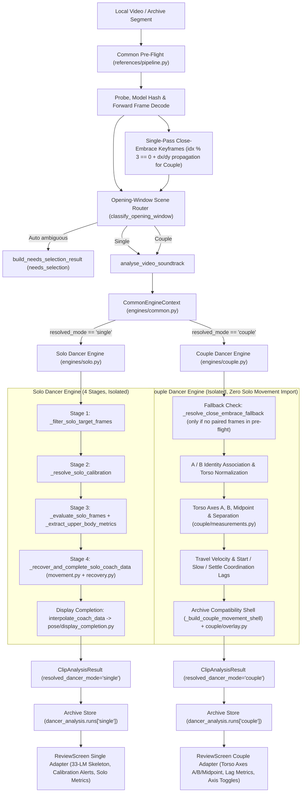
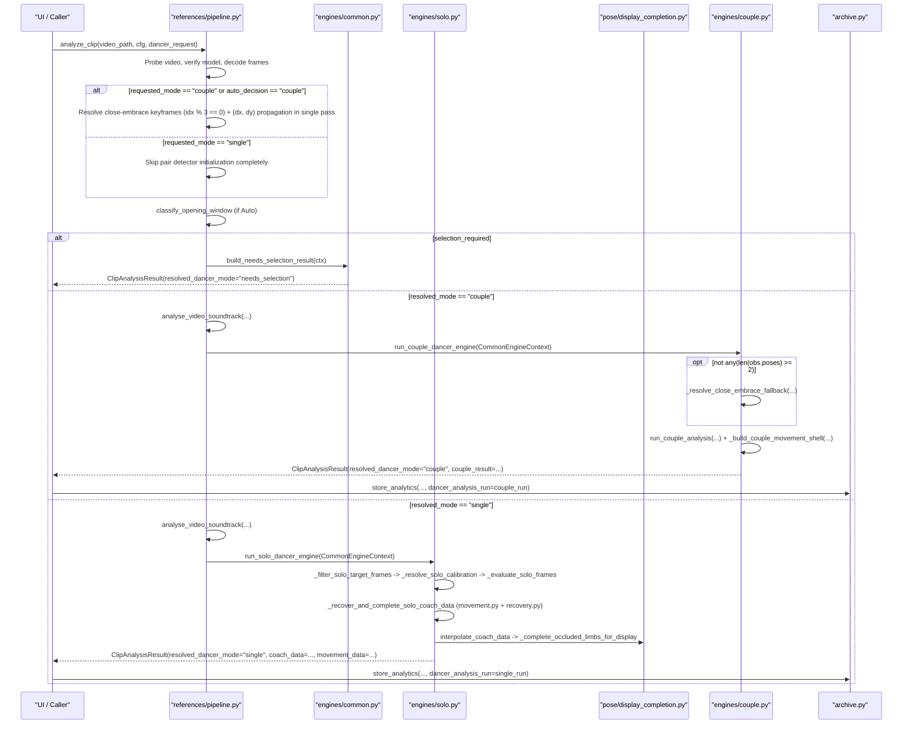
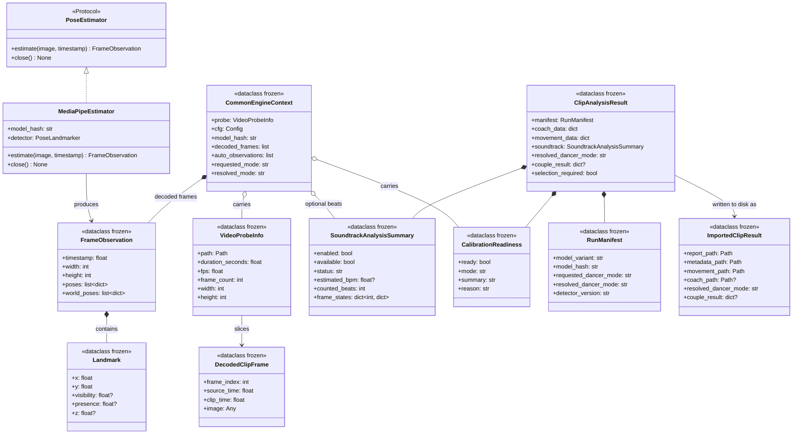
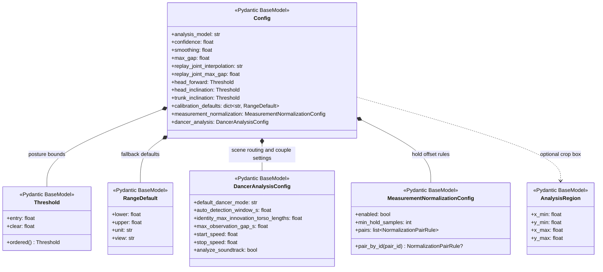
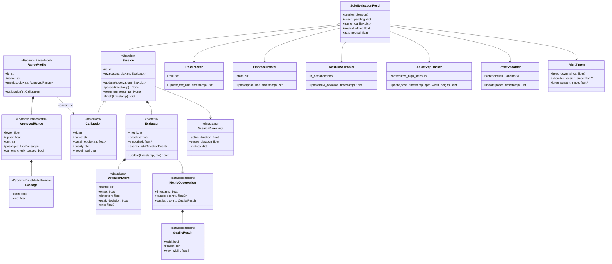
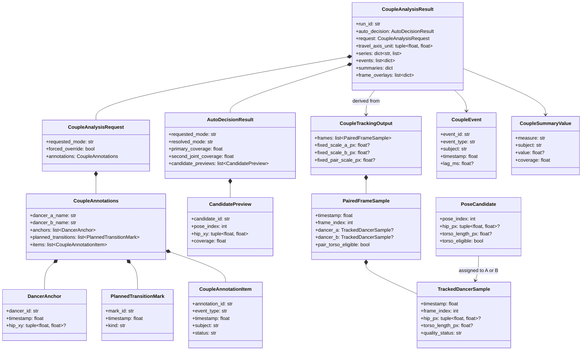
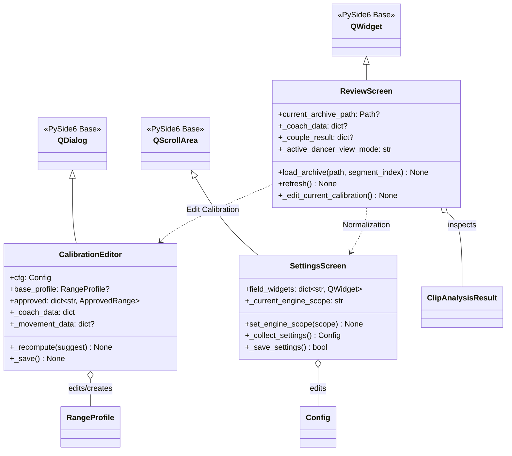

# TangoPosture Dual-Engine Architecture: The Complete Guide for Dummies

**Reading guide, updated 17 November 2026:** Start with the [beginner metric manual](TANGO_POSTURE_GUIDE.md) for what the numbers mean. This document explains the current processing pipeline; the [audit](TECHNICAL_DEBT_AND_REDESIGN.md) separates remaining limitations from proposed redesign. Detailed class relationships are in the [UML guide](UML_CLASS_DIAGRAMS_FOR_DUMMIES.md).

**Important boundaries:** separate engine entry points do not mean complete dependency isolation: couple measurements reuse the movement detector for contacts and pivots. `CommonEngineContext` is shallowly frozen, not deeply immutable. Display interpolation is distinct from upstream close-embrace propagation, which currently lacks explicit origin metadata. Read the audit before treating all supplied “raw” observations as fresh detections.


> **Who is this guide for?**  
> Whether you are a tango teacher, a curious developer opening the codebase for the first time, or a future maintainer trying to understand *what every box, arrow, function, and class does*, this guide explains the **entire TangoPosture architecture from scratch** — using everyday analogies, concrete numerical frame-by-frame examples, and exact file pointers.

> **Companion Reference**:  
> For standalone full-page UML class cards with field-by-field and method-by-method tables, see also `docs/UML_CLASS_DIAGRAMS_FOR_DUMMIES.md`.

---

## Chapter 1: The Big Picture ("Why Did We Split Into Two Engines?")

Imagine walking into an auto repair shop that tries to service **both bicycles and eighteen-wheeler trucks on the exact same workbench at the exact same time**. Every tool gets in the way of the other: bicycle brakes confuse the truck lift, and truck jacks bend bicycle frames.

Historically, TangoPosture ran into that exact problem.

TangoPosture started life as an app for **analyzing one solo dancer** (`Single Dancer`): measuring head tilt, shoulder tension, knee bend, torso axis curve, giros/pivots, steps, and drawing a full **33-point green stick-figure skeleton**. Later, **Couple Analysis** was bolted onto the same monolithic function (`analyze_clip` in `src/tango_posture/references/pipeline.py`), the same UI screen (`ReviewScreen`), and the same flat settings menu (`SettingsScreen`).

That "one shared monolith" caused painful bugs in **both** modes:

1. **When analyzing a Couple**, the single-dancer machinery hijacked the pipeline — trying to run solo posture coaching tables, solo movement detection (`movement.py`), and single-person 33-point skeleton logic on two people hugging in close embrace (where MediaPipe blurs arms and torsos together).
2. **When analyzing a Solo Dancer**, multi-person heuristics and overly strict gap rules broke the solo skeleton: pivots clipped off after `0.20` seconds, brief camera scale wobbles got mislabeled as "camera cuts" that severed interpolation across frames, and occluded feet or arms disappeared instead of being completed for display.
3. **In the Settings menu**, solo, couple, and shared detection knobs were scattered across flat tabs so changing a setting felt like defusing a bomb without labels.

### The Re-engineered Design: "One Airport Control Tower + Two Separate Workshops"

Instead of one tangled machine, TangoPosture now uses a clean **three-part architecture**:

1. **The Control Tower (Common Pre-Flight Core)** — `references/pipeline.py` & `engines/common.py`  
   Prepares the video once: checks the file, verifies the MediaPipe pose model checksum, decodes frames, extracts soundtrack beats, optionally runs Auto Scene Routing to decide *"Is this 1 dancer or 2 dancers?"*, splits close-embrace keyframes if it is a couple, packs everything into a read-only suitcase (`CommonEngineContext`), and dispatches the clip to **exactly one** of the two workshops.
2. **Workshop #1: The Solo Dancer Engine** — `engines/solo.py` + `pose/display_completion.py` + `references/coach.py`  
   Specializes 100% in **one dancer**: full 33-landmark pose tracking, calibration baselines, posture alerts, pivot/step detection, backward gap recovery, and **topological occluded-limb completion** so the visual coaching skeleton never vanishes during turns or near video edges.
3. **Workshop #2: The Couple Dancer Engine** — `engines/couple.py` + `couple/`  
   Specializes 100% in **two dancers together**: keeping Dancer A and Dancer B straight, drawing clean **torso axes** (Dancer A axis, Dancer B axis, and the shared **Couple Midpoint Axis**), measuring torso separation angle, computing travel velocity and start/slow/settle coordination lags, and detecting transitions and turns — **without ever touching Solo skeletons or importing Solo movement code**.

### Core Module Map (Where Everything Lives)

| Component / Layer | File Path | Size | Plain-English Job |
| :--- | :--- | :---: | :--- |
| **Control Tower (Pre-Flight)** | `src/tango_posture/references/pipeline.py` | 768 lines | Opens the video, verifies the AI pose model, reads each frame once, splits close-embrace couple keyframes in that same pass, routes Single vs. Couple, and hands off to the chosen engine. |
| **Shared Suitcase & Helpers** | `src/tango_posture/engines/common.py` | 131 lines | Defines `CommonEngineContext` (the suitcase handed to engines), beat extraction (`extract_soundtrack_beat_timestamps`), and the `needs_selection` pause builder (`build_needs_selection_result`). |
| **Engine Front Door** | `src/tango_posture/engines/__init__.py` | 19 lines | Public doorway re-exporting `CommonEngineContext`, `run_solo_dancer_engine`, `run_couple_dancer_engine`, and shared helpers. |
| **Workshop #1: Solo Engine** | `src/tango_posture/engines/solo.py` | 788 lines | Runs Solo analysis in 4 modular stages: filter target -> calibrate -> evaluate frames -> movement/recovery/display completion. |
| **Solo Limb Repair Shop** | `src/tango_posture/pose/display_completion.py` | 767 lines | Extracted out of `coach.py`! Fills missing/occluded joints *only* for the visual `display_poses` skeleton (never touching scientific `measurement_poses`). |
| **Solo Coach & Comparison** | `src/tango_posture/references/coach.py` | 1,163 lines | Shrunk from `1,687` lines! Builds per-frame coach entries, runs `interpolate_coach_data` (calling `display_completion.py`), compares calibration ranges, and draws Solo HUD overlays. |
| **Workshop #2: Couple Engine** | `src/tango_posture/engines/couple.py` | 325 lines | Runs `run_couple_analysis`, creates a lightweight empty movement shell (`_build_couple_movement_shell`) without importing Solo `movement.py`, and keeps close-embrace fallback secondary decode strictly as a safety net. |
| **Calibration Editor Parity** | `src/tango_posture/desktop_qt/calibration/editor.py` | 1,367 lines | Loads `movement_data` first and passes both `pose_recovery` and `movement_data` into `interpolate_coach_data(...)` so the Calibration screen skeleton matches Review. |

---

## Chapter 2: Glossary of Key Terms (Zero Jargon Left Behind)

- **Landmark (`Landmark`)**: A single tracked body point (like `"left_ankle"` or `"nose"`) in `src/tango_posture/domain.py`. Stores `x`, `y` (normalized screen coords from `0.0` top/left to `1.0` bottom/right), optional `z` (depth), `visibility` (`0..1`), and `presence` (`0..1`). Effective confidence = `min(visibility, presence)`.
- **33-Landmark Skeleton (`CONNECTIONS`)**: MediaPipe's full stick figure of one person (face, shoulders, elbows, wrists, hips, knees, ankles, heels, toes). Ideal for a solo dancer; unreadable if forced onto two people hugging.
- **The Golden Separation (`measurement_poses` vs. `display_poses`)**:
  - **`measurement_poses` (Read-Only Scientific Truth)**: What the AI pose detector actually saw on each frame. If a knee is hidden behind a skirt, we **never invent fake measurements** here.
  - **`display_poses` (Visual Coaching Skeleton)**: What gets drawn on the video screen. Here, we smooth jitter and complete occluded limbs, tagging every filled-in joint as `"interpolated"` in `display_joint_origins`.
- **Torso Joints (`_TORSO_JOINTS`)**: The 4 core corners of the trunk: `left_shoulder`, `right_shoulder`, `left_hip`, `right_hip`. Everything else hangs off these 4 corners.
- **Torso Axis (Used in Couple Mode)**: A straight line connecting a dancer's mid-hip `H = 0.5 * (left_hip + right_hip)` to their mid-shoulder `S = 0.5 * (left_shoulder + right_shoulder)`.
- **Couple Midpoint Axis & Torso Separation**: Midpoint Axis connects the pair's shared hip midpoint `0.5 * (H_A + H_B)` to their shared shoulder midpoint `0.5 * (S_A + S_B)`. Torso Separation is `abs(tilt_a - tilt_b)` in degrees.
- **Close-Embrace Crop Splitting (`resolve_close_embrace_frame_poses`)**: When two tango dancers hug chest-to-chest, a standard detector often merges them into 1 blob (`len(obs.poses) == 1`). Crop splitting masks out the right half to detect the left dancer, masks out the left half to detect the right dancer, verifies anatomical sizes/separation, and returns 2 poses `[pose_l, pose_r]`.
- **`CommonEngineContext`**: A frozen dataclass (`src/tango_posture/engines/common.py`) carrying every pre-flight output into an engine without allowing cross-contamination.
- **True Cut vs. False Cut**: A real scene edit where the camera cuts to a new angle ("true cut") vs. a brief detector scale wobble that `movement.py` logged in `cut_frames` even though the dancer never moved across the room ("false cut").
- **`.tpr` Archive & `dancer_analysis.runs`**: Separate result slots inside a `.tpr` archive (`runs["single"]` vs. `runs["couple"]`) so running Couple never erases Solo and vice versa.

---

## Chapter 3: The Journey of a Video Clip (Every Box & Call Explained for Dummies)

### 3.1 Architecture Flowchart (The Assembly Line)



#### Every Flowchart Box Explained (With Concrete Examples)

##### Part A — The Control Tower (`V` -> `CTX`)

| Node ID | Box Label | What It Does in Plain English | Concrete Example |
| :---: | :--- | :--- | :--- |
| **`V`** | **Local Video / Archive Segment** | Your raw `.mp4`/`.mov` dance file or an already-imported `.tpr` segment. | You select `vals_practice.mp4` (`15.0s`, `30 fps`, `1920x1080`) in the UI. |
| **`PRE`** | **Common Pre-Flight** (`references/pipeline.py`) | The reception desk (`analyze_clip`) that checks inputs before waking any AI model. | Checks `[clip_in=0.0, clip_out=15.0]` and reads whether you asked for `Auto`, `Single`, or `Couple`. |
| **`READ`** | **Probe, Model Hash & Forward Frame Decode** | Verifies the video (`VideoProbeInfo`), verifies the pinned MediaPipe `.task` SHA-256 hash (`lite`/`full`/`heavy`), and runs the main pose detector over frames `0..449`. | Reads frame `0, 1, 2... 449` once, producing raw `FrameObservation` objects (`landmarks` + `world_landmarks`). |
| **`COUPLE_PF`** | **Single-Pass Close-Embrace Keyframes** | *Couple shortcut!* Instead of decoding the video twice later, whenever Couple mode is active and MediaPipe merged two hugging partners into 1 skeleton, splits keyframes (`idx % 3 == 0`) with `resolve_close_embrace_frame_poses` and slides `(dx, dy)` onto frames in between (`idx % 3 != 0`). | On frame `0` (`0 % 3 == 0`), 1 merged pose splits into Leader + Follower. On frames `1` and `2`, both skeletons shift smoothly by `+0.008` in `x` without re-running the heavy detector! On `requested_mode == "single"`, this box does **nothing**. |
| **`AUTO`** | **Opening-Window Scene Router** (`classify_opening_window`) | Watches the first seconds (`auto_detection_window_s`) to decide if the footage is a solo dancer, an embrace couple, or too ambiguous for guessing. | Sees 1 dancer for 9.8s and someone walking past for 0.3s (`< brief_second_max_s=0.5s`) -> classifies cleanly as `"single"`. Sees two torsos moving in parallel for `>= together_min_s=0.4s` -> classifies as `"couple"`. |
| **`SEL`** | **build_needs_selection_result** (`needs_selection`) | The "Hold on, human — please click who you want!" pause exit. | Two soloists practice side-by-side without coordinated movement: stops early with thumbnail `CandidatePreview` cards so you can pick `"Single"`, `"Couple"`, or drop a click anchor. |
| **`BEAT`** | **analyse_video_soundtrack** | Reads the clip's audio track (via `ffmpeg` + `BeatTracker`) to locate tango musical beats (`1, 2, 3, 4`) and tempo (`BPM`). | Detects `108 BPM` Di Sarli tango beats at `t = 0.55s, 1.11s, 1.66s...` (or falls back gracefully if audio has no clear beat). |
| **`CTX`** | **CommonEngineContext** (`engines/common.py`) | Packs all pre-flight facts into an immutable read-only suitcase and routes to *either* `SOLO` *or* `COUPLE`. | Locks `decoded_frames`, `auto_observations`, `soundtrack_summary`, `cfg`, and `resolved_mode` before entering a workshop. |

##### Part B — Workshop #1: Solo Dancer Engine (`SOLO`, `S1`–`S5` -> `REV_S`)

| Node ID | Box Label | What It Does in Plain English | Concrete Example |
| :---: | :--- | :--- | :--- |
| **`SOLO`** | **Solo Dancer Engine** (`engines/solo.py`) | Entry point `run_solo_dancer_engine(ctx, ...)` — completely isolated from Couple logic. | Receives `CTX` where `resolved_mode == "single"`. |
| **`S1`** | **Stage 1: `_filter_solo_target_frames`** | Filters detections to one chosen person if an anchor/ROI region was supplied; otherwise passes frames through as-is. | You clicked the follower on the left side -> ignores any mirror reflection on the right edge. |
| **`S2`** | **Stage 2: `_resolve_solo_calibration`** | Finds or builds the dancer's personal "zero point" (`Calibration` / `RangeProfile`: neutral head tilt, relaxed shoulder clearance, neutral axis). | Samples `[0.0s, 3.0s]` neutral stance: learns `head_neutral_offset = -9.5°` instead of punishing natural carriage. |
| **`S3`** | **Stage 3: `_evaluate_solo_frames`** | Walks frame-by-frame scoring posture (`measure`), smoothing signals, updating `RoleTracker`, `EmbraceTracker`, `AxisCurveTracker`, `AnkleStepTracker`, `PoseSmoother`, `Session`, and recording untouched `measurement_poses`. | At `t = 4.2s`, dancer lifts back ankle high in a slow tango (`108 BPM <= 115`): `AnkleStepTracker` logs 1 high step; after 2 consecutive high steps (`>= 2`), raises a gentle visual cue. |
| **`S4`** | **Stage 4: `_recover_and_complete_solo_coach_data`** | Detects Solo giros/pivots & foot steps (`movement.py`), attaches footwork coaching notes, and optionally runs backward tracking recovery (`pose/recovery.py`). | Detects clockwise giro (`62°` rotation) over frames `90..120`, tagging `pivots` and checking any true scene cuts. |
| **`S5`** | **Display Completion** (`pose/display_completion.py`) | Repairs the **visual-only** `display_poses` skeleton across frame-0 dropouts, `y = 1.04` border ankles, side-profile head shoulders, and never-reliable joints (`_complete_occluded_limbs_for_display`). | Frame `0` was empty (`poses: []`) and frame `95` lost `left_knee`: `S5` fills both cleanly in `display_poses`, tags `"interpolated"`, and leaves `measurement_poses` completely untouched! |
| **`OUT_S` -> `ARCH` -> `REV_S`** | **Solo Result -> Archive -> Review UI** | Packs `ClipAnalysisResult`, stores it in `dancer_analysis.runs["single"]`, and Review opens with the **33-landmark green/interpolated skeleton**, calibration alerts, and Solo posture table. | In `ReviewScreen`, toggling calibration updates alert badges while Solo skeleton lines render every limb smoothly. |

##### Part C — Workshop #2: Couple Dancer Engine (`COUPLE`, `C1`–`C5` -> `REV_C`)

| Node ID | Box Label | What It Does in Plain English | Concrete Example |
| :---: | :--- | :--- | :--- |
| **`COUPLE`** | **Couple Dancer Engine** (`engines/couple.py`) | Entry point `run_couple_dancer_engine(ctx, ...)` — never imports Solo `movement.py` and never scores Solo posture alerts. | Receives `CTX` where `resolved_mode == "couple"`. |
| **`C1`** | **Fallback Check: `_resolve_close_embrace_fallback`** | Checks if `COUPLE_PF` already found paired (`>= 2` poses) frames during Pass 1. If YES, skips video decoding completely (`0` extra decode cost!). Runs secondary split **only** if zero frames had 2 poses. | Because `COUPLE_PF` already split frame `0, 3, 6...`, `C1` does zero work and jumps straight to `C2`. |
| **`C2`** | **A / B Identity Association & Torso Normalization** | Matches who is Dancer A vs. Dancer B across every frame (`track_couple_frames`) using motion prediction, and measures fixed torso rulers (`fixed_scale_a_px`, `fixed_scale_b_px`). | Keeps Dancer A on the leader track and Dancer B on the follower track without ID flipping even when crossing paths. |
| **`C3`** | **Torso Axes A, B, Midpoint & Separation** (`couple/measurements.py`) | Computes `tilt_a_deg`, `tilt_b_deg`, `couple_midpoint_tilt_deg`, and `torso_separation_deg = abs(tilt_a - tilt_b)`. | Frame `30`: Dancer A leans `+3.2°`, Dancer B leans `+2.4°` -> Midpoint is `+2.8°` and Torso Separation is `0.8°` (very connected!). |
| **`C4`** | **Travel Velocity & Coordination Lags** | Computes centered linear-regression travel speed along `travel_axis_unit` and pairs timing events (`start_lag_ms`, `slow_lag_ms`, `settle_lag_ms`), transitions, and turns. | Leader starts walking at `2.00s`, Follower starts at `2.12s` -> `start_lag_ms = +120 ms`. |
| **`C5` -> `OUT_C` -> `ARCH2` -> `REV_C`** | **Archive Shell + Couple Overlay -> Archive -> Review UI** | `_build_couple_movement_shell` creates an empty validated movement JSON shell locally (no direct movement import in this shell builder), saves to `dancer_analysis.runs["couple"]`, and `couple/overlay.py` draws amber/teal/violet axes in `ReviewScreen`. | Opening Review shows **A axis (amber)**, **B axis (teal)**, **Couple midpoint (violet)**, **hip/shoulder bridges**, and lag/transition tabs — zero tangled Solo stick limbs! |

---

### 3.2 Who Calls Whom? (Sequence Diagram Explained Step by Step)



#### Who Are the 7 Participants? ("Cast of Characters")
1. **`UI` (UI / Caller)**: `ReviewScreen`, Import dialog, or CLI caller pressing "Go".
2. **`PL` (`references/pipeline.py`)**: The **Control Tower** — does all video decoding and routing once.
3. **`CE` (`engines/common.py`)**: Holds `CommonEngineContext` and the early-pause builder `build_needs_selection_result`.
4. **`SE` (`engines/solo.py`)**: **Workshop #1 (Solo Engine)** — owns calibration, Solo trackers, Solo movement, recovery.
5. **`DC` (`pose/display_completion.py`)**: **Solo Limb Repair Shop** — turns gappy Solo frames into smooth, complete display skeletons via `coach.py`'s `interpolate_coach_data`.
6. **`KE` (`engines/couple.py`)**: **Workshop #2 (Couple Engine)** — owns Couple tracking, axes, lags, turns, and `_build_couple_movement_shell`.
7. **`AR` (`archive.py`)**: The **Filing Cabinet** — writes `.tpr` archive JSONs safely into separate `"single"` and `"couple"` slots.

#### Three Concrete End-to-End Trace Examples

##### Trace Example 1: 10-Second Solo Giro Clip (`requested_mode = "single"`)
1. `UI` calls `analyze_clip(..., requested_mode="single")`.
2. `PL` probes the clip (`300` frames at `30 fps`), verifies the selected `heavy` model hash, decodes frames `0..299` once. Because `requested_mode == "single"`, **`_get_image_detector()` is NEVER initialized** (`0 ms` spent on close-embrace cropping!).
3. `PL` runs `analyse_video_soundtrack`, packs `CommonEngineContext(resolved_mode="single")`, and calls `SE.run_solo_dancer_engine(ctx)`.
4. `SE` runs Stage 1 (keep all 300 frames) -> Stage 2 (`cal_in..cal_out` calibration) -> Stage 3 (score posture + build raw `measurement_poses`) -> Stage 4 (`analyse_movement_observations` detects a giro at frames `120..165`, triggers `DC._complete_occluded_limbs_for_display` which fills missing elbows/knees during the turn in `display_poses`).
5. `SE` returns `ClipAnalysisResult(resolved_dancer_mode="single")` -> `UI` asks `AR` to save into `dancer_analysis.runs["single"]`. Any previously saved `"couple"` run stays untouched!

##### Trace Example 2: 15-Second Close-Embrace Couple Walking Clip (`requested_mode = "couple"`)
1. `UI` calls `analyze_clip(..., requested_mode="couple")`.
2. During Pass 1 frame decode in `PL`, on keyframes `idx = 0, 3, 6... 447` (`idx % 3 == 0`) where the pair hugged into `1` pose, `PL` immediately runs `resolve_close_embrace_frame_poses` and splits them into `[pose_l, pose_r]`. On frames `1, 2, 4, 5...`, torso shift is `< 0.05` so `_translate_pose` shifts both skeletons smoothly by `(dx, dy)` in microseconds.
3. `PL` extracts beats and calls `KE.run_couple_dancer_engine(ctx)`.
4. `KE` checks `not any(len(obs.poses) >= 2 ...)` -> `False`! Paired poses are already present, so `_resolve_close_embrace_fallback` is **skipped** (no second video decode!).
5. `KE` runs `run_couple_analysis` (computing `tilt_a_deg`, `tilt_b_deg`, `couple_midpoint_tilt_deg`, `torso_separation_deg`, velocities, `start_lag_ms`) and calls `_build_couple_movement_shell` locally (no direct movement import in the shell builder; measurements still reuse movement.py).
6. `KE` returns `ClipAnalysisResult(resolved_dancer_mode="couple", couple_result=...)` -> `UI` saves into `dancer_analysis.runs["couple"]`.

##### Trace Example 3: Ambiguous Practice-Hall Clip (`requested_mode = "auto"`)
1. `UI` calls `analyze_clip(..., requested_mode="auto")`.
2. `PL` decodes frames and feeds the opening window to `classify_opening_window`. Two bystanders and a solo couple candidate appear without consistent co-movement, so `auto_decision.resolved_mode == "needs_selection"`.
3. `PL` calls `CE.build_needs_selection_result(ctx)` **immediately**, skipping soundtrack extraction and skipping both heavy engines.
4. `UI` receives `selection_required=True` + thumbnail `candidate_previews` and prompts the user to choose `"Single"`, `"Couple"`, or click the target dancer.

---

## Chapter 4: Inside the Control Tower (`references/pipeline.py` & `engines/common.py`)

### 4.1 What Is Inside the `CommonEngineContext` Suitcase?

Defined in `src/tango_posture/engines/common.py` (`131` lines), `CommonEngineContext` is a shallowly frozen package (nested data remains mutable) containing:
- **Settings & Video Info**: `cfg` (`Config`), `probe` (`VideoProbeInfo`: width, height, fps, frame count, file path), `clip_in` / `clip_out` / `clip_duration`, `processed_fps`, `clean_title`, `cap_profile`.
- **AI Model Provenance**: `model_path`, `model_hash`, `readiness` (`CalibrationReadiness`), `performance` timing metrics.
- **Decoded Frames**: `decoded_frames`, `raw_observations`, `auto_observations` (including in-pass close-embrace splits), `frame_times`.
- **Music & Mode Context**: `soundtrack_summary`, `analysis_mode` (`"posture"` or `"movement"`), `requested_mode` (`"auto"`, `"single"`, `"couple"`), `request_obj`, and `auto_decision` (`AutoDecisionResult`).

### 4.2 How Single-Pass Close-Embrace Keyframe Splitting Works

Before our cleanup, choosing **Couple** read the video **twice** (once in `pipeline.py`, once in `engines/couple.py`). Now `pipeline.py` runs `split_couple_in_pass = requested_mode == "couple" or (auto_decision is not None and auto_decision.resolved_mode == "couple")` **inside the single forward decode loop**:
- **Keyframes (`idx % 3 == 0`)**: Split via `resolve_close_embrace_frame_poses`; if `>= 2` poses return, cache `(last_split_pos, last_primary_mid, last_split_pair)`.
- **In-between frames (`idx % 3 != 0`)**: Compute torso shift `(dx, dy) = cur_mid - last_primary_mid`. Within `<= 2` frames and `math.hypot(dx, dy) <= 0.05`, translate both split skeletons via `_translate_pose(p, dx, dy)` cleanly.
- **Zero Solo overhead**: When `requested_mode == "single"`, `split_couple_in_pass` is `False` and `run_auto_window` is `False`, so `_get_image_detector()` is never instantiated.

---

## Chapter 5: Inside Workshop #1 — The Solo Dancer Engine (`engines/solo.py`)

In earlier versions, `run_solo_dancer_engine` was one `620+`-line giant function. Today `src/tango_posture/engines/solo.py` (`788` lines) reads like a 4-chapter recipe book where every stage has **one clear job**.

### Stage 1: `_filter_solo_target_frames(ctx)` — *"Zoom In On Our Dancer"*
- **What goes in**: `ctx` (`CommonEngineContext`).
- **What comes out**: `decoded_frames: list[(frame_index, source_time, clip_time, FrameObservation)]`.
- **How it works (with Example)**:
  - If you did **not** set a manual click anchor or crop region box (`single_anchor is None and analysis_region is None`), it returns `ctx.decoded_frames` unchanged in `O(1)` time.
  - Suppose another couple is dancing in the corner of your practice studio, so you dropped an anchor on your own hips (`hip_xy = (0.35, 0.52)`) or drew `analysis_region = {"x_min": 0.1, "x_max": 0.6, ...}`. `_filter_solo_target_frames` calls `extract_single_target_observations(...)`, keeping **only** your skeleton per frame and throwing away background detections before Stage 2 or Stage 3 ever sees them.

### Stage 2: `_resolve_solo_calibration(ctx, decoded_frames, reference, calibration_interval)` — *"Set the Personal Ruler"*
- **What goes in**: Pre-filtered `decoded_frames`, any existing saved `.tpc` `reference`, and optional `[cal_in, cal_out]` seconds inside the clip (`calibration_interval`).
- **What comes out**: `(active_reference: Calibration | None, cal_window: tuple[float, float] | None)`.
- **How it works (with Example)**:
  - If `ctx.analysis_mode == "movement"`, Solo skips calibration completely and returns `(None, None)`.
  - If you selected a `calibration_interval = (1.0, 4.0)` (seconds 1 to 4 where you stood in balanced neutral embrace), Stage 2 loops over frames where `1.0 <= source_time <= 4.0`, runs `measure(...)`, collects raw median offsets (`cal_head_angles`, `cal_shoulder_clearances`, `cal_axis_offsets`), builds a `Calibration` via `calibrate(...)`, and stamps those personal medians into `active_reference.quality`:
    - `head_neutral_offset`: e.g., if your relaxed head hangs `-10.2°`, `-10.2°` becomes your personal zero instead of using the generic default `-12.0°`!
    - `shoulder_neutral_clearance`: your relaxed ear-to-shoulder distance ratio (e.g., `1.08`).
    - `axis_neutral_offset`: your neutral torso alignment baseline.

### Stage 3: `_evaluate_solo_frames(...) -> _SoloEvaluationResult` — *"Score Calmly Frame by Frame"*

Think of Stage 3 as **five calm judges + two pose notebooks** running on every video frame:

1. **Metric Scoring (`measure` / `measure_profile` + `_extract_upper_body_metrics`)**:
   - Measures posture geometry (`head_forward`, `head_inclination`, `trunk_inclination`, `shoulder_clearance`, `knee_flexion`, etc.).
   - If the standard full metric set had a missing piece, `_extract_upper_body_metrics` tries upper-body fallback calculation (`ear` + `shoulder` + `hip` pixel angle).
2. **Smooth Jitter Without Lagging (EMA Smoothing)**:
   - On noisy pose frames (say raw knee angle jumps `16.0° -> 18.5° -> 15.8°`), Stage 3 applies time-aware exponential smoothing:
     $$\alpha = 1 - e^{-\Delta t / \tau}, \quad \text{smoothed} \leftarrow \text{smoothed} + \alpha \cdot (\text{raw} - \text{smoothed})$$
     where $\Delta t$ is seconds since the previous valid frame and $\tau = \max(\text{min\_filter\_time\_constant}, \text{overlay\_smoothing})$. If a dropout lasts longer than `cfg.max_gap` (`0.5s`), the filter resets cleanly rather than blending stale data!
3. **Adaptive Shoulder Baseline**:
   - Outside the calibration window, relaxed clearances within `[shoulder_adaptive_min_clearance=0.65, shoulder_adaptive_max_clearance=1.50]` update `relaxed_clearances` (up to `600` samples), refining `sh_neutral` at the configured percentile (`75th`).
4. **The Five Solo State Trackers (So Alerts Never Strobe)**:
   - **`RoleTracker`**: Waits `role_assign_ms` (`300ms`) of steady evidence before switching `NONE -> LEADER/FOLLOWER`, and holds across `role_hold_ms` (`5000ms`) of arm changes.
   - **`EmbraceTracker`**: Smooths arm openness and uses `±0.035` hysteresis around `embrace_closed_threshold` (`0.72`) for `embrace_hysteresis_seconds` (`1.0s`).
   - **`AxisCurveTracker`**: Watches hip-to-torso alignment against `axis_curve_entry` (`0.06`) vs `axis_curve_clear` (`0.035`) before opening or clearing an alert.
   - **`AnkleStepTracker`**: Active when music tempo is slow (`bpm <= slow_tango_max_bpm=115.0`); triggers `bad_ankles=True` after `>= 2` consecutive high-ankle lift steps above `ankle_high_lift_ratio` (`0.06`).
   - **`Session` + `Evaluator` + `_AlertTimers`**: Tracks sustained posture deviations across scored timestamps (`in_cal == False`) without false-firing on brief 0.2s glances.
5. **The Two Notebooks (`measurement_poses` vs. `poses`) + `PoseSmoother`**:
   - **`coach_entry["measurement_poses"]`**: Saves the exact **unsmoothed** `frame_obs.poses` from MediaPipe. Never altered!
   - **`coach_entry["poses"]`**: Saves visually smoothed `PoseSmoother.update(frame_obs.poses, source_time)`.
   - Packs everything into `_SoloEvaluationResult(session, coach_pending, coach_frame_meta, frame_log, neutral_offset, axis_neutral)`.

### Stage 4: `_recover_and_complete_solo_coach_data(...)` — *"Find Steps/Pivots & Repair Display Limbs"*
1. **Solo Movement & Footwork (`movement.py`)**: Runs `analyse_movement_observations` to detect **pivots/giros**, **step placements**, and candidate **cut_frames**, and appends human-readable footwork notes (`_movement_note_lines`) onto each coach entry (`notes`, `lines`).
2. **Optional Backward Tracking Recovery (`pose/recovery.py`)**: When `cfg.replay_recovery_auto` (or explicit `recover_tracking`) is `True`, runs `run_clip_tracking_recovery` backward across occlusion gaps; if anything throws inside recovery, catches cleanly and records `pose_recovery["status"] = "failed"` without crashing analysis.
3. **Display Limb Completion (Always Runs!)**: Always invokes `interpolate_coach_data(coach_data, cfg, pose_recovery=pose_recovery, movement_data=movement_data)`, which invokes `pose/display_completion.py` so even when backward video recovery is OFF, the visual skeleton still fills gaps smoothly!

---

## Chapter 6: How We Fixed "Missing / Hidden Limbs" (`pose/display_completion.py`)

Why did Solo skeletons look broken or lite-like before, even with the `Heavy` model enabled? Because several harsh display filters threw away valid skeleton pieces during turns, near frame edges, and at clip boundaries. `src/tango_posture/pose/display_completion.py` (`767` lines) fixes all of them while obeying the **Golden Rule**: **raw `measurement_poses` is NEVER modified**.

```text
RAW DETECTIONS (measurement_poses)      ---> Untouched scientific truth!
       |
       v  [Copy into display working buffer]
1. Filter false camera cuts (_filter_true_cut_positions) & remove 0.20s pivot cap
2. Seed empty boundary frames if full torso exists in the shot
3. Bracketed temporal interpolation (interpolate_poses)
4. Pass A: Blend interpolated limbs toward usable low-conf raw points
5. Pass B: Top-down _TOPO_JOINTS rebuild (Torso -> Head -> Elbows -> Wrists -> Knees -> Ankles -> Feet)
6. Pass C: 3-frame (0.25, 0.50, 0.25) smoothing on repaired limbs
       |
       v
VISUAL SKELETON (display_poses)         ---> Every filled joint marked "interpolated", clamped to [0, 1]
```

### All 6 Repair Mechanisms Explained With Concrete Coordinate Examples

#### Mechanism 1: Filter False Camera Cuts & Unlock Pivot Interpolation
- **The Old Bug**: If the dancer turned sideways during a giro, the bounding-box torso scale sometimes spiked, causing `movement.py` to log a frame inside `cut_frames`. Plus `interpolate_poses` clamped pivot gaps to `0.20s`. Any gap `> 0.20s` or touching a false cut turned invisible!
- **The Fix**:
  - `_filter_true_cut_positions` checks the torso center jump (`_pose_torso_center`) across each candidate cut frame. It ONLY keeps a cut as a true scene boundary if `jump > 0.35` (35% of screen width/height!) **or** `dt > cfg.replay_joint_max_gap` (`3.0s`).
  - `interpolate_coach_data` passes `pivot_max_gap=None`, so turning slowly in a 0.6s giro interpolates smoothly across the entire turn!

#### Mechanism 2: Whole-Frame Boundary Dropout Seeding (At Frame `0` or Clip End)
- **Concrete Example**: Suppose a 3-frame clip has:
  - Frame `0` (`t=0.0s`): MediaPipe saw nothing -> `poses: []` (completely empty!)
  - Frame `1` (`t=0.1s`): Full dancer visible (`left_shoulder`, `right_shoulder`, `left_hip`, `right_hip`, knees, ankles...)
  - Frame `2` (`t=0.2s`): Full dancer visible.
- **The Old Bug**: Ordinary interpolation needs points on *both* sides of a gap. Since there is no Frame `-1`, Frame `0` stayed `poses: []` (blank screen!).
- **The Fix**: `_complete_occluded_limbs_for_display` checks:
  1. Do all four `_TORSO_JOINTS` appear somewhere in `observed_joints` (`has_full_torso`)? **Yes!**
  2. Does segment `0` (`_display_segment_ids`) have at least one valid single-pose frame (`segs_with_pose`)? **Yes!**
  - Therefore it seeds `pose_buffers[0] = {}`, allowing Pass B to copy the torso & limbs from the nearest reliable anchor (Frame `1`/`2`), so Frame `0` renders a complete dancer cleanly clamped in `[0.0, 1.0]` and tagged `"interpolated"`.
- **Why the 4-Torso Safety Guard Exists**: If a tiny synthetic unit test only passes `{"left_hip": Landmark(0.5, 0.5)}` (only 1 joint tracked), `has_full_torso` is `False`, so intentionally empty frames remain empty instead of inventing arms and legs!

#### Mechanism 3: Accepting Near-Border Raw Landmarks (`_landmark_usable_raw`: `-0.35..1.35`)
- **Concrete Example**: On Frame `1`, the dancer steps toward the bottom of the camera frame:
  - `left_knee` is at `(0.45, 0.85, conf=0.95)` (inside `[0, 1]`).
  - MediaPipe predicts `left_ankle` at `(0.45, 1.04, visibility=0.40)` (`4%` below the bottom border!).
- **The Fix**: `_landmark_usable_raw` accepts finite non-zero-conf (`_landmark_conf(lm) > 0.0`) landmarks in `[-0.35, 1.35]`. `_resolve_raw_child_point` sanity-checks shin distance against median `ref_len["left_ankle"]`, clamps direction if needed (`0.50..1.35 * rlen`), blends slightly toward child midpoint if present, and Pass B clamps the final display `y` from `1.04 -> 1.00` (`[0.0, 1.0]`). Raw `measurement_poses` still keeps `1.04` untouched!

#### Mechanism 4: Opposite-Shoulder Head Fallback (`_effective_parent`)
- **Concrete Example**: During a tight left-facing promenade, `left_shoulder` is hidden (`conf=0.10`) while `right_shoulder` is clear (`conf=0.92`).
- **The Fix**: `_KINEMATIC_PARENT["nose"]` defaults to `"left_shoulder"`, and `"right_ear"` defaults to `"right_shoulder"`. When the primary shoulder isn't reliable, `_effective_parent` switches seamlessly to the **opposite reliable shoulder** so the head stays anchored instead of dropping!

#### Mechanism 5: The 3-Pass Completion Engine (`Pass A` -> `Pass B` -> `Pass C`)
Suppose across frames `0, 1, 2`:
- `right_elbow` never once exceeds `cfg.confidence = 0.65` (`conf = 0.10` everywhere).
Here is what happens step-by-step:
1. **Pass A (Blend Bracketed Interpolations)**: If `interpolate_poses` *did* bracket a limb joint between two good frames, and raw MediaPipe (`-0.35..1.35`) sits anatomically near the limb (`0.45..1.50 * rlen` from parent and within `0.22` of the interpolated line), Pass A blends it softly toward raw (`weight = min(0.75, max(0.25, raw_conf))`) so bent elbows look natural rather than artificially ruler-straight.
2. **Pass B (Top-Down Topological Rebuild `_TOPO_JOINTS`)**: Rebuilds still-missing joints strictly from core outward: **Torso -> Head -> Elbows -> Wrists -> Knees -> Ankles -> Heels -> Feet**, syncing `interpolated` after *each* layer so children anchor on newly repaired parents!
   - **Torso Layer (`_complete_torso_joint_point`)**: Tries usable raw -> `_nearest_anchor_pos(..., max_gap)` -> `_nearest_anchor_pos(..., float("inf"))` (infinite horizon within same camera shot `seg_ids`!) -> **torso parallelogram** (`a + b - opp` if the other 3 corners are known).
   - **Child Limb Layer (`_complete_occluded_limbs_for_display`)**: Resolves `eff_parent`, then tries `_resolve_raw_child_point` -> `max_gap` parent-relative anchor -> `float("inf")` same-shot parent-relative anchor -> **`_canonical_child_offset`**!
   - **What Does `_canonical_child_offset` Do?** When even infinite-horizon search finds zero reliable frames (e.g., `right_elbow` had `0.10` everywhere), `_torso_down_and_outward` calculates the dancer's unit body-down vector (shoulders -> hips) and side-outward vector, placing the elbow at canonical bone length `rlen` (`_compute_reference_bone_lengths` falls back via opposite arm/leg or `_CANONICAL_TORSO_RATIOS`), clamped to `[0.0, 1.0]`, and tagged `display_joint_origins[pos]["right_elbow"] = "interpolated"`.
3. **Pass C (Light 3-Frame Temporal Smoothing)**: If the clip has `n >= 5` frames and stayed in the same shot segment, applies `[0.25 * prev, 0.50 * cur, 0.25 * next]` across completed limb coordinates to polish transitions.

#### Mechanism 6: `CalibrationEditor` Parity (`desktop_qt/calibration/editor.py`)
`CalibrationEditor` now loads `self._movement_data` **before** calling:
`interpolate_coach_data(coach, self.cfg, pose_recovery=coach.get("pose_recovery"), movement_data=self._movement_data)`
so opening **Edit Calibration** displays the exact same clean skeleton as **Review**.

---

## Chapter 7: Inside Workshop #2 — The Couple Dancer Engine (`engines/couple.py`)

Workshop #2 (`src/tango_posture/engines/couple.py`, `325` lines + `src/tango_posture/couple/`) is designed specifically for **two partners moving together** — ignoring Solo 33-point sticks and Solo posture nagging completely.

### Step 1: Consume Pre-Split Observations (And Skip Redundant Decoding!)
- `run_couple_dancer_engine` inspects `ctx.auto_observations` (already populated by `pipeline.py`'s single-pass `idx % 3 == 0` close-embrace splitting!).
- **Secondary-Pass Gate**: `_resolve_close_embrace_fallback` runs **only** when all three are true:
  1. `estimator_factory is None` (live video MediaPipe mode, not a unit-test mock),
  2. at least one frame has `len(obs.poses) == 1`, **and**
  3. **`not any(len(obs.poses) >= 2 for _, obs in couple_observations)`** (no paired frames exist yet).
  So on every clip where Pass 1 split even a single close-embrace keyframe, `engines/couple.py` performs **zero redundant video reads**!

### Step 2: 1-to-1 Identity Tracking & Fixed Scales (`couple/tracking.py`)
Suppose frame `10` has two `PoseCandidate` detections (`[Cand 0, Cand 1]`):
- **Lineup Matching (`track_couple_frames` + `_TrackMemory`)**: Predicts where Dancer A and Dancer B should be (`predicted_hip(timestamp)`), rejects candidates farther than `identity_max_innovation_torso_lengths` (`0.75` torso lengths), requires at least `identity_margin_torso_lengths` (`0.15`) winner margin over swapped pairing (otherwise leaves identity blank rather than silently swapping partners!), and detects camera `shot_cut` breaks.
- **Fixed Normalized Rulers**: Computes median `fixed_scale_a_px`, `fixed_scale_b_px`, and `fixed_pair_scale_px` (say `180 px` torso height) so walking speed `0.25` literally means `0.25` torso lengths per second regardless of whether the camera zoomed in or stood far away!

### Step 3: Couple Torso Axes, Midpoint Axis & Coordination Lags (`couple/measurements.py`)
Concrete frame example (`t = 3.50s`):
- **Dancer A**: mid-hip `H_A = (0.48, 0.56)`, mid-shoulder `S_A = (0.49, 0.34)` -> forward lean **`tilt_a_deg = +2.6°`**.
- **Dancer B**: mid-hip `H_B = (0.55, 0.55)`, mid-shoulder `S_B = (0.54, 0.33)` -> axis tilt **`tilt_b_deg = -2.6°`** (or leaning slightly toward A).
- **Couple Midpoint Axis**: mid-hip `0.5 * (H_A + H_B) = (0.515, 0.555)` to mid-shoulder `0.5 * (S_A + S_B) = (0.515, 0.335)` -> **`couple_midpoint_tilt_deg = 0.0°`**.
- **Torso Separation**: `abs(tilt_a - tilt_b) = 5.2°`.
- **Travel Speed & Coordination Lags**: Uses centred linear regression over half-window `velocity_filter_window_s` (`0.15s`) projected along `travel_axis_unit`. If Dancer A crosses `start_speed` (`0.20 tl/s`) at `t = 4.00s` and Dancer B crosses at `t = 4.09s` (within `pairing_window_s=0.50s`), `CoupleEvent` logs `start_lag_ms = +90.0 ms`. Also detects `slow` / `settle` (`< stop_speed=0.10`), transitions, and optional turn cues.

### Step 4: Archive Compatibility Shell With Zero Solo Coupling (`_build_couple_movement_shell`)
- `.tpr` archive readers still validate `movement.json` on load. Previously `engines/couple.py` imported Solo `movement.analyse_movement_observations` just to build an empty dictionary! Now `_build_couple_movement_shell` constructs the schema-valid empty shell locally (`pivots=[]`, `steps=[]`, `hip_frames=[]`, exact `_MOVEMENT_DETECTOR_FINGERPRINT`), avoiding a direct import in the shell builder. Couple measurements still import and call the shared movement detector.

### Step 5: Clean Purpose-Built Overlays (`couple/overlay.py`)
`render_couple_frame_overlay` draws cleanly:
- **Dancer A** (Warm amber `(11, 158, 245)`): subtle shoulder/hip crossbars, extended torso axis (`TORSO_AXIS_EXTENSION`), vertical cyan-blue plumb reference behind hips, tilt label `A: +2.6 deg`, and optional ankle dots (`show_steps_turns`).
- **Dancer B** (Teal/cyan `(166, 184, 20)`): matching B torso geometry.
- **Couple Midpoint** (Soft violet `(252, 132, 192)`): dashed hip bridge (`H_A -- H_B`), dashed shoulder bridge (`S_A -- S_B`), thick midpoint axis (`Couple: +0.0 deg (sep 5.2 deg)`), or `Hip-only midpoint` circle if shoulders are hidden. Estimated/interpolated segments render dashed with ` (est)`.

---

## Chapter 8: Beginner's Guide to the Reorganized Settings Menu (`15` Tabs, `3` Engine Scopes)

In `src/tango_posture/config.py` (`SETTING_GROUPS` & `SETTING_ENGINE_SCOPES`) and `src/tango_posture/desktop_qt/screens/settings.py`, all **`102` editable TOML fields** plus **`2` Single-dancer UI panels** live across **`15` tabs** partitioned under a 4-button scope filter (`set_engine_scope`): **All**, **Common (Both Engines)**, **Single Dancer Engine**, and **Couple Dancer Engine**.

### Scope 1: Common (Both Engines) — *4 Tabs*

| Tab Name | Keys Inside (Plain-English Meaning) | What Happens When You Change It? |
| :--- | :--- | :--- |
| **`Common · Files / Models`** *(3 keys)* | `model_path`, `analysis_model` (`lite`/`full`/`heavy`), `data_dir` | Switching `analysis_model` to **`heavy`** gives higher pose accuracy on both Review and Calibration Editor at the cost of slower CPU inference. |
| **`Common · Scene Routing`** *(10 keys)* | `dancer_analysis.default_dancer_mode`, `auto_detection_window_s`, `primary_coverage_min`, `primary_duration_min_s`, `second_joint_coverage_min`, `second_sustained_min_s`, `brief_second_max_s`, `together_min_s`, `together_max_hip_separation_torso_lengths`, `together_direction_cosine_min` | Governs how **Auto** classifies clips: lowering `together_min_s` (`0.4s`) makes Auto pick `"couple"` on shorter embraces; tightening `together_max_hip_separation_torso_lengths` (`2.0`) ignores background people standing far away. |
| **`Common · Detection / Music`** *(5 keys)* | `confidence` (`0.70`), `max_gap` (`0.5s`), `overlay_smoothing` (`0.20s`), `tango_bpm` (`120.0`), `dancer_analysis.analyze_soundtrack` | Raising `confidence` makes trackers stricter about only trusting clear landmarks; lowering `overlay_smoothing` toward `0.0` shows rawer snappier skeletons with more tremor. |
| **`Common · Review / Ollama`** *(8 keys)* | `ollama_base_url`, `ollama_model`, `ollama_timeout`, `ollama_temperature`, `ollama_num_ctx`, `ollama_num_predict`, `ollama_max_report_chars`, `ollama_instruction` | Tunes your local Ollama AI coach model, context size, and writing style for narrative written reports in Review. |

### Scope 2: Single Dancer Engine — *9 Tabs (7 Config Tabs + 2 Calibration UI Tools)*

| Tab Name | Key Controls & Plain-English Effect |
| :--- | :--- |
| **`Single · Camera / View`** *(4 keys)* | `side` (`left`/`right`), `facing` (`left`/`right`), `capture_profile`, `allow_all_angles` — tells Solo math which anatomical side faces the camera. |
| **`Single · Quality / Calibration`** *(6 keys)* | `min_torso`, `min_head`, `max_view_width`, `calibration_suggest_lower_pct` (`10%`), `calibration_suggest_upper_pct` (`90%`), `calibration_min_usable_samples` — rejects tiny/distant poses and controls Auto-Suggest percentiles in Calibration Editor. |
| **`Single · Temporal / Smoothing`** *(4 keys)* | `smoothing` (`0.25s`), `min_filter_time_constant`, `entry_duration` (`1.5s`), `clear_duration` (`0.75s`) — higher `entry_duration` means a mistake must persist longer before triggering a posture alert. |
| **`Single · Head / Shoulders`** *(21 keys)* | `head_neutral_offset`, `head_down_duration`, `head_down_angle`, `shoulder_tension_duration`, `shoulder_raise_threshold`, plus adaptive scale & recovery parameters — prevents false "raised shoulders" warnings by learning relaxed baseline clearance safely. |
| **`Single · Embrace / Knees`** *(11 keys)* | `role_assign_ms`, `role_hold_ms`, `embrace_closed_threshold`, `embrace_hysteresis_seconds`, `closed_embrace_min_knee_bend`, `knee_straight_duration`, visibility & tiebreak margins — guards soft knees and steady Leader/Follower detection. |
| **`Single · Torso / Footwork`** *(8 keys)* | `axis_curve_entry`, `axis_curve_clear`, `axis_curve_duration`, `axis_curve_clear_duration`, `axis_neutral_offset`, `slow_tango_max_bpm`, `ankle_high_lift_ratio`, `max_consecutive_high_ankle_steps` — monitors torso alignment curve and glides vs. lifted steps in slow tangos. |
| **`Single · Replay / Recovery`** *(9 keys)* | `replay_joint_interpolation` (`linear`/`quadratic`), `replay_joint_max_gap` (`3.0s` — set `0` to turn off display limb completion!), `replay_recovery_auto`, recovery window/context/budget knobs, `replay_show_recovered_joints`. |
| **`Measurement normalization`** *(UI Panel)* | Interactive panel to compute & inspect per-metric hold offsets (`MeasurementNormalizationConfig`) between a `.tpc` calibration clip and a different camera setup. |
| **`Calibration defaults`** *(UI Panel)* | Edits default lower/upper bounds (`RangeDefault`) used by `Use Defaults` inside `CalibrationEditor`. |

### Scope 3: Couple Dancer Engine — *2 Tabs*

| Tab Name | Keys Inside & Plain-English Effect |
| :--- | :--- |
| **`Couple · Tracking / Interpolation`** *(4 keys)* | `dancer_analysis.identity_max_innovation_torso_lengths` (`0.75`), `identity_margin_torso_lengths` (`0.15`), `max_observation_gap_s` (`0.20s`), `display_interpolation_max_gap_s` (`0.13s`) — controls how strictly A and B identities lock onto partners vs. marking `unknown`, and how long display axes bridge tiny occlusion blips. |
| **`Couple · Axes / Coordination`** *(9 keys)* | `dancer_analysis.velocity_filter_window_s` (`0.15s`), `persistence_s` (`0.15s`), `pairing_window_s` (`0.50s`), `start_speed` (`0.20`), `stop_speed` (`0.10`), `slowing_fraction` (`0.25`), `transition_min_coverage` (`0.75`), `secondary_speed_rise` (`0.12`), `auto_turn_suggestions` — controls velocity smoothing, what speed defines starting vs. settling, how far apart A & B events can pair for `lag_ms`, and auto-turn candidate hints. |

---

## Chapter 9: Technical Debt Scorecard, Verification & Future Roadmap

### Current audit and improvement plan

Reviewed 17 November 2026. The engine split is implemented, but it does not eliminate shared movement dependencies, mutable nested data, or compatibility-shell debt. The [technical debt audit](TECHNICAL_DEBT_AND_REDESIGN.md) records source evidence, risks, prioritized changes, migration strategy and acceptance checks. It replaces the previous historical scorecard and undated test totals.

The first priorities are pose provenance, transition persistence, subject-safe turn matching and accurate evidence statuses. Then store reproducible settings, extract pure services, simplify the Qt presenters and evolve archive contracts. These are proposals, not completed fixes.

See the audit's verification section for checks actually run during this update. Historical lint/type/test counts are not a guarantee for the current working tree.

---

## Chapter 10: Complete UML Class Diagrams & Object Reference (For Dummies)

> A **UML Class Diagram** is an org chart for Python blueprints ("classes"). Each box shows **what data lives inside** (top attributes) and **what buttons/actions it supports** (bottom methods).  
> **Quick Arrow Legend**: `*--` = *strictly owns inside itself* · `o--` = *holds a shared reference to* · `-->` = *uses or creates* · `<|--` = *is a subclass of* · `<|..` = *implements a contract*.

### 10.1 Domain 1 — Pre-Flight Primitives, Video & Result Envelopes



#### Every Class in Domain 1 Explained for Dummies

1. **`PoseEstimator`** (`src/tango_posture/domain.py`): **The Wall Socket Rulebook**. Doesn't run AI itself — simply says *"Any pose detector plugged into `pipeline.py` must have `.estimate(image, timestamp) -> FrameObservation` and `.close()`."* That lets tests plug in a fast fake detector without running MediaPipe.
2. **`MediaPipeEstimator`** (`src/tango_posture/pose/mediapipe_backend.py`): **The Real AI Plug**. Wraps Google's MediaPipe `PoseLandmarker` (`num_poses=2`), checks the model file checksum first, guarantees strictly increasing timestamps (`last_ms`), and emits both 2D screen landmarks (`poses`) and 3D hip-centered landmarks (`world_poses`).
3. **`Landmark`** (`src/tango_posture/domain.py`): **One Reflective Motion-Capture Dot**. Holds a single joint like `"left_ankle"` with screen `(x, y)` in `0..1`, `z`, `visibility`, and `presence` (`Landmark(0.45, 0.83, visibility=0.95, presence=0.95)`).
4. **`FrameObservation`** (`src/tango_posture/domain.py`): **One Photo Frame's Skeleton Snapshot**. Bundles `timestamp`, video `width`/`height`, and `poses` (0, 1, or 2+ dicts of `Landmark` dots) captured on that single frame.
5. **`VideoProbeInfo`** (`src/tango_posture/references/video.py`): **The Video File Passport**. Created up front by `probe_import_video()` to confirm the file exists, isn't corrupted/oversized, and records `fps`, `frame_count`, `duration_seconds`, `width`, `height`, and `first_pts_seconds`.
6. **`DecodedClipFrame`** (`src/tango_posture/references/video.py`): **One Conveyor-Belt Video Slice**. Holds `frame_index`, `source_time` (time in original file), `clip_time` (time since clip trim start), and raw BGR pixel `image` for `PoseEstimator`.
7. **`SoundtrackAnalysisSummary`** (`src/tango_posture/references/soundtrack.py`): **The Song Beat Sheet**. Tells both engines if music beats were found (`status="detected"`), tempo (`estimated_bpm`), total `counted_beats`, `phrase_count`, and per-frame `frame_states`.
8. **`CalibrationReadiness`** (`src/tango_posture/calibration/readiness.py`): **The Pre-Flight Green Light**. Answers whether posture review has everything needed (`ready=True`, `mode="existing_reference" | "clip_interval" | "movement"`) before running heavy work.
9. **`CommonEngineContext`** (`src/tango_posture/engines/common.py`): **The Locked Suitcase Between Control Tower and Workshops**. Shallowly frozen handoff (nested lists/dictionaries remain mutable) holding `probe`, `cfg`, `decoded_frames`, `auto_observations`, `auto_decision`, `resolved_mode`, and `soundtrack_summary` so Solo and Couple engines start cleanly without re-probing anything.
10. **`RunManifest`** (`src/tango_posture/references/results.py`): **The Shipping Label on Every Analysis Run**. Stamps `model_variant`, `model_hash`, `metric_version`, `width/height/fps`, `requested_dancer_mode`, and `resolved_dancer_mode` so `.tpr` archives know *how* they were produced.
11. **`ClipAnalysisResult`** (`src/tango_posture/references/results.py`): **The Unified In-Memory Output Box**. Both `run_solo_dancer_engine`, `run_couple_dancer_engine`, and `build_needs_selection_result` return this exact class (Solo populates `coach_data`/`movement_data`/`session_summary`; Couple populates `couple_result`).
12. **`ImportedClipResult`** (`src/tango_posture/references/results.py`): **The On-Disk Archive Receipt**. Returned once `ClipAnalysisResult` has been written into a permanent `.tpr` archive folder (`report_path`, `metadata_path`, `movement_path`, `coach_path`, optional YouTube/Facebook links).

---

### 10.2 Domain 2 — Configuration & Engine-Scoped Settings



#### Every Class in Domain 2 Explained for Dummies

1. **`Config`** (`src/tango_posture/config.py`): **The Master Control Panel**. Holds all `102` settings (`analysis_model`, `confidence`, Solo posture/recovery limits, Ollama config) plus nested `dancer_analysis`, `calibration_defaults`, and `measurement_normalization`. Rejects typos or `NaN` values automatically at load time.
2. **`DancerAnalysisConfig`** (`src/tango_posture/config.py`): **The Auto-Routing & Couple Sub-Panel** (`cfg.dancer_analysis`). Stores Auto window rules (`auto_detection_window_s`, `together_min_s`) plus Couple identity/velocity thresholds (`identity_max_innovation_torso_lengths`, `start_speed`, `stop_speed`), automatically enforcing `stop_speed < start_speed` and `brief_second_max_s < second_sustained_min_s`.
3. **`Threshold`** (`src/tango_posture/config.py`): **Sticky Thermostat Bounds** (`entry`, `clear`). Ensures alarms don't flicker on/off around one borderline number (`clear` must be `< entry`, e.g., `entry=10°`, `clear=6°`).
4. **`RangeDefault`** (`src/tango_posture/config.py`): **Starter Green-Zone Targets**. Stores fallback `lower`, `upper`, `unit`, and `view` (`"side"|"front"|"all"`) used when clicking *Use Defaults* in Calibration Editor.
5. **`AnalysisRegion`** (`src/tango_posture/config.py`): **Normalized Practice-Floor Crop Box**. Validates `0 <= x_min < x_max <= 1` and `0 <= y_min < y_max <= 1` when restricting detection to one part of the room.
6. **`MeasurementNormalizationConfig`** (`src/tango_posture/normalization_models.py`): **Camera-Angle Glasses Container**. Stores per-pair calibration-vs-practice alignment rules (`NormalizationPairRule` -> `MetricNormalizationRule`, `HoldWindow`, `HoldSourceIdentity`) with `.pair_by_id()` lookup to correct consistent camera angle offsets safely.

---

### 10.3 Domain 3 — Solo Dancer Engine, Calibration, Session & Trackers



#### Every Class in Domain 3 Explained for Dummies

1. **`QualityResult`** (`src/tango_posture/domain.py`): **The Per-Metric Inspector Stamp**. Holds `valid=True/False` plus why (`reason="Knee occluded"`), preventing blurry guesses from distorting scores.
2. **`MetricObservation`** (`src/tango_posture/domain.py`): **One Frame's Lab Sheet**. Packs measured angles/offsets (`values`) paired alongside each metric's `QualityResult` stamp at `timestamp`.
3. **`Calibration`** (`src/tango_posture/domain.py`): **Personal Neutral Posture Ruler**. Stores a dancer's baseline values and neutral quality offsets (`head_neutral_offset`, `shoulder_neutral_clearance`, `axis_neutral_offset`, optional `range_profile`) tied to a specific AI `model_hash`.
4. **`Passage`** (`src/tango_posture/calibration/models.py`): **One Clean Highlighted Time Span** (`[start, end)` seconds, where `end > start`) selected inside the Calibration Editor.
5. **`ApprovedRange`** (`src/tango_posture/calibration/models.py`): **One Metric's Green Zone**. Stores `lower`..`upper`, unit, camera view, summary stats (`median`, `p10`, `p90`) from approved `Passage` spans, and `camera_check_passed`.
6. **`RangeProfile`** (`src/tango_posture/calibration/models.py`): **Modern `.tpc` Multi-Metric Profile**. Collects `ApprovedRange` targets across metrics (`metrics: dict[str, ApprovedRange]`) and converts into a `Calibration` via `.calibration()`.
7. **`DeviationEvent`** (`src/tango_posture/domain.py`): **One Recorded Posture Mistake Streak**. Logs when a deviation began (`onset`), crossed the sustained duration trigger (`detection`), peaked (`peak_deviation`), and cleared (`end`, `end_reason`).
8. **`Evaluator`** (`src/tango_posture/temporal.py`): **Single-Metric Patient Coach**. Exponentially smooths noisy values for one metric and applies `entry_duration` / `clear_duration` hysteresis before opening or closing a `DeviationEvent` (`WITHIN_REFERENCE`, `PENDING`, `DEVIATION`, or `UNKNOWN`).
9. **`Session`** (`src/tango_posture/session.py`): **The Session Scorekeeper**. Owns one `Evaluator` per scored metric, feeds them every `MetricObservation`, tracks active vs. `pause()`/`resume()` durations, flushes observations to `Storage`, and calls `.finish()` to summarize the run.
10. **`SessionSummary`** (`src/tango_posture/domain.py`): **The End-of-Dance Report Card**. Summarizes `active_duration`, `pause_duration`, and per-metric statistics.
11. **`RoleTracker`** (`src/tango_posture/geometry.py`): **Steady Leader/Follower Badge Holder**. Confirms `LEADER` or `FOLLOWER` only after `assign_sec` (`300ms`) and holds it over `hold_sec` (`5000ms`) of brief frame ambiguity.
12. **`EmbraceTracker`** (`src/tango_posture/geometry.py`): **Open vs. Closed Embrace Watcher**. Smooths arm-openness scores and uses symmetric `±0.035` hysteresis around `closed_threshold` before changing `"CLOSED"` <-> `"OPEN"`.
13. **`AxisCurveTracker`** (`src/tango_posture/geometry.py`): **Spine Alignment Watcher**. Smooths ankle-hip-head axis curvature and fires alerts only when curvature exceeds `entry` (`0.06`) for `entry_duration` (`1.5s`) and stays clear below `clear` (`0.035`) for `clear_duration` (`0.75s`).
14. **`AnkleStepTracker`** (`src/tango_posture/geometry.py`): **Slow-Tango Floor-Glide Judge**. Segments individual foot steps when ankle separation rises and returns to the floor; in slow tangos (`bpm <= 115`), flags `alert=True` after `>= 2` consecutive high-lift steps.
15. **`PoseSmoother`** (`src/tango_posture/geometry.py`): **Visual Skeleton Shock Absorber**. Smooths display landmark `x, y, visibility, presence` exponentially over `smoothing_sec` (`0.20s`) and bridges 1–2 frame dips (`hold_sec <= 0.15s`) so skeletons don't blink.
16. **`_AlertTimers`** (`src/tango_posture/references/coach.py`): **Stopwatch Memory for Frame Coaching Banners**. Remembers when sustained head-down, shoulder-tension, and straight-knee alerts started (`head_down_since`, `shoulder_tension_since`, `knee_straight_since`) inside coach frame building.
17. **`_SoloEvaluationResult`** (`src/tango_posture/engines/solo.py`): **Stage 3 -> Stage 4 Clipboard**. Cleanly bundles `session`, `coach_pending` frame dicts, `coach_frame_meta`, `frame_log`, `neutral_offset`, and `axis_neutral` between Solo engine stages.

---

### 10.4 Domain 4 — Couple Dancer Engine, Routing & Two-Dancer Tracking



#### Every Class in Domain 4 Explained for Dummies

1. **`DancerAnchor`** (`src/tango_posture/couple/models.py`): **Human Identity Pin**. Records a user click pinning `"A"`, `"B"`, or `"single"` at `(hip_xy)` on a timestamp/frame so the tracker locks onto the intended person.
2. **`PlannedTransitionMark`** (`src/tango_posture/couple/models.py`): **Teacher's "Intended Pause / Reversal" Bookmark**. Marks intentional pauses (`planned_pause`, `planned_reversal`, `settling_step`) so velocity drops aren't treated as hesitations.
3. **`CoupleAnnotationItem`** (`src/tango_posture/couple/models.py`): **Confirmed or Edited Couple Event Note**. Stores human-confirmed starts, slows, settles, contact cues, or turn markers (`status="user_confirmed"`, soft `deleted` flag).
4. **`CoupleAnnotations`** (`src/tango_posture/couple/models.py`): **Complete Teacher Notebook**. Bundles dancer names (`"Dancer A"`, `"Dancer B"`), anchors, travel-direction clicks, manual beats, `planned_transitions`, and `items` without overwriting raw automated evidence.
5. **`CoupleAnalysisRequest`** (`src/tango_posture/couple/models.py`): **The Job Order Form**. Carries `requested_mode` (`"auto"|"single"|"couple"`), `forced_override`, optional `analysis_region`, soundtrack/turn toggles, and `CoupleAnnotations`.
6. **`CandidatePreview`** (`src/tango_posture/couple/models.py`): **Thumbnail ID Card**. Built during ambiguous opening windows so the UI can show hip center, bounding box, eligible duration, and coverage for each person in frame.
7. **`AutoDecisionResult`** (`src/tango_posture/couple/models.py`): **Scene Router Verdict Sheet**. Explains *why* `Auto` picked `"single"`, `"couple"`, or `"needs_selection"`, preserving exact coverage numbers (`primary_coverage`, `second_joint_coverage`, `max_continuous_paired_span_s`).
8. **`PoseCandidate`** (`src/tango_posture/couple/tracking.py`): **Unassigned Per-Frame Detection**. Extracts pixel `hip_px`, `shoulder_px`, `torso_length_px`, and eligibility flags from one raw pose before deciding if it belongs to Dancer A or B.
9. **`TrackedDancerSample`** (`src/tango_posture/couple/models.py`): **One Dancer's State on One Frame**. Holds assigned `raw_pose`, display-interpolated `display_pose`, pixel centers, assignment innovation/margin diagnostics, and `quality_status`.
10. **`PairedFrameSample`** (`src/tango_posture/couple/models.py`): **Side-by-Side Pair Snapshot**. Combines `dancer_a` and `dancer_b` on one frame, recording `pair_torso_eligible`, `shot_cut`, and `identity_break`.
11. **`CoupleTrackingOutput`** (`src/tango_posture/couple/tracking.py`): **Full Tracked Timeline & Fixed Torso Rulers**. Stores the entire sequence of `PairedFrameSample` frames plus median `fixed_scale_a_px`, `fixed_scale_b_px`, and `fixed_pair_scale_px` used to express speeds in torso lengths per second.
12. **`CoupleEvent`** (`src/tango_posture/couple/models.py`): **One Timeline Coordination Event**. Records automated or confirmed events (`start`, `slow`, `settle`, turn events) with paired leader/follower timing difference (`lag_ms`) and optional musical beat offset (`beat_offset_ms`).
13. **`CoupleSummaryValue`** (`src/tango_posture/couple/models.py`): **One Headline KPI Metric Card**. Reports aggregated `value` (median), `iqr` spread, `count`, `unit`, `coverage`, and provenance status (`"measured" | "estimated" | "user_confirmed" | "unavailable"`).
14. **`CoupleAnalysisResult`** (`src/tango_posture/couple/models.py`): **Master Couple Output Package**. Stores normalized torso-axis series (`tilt_a_deg`, `tilt_b_deg`, `couple_midpoint_tilt_deg`, `torso_separation_deg`), travel velocity series, events, summaries, and `frame_overlays` written into `analytics_XX.json`.

---

### 10.5 Domain 5 — Desktop Qt Presentation Layer



#### Every Class in Domain 5 Explained for Dummies

1. **`ReviewScreen`** (`src/tango_posture/desktop_qt/screens/review.py` — `3,411` lines; inherits `QWidget`): **The Replay Theater**. Loads `.tpr` archives via `load_archive()`, detects archived `dancer_analysis.runs["single"]` and `["couple"]`, and switches overlays & right-hand controls dynamically via `_sync_dancer_analysis_state()` between Solo mode (`_coach_data` 33-point skeletons, calibration alerts, `Edit Calibration`) and Couple mode (`_couple_result` axis toggles, lag tables, transition marks, and editable event undo stack).
2. **`SettingsScreen`** (`src/tango_posture/desktop_qt/screens/settings.py` — `825` lines; inherits `QScrollArea`): **The Scoped Switchboard**. Builds Qt editors for all `102` TOML settings across `15` tabs, filters tabs dynamically between `Common (Both Engines)`, `Single Dancer Engine`, and `Couple Dancer Engine` via `set_engine_scope()`, hosts collapsible plain-English guides, and imports/exports validated `Config` files.
3. **`CalibrationEditor`** (`src/tango_posture/desktop_qt/calibration/editor.py` — `1,367` lines; inherits `QDialog`): **The Green-Zone Workshop**. Opens `.tpr` evidence or `.tpc` profiles (`Edit Calibration`), loads `self._movement_data` before calling `interpolate_coach_data(..., pose_recovery=coach.get("pose_recovery"), movement_data=self._movement_data)` for full skeleton fidelity, lets users approve clean `Passage` intervals per body section, and exports a verified `RangeProfile`.
