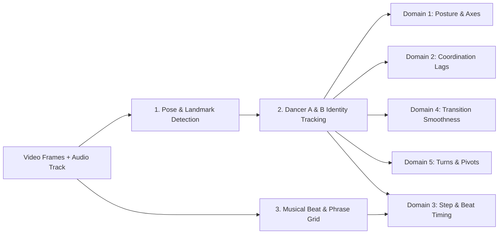
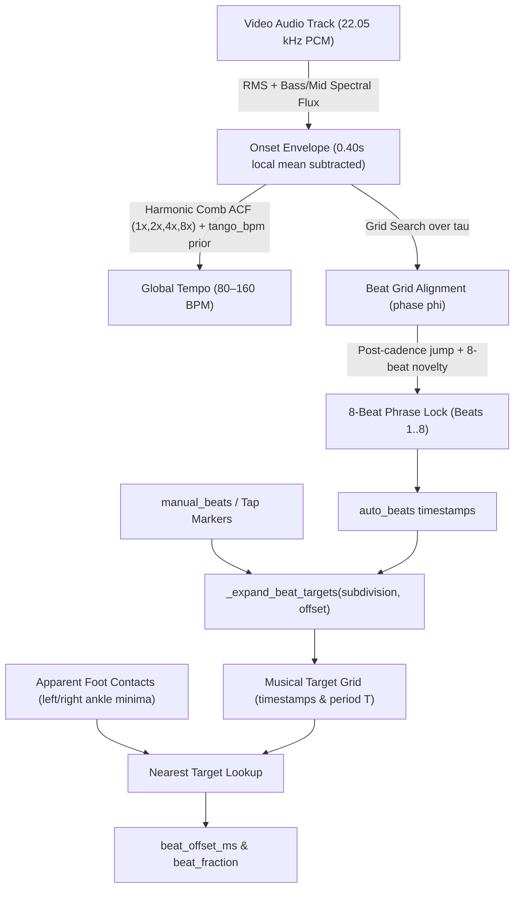
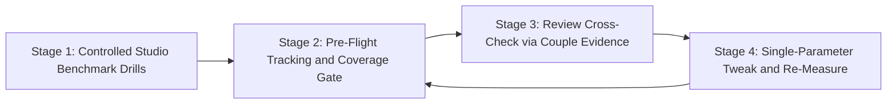

# TangoPosture Couple Analysis & Beat Timing Manual ("For Dummies" Edition)

> [!NOTE]
> This manual explains every metric, mathematical formula, landmark input, beat detector, and configuration parameter used in TangoPosture's **Couple Analysis Engine** (`couple/tracking.py`, `couple/measurements.py`, `couple/overlay.py`, `beat.py`, `references/soundtrack.py`, and `couple/csv_export.py`), written so any dancer, teacher, or analyst can understand both *what the numbers mean* and *how to inspect them*.

---

## 1. The Big Picture ("For Dummies" Mental Model)

Imagine watching two tango dancers from the side of the dance floor. Strip away faces, clothing, and artistic expression, and reduce the physics to four simple elements:

1. **Two Upright Rods (`Torso A` and `Torso B`)**: Each dancer's upper body is treated as a straight line from the **midpoint between their hips** up to the **midpoint between their shoulders**.
2. **An Invisible Spring (`Couple Midpoint Axis` & `Separation`)**: When partners are close enough (within `couple_axis_max_separation_m`, default `1.0 m`), TangoPosture draws a thicker averaged line halfway between their two rods—like the shared "axis" of the embrace—and measures whether they tilt together (`Pearson r`) or form a V/A-frame (`torso_separation`).
3. **A Floor Track (`Travel Axis` & `Velocity`)**: Looking at how the pair's hips move across the screen over time, the software figures out which direction they are dancing along (`ronda` line of dance) and tracks each person's speed along that path to see **who starts, slows down, and stops first**.
4. **A Musical Clock (`Beat Grid` & `Step Contacts`)**: From either the video's soundtrack (`BeatTracker`) or manual beat taps/markers you confirm in Review, TangoPosture builds a musical grid and checks whether foot landings fall **ahead of**, **right on**, or **behind** the beat.

---

## 2. How MediaPipe Landmarks Become Couple Geometry

### 2.1 Which Landmarks Are Actually Used?

MediaPipe detects 33 points per body (`x, y` normalized in `[0.0, 1.0]`, plus `visibility` confidence). Out of those 33 points, the Couple pipeline relies strictly on the landmarks that remain reliable when two bodies overlap:

| Body Region | Exact Landmark Keys | How They Are Used |
| --- | --- | --- |
| **Torso Base** | `left_hip`, `right_hip` | Averaged into `hip_px` (Dancer's center of mass & travel trajectory). Both must clear `confidence` (`0.70`). |
| **Torso Top** | `left_shoulder`, `right_shoulder` | Averaged into `shoulder_px` (top of torso rod & pair midpoint). Both must clear `confidence` (`0.70`). |
| **Head / Gaze** | `nose`, `left_ear`, `right_ear` | Computes `head_pitch_a` and `head_pitch_b` (ear-to-nose angle relative to horizontal). Requires reliable `nose` + at least one reliable ear. |
| **Lower Body / Steps** | `left_knee`, `right_knee`, `left_ankle`, `right_ankle`, `left_heel`, `right_heel`, `left_foot_index`, `right_foot_index` | Used by `analyse_movement_observations` to detect apparent foot `contact` events (`Step & Beat Timing`) and by `filter_and_deduplicate_poses` / close-embrace guards. *(Note: ankle/foot dots are hidden on Couple playback overlays in Review.)* |

### 2.2 Step 1 — Canonical Pixel Coordinates (No Upside-Down Math!)

In image files, pixel `y = 0` is at the **top** edge and increases downward. That makes upward torso tilt math confusing, so `canonical_xy()` in `couple/tracking.py` flips `y` immediately into standard Cartesian coordinates (`+X` = right, `+Y` = up):

$$X_{\text{px}} = x_{\text{norm}} \cdot (W - 1), \qquad Y_{\text{px}} = -y_{\text{norm}} \cdot (H - 1)$$

where $W, H$ are frame width and height in pixels.

Then, for each candidate skeleton where both shoulders and hips exceed `cfg.confidence` (default `0.70`):

- **Hip center**: $\mathbf{h} = \frac{1}{2}(\mathbf{p}_{\text{left\_hip}} + \mathbf{p}_{\text{right\_hip}})$
- **Shoulder center**: $\mathbf{s} = \frac{1}{2}(\mathbf{p}_{\text{left\_shoulder}} + \mathbf{p}_{\text{right\_shoulder}})$
- **Instant torso length**: $L = \|\mathbf{s} - \mathbf{h}\|_2$ (must be $\ge \max(8\text{ px},\; 0.5 \cdot \text{min\_torso} \cdot H)$).

### 2.3 Step 2 — Fixed Torso Scale Normalization

Raw pixel speeds depend on zoom (a couple close to the camera appears to move faster in pixels/sec than a distant couple). To solve this, TangoPosture computes each dancer's **Fixed Torso Scale** ($S_A, S_B, S_{\text{pair}}$ in pixels) across the clip (or across user-marked neutral `baseline_passages` if ≥ 3 samples exist):

$$S_A = \text{median}(L_A), \qquad S_B = \text{median}(L_B), \qquad S_{\text{pair}} = \frac{S_A + S_B}{2}$$

All distances and speeds in Couple analysis are then divided by $S$, giving **camera-independent units of torso lengths (`tl`) and torso lengths per second (`tl/s`)**. Because an average adult shoulder-to-hip torso length is roughly **0.50 m**, `1 torso length ≈ 0.50 m` (so `2.0 torso lengths ≈ 1.0 m`).

> [!IMPORTANT]
> If a noisy detection suddenly stretches or shrinks a dancer's torso outside `[fixed_scale_min_ratio, fixed_scale_max_ratio]` (default `[0.45, 2.20]` × $S$), `_enforce_fixed_scale_eligibility()` marks `torso_eligible = False` for that frame so distorted foreshortened poses cannot corrupt tilt angles!

### 2.4 Step 3 — Keeping Dancer A and Dancer B From Swapping Identities

When two partners cross paths or pass closely, naive left-to-right sorting swaps Dancer A and Dancer B mid-song. `track_couple_frames()` uses a **constant-velocity hip predictor + 1-to-1 gated association**:

1. **Duplicate Ghost Removal (`filter_and_deduplicate_poses`)**: First filters out any pose outside the user's **Analysis Region** rectangle (if set) and merges duplicate overlapping MediaPipe detections on the same person whose median joint separation is below `duplicate_pose_max_distance_torso_lengths` (`0.18 tl`).
2. **Prediction (`predicted_hip`)**: Predicts where Dancer A and Dancer B should be in the current frame based on their previous hip velocity.
3. **Innovation Gate**: Any detection farther than `identity_max_innovation_torso_lengths` (`0.75 tl`) from a track's predicted hip is rejected for that track.
4. **Ambiguity Margin**: If swapping `A ↔ B` produces nearly the same total association cost (difference `< identity_margin_torso_lengths`, default `0.15 tl`), the engine refuses to guess! It triggers an identity ambiguity break rather than silently swapping partners.
5. **Shot Cuts & Re-Anchoring**: A frame time jump `> shot_cut_max_frame_gap_s` (`1.50 s`) or a collective hip jump `>= shot_cut_jump_torso_lengths` (`1.50 tl`) resets tracks cleanly unless user **Dancer Anchors** (clicks in Review) re-identify who is A and B.

### 2.5 Close-Embrace Merged Detection Fallback

In tight milonguero close embrace, MediaPipe sometimes sees two hugging bodies as **one merged skeleton** (`len(poses) == 1`). When that happens in Couple mode:

- `_resolve_close_embrace_fallback()` (`engines/couple.py`) inspects a tightened ROI crop around each partner's half of the embrace.
- Any split candidate whose torso tilt exceeds `close_embrace_max_tilt_deg` (default `25.0°`) is rejected as physically implausible, preventing wild upside-down "ghost skeletons".

---

## 3. Every Couple Metric Explained (Math + For Dummies)

### Domain 1 — Posture & Axes (`summaries["posture"]`)

| Metric Key | "For Dummies" Meaning | Exact Formula & Units |
| --- | --- | --- |
| **`torso_tilt_a`** / **`torso_tilt_b`** | Is Dancer A/B standing straight upright (`0°`), leaning right (`+`), or leaning left (`-`) in the camera view? | $\theta = \operatorname{atan2}(s_x - h_x,\; s_y - h_y) \cdot \frac{180}{\pi}$ (degrees). Measured in canonical pixels whenever `torso_eligible` is true. |
| **`couple_midpoint_tilt`** | Imagine drawing one spine right down the middle between Partner A and Partner B. How much does the *couple as one unit* lean left or right? | $\mathbf{h}_{\text{pair}} = \frac{\mathbf{h}_A + \mathbf{h}_B}{2},\; \mathbf{s}_{\text{pair}} = \frac{\mathbf{s}_A + \mathbf{s}_B}{2}$, then $\theta_{\text{mid}} = \operatorname{atan2}(s_{\text{pair},x} - h_{\text{pair},x},\; s_{\text{pair},y} - h_{\text{pair},y})$ (degrees). |
| **`torso_separation`** | Are both torsos parallel like train tracks (`0°`), forming an A-frame tent (`+12°` leaning in), or opening into a V-shape? | $\Delta\theta_{\text{sep}} = \|\operatorname{wrapped\_diff}(\theta_A, \theta_B)\|$ (degrees, always $\ge 0$). Note: If both dancers lean right by `+8°` together, **`torso_tilt_a = +8°`**, **`torso_tilt_b = +8°`**, **`couple_midpoint_tilt = +8°`**, and **`torso_separation = 0°`**! |
| **`torso_tilt_pearson_r`** | Do the partners' torso tilts move together **in sync** across the dance? (`+1.0` = mirror sway together; `0.0` = unrelated; `-1.0` = one leans opposite whenever the other leans). | $r = \dfrac{\sum (a_i - \bar{a})(b_i - \bar{b})}{\|\mathbf{a} - \bar{a}\|_2 \, \|\mathbf{b} - \bar{b}\|_2} \in [-1, +1]$ computed on strictly timestamp-aligned (`≤ 0.1 ms`), finite `measured` pairs (`min_samples >= 3`, non-zero variance). |
| **`head_pitch_a`** / **`head_pitch_b`** | Is the dancer's chin level (`0°`), lifted up (`+`), or looking down at the floor (`-`)? | `head_horizontal_alignment(raw_pose, width, height, cfg.head_neutral_offset)` (degrees). Computed whenever `nose` and at least one ear pass `confidence`. |

#### Distance Gate + Hysteresis for the Shared Midpoint Axis Line

When partners separate beyond 1 meter (e.g., walking apart or solo adornos/soltada), drawing a midpoint line through empty air between them makes no biomechanical sense. `run_couple_analysis()` estimates hip separation in meters using the fixed pair scale:

$$d_{\text{hip, m}} = \frac{\|\mathbf{h}_A - \mathbf{h}_B\|_2}{S_{\text{pair}}} \times 0.50\text{ m/tl}$$

It then applies a **two-threshold hysteresis switch** so the green/cyan shared midpoint line doesn't blink rapidly near the boundary:
- **Turn OFF** when partners move farther than `couple_axis_max_separation_m` (default `1.0 m`) → only individual lines for A and B are drawn.
- **Turn back ON** only when partners come closer than `couple_axis_rejoin_separation_m` (default `0.80 m`) → shared midpoint line reappears for close/open embrace.

#### Why Median and IQR Instead of Mean and Standard Deviation?

Tango videos inevitably contain occasional 1–2 frame pose glitches or brief extreme movements.
- **Median ($P_{50}$)**: The middle value when sorted. One crazy `85°` spike cannot pull the median away from your true habitual posture.
- **IQR (Interquartile Range = $P_{75} - P_{25}$)**: The spread of the middle 50% of frames. A tiny IQR (`1.5°`) means rock-solid posture stability; a large IQR (`12°`) means large sway, slumping, or unstable tracking.

---

### Domain 2 — Coordination (`summaries["coordination"]`: Start, Slow, Settle Lags)

How do you tell *mathematically* whether Dancer A leads and Dancer B responds cleanly 120 ms later—or anticipates 50 ms early?

1. **Infer the Principal Travel Axis ($\hat{\mathbf{u}}_{\text{travel}}$)**:
   - If the user drew two points for **Travel Direction** in Review, $\hat{\mathbf{u}}_{\text{travel}}$ points directly from Point 1 to Point 2.
   - Otherwise, `_infer_travel_axis()` runs **PCA / Eigendecomposition** on all valid pair hip positions $\mathbf{h}_{\text{pair}}$ and takes the eigenvector with the largest variance, oriented along the net start-to-end displacement.
   - Projection onto this floor axis gives scalar progress $s_A(t), s_B(t), s_{\text{pair}}(t)$ in torso lengths (`tl`).
2. **Centred Regression Velocity (`compute_centred_regression_velocity`)**:
   - Frame-to-frame finite differences `(x[i] - x[i-1]) / dt` explode whenever Pose Landmarker jitters by 2 pixels in one frame!
   - Instead, at each frame $t_c$, TangoPosture fits an **ordinary least-squares straight line** across all valid frames inside `[t_c - half_window, t_c + half_window]` (`velocity_filter_window_s = 0.15 s`), requiring ≥ 3 samples with **both left ($t < t_c$) and right ($t > t_c$) support** and no breaks/gaps `> max_observation_gap_s` (`0.20 s`):

   $$v(t_c) = \frac{\sum_j (t_j - t_c)(s_j - \bar{s})}{\sum_j (t_j - t_c)^2} \quad [\text{torso lengths / s}]$$

3. **Sub-Frame Threshold Detection (`_detect_motion_events_for_track`)**:
   Walking along each subject's speed $|v(t)|$ with a 2-state hysteresis machine (`IDLE ↔ TRAVELLING`):
   - **`start`**: Speed crosses upward past `start_speed` (`0.20 tl/s`) and stays above `start_speed` for at least `persistence_s` (`0.15 s`). Linearly interpolates the exact crossing timestamp `t_cross` between frames!
   - **`slow`**: While `TRAVELLING`, tracks the median active cruising speed $v_{\text{med}}$. When speed drops below $(1 - \text{slowing\_fraction}) \cdot v_{\text{med}}$ (`0.75 * v_med` by default) for `persistence_s`, emits `slow`.
   - **`settle`**: Speed drops below `stop_speed` (`0.10 tl/s`) for `persistence_s`, returning to `IDLE`.
4. **Greedy Pairing & Signed Lag (`_pair_coordination_events`)**:
   - Pairs Dancer A's event with Dancer B's matching event (`start↔start`, `slow↔slow`, `settle↔settle`) sorted by closest $|\Delta t|$ within `pairing_window_s` (`0.50 s`), **never pairing across a tracking break**.
   - **Signed Lag**: $\text{lag\_ms} = (t_B - t_A) \times 1000$.
     - **Positive lag (`+110 ms`)**: Dancer A crossed the threshold first; Dancer B followed `110 ms` later.
     - **Negative lag (`-60 ms`)**: Dancer B moved before Dancer A (anticipation, or B initiated the movement!).
     - Summarized by `median` + `IQR` (`start_lag_ms`, `slow_lag_ms`, `settle_lag_ms`), plus `paired_count` and `unpaired_count`.

---

### Domain 3 — How the Beat Is Calculated & Step Timing (`summaries["step_timing"]`)

TangoPosture supports **two beat sources**—an automatic acoustic analyzer (`BeatTracker` in `beat.py` + `references/soundtrack.py`) and user-confirmed/manual beats—and matches apparent foot contacts to them.

#### 3.1 How Automatic Audio Beat & 8-Beat Phrase Detection Works (`beat.py` + `soundtrack.py`)

When **Analyze soundtrack** (`dancer_analysis.analyze_soundtrack`) runs during Video Analysis:
1. Audio from the clip is resampled/fed in chunks into `BeatTracker`.
2. **Acoustic Features**: Computes short-time RMS energy, low-frequency **bass spectral flux** (`62%` weight—catches the bass/marcato beat in tango!), and **mid-frequency flux** (`38%` weight—catches bandoneón/violin rhythmic attacks). Each stream is normalized by its 90th percentile, and a `0.40 s` local moving average is subtracted + `50 ms` Hann-smoothed to build a clean **onset envelope**.
3. **Tempo Estimation (`BPM`)**: Computes the FFT autocorrelation of the onset envelope and scores candidate beat periods (`96–148 BPM` grid, clipped to `[80, 160] BPM`) using a **Phrase-Harmonic Comb** at $1\tau, 2\tau, 4\tau, 8\tau$ lags, weighted by a gentle Gaussian prior (`±24 BPM`) around `cfg.tango_bpm` (`120 BPM` default).
4. **Beat Grid Phase Alignment ($\phi$)**: Slides the beat grid across `[0, τ)` to find the phase $\phi$ where the combined `onset_env + 0.5 * bass_norm` peaks hardest within `±20 ms` of every beat line.
5. **8-Beat Phrase Lock (Beat 1 Identification)**: Once enough musical evidence accumulates (`beat_analysis_seconds`, default `30 s` or `>= 24` beats), evaluates all 8 possible downbeat offsets $m \in \{0..7\}$ using post-cadence attack jumps (strong Beat 1 following a softer Beat 8 breath) to label beats `1..8` and phrase counts.
6. **`extract_soundtrack_beat_timestamps()`**: Records the exact `source_time` of every transition where `playing == True` and `beat` increments.
   - *When audio is missing, silent (`< 0.5 s` or `< 2` transitions), or non-rhythmic*: status becomes `no_events_detected` or `not_enough_evidence`, so fake beats are never hallucinated!

#### 3.2 Manual Beat Overrides & Subdivisions (`_expand_beat_targets`)

In **Review → Couple Evidence**, if the automatic beat missed or is syncopated, you can tap/add `manual_beats`, set `beat_subdivision` (`1` = quarter beat, `2` = *traspié* half-beats, `3` = triplets), and adjust `beat_offset_s`:
- Manual beats **override** `auto_beats` and upgrade status from `estimated` to `user_confirmed`.
- For each beat interval $T_i = b_{i+1} - b_i$ and subdivision $k \in \{0, \dots, \text{subdiv}-1\}$, targets are placed at:

  $$t_{i,k} = b_i + \frac{k}{\text{subdiv}} T_i + \text{beat\_offset\_s}, \qquad P_{\text{target}} = \frac{T_i}{\text{subdiv}}$$

#### 3.3 Matching Steps to Beats (`_attach_beat_offsets`)

1. Foot landing candidates (`event_type == "contact"`) are extracted for Dancer A and Dancer B independently by `analyse_movement_observations()` (`movement.py`) from their raw ankle/foot trajectories.
2. Each `contact` (and `start`) event finds the closest musical target timestamp $b^*$ (`argmin |t - b_k|`) and calculates:
   - **`beat_offset_ms`** $= (t_{\text{step}} - b^*) \times 1000$.
     - Negative (`-45 ms`): stepped slightly **early** (anticipation).
     - Near `0 ms`: stepped right on the beat!
     - Positive (`+110 ms`): stepped slightly **late** (*behind the beat*, common in lyrical/Pugliese phrasing).
   - **`beat_fraction`** $= \dfrac{t_{\text{step}} - b^*}{P_{\text{target}}} \in [-0.5, +0.5]$ (e.g., `+0.25` = a quarter beat behind, regardless of whether the song is 105 BPM slow tango or 132 BPM milonga!).
3. Summarized per dancer as `median_beat_offset_ms`, `iqr_beat_offset_ms`, and `median_beat_fraction`.

---

### Domain 4 — Transition Smoothness (`summaries["transitions"]`)

Measures how cleanly the couple decelerates at the end of a phrase instead of stumbling or lurching backward:

1. **Transition Windows**: Pairs each `slow` event with the next `settle` event (`[t_slow, t_settle]`, or up to `t_slow + 2.0 s` if no settle occurs). Also inspects `±0.5 s` around user-marked transitions.
2. **Coverage Gate**: A transition window is only scored if `pair_hip_eligible` coverage inside the window meets `transition_min_coverage` (`0.75` = 75%). Otherwise it counts as an `unavailable` window.
3. **Two Quality Flags**:
   - **Secondary Speed Peaks (`speed_cue` → `unintended_peaks`)**: Checks if pair speed drops to a `running_min`, then **bursts upward again** by at least `secondary_speed_rise` (`0.12 tl/s`) and sustains ≥ 60% of that rise for `persistence_s` (`0.15 s`). *(For dummies: braking at the red light, then accidentally lurching the car forward before stopping!)*
   - **Velocity Reversals (`reversal` → `unintended_reversals`)**: Checks if pair velocity flips sign opposite to the dominant travel direction above `stop_speed`. *(For dummies: overshooting and rocking/rebounding backward!)*
4. **Intentional Choreography Exclusions**: If you mark a **Planned Reversal**, **Planned Pause**, or **Settling Step** in **Review → Couple Evidence** (`_overlaps_planned` within `±0.20 s`), matching peaks/reversals are still logged in the timeline for inspection, **but are excluded** from `unintended_peaks` and `unintended_reversals`!

---

### Domain 5 — Turns & Pivots (`summaries["turns"]`)

Evaluates *giros*, *ochos*, and pivot exits using both user annotations and optional automated cues:

1. **User-Confirmed Turns (`_turn_events_from_annotations_and_candidates`)**:
   - Pairs each `turn_start` with the next `turn_end` to compute **Turn Duration** (`turn_end - turn_start`, seconds).
   - Finds the nearest `exit` marker within `turn_exit_match_window_s` (`3.0 s` default) of `turn_end` and computes **`exit_minus_turn_end_ms`**:
     - **Positive**: clean exit *after* turn finishes.
     - **Negative (`overlap = True`)**: `reason = "exit_occurred_during_turn"`—one partner started travelling forward before the turn finished rotating!
   - Records per-dancer **`pivot_behavior`** (`appears_planted`, `rotates_in_place`, `repositions`, `unknown`) and **`embrace_opening`** notes.
2. **Optional Auto Suggestions (`auto_turn_suggestions`)**: When enabled in Settings, appends `estimated` turn brackets from `movement.py` (`pivot_candidates`) wherever no user-confirmed turn already overlaps (`±0.30 s`).

---

## 4. Complete Settings Reference (What Controls What)

All settings below live in **Settings → Couple · Tracking / Interpolation**, **Couple · Axes / Coordination**, **Common · Scene Routing**, and **Common · Detection / Music**:

### 4.1 Identity Tracking & Frame Eligibility (`Couple · Tracking / Interpolation`)

| Setting | Default | For Dummies Effect & When to Change |
| --- | --- | --- |
| `confidence` | `0.70` | Minimum MediaPipe visibility for hips/shoulders/head. Lower to `0.55` in dim milonga lighting; raise to `0.80` if wild background limbs leak in. |
| `dancer_analysis.duplicate_pose_max_distance_torso_lengths` | `0.18 tl` | Merges two overlapping skeleton boxes on one dancer. Raise slightly (`0.25`) if MediaPipe keeps drawing double skeletons on a single person. |
| `dancer_analysis.identity_max_innovation_torso_lengths` | `0.75 tl` | Maximum jump allowed between predicted and observed hip per frame. Lower (`0.45`) in crowded rooms to block background passersby; raise (`1.0`) for very fast whippy *sacadas* or low-FPS video. |
| `dancer_analysis.identity_margin_torso_lengths` | `0.15 tl` | Minimum tie-breaker margin between A and B during close passes. Raise to `0.25` to force more cautious ambiguity breaks when dancers cross directly in front of the lens. |
| `dancer_analysis.max_observation_gap_s` | `0.20 s` | Breaks velocity windows across tracking dropouts longer than this. Never interpolate metrics across larger gaps. |
| `dancer_analysis.display_interpolation_max_gap_s` | `0.13 s` | Visual-only dotted-line gap bridging between measured poses in Review (never enters metrics). |
| `dancer_analysis.fixed_scale_min_ratio` / `max_ratio` | `0.45` / `2.20` | Rejects distorted foreshortened torso detections outside `[0.45S, 2.20S]`. Tighten to `0.60–1.70` if steep perspective causes tilt spikes. |
| `dancer_analysis.shot_cut_max_frame_gap_s` | `1.50 s` | Time jump that forces a hard shot-cut reset of tracks. |
| `dancer_analysis.shot_cut_jump_torso_lengths` | `1.50 tl` | Collective spatial jump (when camera angle cuts) that resets tracking. |
| `dancer_analysis.close_embrace_max_tilt_deg` | `25.0°` | Rejects impossible tilted split-body guesses in close-embrace fallback. |

### 4.2 Axes, Smoothing, Hysteresis & Coordination (`Couple · Axes / Coordination`)

| Setting | Default | For Dummies Effect & When to Change |
| --- | --- | --- |
| `dancer_analysis.axis_smoothing_s` | `0.25 s` | Zero-phase forward-backward EMA smoothing on Analytics tilt/separation lines. Raise to `0.35–0.45 s` if Analytics charts look too spiky; set `0.0` for raw per-frame data. |
| `dancer_analysis.overlay_smoothing_s` | `0.20 s` | Smoothing applied to Review playback torso-axis lines (`smooth_couple_frame_overlays`). |
| `dancer_analysis.axis_bridge_max_gap_s` | `0.25 s` | Bridges tiny frame dropouts smoothly on charts and playback lines. |
| `dancer_analysis.overlay_min_landmark_visibility` | `0.50` | Visibility threshold for drawing individual axis lines in Review playback. |
| `dancer_analysis.couple_axis_max_separation_m` | `1.0 m` | Estimated hip distance (`0.50 m/tl`) above which the shared Couple midpoint line turns OFF (hiding the line when apart). |
| `dancer_analysis.couple_axis_rejoin_separation_m` | `0.80 m` | Hysteresis threshold below which the hidden midpoint line turns back ON when partners return into embrace (`<= max_separation_m`). |
| `dancer_analysis.velocity_filter_window_s` | `0.15 s` | Half-window (`±0.15 s` = `0.30 s` total) for centred linear-regression speed. Raise to `0.25 s` for noisy 15 fps video; lower to `0.10 s` for crisp 60 fps fast milonga. |
| `dancer_analysis.start_speed` | `0.20 tl/s` | Speed needed to trigger a `start` event. Raise to `0.30` if breathing/swaying in place triggers false starts. |
| `dancer_analysis.stop_speed` | `0.10 tl/s` | Speed below which a dancer counts as `settle`d. Must be `< start_speed`. |
| `dancer_analysis.slowing_fraction` | `0.25` | Triggers `slow` once speed drops 25% below the active phrase's cruising median. Raise (`0.35`) to ignore gentle cadence modulation. |
| `dancer_analysis.persistence_s` | `0.15 s` | How long a speed crossing must hold before creating an event (filters 1–2 frame glitches). |
| `dancer_analysis.pairing_window_s` | `0.50 s` | Maximum allowed gap between Dancer A and Dancer B events to count as a coupled reaction lag. |
| `dancer_analysis.transition_min_coverage` | `0.75` | Requires ≥ 75% tracked pair frames inside `[t_slow, t_settle]` before judging transition smoothness. |
| `dancer_analysis.secondary_speed_rise` | `0.12 tl/s` | Secondary acceleration surge during deceleration flagged as a stumble/unintended speed cue. |
| `dancer_analysis.turn_exit_match_window_s` | `3.00 s` | Search window around `turn_end` to link an `exit` annotation. |
| `dancer_analysis.auto_turn_suggestions` | `false` | Auto-proposes estimated turn brackets in Review when sustained rotation cues occur. |

### 4.3 Music & Beat Timing (`Common · Detection / Music` + Internal `BeatTracker`)

| Setting | Default | For Dummies Effect & When to Change |
| --- | --- | --- |
| `dancer_analysis.analyze_soundtrack` | `false` | Enables automatic audio track beat/phrase extraction during Video Analysis. Turn ON when video contains clear tango music. |
| `tango_bpm` | `120.0 BPM` | Center of the gentle tempo prior (`80–160` search clamped; `±24 BPM` Gaussian weight). Set near `100` for slow Pugliese or `135` for brisk vals/milonga to avoid half/double-time octave errors! |
| `beat_analysis_seconds` | `30.0 s` | Minimum audio window used before locking the 8-beat phrase downbeat (`Beat 1`). |

---

## 5. What Can Damage These Calculations (and How to Spot / Fix It)

> [!WARNING]
> Biomechanical metrics are only as trustworthy as the 2D skeleton and timestamps feeding them. Always check coverage, tracking-break markers, and video framing before coaching a dancer on a strange number!

| Failure Mode | Why It Damages the Math | Symptom in Results / Charts | How to Fix or Prevent |
| --- | --- | --- | --- |
| **Tilted Camera / Dutch Angle** | `torso_tilt` uses image vertical! A camera tilted `+4°` shifts both dancers' `torso_tilt_a` and `torso_tilt_b` by `+4°`, though `torso_separation` and `Pearson r` remain invariant. | Median `torso_tilt_a` & `b` both offset by the exact same constant even when standing straight. | Level the tripod/camera horizon cleanly, or compare relative changes (`Pearson r`, `torso_separation`, `baseline_change_deg`). |
| **Walking Directly Toward / Away From Camera** | Torso length shrinks/grows due to perspective foreshortening along depth (`Z`), shrinking $S_{\text{pair}}$ bias and turning forward apilado into `0°` horizontal projection. | Sudden drop in `pair_torso_coverage` when `ratio < 0.45`, near-zero projected velocity along the camera axis. | Film predominantly **across** the camera's field of view (`45°–90°` to line of dance). Use **Analysis Region** to crop distant turns. |
| **Heavy Partner Occlusion (Dark Clothing on Dark Clothing)** | MediaPipe drops behind-partner shoulders/hips below `confidence = 0.70`, or merges both torsos into 1 pose. | Grey `unavailable` gaps in charts; `couple_midpoint_tilt` drops out; `torso_separation` clips near `0°`. | Ensure contrasting clothing between A & B, film from a three-quarter front/side angle rather than directly behind Leader's back, or enable close-embrace fallback. |
| **Mirrors & Background Bystanders** | Reflections or bystanders create 3rd/4th skeleton detections inside the room, stealing identity or confusing `filter_and_deduplicate_poses`. | Identity swaps or sudden `shot_cut` breaks; erratic spikes in hip speed. | Set the **Analysis Region** rectangle tightly around the couple's dancing corridor! |
| **Low FPS (< 20 fps) or Variable Frame Rate Drops** | With fewer than 3 samples inside `±0.15 s` (`velocity_filter_window_s`), `compute_centred_regression_velocity` outputs `None` (`unavailable`). | `start_lag_ms` / `slow_lag_ms` show `no_partner_event`, high `unavailable` velocity frames. | Film at `>= 30 fps` (ideally `60 fps`), or widen `velocity_filter_window_s` to `0.25 s` and `max_observation_gap_s` to `0.30 s`. |
| **Rubato / Non-Percussive Tangos (e.g., Late Pugliese / Troilo) or Noisy Room Audio** | Acoustic beat tracker locks onto vocal/rubato swells or applause, doubling/halving tempo (`65 vs 130 BPM`). | `beat_fraction` scatters uniformly across `[-0.5, +0.5]`, `bpm` looks half/double true pulse. | Set `tango_bpm` closer to the true tempo, or tap accurate `manual_beats` in **Review → Couple Evidence** (upgrades beats to `user_confirmed`). |
| **Intentional Choreography Mistaken for Stumbles** | A planned *parada*, *pausa*, or *calecita* entry triggers deceleration + acceleration peaks. | `unintended_peaks` / `unintended_reversals > 0` during a musical pause. | Mark **Planned Pause**, **Planned Reversal**, or **Settling Step** in **Review → Couple Evidence** so those intervals are excluded. |

---

## 6. How to Analyze Couple Results & Build Visualizations

Exported CSV files (`couple/csv_export.py`) and JSON analytics (`couple_result["series"]`, `couple_result["events"]`, `couple_result["summaries"]`) give you rich data for coaching and statistical visualization.

### 6.1 Step-by-Step Analysis Workflow

1. **Check Data Health First (Gatekeeping)**:
   - Look at `a_torso_coverage`, `b_torso_coverage`, `pair_torso_coverage`, and `count` of `identity_breaks`.
   - Rule of thumb: Trust posture/lag summaries when coverage `>= 0.70` (70%) and identity breaks are low; if coverage `< 0.50`, crop with **Analysis Region** or add manual dancer anchors before interpreting numbers.
2. **Analyze Global Posture & Sync (`Domain 1`)**:
   - Check **`torso_tilt_a` median (IQR)** and **`torso_tilt_b` median (IQR)**: Who carries more forward/side lean, and who stays steadier (lower IQR)?
   - Check **`torso_separation` median (IQR)**: Is the embrace A-frame (`~5°–12°`), strictly upright parallel (`~0°–3°`), or collapsing/opening erratically (large IQR `> 8°`)?
   - Check **`torso_tilt_pearson_r`**:
     - `r >= +0.50`: Partners incline and sway **together as one shared pendulum**.
     - `r ≈ 0.0`: Independently oscillating upper bodies (common when Follower resists tension or Leader over-rotates).
     - `r <= -0.30`: Mirroring/counter-tilting in opposite image directions (compare camera orientation!).
3. **Analyze Lead-Follow Dynamics (`Domain 2` & `4`)**:
   - Check **`start_lag_ms`**: Healthy responsive following usually shows a small positive lag (`+60 to +160 ms`) with compact IQR (`< 120 ms`). Consistent negative medians (`< 0 ms`) indicate Follower **anticipating** before the Leader's torso initiates.
   - Check **`slow_lag_ms`** & **`settle_lag_ms`**: Compare start vs stop synchronization—many couples start cleanly together (`+90 ms`) but drift apart on braking (`+240 ms` or unintended speed reversals).
4. **Analyze Musicality (`Domain 3`)**:
   - Inspect **`median_beat_offset_ms`** and **`median_beat_fraction`** separately for A and B: Do both partners step at the same rhythmic pocket (e.g., both landing `+40 ms` behind the *marcato*), or is one rushing while the other drags?

### 6.2 Recommended Visualizations (Metrics, Distributions & Outliers)

Whether in TangoPosture's **Analytics** tab or exporting the CSV/JSON into Python (`matplotlib` / `seaborn` / `plotly`) or Excel, here are the highest-value charts you can build from every metric:

| Visualization Type | Best Metrics to Plot | What It Reveals & How to Spot Outliers |
| --- | --- | --- |
| **1. Synchronized Time-Series + Highlighted Event Bands** *(built into Analytics)* | `torso_tilt_a(t)`, `torso_tilt_b(t)`, `couple_midpoint_tilt(t)`, `torso_separation(t)`, `v_A(t)`, `v_B(t)` | Shows *when* during the phrase connection breaks down. Gray bands = `unavailable` occlusions; vertical stems = `start`/`slow`/`settle` markers; red/orange horizontal bands = excursions outside calibrated ranges. |
| **2. Scatter Plot + Linear Regression Line** | X-axis: `torso_tilt_a(t)` vs Y-axis: `torso_tilt_b(t)` (paired samples) | Visually explains **`torso_tilt_pearson_r`**! A tight diagonal cloud along `y = x` means shared tilt synchronization; isolated points far off the diagonal are **coordination outliers** (sudden disconnection or 1-frame tracking glitches) you can inspect by clicking their timestamp! |
| **3. Box Plots + Swarm/Strip Overlay (with Tukey Fences)** | `start_lag_ms`, `slow_lag_ms`, `settle_lag_ms`, `beat_offset_ms`, `torso_separation` | Immediately visualizes **Median** (center line), **IQR** (box height = $P_{75} - P_{25}$), and **Statistical Outliers** using Tukey's rule: points outside $[Q_1 - 1.5 \cdot \text{IQR},\; Q_3 + 1.5 \cdot \text{IQR}]$. Great for comparing 3 takes of the same *caminata* side-by-side! |
| **4. Histogram + KDE Density Distribution** | `torso_tilt_a`, `torso_tilt_b`, `torso_separation`, `head_pitch_a/b` | Shows whether posture has **one habitual equilibrium** (clean single bell peak) or **two distinct postures** (bimodal—e.g., walking straight vs tilting during pivots/turns). |
| **5. Beat-Phase Circular / Rose Plot (or `[-0.5, +0.5]` Histogram)** | `beat_fraction` of `contact` events (`event_type == "contact"`) | Maps `beat_fraction` onto a `0°–360°` musical circle (`0°` = exact beat). Tight narrow wedge around `+15°` shows locked rhythmic groove (*cadencia*); flat circle shows off-beat stepping or double/half-time mismatch! |
| **6. Multi-Track Event Ladder / Waterfall Plot** | Timestamps of `beat`, `A:start/contact`, `B:start/contact`, `turn` | Visualizes lead-follow call-and-response in chronological order: Beat ticks → A's `start` → B's `start` (`lag_ms`) → A/B foot `contact`s (`beat_offset_ms`) → `slow` → `settle`. Instantly exposes where an anticipation (`t_B < t_A`) or skipped beat occurred. |
| **7. Paired Lead-Follow Lag Trend Over Clip Time** | X-axis: `timestamp` vs Y-axis: `lag_ms` (`B - A`) with zero line | Shows whether coordination improves as the couple warms up or degrades during fatigue/fast musical codas (`lag_ms` widening or flipping negative over time). |

### 6.3 Quick Outlier Checklist (Real Technique Flaw vs Pose Error)

When a Box Plot or Scatter Plot highlights an extreme outlier ($> Q_3 + 1.5 \cdot \text{IQR}$ or $< Q_1 - 1.5 \cdot \text{IQR}$):
1. Seek to that exact timestamp in **Review**.
2. Check if either skeleton is drawn with **dotted lines** (`interpolated_display = True`) or missing shoulders/hips.
3. Check if a tracking break or bystander appeared in frame within `±0.3 s`.
4. **Only coach the dancer on outliers that have solid measured skeletons and clear framing**—ignore hardware/occlusion outliers or clean them with **Analysis Region** and **Save Annotations**.

---

## 7. Consistent 4-Stage Framework to Test & Validate Every Couple Metric

Use this repeatable protocol whenever you change camera placement, video framerate, MediaPipe model (`lite` / `full` / `heavy`), or `dancer_analysis` thresholds:

### Stage 1 — Record 5 Controlled Ground-Truth Benchmark Clips (10–20 Seconds Each)
Instead of guessing on complex milonga footage first, verify accuracy on **five simple 10–20 s drills** filmed cleanly across the camera view (`>= 30 FPS`):
1. **Drill 1 — Sync Start, Cruise & Stop (Group 1)**: Stand still for 2 s → Dancer A initiates walking right across the frame while Dancer B starts clearly `~0.2 s` later → cruise 4 steps → decelerate together → stop still for 2 s. *(Ground truth: `velocity > 0.20`, positive `start_lag_ms ~ +200 ms`, `paired_count = 1` per phase.)*
2. **Drill 2 — Metronome Stepping Drill (Group 2)**: Step clearly on every click of a steady `120 BPM` (`500 ms` period) metronome or tango *marcato* track for 12 steps, then pause 2 s and intentionally step `1` beat half-step late (*traspié*). *(Ground truth: `contact_count >= 12` per dancer, `beat_offset_ms` tightly clustered near `0 ms`, low `iqr_beat_offset_ms < 40 ms`.)*
3. **Drill 3 — Smooth Stop vs Double-Clutch Rebound (Group 3)**: Walk 4 steps and brake monotonically to zero (`Run A`), then walk 4 steps, brake almost to a stop, lurch forward/rock backward unintentionally (`Run B`), and finally repeat `Run B` while annotating **Planned Pause** / **Planned Reversal** (`Run C`). *(Ground truth: `Run A` -> `0` cues; `Run B` -> `>= 1` unintended peak/reversal; `Run C` -> unintended drops to `0` while planned tallies increment.)*
4. **Drill 4 — Upright Parallel vs Apilado A-Frame vs Apart `> 1 m` (Group 4)**: Stand still upright facing side-on (`3 s`) → lean symmetrically right (`~+8°` both) (`3 s`) → form an inward A-frame (`A = +6°`, `B = -6°`) (`3 s`) → separate `> 1.2 m` apart and rejoin `< 0.7 m` (`3 s`). *(Ground truth: upright tilts `~0°`; symmetric lean shows `torso_separation ~0°` and high `torso_tilt_pearson_r`; A-frame shows `torso_separation ~12°`; separation disables shared axis line above `1.0 m` and restores below `0.80 m`.)*
5. **Drill 5 — Gyro / Ocho Pivot & Clean vs Overlapped Exit (Group 5)**: Stand → rotate `180°` (*media vuelta* / *giro*), finish rotating for `0.5 s`, then step out (`Turn 1: clean exit`) → rotate `180°` again and step out *while* hips are still finishing rotation (`Turn 2: overlapped exit`). *(Ground truth: `exit_minus_turn_end_ms > 0` on Turn 1, `< 0 ms` with `overlap_count = 1` on Turn 2.)*

### Stage 2 — Pre-Flight Tracking & Coverage Gatekeeping (Must Pass Before Scoring Any Metric)
Inspect `result.coverage`, `tracking.fixed_scale_*`, and `series["pair_breaks"]` before trusting numbers:
- `a_hip_coverage >= 0.75` and `b_hip_coverage >= 0.75` (`pair_hip_coverage >= 0.70`) for Travel, Coordination, and Transitions.
- `pair_torso_coverage >= 0.70` and `a_head_coverage / b_head_coverage >= 0.60` for Posture and Head metrics.
- Fixed scales `fixed_scale_a_px` and `fixed_scale_b_px` within `15%` of manual shoulder-to-hip pixel check (`scale_a / scale_b` realistic for partner heights).
- Verify `travel_axis_unit` arrow in **Review** points along the true line of dance (if perpendicular or inverted due to walking back and forth equally, draw explicit 2-point **Travel Direction**).

### Stage 3 — Ground-Truth Verification in **Review → Couple Evidence**
- Scrub the timeline frame-by-frame to compare every automated candidate event (`start`, `slow`, `settle`, `contact`, `musical_target`, `speed_cue`, `turn`) against the actual video frame.
- Use manual edits/confirmations/deletions in `CoupleAnnotations`, which invoke `rebuild_couple_result_with_annotations()` (`couple/measurements.py`) without wiping out the raw `automated_candidates` so you can measure raw detector precision vs annotated truth.

### Stage 4 — Single-Parameter Sensitivity Check
When tuning a setting (`start_speed`, `velocity_filter_window_s`, `confidence`, etc.), change **one parameter at a time**, re-run **Analyze** (or `rebuild_couple_result_with_annotations`), and compare summary **medians** and **IQRs**. A healthy configuration is stable: changing a threshold by `±15%` should not double event counts or flip lag signs!

---

## 8. Detailed Playbook by Analytical Group & Metric

---

### 8.1 Group 1: Travel and Coordination

#### Metrics Covered
- `velocity_a` & `velocity_b` (signed `torso_lengths / s`, computed via `compute_centred_regression_velocity`)
- `velocity_pair` (signed `pair_torso_lengths / s` of the dual-hip midpoint)
- `start_lag_ms`, `slow_lag_ms`, `settle_lag_ms` (median and IQR of $t_B - t_A$ in ms)
- `paired_count` & `unpaired_count` (`start_paired_count`/`unpaired_count`, `slow_paired_count`/`unpaired_count`, `settle_paired_count`/`unpaired_count`)

#### Validation Test (How to Verify Each Metric)
1. **`velocity_a`, `velocity_b`, `velocity_pair`**: Measure physical floor distance traveled in a steady straight walk (e.g., `2.0 m` over `4.0 s` = `0.50 m/s ≈ 1.0 tl/s` assuming `1 tl ≈ 0.50 m`). Check that `velocity_pair` plateaus near `+1.0 tl/s` (rightward/with-axis) and `-1.0 tl/s` when walking back along the opposite direction. Confirm `velocity` returns to `None` cleanly across breaks/gaps (`> max_observation_gap_s`), never inventing infinite spikes.
2. **`start_lag_ms`, `slow_lag_ms`, `settle_lag_ms`**: Inspect the first 3 `start` / `slow` / `settle` events in Drill 1 in **Review**. Compare exact visual video frame where Dancer A's vs Dancer B's pelvis center translates horizontally against `event["timestamp"]`. Confirm `lag_ms = (t_B - t_A) * 1000` matches your stopwatch/frame diff within `±1 frame` (`±33 ms` at 30 fps) thanks to sub-frame linear crossing interpolation (`_interpolate_crossing`).
3. **`paired_count` & `unpaired_count`**: Count distinct walk phrases manually (`N`). Verify `start_paired_count == N`, `settle_paired_count == N`, and inspect every `unpaired_count > 0` item (`reason == "no_partner_event_within_pairing_window"`) to distinguish real missed partner moves vs tracking dropouts.

#### Recommendations & Interpretation Targets
| Metric | Healthy Tango Recommendation | Warning Signs to Investigate |
| --- | --- | --- |
| **`velocity_a` / `velocity_b` / `velocity_pair`** | Steady *caminata*: peak speeds `0.6 – 1.8 tl/s` (`0.3 – 0.9 m/s`); fast *corrida*: up to `2.5 tl/s`. Zero resting speed `< 0.08 tl/s`. | Resting noise floor `> 0.15 tl/s` (jitter/wrong axis) or peak speed `> 5.0 tl/s` (identity swap). |
| **`start_lag_ms`** | Leader = `A`, Follower = `B`: **`+40 ms to +180 ms`** (`IQR < 100 ms`). Shows connection wait without dragging. | **Consistent negative (`< -30 ms`)**: Follower anticipates/rushes before Leader's center moves, or A/B roles are inverted! **Large positive (`> +300 ms`)**: Delayed transfer/heavy pull. |
| **`slow_lag_ms`** | **`0 ms to +180 ms`**, staying tight (`IQR < 120 ms`) alongside `start_lag_ms`. | Widening `slow_lag_ms` while `start_lag_ms` is tight indicates losing chest-to-chest braking connection at phrase ends. |
| **`settle_lag_ms`** | **`-30 ms to +150 ms`**. Near `0 ms` means both partners settle on the floor cleanly together. | **`> +350 ms`** or unpaired `settle`: one partner glides past or keeps shifting hips after the other has parked. |
| **`paired_count` / `unpaired_count`** | `paired_count / (paired_count + unpaired_count / 2) >= 0.85` across clean walking phrases. | High `unpaired_count` (`> 25%` of phrases): threshold mismatch, asymmetry across dancers, or a tracking `pair_break` occurring mid-phrase. |

#### Controlling Parameters (`DancerAnalysisConfig`)
- `velocity_filter_window_s` (`0.15 s`): Half-window for centred OLS regression (`±0.15 s` = `0.30 s` total).
- `max_observation_gap_s` (`0.20 s`): Maximum gap between raw hip detections inside a regression segment.
- `start_speed` (`0.20 tl/s`): Upward speed crossing threshold to transition `IDLE -> TRAVELLING`.
- `stop_speed` (`0.10 tl/s`): Downward speed threshold to emit `settle` and return `TRAVELLING -> IDLE`.
- `slowing_fraction` (`0.25`): Triggers `slow` when active speed falls below `(1 - 0.25) * v_med` of current travelling bout.
- `persistence_s` (`0.15 s`): Hold duration required after crossing `start_speed` / `slow_thresh` / `stop_speed`.
- `pairing_window_s` (`0.50 s`): Maximum allowed $|t_B - t_A|$ for 1-to-1 greedy pairing.
- User annotations: **Travel Direction 2-point vector** (`travel_direction_points`), manual `start` / `slow` / `settle` confirmations or adjustments, **Baseline passages** (for `fixed_scale_*`).

#### Troubleshooting & Parameter Tweaks
- **Problem: `velocity_*` stays near `0.0` even though dancers are walking fast, OR signs look wrong.**
  - *Cause*: Auto-PCA `_infer_travel_axis()` locked onto perpendicular depth/sway axis, or couple walked equal distance out and back so camera-plane PCA picked side-to-side motion.
  - *Fix*: Explicitly draw the 2-point **Travel Direction** arrow along the line of dance in **Review**, or crop to one linear pass.
- **Problem: `velocity_*` is mostly `None` (`unavailable`).**
  - *Cause*: Video framerate is `< 20 FPS` (e.g., 12–15 FPS gives `< 3` frames inside `±0.15 s`!) or `hip_eligible` drops frequently (`confidence = 0.70`).
  - *Fix*: Increase `velocity_filter_window_s` to `0.25 s`, raise `max_observation_gap_s` to `0.30 s`, or lower `confidence` to `0.55`.
- **Problem: False `start` events triggered during stationary sway/breathing, or slow lyrical walking never triggers `start`.**
  - *Fix*: Raise `start_speed` (`0.25–0.30 tl/s`) and `persistence_s` (`0.20 s`) to suppress breathing jitter; lower `start_speed` to `0.12–0.15 tl/s` and `stop_speed` to `0.06 tl/s` for ultra-slow *Pugliese* steps.
- **Problem: `slow` never fires before `settle`, or fires on gentle speed variations mid-walk.**
  - *Fix*: Check `slowing_fraction` (`0.25`). Lower to `0.15` if brakes are gradual; raise to `0.35` to ignore natural step-by-step hip velocity ripple during cruising.
- **Problem: `unpaired_count` is high even when both partners visibly start/stop together.**
  - *Fix*: Check `pair_breaks` (never pairs across breaks!)—re-anchor identities if an ambiguity break occurred between $t_A$ and $t_B$. If real response lags exceed `0.5 s` (e.g., slow musical pause response), widen `pairing_window_s` to `0.75–1.00 s`.

#### Visualizations to Build for Group 1
1. **Dual Velocity Trace + Threshold Band Chart**: Plot `velocity_a(t)` and `velocity_b(t)` overlaid against horizontal dotted lines at `±start_speed` and `±stop_speed`, with shaded vertical phase ribbons from `start` → `slow` → `settle` and connecting arrow brackets annotated with `lag_ms`.
2. **Phase Lag Distribution Strip/Box Plot**: Side-by-side box plots (with individual scatter points + horizontal `0 ms` zero-lag line) of paired `start_lag_ms`, `slow_lag_ms`, and `settle_lag_ms` to spot anticipation (`< 0 ms`), sluggish stops, and Tukey outliers (`> Q3 + 1.5*IQR`).
3. **Pairing Integrity Bar Chart**: Stacked bar showing `paired_count` vs `unpaired_count` for `start`, `slow`, and `settle` alongside `pair_hip_coverage`.

---

### 8.2 Group 2: Steps and Musical Timing

#### Metrics Covered
- `contact_count` (total detected `contact` events per dancer `A` and `B`)
- `matched_count` (contacts paired with a nearest `musical_target`)
- `beat_offset_ms` & `median_beat_offset_ms` ($t_{\text{contact}} - t_{\text{beat}}$ in ms)
- `iqr_beat_offset_ms` ($P_{75} - P_{25}$ spread of `beat_offset_ms`)
- `beat_fraction` & `median_beat_fraction` ($(t_{\text{contact}} - t_{\text{beat}}) / P_{\text{target}}$)

#### Validation Test (How to Verify Each Metric)
1. **`contact_count`**: On Drill 2 (12 clean steps), watch the raw ankle trajectory in **Review**. Verify that detected `contact` timestamps match the exact frame where the stepping foot plants/settles onto the floor (not mid-swing *boleo* or stationary ankle twist). Confirm `contact_count` matches visible floor transfers within `±1` step.
2. **`matched_count` & `beat_offset_ms`**: Compare `beat_targets` timestamps against known metronome click timestamps or audible downbeats in the video (`nearest_beat_time`). Check `matched_count == contact_count` whenever musical targets exist across the clip span. Verify negative offsets match visibly early steps and positive offsets match visibly delayed steps.
3. **`iqr_beat_offset_ms` & `median_beat_fraction`**: On a constant `120 BPM` (`500 ms` beat period) vs `100 BPM` (`600 ms` beat period) test, confirm a constant `50 ms` delay gives `beat_fraction = +0.10` at 120 BPM and `+0.083` at 100 BPM. Confirm half-beat *traspié* checks (`beat_subdivision = 2`) keep `beat_fraction` inside `[-0.5, +0.5]` instead of inflating offsets near `±250 ms`.

#### Recommendations & Interpretation Targets
| Metric | Healthy Tango Recommendation | Warning Signs to Investigate |
| --- | --- | --- |
| **`contact_count` vs `matched_count`** | `matched_count == contact_count` whenever music is active (`status = user_confirmed` when beats verified). | `matched_count == 0` -> soundtrack beats missing (`analyze_soundtrack = false` or quiet audio) and no manual beats entered. `contact_count` near zero despite walking -> skirt/dark floor occluded ankles! |
| **`median_beat_offset_ms`** | **On-beat (*marcato*, Di Sarli/D'Arienzo)**: `-35 ms to +45 ms`. **Behind the beat (*cadencia* / Pugliese)**: `+30 ms to +110 ms`. | Large consistent mismatch (`|offset| > 180 ms` at `~120 BPM`): off-beat stepping (*contratiempo* when `beat_subdivision = 1`), wrong audio-video sync offset, or `beat_offset_s` phase shift. |
| **`iqr_beat_offset_ms`** | Tight consistent pocket: **`<= 60–90 ms`**. Intermediate dancers typically `90–140 ms`. | **`> 160 ms`**: Erratic rushing/dragging, double-time vs half-time switching, or mixing single-beat steps and half-beat *traspiés* under `subdivision = 1`. |
| **`median_beat_fraction` (A vs B)** | Leader & Follower share similar `median_beat_fraction` (e.g., `|frac_B - frac_A| <= 0.08`). Typically `-0.08 to +0.15` for grounded walking. | Near `±0.40 – 0.50`: Consistently stepping on the **and** half-beat while grid is `subdivision = 1` (set `beat_subdivision = 2` to evaluate *traspiés* properly!). |

#### Controlling Parameters
- **Music & Beat Grid**: `tango_bpm` (`120.0 BPM` harmonic prior), `beat_analysis_seconds` (`30.0 s` phrase lock), `dancer_analysis.analyze_soundtrack` (`false` default — turn `true` for audio clips).
- **Review Beat Annotations (`CoupleAnnotations`)**: `manual_beats`, `beat_subdivision` (`1`, `2`, `3`, ...), `beat_offset_s` (fine phase shift in seconds).
- **Step Contact Engine (`DETECTOR_CONFIG` in `movement.py`)**: `step_min_landmark_confidence` (`0.45`), `step_smooth_tau_s` (`0.10 s`), `step_move_speed_scale_s` (`0.30`), `step_settle_speed_scale_s` (`0.35`), `step_settle_radius_scale` (`0.045`), `step_settle_min_duration_s` (`0.10 s`), `step_min_center_travel_scale` (`0.075`), `step_min_both_ends_travel_scale` (`0.065`), `step_min_leg_extension_ratio` (`0.78`), `step_max_airborne_lift_scale` (`0.14`), `step_debounce_s` (`0.25 s`).

#### Troubleshooting & Parameter Tweaks
- **Problem: Every footstep is missed (`contact_count` is much smaller than actual steps).**
  - *Causes*: (1) Partner's skirt, wide trousers, or dark shoes against a dark floor pushed ankles/heels/toes below `step_min_landmark_confidence` (`0.45`). (2) Tiny micro-steps `< 0.075` body scale (`step_min_center_travel_scale`) or ultra-fast steps faster than `step_debounce_s` (`0.25 s`). (3) Frame rate `< 15 FPS`.
  - *Fixes*: Improve floor-to-shoe visual contrast and film at `>= 30 FPS`; use offline **Full** or **Heavy** model (`analysis_model = "heavy"`); add/confirm missed `contact` annotations manually in **Review → Couple Evidence**.
- **Problem: Phantom extra `contact` events appear during pivots or leg *boleos* / *ganchos*.**
  - *Cause*: Ankle swings low or twists in place while weight never transferred.
  - *Fix*: Inspect the event in Review; delete false `contact` candidates directly in **Couple Evidence** (`deleted = True`).
- **Problem: `beat_offset_ms` alternates `-250 ms` and `+250 ms` symmetrically (high `iqr_beat_offset_ms`), even though steps look musical.**
  - *Causes*: (1) Video audio track dropped beat/halved tempo (`60 vs 120 BPM`), OR (2) Dancer is stepping syncopated half-beats (*traspiés*) with `beat_subdivision = 1`, OR (3) Audio recording latency shifts beats by a fixed `80–150 ms`.
  - *Fixes*: Set `tango_bpm` closer to track BPM before running soundtrack analysis; tap/confirm `manual_beats` in Review; set `beat_subdivision = 2` for *traspié* phrases; apply `beat_offset_s` if audio/video mux has constant lag.

#### Visualizations to Build for Group 2
1. **Beat-Phase Circular Rose Plot (`[-0.5, +0.5]` → `[-180°, +180°]`)**: Maps `beat_fraction` onto a polar compass where `0°` (12 o'clock) is the musical beat, positive angles (`+90° = +0.25 beat`) sit behind the beat, and separate radial rings/colors compare **Dancer A** vs **Dancer B**.
2. **Paired Partner Offset Timeline / Waterfall**: Plot `timestamp` (X) vs `beat_offset_ms` (Y) with separate traces for A and B (`y = 0 ms` dashed beat reference), showing whether A and B drift in parallel or diverge mid-song.
3. **Histogram + IQR Strip Plot of `beat_offset_ms`**: Compare A and B timing distributions side-by-side (`[Q1 - 1.5*IQR, Q3 + 1.5*IQR]` outlier markers) to separate consistent rhythmic placement (*cadencia*) from erratic inconsistency.

---

### 8.3 Group 3: Transitions

#### Metrics Covered
- `secondary_speed_peaks` (unintended speed surges while slowing down)
- `unintended_reversals` (unintended velocity sign flips opposite dominant motion)
- `planned_pauses`, `planned_reversals`, & `settling_steps` (user mark tallies)
- Transition `coverage` & `status` (`"measured"` vs `"unavailable"`)

#### Validation Test (How to Verify Each Metric)
1. **Smooth Brake Negative Control (`Run A`)**: Record 3 clean decelerations to complete stillness with no bounce. Verify `[t_slow, t_settle]` brackets align cleanly with actual deceleration, `coverage >= 0.75`, `status == "measured"`, `secondary_speed_peaks == 0`, and `unintended_reversals == 0`.
2. **Deliberate Double-Clutch / Rocking Positive Control (`Run B`)**: Walk, slow almost to `stop_speed`, deliberately lunge `+0.20 tl/s` (`>= 0.12` rise for `>= 0.15 s`) or rebound backward `> stop_speed`, then settle. Verify `secondary_speed_peaks >= 1` and/or `unintended_reversals >= 1` emit matching `speed_cue` timestamps exact to the video stumble.
3. **Choreography Override Check (`Run C`)**: On `Run B`, place `PlannedTransitionMark` (`planned_pause`, `settling_step`, or `planned_reversal`) overlapping `±0.20 s`. Confirm `rebuild_couple_result_with_annotations()` flips `speed_cue` status to `"user_confirmed"` and drops `secondary_speed_peaks` / `unintended_reversals` to `0` while incrementing `settling_steps` / `planned_reversals`.

#### Recommendations & Interpretation Targets
| Metric | Healthy Tango Recommendation | Warning Signs to Investigate |
| --- | --- | --- |
| **`secondary_speed_peaks`** | **`0` per clean phrase ending** (`<= 1` minor collecting adjustment per clip when intentional marks are entered). | **`>= 2` unintended peaks**: Couple breaks down deceleration—either one partner collects late, pushes off at end of step, or pulls when weight transfer finishes. |
| **`unintended_reversals`** | **`0` unintended reversals** in unidirectional *caminata*. | **`>= 1` unintended reversals**: Over-striding followed by subtle backward recoil/bounce at stop (rock step out of control), unless a real *rebote*/*vaivén* happened! |
| **`planned_pauses` / `planned_reversals` / `settling_steps`** | Matches number of choreographed pauses, direction changes, and deliberate *cruce*/closing adjustments in the clip. | `0` across a clip filled with deliberate *rebotes* or stops -> reviewer has not marked choreography yet, biasing `unintended_*` high! |
| **Transition `coverage` & `status`** | `status == "measured"` and **`coverage >= 0.75`** (`>= 0.85` ideal). | `status == "unavailable"` (`insufficient_transition_coverage`): Partner hips occluded during turn-in stops—never coach transition quality when `status == "unavailable"`. |

#### Controlling Parameters
- `dancer_analysis.transition_min_coverage` (`0.75`): Minimum fraction of valid dual-hip frames required in `[t_slow, t_settle]` (or `[mark - 0.5s, mark_end + 0.5s]`).
- `dancer_analysis.secondary_speed_rise` (`0.12 tl/s`): Surge above running minimum required to trigger a `secondary_speed_peak` (60% of this = `0.072 tl/s` must hold over `persistence_s`).
- `dancer_analysis.persistence_s` (`0.15 s`): Minimum duration a speed surge or opposite velocity must stay sustained.
- `dancer_analysis.stop_speed` (`0.10 tl/s`): Opposite velocity floor for detecting reversal (`v * dom_sign < -stop_speed`).
- `dancer_analysis.slowing_fraction` (`0.25`): Controls where `slow` begins transition brackets (note: if no `slow` event fires and there are no planned marks, `_evaluate_transitions()` checks clip-wide reversal only, not `secondary_speed_peaks`).
- Review `annotations.planned_transitions`: `PlannedTransitionMark(kind=...)` with `±0.20 s` overlap tolerance (`_overlaps_planned`).

#### Troubleshooting & Parameter Tweaks
- **Problem: Transition `status == "unavailable"` even though steps occurred clearly.**
  - *Cause*: One partner's hip dipped below `confidence = 0.70` mid-brake (dropping bracket `pair_hip_coverage < 0.75`), or `slow` never triggered so only whole-clip `pair_hip_coverage` was checked under occlusion.
  - *Fix*: Inspect gray `unavailable` regions in **Analytics**; add Dancer Anchors around gaps, check lighting, or adjust `confidence` (`0.55–0.65`) / `transition_min_coverage` (`0.60`) only if hip occlusion is minor.
- **Problem: `secondary_speed_peaks` triggers on every tiny ankle settle ripple.**
  - *Cause*: `velocity_filter_window_s` (`0.15 s`) + `secondary_speed_rise` (`0.12 tl/s`) is sensitive to natural pelvic settling bounce on fast steps.
  - *Fix*: Raise `secondary_speed_rise` to `0.18–0.22 tl/s` or widen `velocity_filter_window_s` to `0.20 s` / `persistence_s` to `0.20 s`. Mark genuine double-steps as `settling_step`.
- **Problem: Planned *rebote* (*amague* / change of direction) counts as `unintended_reversals`.**
  - *Cause*: Reviewer left `planned_transitions` empty; note also that whole-clip `dom_sign` is determined by net sign majority, so a clip walking 50% right and 50% left will see one half as opposite!
  - *Fix*: Mark **Planned Reversal** at the turnaround timestamp in Review (`±0.20 s` covers turning apex), or clip unidirectional *caminata* passages separately.

#### Visualizations to Build for Group 3
1. **Deceleration Speed-vs-Time Phase Strip**: Plot `|velocity_pair(t)|` inside each shaded `[t_slow, t_settle]` bracket, showing the decaying curve, running minimum dashed envelope (`running_min + secondary_speed_rise`), red markers for `measured` `speed_cue`s, and green markers for `user_confirmed` planned choreography marks.
2. **Signed Velocity Reversal Strip**: Plot signed `velocity_pair(t)` around `0.0 tl/s` with shaded zones at `±stop_speed`, making unintended backward recoils immediately visible below zero.

---

### 8.4 Group 4: Posture and Alignment

#### Metrics Covered
- `torso_tilt_a` & `torso_tilt_b` (signed degrees from image vertical, $+ =$ shoulders camera-right of hips)
- `couple_midpoint_tilt` (signed degrees of pair midpoint hip→shoulder axis)
- `torso_separation` ($|\operatorname{wrapped\_diff}(\theta_A, \theta_B)| \ge 0^\circ$)
- `head_pitch_a` & `head_pitch_b` (degrees with `head_neutral_offset` subtracted)
- `torso_tilt_pearson_r` (Pearson $r \in [-1, +1]$ on aligned `measured` frame pairs)

#### Validation Test (How to Verify Each Metric)
1. **Static Plumb & Lean Verification (Drill 4)**: Stand straight next to a visible vertical doorway/pillar (`0°`), then lean noticeably right toward camera-right (`+x`) and confirm both `torso_tilt_a` and `torso_tilt_b` read `~0° ± 2°` upright and turn positive (`+6°..+12°`) leaning right and negative (`-6°..-12°`) leaning left.
2. **A-Frame Separation Check**: While Leader leans `+6°` right toward Follower and Follower leans `-6°` left into embrace, verify `couple_midpoint_tilt` reads `~0°` (centered!), while `torso_separation` reads `~12°` (`|6 - (-6)|`). Confirm that when partners walk $> 1.0\text{ m}$ apart (`couple_axis_max_separation_m`), Review hides the shared couple line and keeps individual A/B lines, restoring below `0.80 m`.
3. **Pearson Synchronization Check (`torso_tilt_pearson_r`)**: Record 10 s swaying/leaning smoothly together left-and-right as a coupled unit (`r` should exceed `+0.70`), vs Follower stiffening upright while Leader sways alone (`r` drops near `0.0`).
4. **Head Pitch Sanity Check (`head_pitch_a/b`)**: Look level ahead (`~0°`), then drop chin to look at partner's feet (`<= -15°`). Verify values stay `None` (`head_landmarks_unavailable`) when facing directly away from camera so unseen noses are never guessed.

#### Recommendations & Interpretation Targets
| Metric | Healthy Tango Recommendation | Warning Signs to Investigate |
| --- | --- | --- |
| **`torso_tilt_a` & `torso_tilt_b`** | **Steady upright (*salón*)**: Median within `±4°` of vertical (assuming level camera), `IQR <= 3°–5°`. **Milonguero *apilado***: Controlled forward lean `4°–10°` toward partner (`IQR <= 4°`), opposite signs between facing partners! | **Large `IQR > 10°`**: Forward-back bobbing every step ("pitching"), OR camera roll tilt / severe foreshortening (`fixed_scale` issues). |
| **`couple_midpoint_tilt`** | **`0° ± 3°`** (`IQR <= 3°`) in balanced embrace—even in *apilado*, mutual leans cancel around vertical center! | Steady drift away from `0°` (`> 6°` sustained) signals the pair's shared center-of-gravity axis is tilting off-balance over one side (or tripod horizon is tilted). |
| **`torso_separation`** | **Parallel upright**: `0°–4°` (`IQR <= 3°`). **Balanced A-frame *apilado***: `6°–14°` (`IQR <= 4°`). | **Large separation `> 18°`** with **high `IQR > 8°`**: Dropping into heavy V/A tension collapse during turns or pushing away with arms. |
| **`head_pitch_a` / `head_pitch_b`** | Gaze slightly level (`-8° to +6°`, `IQR <= 6°`), keeping cervical line aligned without looking down at feet. | Sustained negative median (`< -15°`) -> chronic looking at the floor (note: verify `head_neutral_offset` matches natural anatomy/camera height first!). |
| **`torso_tilt_pearson_r`** | **Synchronous sway / side-by-side parallel**: `r >= +0.50`. **Rigid static upright stance**: `r` can be near `0` or `unavailable (zero_variance)` if tilts barely move! | **`r < 0.0` during active movement** (or unexpected sign): In pure in-line linear sway, one dancer tilts away while partner tilts toward (*broken frame* or counter-leaning). Note sign convention when partners rotate 180° relative to camera! |

#### Controlling Parameters
- **Core Quality & Normalization**: `confidence` (`0.70`), `min_torso` (`0.12`), `head_neutral_offset` (`-12.0°`), `dancer_analysis.fixed_scale_min_ratio` (`0.45`), `dancer_analysis.fixed_scale_max_ratio` (`2.20`), `dancer_analysis.close_embrace_max_tilt_deg` (`25.0°`).
- **Smoothing & Display**: `dancer_analysis.axis_smoothing_s` (`0.25 s`, Analytics charts), `dancer_analysis.overlay_smoothing_s` (`0.20 s`, Review playback lines), `dancer_analysis.axis_bridge_max_gap_s` (`0.25 s`), `dancer_analysis.overlay_min_landmark_visibility` (`0.50`).
- **Midpoint Axis Distance Gate**: `dancer_analysis.couple_axis_max_separation_m` (`1.0 m`), `dancer_analysis.couple_axis_rejoin_separation_m` (`0.80 m`).
- **Calibration Ranges**: Optional `baseline_passages` and `.tpc` approved limits (`COUPLE_METRIC_DETAILS`), evaluated via `calibration_smoothing_s` (`0.25 s`), `calibration_entry_duration_s` (`1.5 s`), `calibration_clear_duration_s` (`0.75 s`).

#### Troubleshooting & Parameter Tweaks
- **Problem: `torso_tilt_a` & `torso_tilt_b` both show a steady `+5°` bias even when dancers stand visibly vertical.**
  - *Cause*: Tripod/phone camera horizon is rolled `5°` (since `atan2` uses raw image vertical).
  - *Fix*: Level camera mechanically. In existing clips, rely on `torso_separation`, `torso_tilt_pearson_r`, and `baseline_change_deg` (using `baseline_passages` neutral stance subtraction!).
- **Problem: `torso_tilt_pearson_r` reads `unavailable` (`zero_variance` or `insufficient_paired_samples`) or unexpectedly near `0`.**
  - *Causes*: (1) If both dancers hold rock-steady posture (`std ~ 0°`), tiny signal-to-noise ratio prevents correlation (`zero_variance`). (2) `pair_torso_coverage` had `< 3` simultaneously measured frames. (3) During 180° turns facing camera vs side-on, screen-right (`+`) switches anatomical direction!
  - *Fix*: Compute `torso_tilt_pearson_r` across dynamic walking/swaying clips in **one dominant facing direction** (`pair_torso_coverage >= 0.70`, `>= 10` moving samples), not static standing holds.
- **Problem: Shared green/cyan midpoint axis line flickers ON/OFF or disappears during wide open embrace.**
  - *Fix*: Adjust `couple_axis_max_separation_m` (e.g., `1.2 m` for wide open embrace) and `couple_axis_rejoin_separation_m` (`0.95 m`) keeping a `>= 0.15 m` hysteresis gap.
- **Problem: Torso lines jump wildly to `±35°` when partners overlap tightly in close embrace.**
  - *Fix*: Check `fixed_scale_min_ratio` / `max_ratio` (`0.55–1.80` tightens rejection of foreshortened bodies) and keep `close_embrace_max_tilt_deg` (`20–25°`) so implausible split candidates are discarded; verify **Analysis Model** (`Full` or `Heavy` cuts close-embrace overlap errors noticeably vs `Lite`).

#### Visualizations to Build for Group 4
1. **Synchronized Multi-Axis Ribbon Plot**: Plot `torso_tilt_a(t)`, `torso_tilt_b(t)`, and `couple_midpoint_tilt(t)` on top (`±°`), and `torso_separation(t)` below (`0°+`), with gray shading wherever `unavailable` occurs and optional green/red approved-range corridors.
2. **Partner Tilt Joint Scatter Plot (`torso_tilt_a` vs `torso_tilt_b`) + OLS Trend Line**: Visualize `torso_tilt_pearson_r` directly! Highlight `y = x` (parallel sway) vs `y = -x` (symmetric A-frame inclination) and flag points outside `±2 SD` residuals as moment-by-moment disconnection or occlusion outliers.
3. **Violin / Box Plots of `torso_separation` & `head_pitch_a/b` by Passage/Baseline**: Compare upright standing (`baseline`) vs walking vs turning intervals to see whether embrace geometry collapses specifically during turns.

---

### 8.5 Group 5: Turns

#### Metrics Covered
- `turn_count` (confirmed user turns + optional auto-suggested pivot intervals)
- `median_turn_duration_s` & `iqr_turn_duration_s` (`turn_end - turn_start` in seconds)
- `median_exit_minus_turn_end_ms` & `iqr_exit_minus_turn_end_ms` ($(t_{\text{exit}} - t_{\text{turn\_end}}) \times 1000$)
- `overlap_count` (turns where $t_{\text{exit}} < t_{\text{turn\_end}}$, flagging `exit_occurred_during_turn`)
- `pivot_behavior_a`, `pivot_behavior_b`, & `embrace_opening` (qualitative turn metadata labels)

#### Validation Test (How to Verify Each Metric)
1. **`turn_count` & `median_turn_duration_s`**: Mark `turn_start` when the pivoting dancer begins rotating hips and `turn_end` at completion on 4 controlled *ochos* / *giros*. Compare `turn_duration_s` against frame timestamps. Toggle `auto_turn_suggestions = True` and verify auto pivot brackets (`event_type == "turn"`, `status == "estimated"`) align with real `>= 20°` hip yaw rotations (`DETECTOR_CONFIG`) without double-counting user-marked turns (`±0.30 s` deduplication window).
2. **`exit_minus_turn_end_ms` & `overlap_count`**: On Drill 5, verify that clean exits (stepping out after turn completion) show positive values (`+150 to +450 ms`, `overlap = False`) and premature exits (initiating travel step before hips finish rotating) show negative values (`< 0 ms`, `overlap = True`, incrementing `overlap_count`).
3. **Qualitative Tags (`pivot_behavior_a/b`, `embrace_opening`)**: Confirm round-trip persistence inside exported JSON/archive metadata after saving in Review (`pivot_behavior` values: `appears_planted`, `rotates_in_place`, `repositions`, `unknown`).

#### Recommendations & Interpretation Targets
| Metric | Healthy Tango Recommendation | Warning Signs to Investigate |
| --- | --- | --- |
| **`median_turn_duration_s` & `iqr_turn_duration_s`** | Consistent tempo-matched turn phrasing: typically `0.6 – 1.8 s` for *ochos*, `1.5 – 3.5 s` for *giro* sequences, with compact IQR (`< 0.4 s` across repeated identical *ochos*). | Large `iqr_turn_duration_s`: Rushing certain turn sides (e.g., left-pivot faster than right-pivot) or inconsistent `turn_start/turn_end` annotation criteria. |
| **`median_exit_minus_turn_end_ms`** | Clean grounded pivot completion before exit transfer: **`+50 ms to +300 ms`** (`iqr < 180 ms`). | **`< 0 ms` (negative)** -> **Rushed exit** before pivot resolves. **`> +800 ms`** -> Long dead pause/hesitation losing musical continuity, OR missed linking to the right `exit` marker (`turn_exit_match_window_s`). |
| **`overlap_count`** | **`0`** (clean separation between rotational pivot completion and linear exit departure). | **`>= 1` overlap**: Follower/Leader pulls off the standing axis mid-pivot (`exit_occurred_during_turn`). Prioritize reviewing video at that turn's `timestamp`! |
| **`pivot_behavior_a` / `b` & `embrace_opening`** | Stable `appears_planted` or deliberate `rotates_in_place` without unwanted `embrace_opening`. | Repeated `repositions` (hopping/re-anchoring standing foot mid-pivot) paired with negative `exit_minus_turn_end_ms` and widening `torso_separation`. |

#### Controlling Parameters
- `dancer_analysis.turn_exit_match_window_s` (`3.00 s` default): Maximum time window `|t_exit - t_turn_end|` (with `t_exit >= t_turn_start - 0.10 s`) used to pair an `exit` annotation to a turn.
- `dancer_analysis.auto_turn_suggestions` (`false` default): Merges automated hip-yaw `pivot_candidates` not overlapping confirmed turns within `±0.30 s`.
- **3D/2D Pivot Detector (`DETECTOR_CONFIG` in `movement.py`)**: `min_landmark_confidence` (`0.55`), `heading_smooth_tau_s` (`0.10 s`), `min_3d_hip_span` (`0.035`), `min_2d_hip_span_ratio` (`0.08`), `pivot_window_min_s` (`0.35 s`), `pivot_window_max_s` (`0.80 s`), `pivot_min_net_deg` (`20.0°`), `pivot_entry_rate_deg_s` (`30.0°/s`), `pivot_exit_rate_deg_s` (`14.0°/s`), `pivot_max_opposite_fraction` (`0.22`), `pivot_foot_anchor_radius_scale` (`0.18`).

#### Troubleshooting & Parameter Tweaks
- **Problem: `median_exit_minus_turn_end_ms` is `None` (`unavailable`) even though turns and exits were marked.**
  - *Cause*: Marked `exit` fell outside `turn_exit_match_window_s` (`3.0 s` from `turn_end`), was placed $> 0.10\text{ s}$ BEFORE `turn_start`, or was consumed by an adjacent turn!
  - *Fix*: Inspect timestamp ordering (`turn_start <= turn_end`, `exit >= turn_start - 0.10`) in Review, or widen `turn_exit_match_window_s` up to `4.5 s` for slow extended *giros*.
- **Problem: `auto_turn_suggestions = true` creates too few or missing turn suggestions.**
  - *Cause*: Slow *molinetes* or partial `< 20°` pivots don't hit `30.0°/s` entry angular velocity or drop hip visibility below `0.55` during cross-body occlusion.
  - *Fix*: Switch **Offline Analysis Model** to **Full** or **Heavy** for cleaner 3D hip yaw (`world_pose` `dx, dz`), or mark `turn_start` / `turn_end` explicitly in **Review → Couple Evidence** (manual confirmations always take priority over auto suggestions).
- **Problem: `overlap_count` increments when the exit looks clean visually.**
  - *Cause*: Reviewer placed `turn_end` slightly too late (after upper body relaxed) or `exit` at toe detachment instead of weight departure.
  - *Fix*: Standardize your annotation rule: mark `turn_end` on the **last frame of hip yaw rotation** and mark `exit` on the **first frame of linear hip translation / exit step initiation**.

#### Visualizations to Build for Group 5
1. **Turn Duration & Exit-Timing Gantt / Dumbbell Chart**: One horizontal bar per turn (`Y = turn #1, #2, ...`), showing `[turn_start, turn_end]` duration (`seconds`) with a diamond marker at `exit_timestamp` (colored green if right of `turn_end` = clean exit, red if inside/left of `turn_end` = `overlap`!).
2. **Exit Offset Strip + Threshold Plot (`exit_minus_turn_end_ms`)**: Horizontal zero-line separating premature overlapped exits (`< 0 ms` shaded red) from clean settled exits (`>= 0 ms` shaded green), grouped by `pivot_behavior` (`rotates_in_place` vs `repositions`) or `embrace_opening`.
3. **Turn-Scoped Cross-Domain Alignment Overlay**: Plot `torso_separation(t)` and `|velocity_pair(t)|` locked around `[turn_start - 0.5s, turn_end + 1.0s]` so you can visually verify whether overlaps correlate with embrace collapse!

---

## 9. Quick Reference Matrix: Metrics → Parameters → Ideal Visual Check

| Analytical Group | Key Summary Metrics | Top Tunable Parameters | Best Assessment Chart |
| --- | --- | --- | --- |
| **1. Travel & Coordination** | `velocity_a/b/pair`, `start/slow/settle_lag_ms`, `paired_count`, `unpaired_count` | `velocity_filter_window_s`, `start_speed`, `stop_speed`, `slowing_fraction`, `persistence_s`, `pairing_window_s` | Dual speed curves + lag-bracket boxplots |
| **2. Steps & Beat Timing** | `contact_count`, `matched_count`, `beat_offset_ms`, `iqr_beat_offset_ms`, `beat_fraction` | `tango_bpm`, `analyze_soundtrack`, `manual_beats`, `beat_subdivision`, `beat_offset_s` | Polar Beat-Phase Rose (`[-0.5, +0.5]`) + A/B offset ladder |
| **3. Transitions** | `secondary_speed_peaks`, `unintended_reversals`, `planned_*`, `coverage/status` | `transition_min_coverage`, `secondary_speed_rise`, `persistence_s`, `planned_transitions` | Braking speed curve inside `[t_slow, t_settle]` |
| **4. Posture & Alignment** | `torso_tilt_a/b`, `couple_midpoint_tilt`, `torso_separation`, `head_pitch_a/b`, `torso_tilt_pearson_r` | `axis_smoothing_s`, `couple_axis_max_separation_m`, `couple_axis_rejoin_separation_m`, `fixed_scale_*`, `confidence` | Synchronized tilt series + A-vs-B joint scatter |
| **5. Turns** | `turn_count`, `median/iqr_turn_duration_s`, `median/iqr_exit_minus_turn_end_ms`, `overlap_count`, `pivot_behavior`, `embrace_opening` | `auto_turn_suggestions`, `turn_exit_match_window_s`, `turn_start/turn_end/exit` markers | Turn Gantt + exit-offset dumbbell (`0 ms` overlap line) |
