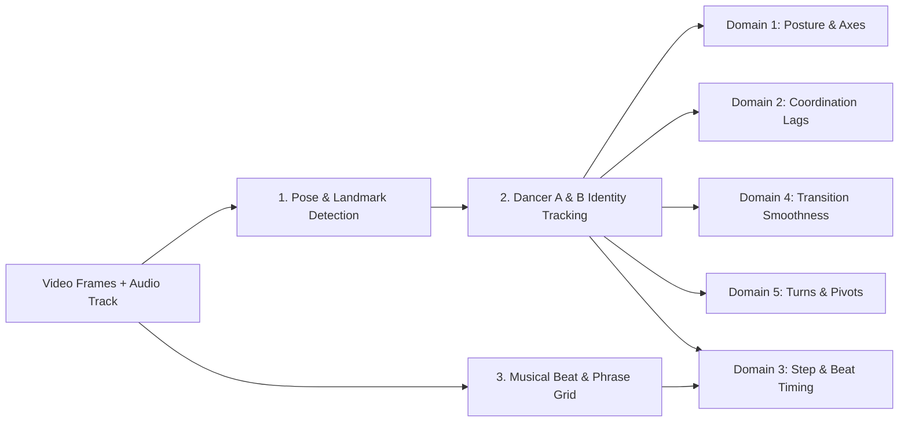
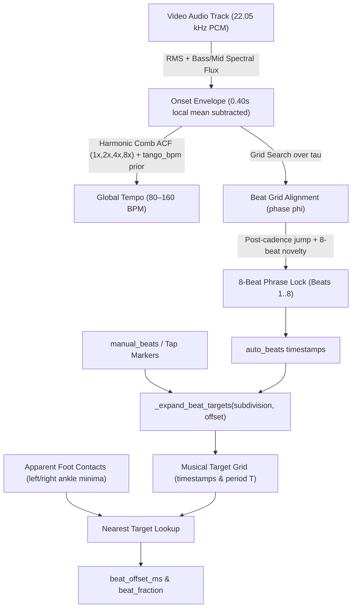

# TangoPosture Couple Analysis & Beat Timing Manual ("For Dummies" Edition)

> [!NOTE]
> This manual explains every metric, mathematical formula, landmark input, beat detector, and configuration parameter used in TangoPosture's **Couple Analysis Engine** (`couple/tracking.py`, `couple/measurements.py`, `couple/overlay.py`, `beat.py`, `references/soundtrack.py`, and `couple/csv_export.py`), written so any dancer, teacher, or analyst can understand both *what the numbers mean* and *how to inspect them*.

---

## 1. The Big Picture ("For Dummies" Mental Model)

Imagine watching two tango dancers from the side of the dance floor. Strip away faces, clothing, and artistic expression, and reduce the physics to four simple elements:

1. **Two Upright Rods (`Torso A` and `Torso B`)**: Each dancer's upper body is treated as a straight line from the **midpoint between their hips** up to the **midpoint between their shoulders**.
2. **An Invisible Spring (`Couple Midpoint Axis` & `Separation`)**: When partners are close enough (within `couple_axis_max_separation_m`, default `1.0 m`), TangoPosture draws a thicker averaged line halfway between their two rods—like the shared "axis" of the embrace—and measures whether they tilt together (`Pearson r`) or form a V/A-frame (`torso_separation`).
3. **A Floor Track (`Travel Axis` & `Velocity`)**: Looking at how the pair's hips move across the screen over time, the software figures out which direction they are dancing along (`ronda` line of dance) and tracks each person's speed along that path to see **who starts, slows down, and stops first**.
4. **A Musical Clock (`Beat Grid` & `Step Contacts`)**: From either the video's soundtrack (`BeatTracker`) or manual beat taps/markers you confirm in Review, TangoPosture builds a musical grid and checks whether foot landings fall **ahead of**, **right on**, or **behind** the beat.

---

## 2. How MediaPipe Landmarks Become Couple Geometry

### 2.1 Which Landmarks Are Actually Used?

MediaPipe detects 33 points per body (`x, y` normalized in `[0.0, 1.0]`, plus `visibility` confidence). Out of those 33 points, the Couple pipeline relies strictly on the landmarks that remain reliable when two bodies overlap:

| Body Region | Exact Landmark Keys | How They Are Used |
| --- | --- | --- |
| **Torso Base** | `left_hip`, `right_hip` | Averaged into `hip_px` (Dancer's center of mass & travel trajectory). Both must clear `confidence` (`0.70`). |
| **Torso Top** | `left_shoulder`, `right_shoulder` | Averaged into `shoulder_px` (top of torso rod & pair midpoint). Both must clear `confidence` (`0.70`). |
| **Head / Gaze** | `nose`, `left_ear`, `right_ear` | Computes `head_pitch_a` and `head_pitch_b` (ear-to-nose angle relative to horizontal). Requires reliable `nose` + at least one reliable ear. |
| **Lower Body / Steps** | `left_knee`, `right_knee`, `left_ankle`, `right_ankle`, `left_heel`, `right_heel`, `left_foot_index`, `right_foot_index` | Used by `analyse_movement_observations` to detect apparent foot `contact` events (`Step & Beat Timing`) and by `filter_and_deduplicate_poses` / close-embrace guards. *(Note: ankle/foot dots are hidden on Couple playback overlays in Review.)* |

### 2.2 Step 1 — Canonical Pixel Coordinates (No Upside-Down Math!)

In image files, pixel `y = 0` is at the **top** edge and increases downward. That makes upward torso tilt math confusing, so `canonical_xy()` in `couple/tracking.py` flips `y` immediately into standard Cartesian coordinates (`+X` = right, `+Y` = up):

$$X_{\text{px}} = x_{\text{norm}} \cdot (W - 1), \qquad Y_{\text{px}} = -y_{\text{norm}} \cdot (H - 1)$$

where $W, H$ are frame width and height in pixels.

Then, for each candidate skeleton where both shoulders and hips exceed `cfg.confidence` (default `0.70`):

- **Hip center**: $\mathbf{h} = \frac{1}{2}(\mathbf{p}_{\text{left\_hip}} + \mathbf{p}_{\text{right\_hip}})$
- **Shoulder center**: $\mathbf{s} = \frac{1}{2}(\mathbf{p}_{\text{left\_shoulder}} + \mathbf{p}_{\text{right\_shoulder}})$
- **Instant torso length**: $L = \|\mathbf{s} - \mathbf{h}\|_2$ (must be $\ge \max(8\text{ px},\; 0.5 \cdot \text{min\_torso} \cdot H)$).

### 2.3 Step 2 — Fixed Torso Scale Normalization

Raw pixel speeds depend on zoom (a couple close to the camera appears to move faster in pixels/sec than a distant couple). To solve this, TangoPosture computes each dancer's **Fixed Torso Scale** ($S_A, S_B, S_{\text{pair}}$ in pixels) across the clip (or across user-marked neutral `baseline_passages` if ≥ 3 samples exist):

$$S_A = \text{median}(L_A), \qquad S_B = \text{median}(L_B), \qquad S_{\text{pair}} = \frac{S_A + S_B}{2}$$

All distances and speeds in Couple analysis are then divided by $S$, giving **camera-independent units of torso lengths (`tl`) and torso lengths per second (`tl/s`)**. Because an average adult shoulder-to-hip torso length is roughly **0.50 m**, `1 torso length ≈ 0.50 m` (so `2.0 torso lengths ≈ 1.0 m`).

> [!IMPORTANT]
> If a noisy detection suddenly stretches or shrinks a dancer's torso outside `[fixed_scale_min_ratio, fixed_scale_max_ratio]` (default `[0.45, 2.20]` × $S$), `_enforce_fixed_scale_eligibility()` marks `torso_eligible = False` for that frame so distorted foreshortened poses cannot corrupt tilt angles!

### 2.4 Step 3 — Keeping Dancer A and Dancer B From Swapping Identities

When two partners cross paths or pass closely, naive left-to-right sorting swaps Dancer A and Dancer B mid-song. `track_couple_frames()` uses a **constant-velocity hip predictor + 1-to-1 gated association**:

1. **Duplicate Ghost Removal (`filter_and_deduplicate_poses`)**: First filters out any pose outside the user's **Analysis Region** rectangle (if set) and merges duplicate overlapping MediaPipe detections on the same person whose median joint separation is below `duplicate_pose_max_distance_torso_lengths` (`0.18 tl`).
2. **Prediction (`predicted_hip`)**: Predicts where Dancer A and Dancer B should be in the current frame based on their previous hip velocity.
3. **Innovation Gate**: Any detection farther than `identity_max_innovation_torso_lengths` (`0.75 tl`) from a track's predicted hip is rejected for that track.
4. **Ambiguity Margin**: If swapping `A ↔ B` produces nearly the same total association cost (difference `< identity_margin_torso_lengths`, default `0.15 tl`), the engine refuses to guess! It triggers an identity ambiguity break rather than silently swapping partners.
5. **Shot Cuts & Re-Anchoring**: A frame time jump `> shot_cut_max_frame_gap_s` (`1.50 s`) or a collective hip jump `>= shot_cut_jump_torso_lengths` (`1.50 tl`) resets tracks cleanly unless user **Dancer Anchors** (clicks in Review) re-identify who is A and B.

### 2.5 Close-Embrace Merged Detection Fallback

In tight milonguero close embrace, MediaPipe sometimes sees two hugging bodies as **one merged skeleton** (`len(poses) == 1`). When that happens in Couple mode:

- `_resolve_close_embrace_fallback()` (`engines/couple.py`) inspects a tightened ROI crop around each partner's half of the embrace.
- Any split candidate whose torso tilt exceeds `close_embrace_max_tilt_deg` (default `25.0°`) is rejected as physically implausible, preventing wild upside-down "ghost skeletons".

---

## 3. Every Couple Metric Explained (Math + For Dummies)

### Domain 1 — Posture & Axes (`summaries["posture"]`)

| Metric Key | "For Dummies" Meaning | Exact Formula & Units |
| --- | --- | --- |
| **`torso_tilt_a`** / **`torso_tilt_b`** | Is Dancer A/B standing straight upright (`0°`), leaning right (`+`), or leaning left (`-`) in the camera view? | $\theta = \operatorname{atan2}(s_x - h_x,\; s_y - h_y) \cdot \frac{180}{\pi}$ (degrees). Measured in canonical pixels whenever `torso_eligible` is true. |
| **`couple_midpoint_tilt`** | Imagine drawing one spine right down the middle between Partner A and Partner B. How much does the *couple as one unit* lean left or right? | $\mathbf{h}_{\text{pair}} = \frac{\mathbf{h}_A + \mathbf{h}_B}{2},\; \mathbf{s}_{\text{pair}} = \frac{\mathbf{s}_A + \mathbf{s}_B}{2}$, then $\theta_{\text{mid}} = \operatorname{atan2}(s_{\text{pair},x} - h_{\text{pair},x},\; s_{\text{pair},y} - h_{\text{pair},y})$ (degrees). |
| **`torso_separation`** | Are both torsos parallel like train tracks (`0°`), forming an A-frame tent (`+12°` leaning in), or opening into a V-shape? | $\Delta\theta_{\text{sep}} = \|\operatorname{wrapped\_diff}(\theta_A, \theta_B)\|$ (degrees, always $\ge 0$). Note: If both dancers lean right by `+8°` together, **`torso_tilt_a = +8°`**, **`torso_tilt_b = +8°`**, **`couple_midpoint_tilt = +8°`**, and **`torso_separation = 0°`**! |
| **`torso_tilt_pearson_r`** | Do the partners' torso tilts move together **in sync** across the dance? (`+1.0` = mirror sway together; `0.0` = unrelated; `-1.0` = one leans opposite whenever the other leans). | $r = \dfrac{\sum (a_i - \bar{a})(b_i - \bar{b})}{\|\mathbf{a} - \bar{a}\|_2 \, \|\mathbf{b} - \bar{b}\|_2} \in [-1, +1]$ computed on strictly timestamp-aligned (`≤ 0.1 ms`), finite `measured` pairs (`min_samples >= 3`, non-zero variance). |
| **`head_pitch_a`** / **`head_pitch_b`** | Is the dancer's chin level (`0°`), lifted up (`+`), or looking down at the floor (`-`)? | `head_horizontal_alignment(raw_pose, width, height, cfg.head_neutral_offset)` (degrees). Computed whenever `nose` and at least one ear pass `confidence`. |

#### Distance Gate + Hysteresis for the Shared Midpoint Axis Line

When partners separate beyond 1 meter (e.g., walking apart or solo adornos/soltada), drawing a midpoint line through empty air between them makes no biomechanical sense. `run_couple_analysis()` estimates hip separation in meters using the fixed pair scale:

$$d_{\text{hip, m}} = \frac{\|\mathbf{h}_A - \mathbf{h}_B\|_2}{S_{\text{pair}}} \times 0.50\text{ m/tl}$$

It then applies a **two-threshold hysteresis switch** so the green/cyan shared midpoint line doesn't blink rapidly near the boundary:
- **Turn OFF** when partners move farther than `couple_axis_max_separation_m` (default `1.0 m`) → only individual lines for A and B are drawn.
- **Turn back ON** only when partners come closer than `couple_axis_rejoin_separation_m` (default `0.80 m`) → shared midpoint line reappears for close/open embrace.

#### Why Median and IQR Instead of Mean and Standard Deviation?

Tango videos inevitably contain occasional 1–2 frame pose glitches or brief extreme movements.
- **Median ($P_{50}$)**: The middle value when sorted. One crazy `85°` spike cannot pull the median away from your true habitual posture.
- **IQR (Interquartile Range = $P_{75} - P_{25}$)**: The spread of the middle 50% of frames. A tiny IQR (`1.5°`) means rock-solid posture stability; a large IQR (`12°`) means large sway, slumping, or unstable tracking.

---

### Domain 2 — Coordination (`summaries["coordination"]`: Start, Slow, Settle Lags)

How do you tell *mathematically* whether Dancer A leads and Dancer B responds cleanly 120 ms later—or anticipates 50 ms early?

1. **Infer the Principal Travel Axis ($\hat{\mathbf{u}}_{\text{travel}}$)**:
   - If the user drew two points for **Travel Direction** in Review, $\hat{\mathbf{u}}_{\text{travel}}$ points directly from Point 1 to Point 2.
   - Otherwise, `_infer_travel_axis()` runs **PCA / Eigendecomposition** on all valid pair hip positions $\mathbf{h}_{\text{pair}}$ and takes the eigenvector with the largest variance, oriented along the net start-to-end displacement.
   - Projection onto this floor axis gives scalar progress $s_A(t), s_B(t), s_{\text{pair}}(t)$ in torso lengths (`tl`).
2. **Centred Regression Velocity (`compute_centred_regression_velocity`)**:
   - Frame-to-frame finite differences `(x[i] - x[i-1]) / dt` explode whenever Pose Landmarker jitters by 2 pixels in one frame!
   - Instead, at each frame $t_c$, TangoPosture fits an **ordinary least-squares straight line** across all valid frames inside `[t_c - half_window, t_c + half_window]` (`velocity_filter_window_s = 0.15 s`), requiring ≥ 3 samples with **both left ($t < t_c$) and right ($t > t_c$) support** and no breaks/gaps `> max_observation_gap_s` (`0.20 s`):

   $$v(t_c) = \frac{\sum_j (t_j - t_c)(s_j - \bar{s})}{\sum_j (t_j - t_c)^2} \quad [\text{torso lengths / s}]$$

3. **Sub-Frame Threshold Detection (`_detect_motion_events_for_track`)**:
   Walking along each subject's speed $|v(t)|$ with a 2-state hysteresis machine (`IDLE ↔ TRAVELLING`):
   - **`start`**: Speed crosses upward past `start_speed` (`0.20 tl/s`) and stays above `start_speed` for at least `persistence_s` (`0.15 s`). Linearly interpolates the exact crossing timestamp `t_cross` between frames!
   - **`slow`**: While `TRAVELLING`, tracks the median active cruising speed $v_{\text{med}}$. When speed drops below $(1 - \text{slowing\_fraction}) \cdot v_{\text{med}}$ (`0.75 * v_med` by default) for `persistence_s`, emits `slow`.
   - **`settle`**: Speed drops below `stop_speed` (`0.10 tl/s`) for `persistence_s`, returning to `IDLE`.
4. **Greedy Pairing & Signed Lag (`_pair_coordination_events`)**:
   - Pairs Dancer A's event with Dancer B's matching event (`start↔start`, `slow↔slow`, `settle↔settle`) sorted by closest $|\Delta t|$ within `pairing_window_s` (`0.50 s`), **never pairing across a tracking break**.
   - **Signed Lag**: $\text{lag\_ms} = (t_B - t_A) \times 1000$.
     - **Positive lag (`+110 ms`)**: Dancer A crossed the threshold first; Dancer B followed `110 ms` later.
     - **Negative lag (`-60 ms`)**: Dancer B moved before Dancer A (anticipation, or B initiated the movement!).
     - Summarized by `median` + `IQR` (`start_lag_ms`, `slow_lag_ms`, `settle_lag_ms`), plus `paired_count` and `unpaired_count`.

---

### Domain 3 — How the Beat Is Calculated & Step Timing (`summaries["step_timing"]`)

TangoPosture supports **two beat sources**—an automatic acoustic analyzer (`BeatTracker` in `beat.py` + `references/soundtrack.py`) and user-confirmed/manual beats—and matches apparent foot contacts to them.

#### 3.1 How Automatic Audio Beat & 8-Beat Phrase Detection Works (`beat.py` + `soundtrack.py`)

When **Analyze soundtrack** (`dancer_analysis.analyze_soundtrack`) runs during Video Analysis:
1. Audio from the clip is resampled/fed in chunks into `BeatTracker`.
2. **Acoustic Features**: Computes short-time RMS energy, low-frequency **bass spectral flux** (`62%` weight—catches the bass/marcato beat in tango!), and **mid-frequency flux** (`38%` weight—catches bandoneón/violin rhythmic attacks). Each stream is normalized by its 90th percentile, and a `0.40 s` local moving average is subtracted + `50 ms` Hann-smoothed to build a clean **onset envelope**.
3. **Tempo Estimation (`BPM`)**: Computes the FFT autocorrelation of the onset envelope and scores candidate beat periods (`96–148 BPM` grid, clipped to `[80, 160] BPM`) using a **Phrase-Harmonic Comb** at $1\tau, 2\tau, 4\tau, 8\tau$ lags, weighted by a gentle Gaussian prior (`±24 BPM`) around `cfg.tango_bpm` (`120 BPM` default).
4. **Beat Grid Phase Alignment ($\phi$)**: Slides the beat grid across `[0, τ)` to find the phase $\phi$ where the combined `onset_env + 0.5 * bass_norm` peaks hardest within `±20 ms` of every beat line.
5. **8-Beat Phrase Lock (Beat 1 Identification)**: Once enough musical evidence accumulates (`beat_analysis_seconds`, default `30 s` or `>= 24` beats), evaluates all 8 possible downbeat offsets $m \in \{0..7\}$ using post-cadence attack jumps (strong Beat 1 following a softer Beat 8 breath) to label beats `1..8` and phrase counts.
6. **`extract_soundtrack_beat_timestamps()`**: Records the exact `source_time` of every transition where `playing == True` and `beat` increments.
   - *When audio is missing, silent (`< 0.5 s` or `< 2` transitions), or non-rhythmic*: status becomes `no_events_detected` or `not_enough_evidence`, so fake beats are never hallucinated!

#### 3.2 Manual Beat Overrides & Subdivisions (`_expand_beat_targets`)

In **Review → Couple Evidence**, if the automatic beat missed or is syncopated, you can tap/add `manual_beats`, set `beat_subdivision` (`1` = quarter beat, `2` = *traspié* half-beats, `3` = triplets), and adjust `beat_offset_s`:
- Manual beats **override** `auto_beats` and upgrade status from `estimated` to `user_confirmed`.
- For each beat interval $T_i = b_{i+1} - b_i$ and subdivision $k \in \{0, \dots, \text{subdiv}-1\}$, targets are placed at:

  $$t_{i,k} = b_i + \frac{k}{\text{subdiv}} T_i + \text{beat\_offset\_s}, \qquad P_{\text{target}} = \frac{T_i}{\text{subdiv}}$$

#### 3.3 Matching Steps to Beats (`_attach_beat_offsets`)

1. Foot landing candidates (`event_type == "contact"`) are extracted for Dancer A and Dancer B independently by `analyse_movement_observations()` (`movement.py`) from their raw ankle/foot trajectories.
2. Each `contact` (and `start`) event finds the closest musical target timestamp $b^*$ (`argmin |t - b_k|`) and calculates:
   - **`beat_offset_ms`** $= (t_{\text{step}} - b^*) \times 1000$.
     - Negative (`-45 ms`): stepped slightly **early** (anticipation).
     - Near `0 ms`: stepped right on the beat!
     - Positive (`+110 ms`): stepped slightly **late** (*behind the beat*, common in lyrical/Pugliese phrasing).
   - **`beat_fraction`** $= \dfrac{t_{\text{step}} - b^*}{P_{\text{target}}} \in [-0.5, +0.5]$ (e.g., `+0.25` = a quarter beat behind, regardless of whether the song is 105 BPM slow tango or 132 BPM milonga!).
3. Summarized per dancer as `median_beat_offset_ms`, `iqr_beat_offset_ms`, and `median_beat_fraction`.

---

### Domain 4 — Transition Smoothness (`summaries["transitions"]`)

Measures how cleanly the couple decelerates at the end of a phrase instead of stumbling or lurching backward:

1. **Transition Windows**: Pairs each `slow` event with the next `settle` event (`[t_slow, t_settle]`, or up to `t_slow + 2.0 s` if no settle occurs). Also inspects `±0.5 s` around user-marked transitions.
2. **Coverage Gate**: A transition window is only scored if `pair_hip_eligible` coverage inside the window meets `transition_min_coverage` (`0.75` = 75%). Otherwise it counts as an `unavailable` window.
3. **Two Quality Flags**:
   - **Secondary Speed Peaks (`speed_cue` → `unintended_peaks`)**: Checks if pair speed drops to a `running_min`, then **bursts upward again** by at least `secondary_speed_rise` (`0.12 tl/s`) and sustains ≥ 60% of that rise for `persistence_s` (`0.15 s`). *(For dummies: braking at the red light, then accidentally lurching the car forward before stopping!)*
   - **Velocity Reversals (`reversal` → `unintended_reversals`)**: Checks if pair velocity flips sign opposite to the dominant travel direction above `stop_speed`. *(For dummies: overshooting and rocking/rebounding backward!)*
4. **Intentional Choreography Exclusions**: If you mark a **Planned Reversal**, **Planned Pause**, or **Settling Step** in **Review → Couple Evidence** (`_overlaps_planned` within `±0.20 s`), matching peaks/reversals are still logged in the timeline for inspection, **but are excluded** from `unintended_peaks` and `unintended_reversals`!

---

### Domain 5 — Turns & Pivots (`summaries["turns"]`)

Evaluates *giros*, *ochos*, and pivot exits using both user annotations and optional automated cues:

1. **User-Confirmed Turns (`_turn_events_from_annotations_and_candidates`)**:
   - Pairs each `turn_start` with the next `turn_end` to compute **Turn Duration** (`turn_end - turn_start`, seconds).
   - Finds the nearest `exit` marker within `turn_exit_match_window_s` (`3.0 s` default) of `turn_end` and computes **`exit_minus_turn_end_ms`**:
     - **Positive**: clean exit *after* turn finishes.
     - **Negative (`overlap = True`)**: `reason = "exit_occurred_during_turn"`—one partner started travelling forward before the turn finished rotating!
   - Records per-dancer **`pivot_behavior`** (`appears_planted`, `rotates_in_place`, `repositions`, `unknown`) and **`embrace_opening`** notes.
2. **Optional Auto Suggestions (`auto_turn_suggestions`)**: When enabled in Settings, appends `estimated` turn brackets from `movement.py` (`pivot_candidates`) wherever no user-confirmed turn already overlaps (`±0.30 s`).

---

## 4. Complete Settings Reference (What Controls What)

All settings below live in **Settings → Couple · Tracking / Interpolation**, **Couple · Axes / Coordination**, **Common · Scene Routing**, and **Common · Detection / Music**:

### 4.1 Identity Tracking & Frame Eligibility (`Couple · Tracking / Interpolation`)

| Setting | Default | For Dummies Effect & When to Change |
| --- | --- | --- |
| `confidence` | `0.70` | Minimum MediaPipe visibility for hips/shoulders/head. Lower to `0.55` in dim milonga lighting; raise to `0.80` if wild background limbs leak in. |
| `dancer_analysis.duplicate_pose_max_distance_torso_lengths` | `0.18 tl` | Merges two overlapping skeleton boxes on one dancer. Raise slightly (`0.25`) if MediaPipe keeps drawing double skeletons on a single person. |
| `dancer_analysis.identity_max_innovation_torso_lengths` | `0.75 tl` | Maximum jump allowed between predicted and observed hip per frame. Lower (`0.45`) in crowded rooms to block background passersby; raise (`1.0`) for very fast whippy *sacadas* or low-FPS video. |
| `dancer_analysis.identity_margin_torso_lengths` | `0.15 tl` | Minimum tie-breaker margin between A and B during close passes. Raise to `0.25` to force more cautious ambiguity breaks when dancers cross directly in front of the lens. |
| `dancer_analysis.max_observation_gap_s` | `0.20 s` | Breaks velocity windows across tracking dropouts longer than this. Never interpolate metrics across larger gaps. |
| `dancer_analysis.display_interpolation_max_gap_s` | `0.13 s` | Visual-only dotted-line gap bridging between measured poses in Review (never enters metrics). |
| `dancer_analysis.fixed_scale_min_ratio` / `max_ratio` | `0.45` / `2.20` | Rejects distorted foreshortened torso detections outside `[0.45S, 2.20S]`. Tighten to `0.60–1.70` if steep perspective causes tilt spikes. |
| `dancer_analysis.shot_cut_max_frame_gap_s` | `1.50 s` | Time jump that forces a hard shot-cut reset of tracks. |
| `dancer_analysis.shot_cut_jump_torso_lengths` | `1.50 tl` | Collective spatial jump (when camera angle cuts) that resets tracking. |
| `dancer_analysis.close_embrace_max_tilt_deg` | `25.0°` | Rejects impossible tilted split-body guesses in close-embrace fallback. |

### 4.2 Axes, Smoothing, Hysteresis & Coordination (`Couple · Axes / Coordination`)

| Setting | Default | For Dummies Effect & When to Change |
| --- | --- | --- |
| `dancer_analysis.axis_smoothing_s` | `0.25 s` | Zero-phase forward-backward EMA smoothing on Analytics tilt/separation lines. Raise to `0.35–0.45 s` if Analytics charts look too spiky; set `0.0` for raw per-frame data. |
| `dancer_analysis.overlay_smoothing_s` | `0.20 s` | Smoothing applied to Review playback torso-axis lines (`smooth_couple_frame_overlays`). |
| `dancer_analysis.axis_bridge_max_gap_s` | `0.25 s` | Bridges tiny frame dropouts smoothly on charts and playback lines. |
| `dancer_analysis.overlay_min_landmark_visibility` | `0.50` | Visibility threshold for drawing individual axis lines in Review playback. |
| `dancer_analysis.couple_axis_max_separation_m` | `1.0 m` | Estimated hip distance (`0.50 m/tl`) above which the shared Couple midpoint line turns OFF (hiding the line when apart). |
| `dancer_analysis.couple_axis_rejoin_separation_m` | `0.80 m` | Hysteresis threshold below which the hidden midpoint line turns back ON when partners return into embrace (`<= max_separation_m`). |
| `dancer_analysis.velocity_filter_window_s` | `0.15 s` | Half-window (`±0.15 s` = `0.30 s` total) for centred linear-regression speed. Raise to `0.25 s` for noisy 15 fps video; lower to `0.10 s` for crisp 60 fps fast milonga. |
| `dancer_analysis.start_speed` | `0.20 tl/s` | Speed needed to trigger a `start` event. Raise to `0.30` if breathing/swaying in place triggers false starts. |
| `dancer_analysis.stop_speed` | `0.10 tl/s` | Speed below which a dancer counts as `settle`d. Must be `< start_speed`. |
| `dancer_analysis.slowing_fraction` | `0.25` | Triggers `slow` once speed drops 25% below the active phrase's cruising median. Raise (`0.35`) to ignore gentle cadence modulation. |
| `dancer_analysis.persistence_s` | `0.15 s` | How long a speed crossing must hold before creating an event (filters 1–2 frame glitches). |
| `dancer_analysis.pairing_window_s` | `0.50 s` | Maximum allowed gap between Dancer A and Dancer B events to count as a coupled reaction lag. |
| `dancer_analysis.transition_min_coverage` | `0.75` | Requires ≥ 75% tracked pair frames inside `[t_slow, t_settle]` before judging transition smoothness. |
| `dancer_analysis.secondary_speed_rise` | `0.12 tl/s` | Secondary acceleration surge during deceleration flagged as a stumble/unintended speed cue. |
| `dancer_analysis.turn_exit_match_window_s` | `3.00 s` | Search window around `turn_end` to link an `exit` annotation. |
| `dancer_analysis.auto_turn_suggestions` | `false` | Auto-proposes estimated turn brackets in Review when sustained rotation cues occur. |

### 4.3 Music & Beat Timing (`Common · Detection / Music` + Internal `BeatTracker`)

| Setting | Default | For Dummies Effect & When to Change |
| --- | --- | --- |
| `dancer_analysis.analyze_soundtrack` | `false` | Enables automatic audio track beat/phrase extraction during Video Analysis. Turn ON when video contains clear tango music. |
| `tango_bpm` | `120.0 BPM` | Center of the gentle tempo prior (`80–160` search clamped; `±24 BPM` Gaussian weight). Set near `100` for slow Pugliese or `135` for brisk vals/milonga to avoid half/double-time octave errors! |
| `beat_analysis_seconds` | `30.0 s` | Minimum audio window used before locking the 8-beat phrase downbeat (`Beat 1`). |

---

## 5. What Can Damage These Calculations (and How to Spot / Fix It)

> [!WARNING]
> Biomechanical metrics are only as trustworthy as the 2D skeleton and timestamps feeding them. Always check coverage, tracking-break markers, and video framing before coaching a dancer on a strange number!

| Failure Mode | Why It Damages the Math | Symptom in Results / Charts | How to Fix or Prevent |
| --- | --- | --- | --- |
| **Tilted Camera / Dutch Angle** | `torso_tilt` uses image vertical! A camera tilted `+4°` shifts both dancers' `torso_tilt_a` and `torso_tilt_b` by `+4°`, though `torso_separation` and `Pearson r` remain invariant. | Median `torso_tilt_a` & `b` both offset by the exact same constant even when standing straight. | Level the tripod/camera horizon cleanly, or compare relative changes (`Pearson r`, `torso_separation`, `baseline_change_deg`). |
| **Walking Directly Toward / Away From Camera** | Torso length shrinks/grows due to perspective foreshortening along depth (`Z`), shrinking $S_{\text{pair}}$ bias and turning forward apilado into `0°` horizontal projection. | Sudden drop in `pair_torso_coverage` when `ratio < 0.45`, near-zero projected velocity along the camera axis. | Film predominantly **across** the camera's field of view (`45°–90°` to line of dance). Use **Analysis Region** to crop distant turns. |
| **Heavy Partner Occlusion (Dark Clothing on Dark Clothing)** | MediaPipe drops behind-partner shoulders/hips below `confidence = 0.70`, or merges both torsos into 1 pose. | Grey `unavailable` gaps in charts; `couple_midpoint_tilt` drops out; `torso_separation` clips near `0°`. | Ensure contrasting clothing between A & B, film from a three-quarter front/side angle rather than directly behind Leader's back, or enable close-embrace fallback. |
| **Mirrors & Background Bystanders** | Reflections or bystanders create 3rd/4th skeleton detections inside the room, stealing identity or confusing `filter_and_deduplicate_poses`. | Identity swaps or sudden `shot_cut` breaks; erratic spikes in hip speed. | Set the **Analysis Region** rectangle tightly around the couple's dancing corridor! |
| **Low FPS (< 20 fps) or Variable Frame Rate Drops** | With fewer than 3 samples inside `±0.15 s` (`velocity_filter_window_s`), `compute_centred_regression_velocity` outputs `None` (`unavailable`). | `start_lag_ms` / `slow_lag_ms` show `no_partner_event`, high `unavailable` velocity frames. | Film at `>= 30 fps` (ideally `60 fps`), or widen `velocity_filter_window_s` to `0.25 s` and `max_observation_gap_s` to `0.30 s`. |
| **Rubato / Non-Percussive Tangos (e.g., Late Pugliese / Troilo) or Noisy Room Audio** | Acoustic beat tracker locks onto vocal/rubato swells or applause, doubling/halving tempo (`65 vs 130 BPM`). | `beat_fraction` scatters uniformly across `[-0.5, +0.5]`, `bpm` looks half/double true pulse. | Set `tango_bpm` closer to the true tempo, or tap accurate `manual_beats` in **Review → Couple Evidence** (upgrades beats to `user_confirmed`). |
| **Intentional Choreography Mistaken for Stumbles** | A planned *parada*, *pausa*, or *calecita* entry triggers deceleration + acceleration peaks. | `unintended_peaks` / `unintended_reversals > 0` during a musical pause. | Mark **Planned Pause**, **Planned Reversal**, or **Settling Step** in **Review → Couple Evidence** so those intervals are excluded. |

---

## 6. How to Analyze Couple Results & Build Visualizations

Exported CSV files (`couple/csv_export.py`) and JSON analytics (`couple_result["series"]`, `couple_result["events"]`, `couple_result["summaries"]`) give you rich data for coaching and statistical visualization.

### 6.1 Step-by-Step Analysis Workflow

1. **Check Data Health First (Gatekeeping)**:
   - Look at `a_torso_coverage`, `b_torso_coverage`, `pair_torso_coverage`, and `count` of `identity_breaks`.
   - Rule of thumb: Trust posture/lag summaries when coverage `>= 0.70` (70%) and identity breaks are low; if coverage `< 0.50`, crop with **Analysis Region** or add manual dancer anchors before interpreting numbers.
2. **Analyze Global Posture & Sync (`Domain 1`)**:
   - Check **`torso_tilt_a` median (IQR)** and **`torso_tilt_b` median (IQR)**: Who carries more forward/side lean, and who stays steadier (lower IQR)?
   - Check **`torso_separation` median (IQR)**: Is the embrace A-frame (`~5°–12°`), strictly upright parallel (`~0°–3°`), or collapsing/opening erratically (large IQR `> 8°`)?
   - Check **`torso_tilt_pearson_r`**:
     - `r >= +0.50`: Partners incline and sway **together as one shared pendulum**.
     - `r ≈ 0.0`: Independently oscillating upper bodies (common when Follower resists tension or Leader over-rotates).
     - `r <= -0.30`: Mirroring/counter-tilting in opposite image directions (compare camera orientation!).
3. **Analyze Lead-Follow Dynamics (`Domain 2` & `4`)**:
   - Check **`start_lag_ms`**: Healthy responsive following usually shows a small positive lag (`+60 to +160 ms`) with compact IQR (`< 120 ms`). Consistent negative medians (`< 0 ms`) indicate Follower **anticipating** before the Leader's torso initiates.
   - Check **`slow_lag_ms`** & **`settle_lag_ms`**: Compare start vs stop synchronization—many couples start cleanly together (`+90 ms`) but drift apart on braking (`+240 ms` or unintended speed reversals).
4. **Analyze Musicality (`Domain 3`)**:
   - Inspect **`median_beat_offset_ms`** and **`median_beat_fraction`** separately for A and B: Do both partners step at the same rhythmic pocket (e.g., both landing `+40 ms` behind the *marcato*), or is one rushing while the other drags?

### 6.2 Recommended Visualizations (Metrics, Distributions & Outliers)

Whether in TangoPosture's **Analytics** tab or exporting the CSV/JSON into Python (`matplotlib` / `seaborn` / `plotly`) or Excel, here are the highest-value charts you can build from every metric:

| Visualization Type | Best Metrics to Plot | What It Reveals & How to Spot Outliers |
| --- | --- | --- |
| **1. Synchronized Time-Series + Highlighted Event Bands** *(built into Analytics)* | `torso_tilt_a(t)`, `torso_tilt_b(t)`, `couple_midpoint_tilt(t)`, `torso_separation(t)`, `v_A(t)`, `v_B(t)` | Shows *when* during the phrase connection breaks down. Gray bands = `unavailable` occlusions; vertical stems = `start`/`slow`/`settle` markers; red/orange horizontal bands = excursions outside calibrated ranges. |
| **2. Scatter Plot + Linear Regression Line** | X-axis: `torso_tilt_a(t)` vs Y-axis: `torso_tilt_b(t)` (paired samples) | Visually explains **`torso_tilt_pearson_r`**! A tight diagonal cloud along `y = x` means shared tilt synchronization; isolated points far off the diagonal are **coordination outliers** (sudden disconnection or 1-frame tracking glitches) you can inspect by clicking their timestamp! |
| **3. Box Plots + Swarm/Strip Overlay (with Tukey Fences)** | `start_lag_ms`, `slow_lag_ms`, `settle_lag_ms`, `beat_offset_ms`, `torso_separation` | Immediately visualizes **Median** (center line), **IQR** (box height = $P_{75} - P_{25}$), and **Statistical Outliers** using Tukey's rule: points outside $[Q_1 - 1.5 \cdot \text{IQR},\; Q_3 + 1.5 \cdot \text{IQR}]$. Great for comparing 3 takes of the same *caminata* side-by-side! |
| **4. Histogram + KDE Density Distribution** | `torso_tilt_a`, `torso_tilt_b`, `torso_separation`, `head_pitch_a/b` | Shows whether posture has **one habitual equilibrium** (clean single bell peak) or **two distinct postures** (bimodal—e.g., walking straight vs tilting during pivots/turns). |
| **5. Beat-Phase Circular / Rose Plot (or `[-0.5, +0.5]` Histogram)** | `beat_fraction` of `contact` events (`event_type == "contact"`) | Maps `beat_fraction` onto a `0°–360°` musical circle (`0°` = exact beat). Tight narrow wedge around `+15°` shows locked rhythmic groove (*cadencia*); flat circle shows off-beat stepping or double/half-time mismatch! |
| **6. Multi-Track Event Ladder / Waterfall Plot** | Timestamps of `beat`, `A:start/contact`, `B:start/contact`, `turn` | Visualizes lead-follow call-and-response in chronological order: Beat ticks → A's `start` → B's `start` (`lag_ms`) → A/B foot `contact`s (`beat_offset_ms`) → `slow` → `settle`. Instantly exposes where an anticipation (`t_B < t_A`) or skipped beat occurred. |
| **7. Paired Lead-Follow Lag Trend Over Clip Time** | X-axis: `timestamp` vs Y-axis: `lag_ms` (`B - A`) with zero line | Shows whether coordination improves as the couple warms up or degrades during fatigue/fast musical codas (`lag_ms` widening or flipping negative over time). |

### 6.3 Quick Outlier Checklist (Real Technique Flaw vs Pose Error)

When a Box Plot or Scatter Plot highlights an extreme outlier ($> Q_3 + 1.5 \cdot \text{IQR}$ or $< Q_1 - 1.5 \cdot \text{IQR}$):
1. Seek to that exact timestamp in **Review**.
2. Check if either skeleton is drawn with **dotted lines** (`interpolated_display = True`) or missing shoulders/hips.
3. Check if a tracking break or bystander appeared in frame within `±0.3 s`.
4. **Only coach the dancer on outliers that have solid measured skeletons and clear framing**—ignore hardware/occlusion outliers or clean them with **Analysis Region** and **Save Annotations**.
