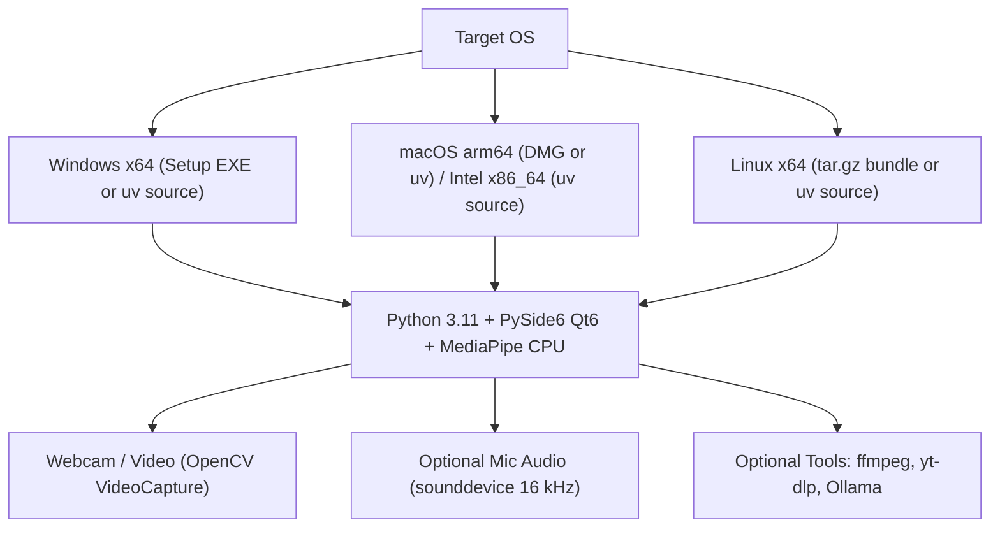

# TangoPosture Installation, System Requirements & Camera Compatibility Guide

> [!NOTE]
> This guide documents **TangoPosture v0.5.0** across **Windows (x64)**, **macOS (Apple Silicon & Intel)**, and **Linux (x86_64)**, based on the runtime stack verified in `pyproject.toml`, `.github/workflows/desktop-release.yml`, `packaging/`, `capture.py`, `beat.py`, `desktop.py`, `models.py`, and `camera_session.py`.

---

## 1. Runtime & Platform Capability Overview

TangoPosture runs locally on your machine using **Python 3.11 (`>=3.11, <3.12`)**, **PySide6 6.10.1 (Qt 6)**, **MediaPipe 0.10.31** (`PoseLandmarker`, `RunningMode.VIDEO`, `num_poses=2`, CPU delegate), **OpenCV 5.0.0.93**, **NumPy 2.4.6**, **Pydantic 2.14.2**, and **sounddevice** (16 kHz mono microphone input).



### Platform Feature Matrix

| Capability / Component | macOS (Apple Silicon `arm64`) | macOS (Intel `x86_64`) | Windows `x64` | Linux (`x86_64`) |
| --- | --- | --- | --- | --- |
| **Pre-built desktop bundle / installer** | Yes (`.dmg`, unsigned / unnotarized) | No (source install via `uv`) | Yes (`TangoPosture-Windows-x64-Setup.exe`, unsigned) | Yes (`TangoPosture-Linux-x64.tar.gz`, experimental) |
| **Source install (`uv`)** | Yes | Yes | Yes | Yes |
| **PySide6 Qt desktop studio & CLI** | Yes | Yes | Yes | Yes (`./TangoPosture/TangoPosture` or `uv run tango-posture qt`) |
| **Pose estimation (`MediaPipe CPU`)** | Yes (bundled Lite or `models fetch`) | Yes (`models fetch`) | Yes (bundled Lite or `models fetch`) | Yes (bundled Lite or `models fetch`) |
| **Packaged `desktop.py` entry point** | Yes (`~/Library/Application Support/TangoPosture`) | Source CLI (`uv run tango-posture qt`) | Yes (`%LOCALAPPDATA%\TangoPosture`) | Yes (`$XDG_DATA_HOME/TangoPosture` or `~/.local/share/TangoPosture`) |
| **Live audio-into-video muxing (`beat.py`)** | Native macOS `AVFoundation` `.mp4` mux | Native macOS `AVFoundation` `.mp4` mux | Separate `.wav` / visual MP4 unless external muxing is used | Separate `.wav` / visual MP4 |
| **Guided speech instructions (`SpeechManager`)** | Native `/usr/bin/say` TTS | Native `/usr/bin/say` TTS | On-screen text guidance (auto fallback) | On-screen text guidance (auto fallback) |
| **Live Beat Tracker (`sounddevice`)** | Yes (CoreAudio / macOS mic permission prompt) | Yes (CoreAudio) | Yes (WASAPI / MME / DirectSound via PortAudio) | Yes (`libportaudio2` / ALSA / PulseAudio / PipeWire) |
| **Offline soundtrack extraction (`soundtrack.py`)** | Optional `ffmpeg` on `PATH` | Optional `ffmpeg` on `PATH` | Optional `ffmpeg` on `PATH` | Optional `ffmpeg` on `PATH` |

> [!WARNING]
> **Windows ARM (`arm64`), 32-bit x86 Windows, and Linux ARM (`aarch64`)**: Pre-built installers do not exist for Windows ARM (`windows.iss` restricts installation with `ArchitecturesAllowed=x64compatible`), macOS Intel, or Linux ARM; run those platforms from source with `uv`. Linux `x64` desktop bundles target `ubuntu-24.04` / modern `glibc` (`>= 2.39`) and still require host Qt6/OpenGL/PortAudio shared libraries (`libgl1`, `libportaudio2`, `libxcb-*`).

---

## 2. System Requirements (Minimum vs Recommended)

> [!IMPORTANT]
> MediaPipe `PoseLandmarker` inside TangoPosture explicitly initializes with **`Delegate.CPU`** (`pose/mediapipe_backend.py`) and processes up to **`num_poses=2`** people per frame. Therefore **single-core and multi-core CPU performance matters far more than a discrete GPU**. Live webcam practice uses only `pose_landmarker_lite.task` (`5.5 MB`), while offline video analysis can use **Lite**, **Full**, or **Heavy** weights.

### 2.1 Windows (x64)

| Resource | Minimum (640×480 Live Lite Practice) | Recommended (720p/1080p Live + Offline Full/Heavy + Couple Analysis) |
| --- | --- | --- |
| **OS** | Windows 10 x64 (21H2+) or Windows 11 x64 (`x64compatible`, 64-bit only) | Windows 11 x64 (22H2+ with latest camera & audio drivers) |
| **Architecture / CPU** | 64-bit x86_64 processor with **AVX2** support (Intel Core i5 8th Gen / AMD Ryzen 3 3000+, 4 threads) | Modern 6+ core x86_64 CPU (Intel Core i5/i7 12th Gen+ or AMD Ryzen 5 5600X+ / Ryzen 7) for smooth 20–30 FPS pose tracking & fast offline analysis |
| **Memory (RAM)** | **8 GB RAM** (Live Practice & Review with Lite model) | **16 GB RAM** (32 GB if running local **Ollama** `llama3.2` simultaneously during Review/AI Coach) |
| **Storage** | **3 GB free SSD/HDD space** (installed bundle/venv + Lite/Full/Heavy models + initial `.tp` recordings) | **20+ GB free NVMe SSD space** (each 3-minute 720p raw + overlay `.tp` / `.tpr` archive uses ~50–150 MB) |
| **GPU / Display** | DirectX 11 / OpenGL 2.1 capable display (`1280 × 720` minimum screen area) | Hardware OpenGL / Qt RHI acceleration at **`1920 × 1080`** or higher (`Left nav + splitter charts`) |
| **Runtime Libraries** | Standard Windows 10/11 UCRT + Visual C++ x64 runtime (bundled in most systems; included for Inno Setup if MSVC runtime present) | Up-to-date Microsoft Visual C++ Redistributable (x64) + UVC webcam drivers + audio input device |
| **Camera / Audio I/O** | 1× UVC-compatible webcam (640×480 @ 15+ FPS) | 1× UVC 1080p/720p 30 FPS low-light webcam + room microphone for 8-beat tracking |

### 2.2 Mac (Apple Silicon & Intel)

| Resource | Minimum (macOS Source or DMG) | Recommended (Best Live FPS & Offline Heavy Analysis) |
| --- | --- | --- |
| **OS** | **macOS 13 (Ventura)** or newer (CI builds and tests on `macOS 15`) | **macOS 14 (Sonoma)** or **macOS 15 (Sequoia)** |
| **Architecture / CPU** | **DMG Installer**: Apple Silicon (`arm64` M1 or newer)<br>**Source (`uv`)**: Apple M1 (`arm64`) or Intel 64-bit Core i5 (8th Gen+ `x86_64`) | **Apple M1 Pro / M2 / M3 / M4 (`arm64`)** — NEON CPU acceleration runs MediaPipe Lite cleanly at 25–30 FPS and accelerates AVFoundation muxing |
| **Memory (RAM)** | **8 GB Unified Memory / RAM** | **16 GB+ Unified Memory** (especially for Couple analysis, Heavy model offline passes, or local Ollama) |
| **Storage** | **3 GB free APFS space** | **20+ GB free SSD space** for `.tp` / `.tpr` practice archives and downloaded Full/Heavy models |
| **Display** | `1280 × 800` built-in or external display | Retina / `1440 × 900` or external `1920 × 1080`+ display |
| **macOS Permissions** | Explicit approval in **System Settings > Privacy & Security > Camera** & **Microphone** | Approved Camera + Microphone + Continuity Camera / external USB camera connected cleanly |

### 2.3 Linux (`x86_64`)

| Resource | Minimum (Tarball Bundle or Source Install) | Recommended (Smooth Live Studio & Offline Analysis) |
| --- | --- | --- |
| **Distribution** | 64-bit Linux (`ubuntu-24.04` / `glibc >= 2.39` for pre-built `.tar.gz`; `Ubuntu 22.04+` / `Debian 12+` / `Fedora 39+` from source) | **Ubuntu 24.04 LTS** / **Fedora 40+** on **X11** or **Wayland** (with XWayland/Qt6 Wayland support) |
| **Architecture / CPU** | `x86_64` CPU with AVX2 (4+ threads, e.g., Core i5 8th Gen / Ryzen 3000+) | 6+ core `x86_64` CPU (Ryzen 5 5600+ / Core i5 12th Gen+) |
| **Memory (RAM)** | **8 GB RAM** | **16 GB+ RAM** (32 GB if running local Ollama alongside offline video analysis) |
| **Storage** | **3 GB free disk space** | **20+ GB free SSD space** |
| **Display & Session** | Desktop environment with X11 (`DISPLAY`) or Wayland (`QT_QPA_PLATFORM=wayland` or `xcb`); `1280 × 720`+ | Hardware OpenGL Mesa drivers (`libgl1`, `libegl1`) and `1920 × 1080`+ monitor |
| **Required System Packages** | Qt6/XCB shared libs, OpenCV runtime libs, `v4l2` user permissions (`video` group), `libportaudio2` | Same plus **`ffmpeg`** installed for soundtrack/excerpt workflows |

---

## 3. Step-by-Step Installation Guide

### Option A: Pre-Built Desktop Installers & Bundles (Windows x64, Apple Silicon Mac & Linux x64)

> [!CAUTION]
> Distributed installers are currently **unsigned** (and macOS builds are **not notarized**). Only install builds from official releases after verifying `SHA256SUMS.txt`. Never disable Gatekeeper or Windows SmartScreen globally.

#### Windows x64 (`TangoPosture-Windows-x64-Setup.exe`)
1. Download `TangoPosture-Windows-x64-Setup.exe` and `SHA256SUMS.txt` from the project's GitHub Releases (`https://github.com/derruba2000/TangoPosture/releases`).
2. Verify the SHA-256 checksum in PowerShell:
   ```powershell
   Get-FileHash .\TangoPosture-Windows-x64-Setup.exe -Algorithm SHA256
   Get-Content .\SHA256SUMS.txt
   ```
3. Double-click `TangoPosture-Windows-x64-Setup.exe`. Because it sets `PrivilegesRequired=lowest`, it installs per-user into `%LOCALAPPDATA%\Programs\TangoPosture` without requiring administrator rights (the bundled `pose_landmarker_lite.task` model is already included).
4. If Windows SmartScreen displays *"Windows protected your PC"*, click **More info → Run anyway** (only after confirming the SHA-256 matches `SHA256SUMS.txt`).
5. Launch **TangoPosture** from the Start menu. User data, databases (`tango.sqlite3`), `.tp` practices, `.tpc` calibrations, and recordings are saved under `%LOCALAPPDATA%\TangoPosture`.

#### macOS Apple Silicon (`TangoPosture-macOS-arm64.dmg`)
1. Download `TangoPosture-macOS-arm64.dmg` and `SHA256SUMS.txt` from Releases.
2. Verify checksum in Terminal:
   ```zsh
   shasum -a 256 ~/Downloads/TangoPosture-macOS-arm64.dmg
   cat ~/Downloads/SHA256SUMS.txt
   ```
3. Double-click `TangoPosture-macOS-arm64.dmg` and drag **TangoPosture.app** into **Applications**.
4. Open **TangoPosture** from `/Applications`. Because the `.app` is unnotarized, macOS Gatekeeper will warn *"Apple could not verify TangoPosture is free of malware"*:
   - Dismiss the warning, open **System Settings > Privacy & Security**, scroll down and click **Open Anyway**, then confirm **Open**.
5. Grant **Camera** and **Microphone** access when prompted (required for Live Practice, Self Calibration, and Beat Tracking). User data lives under `~/Library/Application Support/TangoPosture`.

#### Linux x64 (`TangoPosture-Linux-x64.tar.gz`)
1. Install required host runtime shared libraries (Qt6 XCB/OpenGL, PortAudio, V4L2, `ffmpeg`) using the `apt` / `dnf` commands in **Option B** below, and confirm your user is in the `video` and `audio` groups.
2. Download `TangoPosture-Linux-x64.tar.gz` and `SHA256SUMS.txt` from Releases.
3. Verify checksum, extract, and launch:
   ```bash
   sha256sum -c SHA256SUMS.txt --ignore-missing
   tar -xzf TangoPosture-Linux-x64.tar.gz
   ./TangoPosture/TangoPosture
   ```
4. User data, databases, `.tp` practices, `.tpc` calibrations, and recordings are saved under `$XDG_DATA_HOME/TangoPosture` (defaulting to `~/.local/share/TangoPosture`). The bundled `TangoPosture.png` icon inside `TangoPosture/` can be referenced if you create a `.desktop` menu entry.

---

### Option B: Source Installation via `uv` (Recommended for Developers, Intel Macs & All Linux Distros)

Source installation gives identical access to the Qt desktop app (`tango-posture qt`), headless/CLI runner (`tango-posture run`), and local Python virtual environment locked via `uv.lock` (**Python 3.11 exact constraint `>=3.11,<3.12`**).

#### 1. OS Prerequisites Before `uv sync`

- **macOS (Apple Silicon & Intel)**:
  - Install Xcode Command Line Tools if `git` is missing: `xcode-select --install`
- **Windows x64**:
  - Install Git for Windows and standard PowerShell.
- **Linux (`Ubuntu 22.04 / 24.04 / Debian 12`)**:
  PySide6 (Qt 6), OpenCV, and `sounddevice` (PortAudio) need XCB/OpenGL/ALSA shared libraries installed on the host OS:
  ```bash
  sudo apt-get update
  sudo apt-get install -y \
    git curl libgl1 libegl1 libxkbcommon-x11-0 \
    libxcb-cursor0 libxcb-icccm4 libxcb-image0 libxcb-keysyms1 \
    libxcb-randr0 libxcb-render-util0 libxcb-shape0 libxcb-xinerama0 \
    libportaudio2 v4l-utils ffmpeg
  ```
  Ensure your Linux user belongs to the `video` and `audio` groups for webcam/mic access:
  ```bash
  sudo usermod -aG video,audio "$USER"
  # Log out and back in for group changes to apply
  ```
- **Linux (`Fedora 39+ / RHEL-compatible`)**:
  ```bash
  sudo dnf install -y \
    git mesa-libGL mesa-libEGL libxkbcommon-x11 xcb-util-cursor \
    xcb-util-wm xcb-util-image xcb-util-keysyms portaudio v4l-utils ffmpeg
  ```

#### 2. Install `uv`, Sync Locked Dependencies, Fetch Pinned Lite Model, Launch

**macOS & Linux (`bash` / `zsh`):**
```bash
curl -LsSf https://astral.sh/uv/install.sh | sh
git clone https://github.com/derruba2000/TangoPosture.git
cd TangoPosture

uv python install 3.11
uv sync --frozen
uv run tango-posture models fetch
uv run tango-posture qt
```

**Windows x64 (`PowerShell`):**
```powershell
powershell -ExecutionPolicy ByPass -c "irm https://astral.sh/uv/install.ps1 | iex"
git clone https://github.com/derruba2000/TangoPosture.git
cd TangoPosture

uv python install 3.11
uv sync --frozen
uv run tango-posture models fetch
uv run tango-posture qt
```

> [!TIP]
> On Linux Wayland sessions, if Qt complains about `xcb` plugins, run `QT_QPA_PLATFORM=wayland uv run tango-posture qt` or fall back to XWayland with `QT_QPA_PLATFORM=xcb uv run tango-posture qt`.

---

### Option C: Air-Gapped / Offline Pose Model Setup

Live Practice and Guided Self-Calibration **never** auto-download models at runtime and strictly require `pose_landmarker_lite.task` verified against `models/manifest.json`:

| Variant | Filename | Mode Used | Exact Required SHA-256 |
| --- | --- | --- | --- |
| **Lite** | `pose_landmarker_lite.task` | Live Practice, Self Calibration & default Offline Analysis | `59929e1d1ee95287735ddd833b19cf4ac46d29bc7afddbbf6753c459690d574a` |
| **Full** | `pose_landmarker_full.task` | Offline Review & Library analysis (`analysis_model = "full"`) | `5134a3aad27a58b93da0088d431f366da362b44e3ccfbe3462b3827a839011b1` |
| **Heavy** | `pose_landmarker_heavy.task` | Offline Review & Library analysis (`analysis_model = "heavy"`) | `64437af838a65d18e5ba7a0d39b465540069bc8aae8308de3e318aad31fcbc7b` |

For completely offline machines:
1. Download the `.task` file(s) from the `source_url` entries listed in `models/manifest.json` on an internet-connected machine and verify their SHA-256 hashes.
2. Copy `pose_landmarker_lite.task` to `models/pose_landmarker_lite.task` (or pass `--model-path /path/to/pose_landmarker_lite.task` / set `model_path` in `settings.toml`).
3. Optionally place `pose_landmarker_full.task` or `pose_landmarker_heavy.task` inside `<data_dir>/models/` or `models/` — TangoPosture verifies the hash locally in place without touching the network.

---

### Option D: Optional Companion Tools (Not Bundled)

| Tool | What It Enables in TangoPosture | How to Install |
| --- | --- | --- |
| **`ffmpeg`** | Offline audio soundtrack beat analysis (`analyze_soundtrack = true`) on `.tp`/`.tpr`/video files, audio-preserving video clipping, and excerpt overlay export (`replay.py`, `soundtrack.py`). | macOS: `brew install ffmpeg`<br>Windows: `winget install Gyan.FFmpeg`<br>Linux: `sudo apt install ffmpeg` |
| **`yt-dlp`** | Importing YouTube or Facebook practice/teacher videos directly inside the Library tab (`references/downloads.py`). | macOS: `brew install yt-dlp`<br>Windows/Linux: `uv tool install yt-dlp` |
| **Ollama** | Local AI Coach report explanations in **AI Coach** tab (`ollama_base_url = "http://127.0.0.1:11434"`, default `ollama_model = "llama3.2"`). | Install from [ollama.com](https://ollama.com), then run `ollama serve` and `ollama pull llama3.2`. |

---

## 4. Camera Compatibility & Studio Setup Requirements

TangoPosture opens webcams using OpenCV (`cv2.VideoCapture(index)` in `capture.py` and `discover_cameras()` in `desktop_qt/practice/worker.py`) with the operating system's native video capture stack.

### 4.1 Hardware, Drivers & OS Backend Compatibility

| Requirement / Feature | Specification Verified in Code (`capture.py`, `worker.py`, `config.py`) | Practical Recommendation |
| --- | --- | --- |
| **Camera Protocol / Interface** | Any **UVC 1.1 / UVC 1.5** compliant USB webcam, built-in laptop webcam, macOS **Continuity Camera** (iPhone over USB/Wi-Fi), or UVC HDMI-to-USB capture card exposed as a standard OS camera index. | Use wired USB 2.0/3.0 webcams (e.g., Logitech C920/C922/Brio, Elgato Facecam, OBSBOT, or Mac built-in FaceTime HD / iPhone Continuity Camera). Avoid proprietary IP-only cameras unless bridged via a UVC/virtual webcam driver. |
| **OS Capture Backends** | **macOS**: AVFoundation (built-in permissions check waits up to `30 s` for OS prompt approval)<br>**Windows**: Microsoft Media Foundation (MSMF) / DirectShow<br>**Linux**: Video4Linux2 (`V4L2`, `/dev/video*`) | Test external USB hubs directly into the computer port if frame stalls occur—unpowered hubs often drop UVC bandwidth at 1080p. |
| **Camera Index Discovery** | `discover_cameras()` probes indices **`0` through `4`** (plus your configured `camera` index from `settings.toml`, default `0`). | If a virtual camera (OBS/Snap/Zoom) occupies index `0`, select your physical camera in the UI dropdown or set `camera = 1` (or `2`) in **Settings**. |
| **Exclusive Device Access** | OpenCV opens the webcam exclusively on Windows/Linux. If Zoom, Teams, Chrome, OBS, or another TangoPosture preview window holds the device, preview fails with `"Camera unavailable"` / `"busy"`. | Close browser video tabs and conferencing apps before clicking **Start camera preview**. |
| **Unsupported Camera Types** | Cameras requiring custom vendor SDKs without UVC/V4L2/AVFoundation drivers (e.g., raw RTSP streams without virtual webcam software, industrial GigE/CameraLink, raw GenICam, or depth-only IR sensors without RGB BGR output). | Convert external camcorders via an HDMI-to-USB **UVC capture card** or export `.mp4`/`.mov` files for offline **Review** / **Library** import. |

### 4.2 Stream Format, Resolution & Latency Timing Gates

TangoPosture enforces strict frame freshness and gap timeouts so stale buffered webcam frames never corrupt angle/timing metrics:

| Parameter | Code Behavior & Thresholds | Camera Compatibility Meaning |
| --- | --- | --- |
| **Capture Resolution (`width × height`)** | Default config requests `width = 640`, `height = 480`; accepts any standard UVC aspect ratio (landscape `16:9` / `4:3` or portrait mobile video in offline files). | **Minimum**: `640 × 480` (`480p`)<br>**Recommended**: `1280 × 720` (`720p`) or `1920 × 1080` (`1080p`). Higher resolution stabilizes ankle/ear localization at 3+ meter studio distances without noticeably slowing MediaPipe (which internally scales its tensor input). |
| **Minimum Frame Rate** | `Capture.read()` raises `OSError("Camera stalled: no fresh frame")` if a captured frame is older than **`0.5 s`**, and `OSError("Camera stalled or permissions denied")` after **`3.0 s`** without frames. Guided calibration uses `camera_stall_timeout_s = 3.0 s` and `max_gap = 0.5 s`. | **Minimum**: Sustained **15 FPS** (frame period `<= 67 ms`) even in indoor studio lighting.<br>**Recommended**: **30 FPS** constant frame rate. **Turn off aggressive webcam low-light auto-exposure boost** (which often drops USB webcams down to 7–10 FPS and causes `> 0.5 s` gaps or stall errors). |
| **Display Mirroring vs Analysis** | `mirror` (`true`/`false`) flips only the preview display (`GuidedCalibration` forces `mirror=False` on stored observations/landmarks). | Enable **Mirror preview** for comfort if desired; never physically rotate the camera `90°` sideways without ensuring the captured video orientation matches upright pixel coordinates. |
| **Two-Camera Note** | TangoPosture processes **one camera stream at a time** (`cfg.camera` integer index) in Solo & Couple Practice/Calibration. Couple mode detects up to 2 dancers (`num_poses=2`) from that single camera view. | One well-placed wide-view camera is all you need—even for couple dancing. |

### 4.3 Optical Field of View & Physical Studio Placement Requirements

Passing hardware detection is only half the requirement: **MediaPipe + TangoPosture's geometry gates (`check_full_body_framing()`, `measure()`, `classify_guide_view()`)** reject frames that do not satisfy these physical optical constraints:

| Optical / Framing Requirement | Exact Code Gate | Studio Setup Rule |
| --- | --- | --- |
| **Full Head-to-Shoe Visibility** | `check_full_body_framing()` and side-on `measure()` require `nose`, reliable `shoulders`/`hips`, and at least one ankle/heel/toe landmark inside normalized `[0.0, 1.0]` frame bounds (`confidence >= 0.70`, knee/ankle helper floor `0.35`). | Position camera so your entire body **from hair/forehead to shoe soles** fits comfortably inside the frame with ~10–15% headroom and floor margin—including during walking steps! |
| **Minimum Body Size in Frame** | Torso length (shoulder-to-hip) must be **`>= 0.12 * min(width, height)`** (`min_torso = 0.12`, `72 px` on 600p/720p). Neck length (shoulder-to-ear) must be **`>= 0.04 * min(width, height)`** (`min_head = 0.04`). | Don't place the camera so far back in a large hall that the dancer shrinks below ~35–40% of total frame height. Optimal distance is typically **`2.2 m – 3.5 m`** with a standard webcam lens. |
| **Lens Field of View (FoV)** | Wide-angle distortion curves plumb lines (`hip_offset`, `torso_axis_tilt`, `head_pitch`) near frame edges. | Use a standard **`70° – 90°` diagonal FoV** webcam (`~78°` like Logitech C920/Brio default). **Avoid ultra-wide `120°–170°` action-cam / GoPro "SuperView" fisheye modes** unless hardware lens-distortion correction is turned ON. |
| **Camera Height & Level Horizon** | `torso_axis_tilt` and `head_pitch` measure angles against **image vertical/horizontal** (`atan2(dx, dy)`). | Mount on a tripod at **waist-to-sternum height (~`1.0 m – 1.3 m`)**, level horizontally with a bubble level or grid, and avoid high overhead laptop angles tilted sharply downward. |
| **Background, Lighting & Clothing** | Single-dancer calibration rejects frames if **`len(poses) > 1`** (including mirrors or wall posters!) and drops reliability if dark clothes blend into dark floors. | Face away from **full studio mirrors** (or angle the camera so mirrors don't reflect a duplicate person), ensure even front/side lighting (avoid strong backlighting from bright windows behind you), and wear fitted clothing with **shoe/trouser contrast against the floor**. |

---

## 5. Quick Verification Checklist After Install

Run these checks once after installing to confirm your CPU, camera, audio, and pose pipeline work cleanly:

1. **Application Startup**:
   - **Packaged app**: Launch from Applications (macOS), Start Menu (Windows), or `./TangoPosture/TangoPosture` (Linux) — confirm the **Home** and **Settings** tabs load without error banners.
   - **Source install**: Run `uv run tango-posture --help` and `uv run tango-posture qt`.
2. **Camera Check**:
   - Open **Self Calibration** (or **Self Practice**), pick your camera in the dropdown, click **Start camera preview**, and stand `2.5 m` back so head and shoes fit in frame.
   - Confirm smooth skeleton tracking and banner text reading **`"Full body framed and ready."`**.
3. **Optional Microphone Check (Beat Tracking)**:
   - Play a tango track in the room during **Self Practice** preview and check that `Beat:` advances from `Waiting for song to begin...` to `Understanding beats (X/30s)` once music reaches audible room volume.

---

## 6. Low-Level Troubleshooting Logs (`--troubleshoot`)

If a camera fails to open, frame reads stall, MediaPipe tracking drops, audio beat tracking stays idle, or Qt hits a platform issue, launch with **`--troubleshoot`** (or **`troubleshoot`**) to capture a full per-execution diagnostic log:

```bash
# Source install (creates ./logs/troubleshoot_YYYYMMDD_HHMMSS_ffffff_pid<PID>.log)
uv run tango-posture --troubleshoot
uv run tango-posture troubleshoot

# Optional custom log directory or CLI subcommand
uv run tango-posture --troubleshoot --log-dir /tmp/tango_logs run --camera 0

# Packaged macOS / Windows / Linux desktop app (writes under <data_dir>/logs/)
open -a TangoPosture --args --troubleshoot          # macOS
.\TangoPosture.exe --troubleshoot                   # Windows PowerShell
./TangoPosture/TangoPosture --troubleshoot          # Linux
```

You can also set `TANGOPOSTURE_TROUBLESHOOT=1` in the environment. When troubleshooting is not enabled, no instrumentation hooks are installed.

Each log file begins with machine specs (OS, CPU, RAM, macOS hardware/camera/audio/display profiler and TCC camera/mic permissions, disk space, Python paths) and every installed Python package (`name==version`), then records timestamped `DEBUG`-level telemetry for OpenCV `VideoCapture`/`VideoWriter`, MediaPipe `PoseLandmarker` calls, `sounddevice` audio streams, Qt screens/`QMediaDevices`, module imports, settings changes, warnings/exceptions, and periodic memory/CPU heartbeats.
