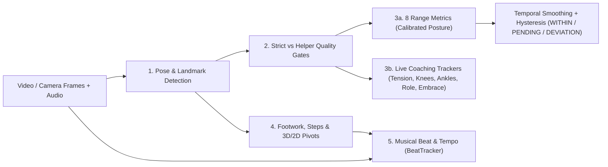
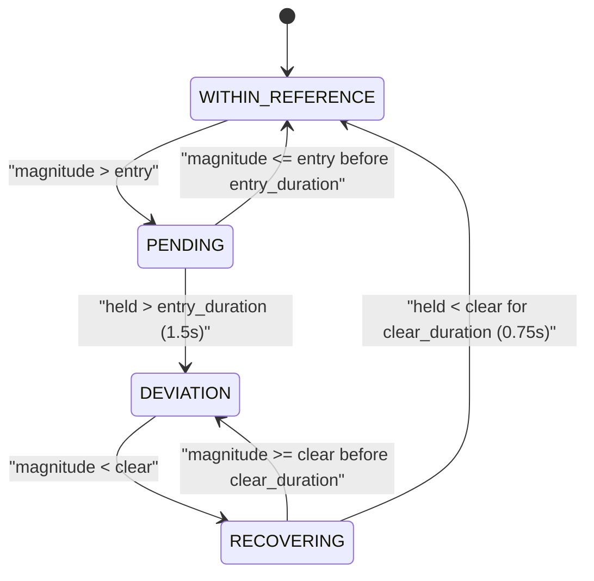
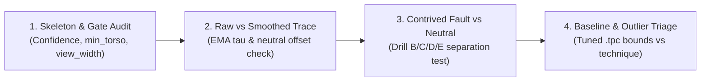
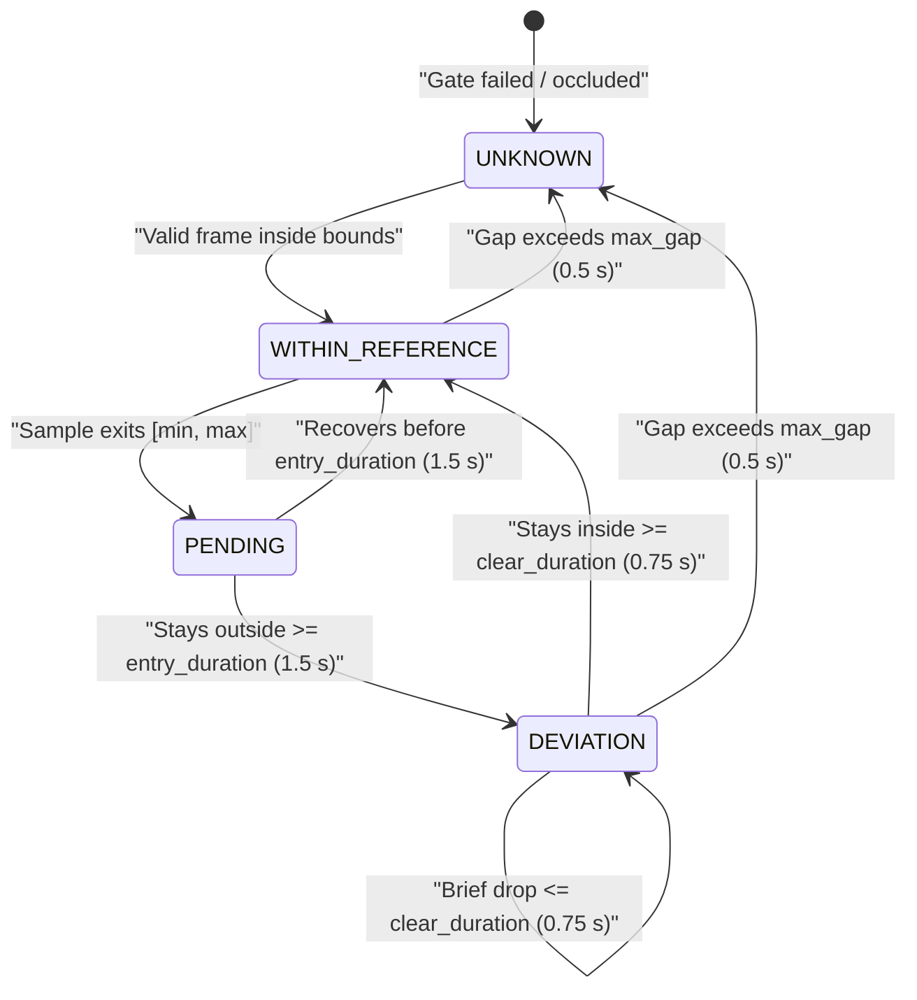

# TangoPosture Solo Dancer Metrics, Calibration & Movement Manual ("For Dummies" Edition)

> [!NOTE]
> This manual explains every metric, formula, landmark input, temporal hysteresis state machine, footwork/pivot detector, self-calibration check, and configuration parameter used in TangoPosture's **Solo Dancer Engine** (`metrics.py`, `geometry.py`, `temporal.py`, `movement.py`, `engines/solo.py`, `calibration/measurements.py`, `calibration/camera_session.py`, and `calibration/statistics.py`), written so any dancer, teacher, or analyst can understand both *what the numbers mean* and *how to interpret them*.

---

## 1. The Big Picture ("For Dummies" Mental Model)

Picture one tango dancer practising in profile (or facing the camera). Strip away styling and clothes, and TangoPosture sees **five connected physical blocks** plus **floor footprints**:

1. **The Neck & Gaze Stack (`head_pitch`, `head_forward`, `head_inclination`)**: Measures whether your chin is level, your head cranes forward in front of your spine, or your neck tilts away from your torso axis.
2. **The Floating Collarbone Check (`shoulder_clearance` & `Shoulder Elevation %`)**: Measures the vertical breathing space between your ear and shoulders, divided by a rigid body-size ruler so camera zoom does not fool it.
3. **The Plumb Line & Upright Spine (`hip_offset`, `torso_axis_tilt`, `trunk_inclination`)**: Drops a plumb line from your ankle to the back of your head (`hip_offset` checks if your pelvis pokes backward) and compares both your hip-to-shoulder spine (`trunk_inclination`) and your averaged center torso (`torso_axis_tilt`, pink line) against vertical.
4. **Soft Legs & Brushing Feet (`knee_flexion`, `ankle_lift_ratio`)**: Watches your standing/supporting knees for stiff locked legs (`0°`) and watches whether your free foot stays close to the floor during slow lyrical tangos (`≤ 115 BPM`).
5. **The Tango Frame & Floor Track (`Role`, `Embrace`, `Steps`, `Pivots`, `Beat`)**: Detects whether your arms hold a Leader or Follower frame (`Open` vs `Closed`), stamps grounded footprints (`steps`), spots `clockwise` / `counter-clockwise` turns (`pivots`), and checks step timing against the musical beat.

---

## 2. How MediaPipe Landmarks Become Solo Geometry

### 2.1 Which Landmarks Are Used for What?

MediaPipe extracts 33 normalized `[0.0, 1.0]` image landmarks (`x`, `y`, `visibility`, `presence`) plus metric 3D `world_poses`. Each Solo component uses only the landmarks needed for its joint chain:

| Sub-System | Exact Landmark Keys | How They Are Used |
| --- | --- | --- |
| **Core Torso & Head Axis** | `nose`, `left_ear`, `right_ear`, `left_shoulder`, `right_shoulder`, `left_hip`, `right_hip` | Core trunk vector $\mathbf{t} = \text{normalize}(\mathbf{s} - \mathbf{h})$, facing normal $\mathbf{n}$, `view_width`, `trunk_inclination`, `head_forward`, `head_inclination`, `torso_axis_tilt`, `head_pitch`. |
| **Plumb-Line Axis Curve** | `nose`, `left/right_ear`, `left/right_hip`, `left/right_ankle` | Connects `ankle → head_back` and measures perpendicular posterior hip protrusion (`hip_offset`). |
| **Shoulders (Rigid Scale)** | `left_ear`, `right_ear`, `left_shoulder`, `right_shoulder`, `left_hip`, `right_hip`, `nose` | Measures `shoulder.y - ear.y` normalized by shrug-invariant ear-to-hip / skull/shoulder scales. |
| **Knees & Slow-Tango Ankles** | `left/right_hip`, `left/right_knee`, `left/right_ankle` | Interior knee angle (`knee_flexion`) and vertical lifted-vs-grounded ankle height (`ankle_lift_ratio`). |
| **Offline Steps & Pivots** | `left/right_ankle`, `left/right_heel`, `left/right_foot_index`, `left/right_hip`, `left/right_shoulder`, plus `world_pose` hips | Grounded step anchors (`steps`), floor stride heading, 3D hip heading (`hip_heading_3d_deg`), and 2D shoulder/hip width envelope (`pivots`). |
| **Role & Embrace Frame** | `left/right_shoulder`, `left/right_elbow`, `left/right_wrist`, plus `left/right_hip`, `nose`, `ears` | Detects `LEADER` vs `FOLLOWER` asymmetry and `OPEN` vs `CLOSED` embrace geometry. |

### 2.2 Pixel Conversion ("Cartesian Up vs Image Down")

In image coordinates, `y = 0` is at the top of the screen and increases **downward**. Different helpers either convert directly to upward-positive Cartesian pixels (`pixel(lm, W, H) = (lm.x * W, -lm.y * H)`) or work explicitly with image `y` differences (where smaller `y` means higher in the frame, such as lifted ankles and shrugged shoulders).

### 2.3 Strict Quality Gates vs Helper Visibility Floors

Why do some Solo indicators keep working when another reads `UNKNOWN` (*Not measured*)? Because Solo distinguishes **strict core posture gates** from **limb helper floors**:

1. **Strict Core Posture Gates (`metrics.py`)**:
   - **Single person only**: `len(poses) == 1`. Two people or `0` people mark all core metrics `UNKNOWN`.
   - **Visibility floor**: Required landmarks must clear `cfg.confidence` (default `0.70`).
   - **Minimum anatomy size**:
     - Torso length $L = \|\mathbf{s} - \mathbf{h}\|_2 \ge \text{min\_torso} \cdot \min(W, H)$ (`0.12` default).
     - Shoulder-to-ear neck length $\ge \text{min\_head} \cdot \min(W, H)$ (`0.04` default; blocks head-only metrics if failed while keeping `trunk_inclination`).
   - **Side-View Cutoff (`view_width`)**: Computes projected body width $\text{width} = \frac{\max(\|\mathbf{s}_L - \mathbf{s}_R\|,\; \|\mathbf{h}_L - \mathbf{h}_R\|)}{L}$.
     - If `allow_all_angles = False` and `width > max_view_width` (`0.45` default), `measure()` returns `UNKNOWN` (*"Return to the selected side-on view"*).
     - Calibrated `.tpc` profiles override this per metric via `view_eligible(target.view, view_width, max_view_width)`: **`side`** (`<= max_view_width`), **`front`** (`> max_view_width`), or **`all`**.
2. **Helper Visibility Floors (`geometry.py`)**:
   - **Shoulders**: Uses `shoulder_visibility_floor = 0.50` so momentary profile ear/shoulder dips don't drop shoulder feedback.
   - **Knees & Ankles**: Uses `knee_visibility_floor = 0.35` (`0.45` for `axis_curve_alignment` plump line) because dark tango trousers/skirts and rapid footwork frequently lower ankle visibility into `0.35–0.65`.

### 2.4 Target Extraction, Smoothing & Gap Recovery (`engines/solo.py`, `pose/interpolation.py`)

- **Display vs Raw Measurements**: `PoseSmoother` (`overlay_smoothing = 0.20 s`) smooths skeleton lines visually and bridges tiny 1–2 frame visibility dips (`<= min(0.15s, max_gap * 0.5)`), **but posture scoring ALWAYS runs on unsmoothed raw landmarks (`measurement_poses`)** so smoothing never hides real errors or invents fake measurements!
- **Auto Gap Recovery (`replay_recovery_auto`)**: Offline analysis in Review can optionally run short-gap linear/cubic recovery across gaps up to `replay_recovery_max_gap_s` (`0.75 s`) within `replay_recovery_budget_s` (`12.0 s`), clearly styling any recovered bones with **dotted lines** instead of solid lines.

---

## 3. All Solo Metrics Explained (Math + For Dummies)

### 3.1 Group A — The 8 Range Calibration Metrics (`METRIC_DETAILS`)

These 8 metrics can be calibrated in **Self Calibration** or **Calibration Editor** (`.tpc` profiles) and scored frame-by-frame in **Review** and **Analytics**:

| Key | Plain-English Meaning | Exact Formula & Sign Convention | View & Landmarks Needed |
| --- | --- | --- | --- |
| **`head_pitch`** | **Chin up/down angle** (gaze direction relative to horizontal horizon). | $\theta_{\text{raw}} = \operatorname{atan2}((y_{\text{ear}} - y_{\text{nose}})H,\; |x_{\text{nose}} - x_{\text{ear}}|W)$, then **`head_pitch = theta_raw - head_neutral_offset`** (`degrees`, default `-12.0°` offset so anatomically level gaze reads ~`0°`). Negative = looking down! | Prefer `side`/`all`; needs reliable `nose` + ear (`left/right_ear`), or inter-ear span during 360° rotations. |
| **`head_forward`** | **Turtle-neck offset**: How far forward your head sits ahead of your spine line. | Let $\mathbf{t} = \frac{\mathbf{s} - \mathbf{h}}{\|\mathbf{s} - \mathbf{h}\|}$ be spine up-vector, $\mathbf{n} = f \cdot (t_y, -t_x)$ be forward normal (`f = +1` facing right, `-1` left), and $\mathbf{h}_{\text{vec}} = \mathbf{e} - \mathbf{s}$. Then **`head_forward = (h_vec · n) / L`** (`torso_lengths`). Positive = head protruding forward! | `side` (uses configured `side` + `facing`). |
| **`head_inclination`** | **Neck bend angle**: Angle of the ear–shoulder vector relative to the torso spine. | **`head_inclination = atan2(h_vec · n, h_vec · t)`** (`degrees`). Shares the same ear–shoulder–hip geometry as `head_forward`, expressing neck bend in degrees instead of torso lengths. | `side` (`ear`, `shoulder`, `hip`). |
| **`shoulder_clearance`** | **Neck breathing room**: Normalized vertical distance from shoulder up to ear (shrug detector). | For each visible ear–shoulder pair: $\Delta y = (y_{\text{sh}} - y_{\text{ear}})H$. Pick the *smallest* (tightest/highest) $\Delta y$ and divide by shrug-invariant reference scale $S$: **`raw_clearance = min_dy / S`** (`normalized_clearance`). Smaller = tenser/raised shoulders! | `front` or `side`; prefers `0.26 * (hip.y - ear.y)H`, falling back to rigid skull/shoulder scales. |
| **`hip_offset`** | **Pelvis curve ("bump" behind axis)**: How far your hips poke behind a straight plumb line from your ankle to the back of your head. | Connects ankle $\mathbf{a}$ to estimated back-of-head $\mathbf{b}$, with posterior unit normal $\mathbf{n}_{\text{post}}$. Computes **`(h - a) · n_post / ||b - a|| - neutral_offset`** (`axis_lengths`). Positive = pelvis curving/protruding backward (sitting back). | `side` (`ear`, `hip`, `ankle`, optional `nose`; `axis_len >= 0.20 H`). |
| **`torso_axis_tilt`** | **Pink line torso lean**: Unsigned magnitude of upper-body tilt away from straight vertical. | Uses `left/right_shoulder` midpoint $\mathbf{s}$ and `left/right_hip` midpoint $\mathbf{h}$: $\theta = |\operatorname{atan2}((s_x - h_x)(W-1),\; (h_y - s_y)(H-1))|$ (`degrees`, always $\ge 0^\circ$). Pure `0°` = plumb vertical spine. | `front` or `all` (requires ALL 4: both shoulders + both hips!). |
| **`trunk_inclination`** | **Signed torso lean forward/back** along your facing direction. | **`trunk_inclination = atan2(f * t_x, t_y)`** (`degrees`), where `f = +1` facing right, `-1` left. Positive = leaning torso **forward** (*apilado*/intention); Negative = leaning **backward**. | `side` or `all` (`shoulder`, `hip`). |
| **`knee_flexion`** | **Soft-knee bend**: How softly bent your *straightest* reliably visible leg is (`0°` = locked knee). | Interior angle $\beta = \arccos\left(\frac{\mathbf{u} \cdot \mathbf{v}}{\|\mathbf{u}\|\|\mathbf{v}\|}\right)$ between $\mathbf{u} = \text{hip} - \text{knee}$ and $\mathbf{v} = \text{ankle} - \text{knee}$. **`flexion = max(0, 180° - beta)`** (`degrees`). Picks the minimum across legs (with visibility tiebreak) so one stiff locked leg is never masked by a bent trailing knee! | `side` or `all` (segment px $\ge 10$, `vis >= 0.35`). |

---

### 3.2 Group B — Live Coaching Trackers & Tango Heuristics (`geometry.py`)

In addition to the 8 profile metrics, `engines/solo.py` runs specialized live/frame trackers:

1. **Shoulder Elevation % (`shoulder_tension_alignment` + Adaptive Baseline)**:
   - Converts `raw_clearance` into percentage elevation above your relaxed neutral baseline $B = \max(0.20,\; \text{neutral\_clearance})$:
     $$\text{elevation\_pct} = \frac{B - \text{raw\_clearance}}{B} \times 100\%$$
   - When shrugging (`raw_clearance` shrinks by 10%), `elevation_pct` jumps to `+10%`.
   - When using Settings defaults, a rolling **Adaptive Shoulder Baseline** collects up to `60` qualifying frames inside `[0.65, 2.50]` and sets effective neutral clearance from the `75th` percentile (`shoulder_adaptive_percentile`), so naturally shorter/longer necks adapt automatically without false alarms!

2. **Ankle Lift Ratio & Slow-Tango Floor Brushing (`AnkleStepTracker`)**:
   - Computes how high the free ankle lifts above the supporting ankle normalized by leg length ($\text{hip} \to \text{knee} \to \text{ankle}$):
     $$\text{lift\_ratio} = \frac{\max(0,\; y_{\text{grounded}} - y_{\text{lifted}})}{\text{leg\_length}}$$
   - Segments individual steps (`smoothed > step_start_ratio` until foot lands `<= step_end_ratio`).
   - Only active when tempo $\le \text{slow\_tango\_max\_bpm}$ (`115.0 BPM` default—like Di Sarli!).
   - Counts consecutive high-lifted steps (`peak >= ankle_high_lift_ratio`, default `0.06` = 6% of leg length). Reaching `max_consecutive_high_ankle_steps` (`2`) triggers an ankle alert; a valid low floor-skimming step (`>= 0.12 s`) resets the counter to `0`!

3. **Role Detection (`RoleTracker`: `LEADER` vs `FOLLOWER`)**:
   - Inspects asymmetric embrace arm posture:
     - **Leader**: Left wrist raised (`lw.y <= ls.y + 0.16`, higher than right wrist) and right arm held horizontally around partner (or left-arm side fallback).
     - **Follower**: Right wrist raised above shoulder height and left arm resting horizontally on Leader's shoulder (with side-profile fallback).
   - Debounced with hysteresis: requires `role_assign_ms` (`300 ms`) to adopt a new role, and holds the active role across `role_hold_ms` (`5000 ms`) of temporary arm occlusion before reverting to `NONE`.

4. **Embrace Type (`EmbraceTracker`: `CLOSED` vs `OPEN`)**:
   - Once a role is active (`LEADER` or `FOLLOWER`), `embrace_openness_score()` computes a continuous `[0.0, 1.5]` score from horizontal elbow/wrist separation, nose-to-embrace openness ratio (how far outward from torso center the closed-side elbow/wrist sits), and shoulder width scale.
   - Smooths over time: crosses `< embrace_closed_threshold` (`0.72`) sustained for `embrace_hysteresis_seconds` (`0.8 s`) → **`CLOSED`**, or `>= 0.72` → **`OPEN`**.

---

### 3.3 Group C — Temporal Smoothing & Hysteresis State Machine (`Evaluator` in `temporal.py`)

Real movement fluctuates naturally; you don't want a red alert flashing because of a 0.1 s glance down! Every posture metric passes through `Evaluator` (and `AxisCurveTracker` for `hip_offset`):

1. **Exponential Time Filter**: Computes uneven-timestamp smoothing gain $\alpha = 1 - e^{-\Delta t / \tau}$, where $\tau = \text{cfg.smoothing}$ (`0.25 s` default; or `min_filter_time_constant = 0.0001 s` if raw unfiltered checks are requested):
   $$\hat{x}_i = \hat{x}_{i-1} + \alpha \cdot \operatorname{wrapped}(x_i - \hat{x}_{i-1})$$
   Any tracking gap `> max_gap` (`0.50 s`) resets the filter so stale history never leaks across dropouts.
2. **Deviation vs Limits**:
   - **Approved `.tpc` range `[lower, upper]`**: Distance outside limits $\delta = \hat{x}_i - \text{clamp}(\hat{x}_i, \text{lower}, \text{upper})$, with `entry = 0.0` (must stay outside for `entry_duration = 1.5 s` to trigger `DEVIATION`, then return inside `[lower, upper]` for `clear_duration = 0.75 s` to clear!).
   - **Settings threshold (`entry > clear`)**: Must stay `> entry` for `entry_duration` (`1.5 s`) and drop `< clear` for `clear_duration` (`0.75 s`) — classic two-level hysteresis!

---

### 3.4 Group D — Offline Footwork, Steps, Pivots & Musical Beat (`movement.py` + `beat.py`)

When Review runs **Movement Analysis** (`analyse_movement_observations`):

1. **Footprint / Step Contact Detection (`_FootTracker`)**:
   - Tracks each foot independently using ankle, heel, and toe (`foot_index`) bottom point + smoothed centroid velocity (`step_smooth_tau_s`).
   - State machine: **`INITIAL → ANCHORED ↔ MOVING → SETTLING`**:
     - Once a foot leaves its previous floor spot (`dist >= step_min_center_travel_scale`), accelerates (`MOVING`), then slows below `step_settle_speed_scale_s` and stays inside `step_settle_radius_scale` for `step_settle_min_duration_s`, `_try_confirm_step()` stamps a new footprint!
     - **Anti-Ghost Guards**: Rejects pure heel/toe swivels in place (`step_min_both_ends_travel_scale`) AND rejects suspended/airborne *boleos* (`leg_span < step_min_leg_extension_ratio * max_leg_span` or elevated `> step_max_airborne_lift_scale` above the standing foot).
     - **Step Fade**: Replay renders recent footprints on the floor fading smoothly over `replay_step_history_seconds` (`5.0 s`).

2. **Pivot & Turn Detection (`_detect_pivot_intervals`)**:
   - Combines two cues:
     - **3D World Hip Heading (`hip_heading_3d_deg`)**: Direction of `(left_hip - right_hip)` horizontal projection in MediaPipe `world_poses` (smoothly `unwrap_angles()` across $\pm 180^\circ$ wrap boundaries with `heading_smooth_tau_s`).
     - **Supporting Foot Anchor**: `_support_side_for_slice()` checks which foot remained planted within `pivot_foot_anchor_radius_scale` (`0.18` body scales) during the rotation!
   - Scans sliding time windows `[win_min, win_max]`: triggers a `clockwise` or `counter-clockwise` pivot whenever net rotation `>= pivot_min_net_deg` and mean turn rate `>= pivot_entry_rate_deg_s` without reversing (`<= pivot_max_opposite_fraction`), trimming clean ends at `pivot_exit_rate_deg_s`.

3. **How the Beat Is Calculated (`beat.py` + `soundtrack.py`)**:
   - Same acoustic `BeatTracker` shared across the app: normalizes `0.62 * bass_flux + 0.38 * mid_flux`, subtracts a `0.40 s` moving mean + `50 ms` Hann kernel to get the onset envelope, finds tempo via **1x/2x/4x/8x Harmonic Comb Autocorrelation** centered softly on `tango_bpm` (`120.0 BPM`), aligns beat phase $\phi$, and locks Beat 1 of each 8-beat tango phrase after `beat_analysis_seconds` (`30.0 s`)!

---

### 3.5 Group E — Solo Camera Self-Calibration & Repeat Check (`camera_session.py` & `statistics.py`)

When calibrating in **Self Calibration**, TangoPosture protects you from saving noisy or unusable ranges:

1. **Readiness State Machine**: `Preview → Prompt → Wait for view and pose → Settle → Capture → Evaluate → Review`.
   - Checks **1 dancer only** + identity continuity (`jump <= 0.75` torso lengths).
   - Checks **strict view framing**: Front holds require `view_width > max_view_width + front_view_width_margin` (`0.55` default), front anatomical shoulder/hip order, and `nose` between ears; Side holds require `view_width <= max_view_width` (`0.45`) and clear ear-to-nose horizontal sign (`|dx| >= 0.015`).
   - Checks **Stillness**: Torso midpoint drift during `stable_time_s` (`0.75 s`) must stay `<= settle_drift_torso_lengths` (`0.05 tl`).
   - Checks **Coverage**: Accumulates valid duration only across adjacent non-duplicate frames within `min(max_usable_gap_s, max_gap)` (`0.20 s`), requiring `>= min_usable_hold_s` (`2.0 s` out of `2.5 s`).
2. **Range Suggestion (`summarize_examples`)**:
   - Uses **`calibration_suggest_lower_pct` (`10%`)** ($P_{10}$), **Median (`50%`)**, and **`calibration_suggest_upper_pct` (`90%`)** ($P_{90}$) over accepted passages — i.e., **the middle 80%** of your normal tango examples!
3. **Deliberate-Change Repeat Check (`repeat_check`)**:
   - To enable live camera alerts (`camera_check_passed = True`), run a 4-hold check (**neutral A → deliberate change A → neutral B → deliberate change B**, e.g., gentle shrug or gaze drop).
   - **Rule**: Both deliberate shifts $|M_{\text{chg}} - M_{\text{neu}}|$ must have the **same direction** (plus known expected sign where physically required, e.g., knee bend decreases when standing straighter, shoulder clearance decreases when shrugging) AND exceed **$2 \times$ max within-hold spread ($P_{90} - P_{10}$)**, while your return hold $M_{\text{neu,B}}$ matches $M_{\text{neu,A}}$! Weak/ambiguous tests stay safely **Comparison only**.

---

## 4. Complete Solo Settings Reference (`Single · *` & `Calibration · Solo camera`)

| Setting | Default | For Dummies Effect & When to Tune |
| --- | --- | --- |
| `side` / `facing` | `"left"` / `"right"` | Camera profile side & facing direction in the unmirrored image (auto-detected during Solo Camera Calibration). |
| `allow_all_angles` | `false` | Allows front/oblique/360° poses in scoring instead of restricting strictly to side-on (`view_width <= max_view_width`). |
| `confidence` | `0.70` | Minimum landmark confidence for core posture gates. Lower to `0.55` in low light; raise to `0.80` for strict quality. |
| `min_torso` / `min_head` | `0.12` / `0.04` | Minimum body fraction of frame height. Prevents tiny distant silhouettes from producing wild angles. |
| `max_view_width` | `0.45` | Side-on vs front-on cutoff (torso width / torso length). Below `0.45` = side-on. |
| `calibration_suggest_lower_pct` / `upper_pct` | `10.0` / `90.0` | Percentile band (`P10` to `P90` = middle 80%) suggested when creating `.tpc` profiles. |
| `smoothing` / `overlay_smoothing` | `0.25 s` / `0.20 s` | Temporal smoothing for metric evaluation vs skeleton drawing (`overlay_smoothing`). |
| `entry_duration` / `clear_duration` | `1.5 s` / `0.75 s` | How long a posture deviation must persist before turning red, and how long back in bounds to clear. |
| `max_gap` | `0.5 s` | Gaps larger than this reset smoothing filters and break calibration coverage. |
| `head_neutral_offset` / `head_down_angle` / `head_down_duration` | `-12.0°` / `-15.0°` / `3.0 s` | Neutral ear-to-nose offset, red alert pitch threshold, and persistence for looking down. |
| `shoulder_raise_threshold` / `shoulder_tension_duration` | `10.0%` / `1.0 s` | Alert when shoulders elevate ≥ `10%` closer to ears for ≥ `1.0 s`. |
| `shoulder_neutral_clearance` | `1.05` | Fallback baseline ratio before adaptive baseline (`shoulder_adaptive_min_samples = 15`) takes over. |
| `knee_visibility_floor` / `closed_embrace_min_knee_bend` / `knee_straight_duration` | `0.35` / `6.0°` / `1.5 s` | Knee detection floor (`0.35`), minimum soft-knee bend (`6°`), and locked-leg alert duration. |
| `axis_curve_entry` / `clear` / `duration` | `0.06` / `0.035` / `1.5 s` | Posterior hip bump entry (`6%` of axis length) and clear (`3.5%`) thresholds with `1.5 s` persistence. |
| `slow_tango_max_bpm` / `ankle_high_lift_ratio` / `max_consecutive_high_ankle_steps` | `115 BPM` / `0.06` / `2` | Gates slow-tango floor-brushing check (`<= 115 BPM`), flags lifts > 6% of leg length for 2 consecutive steps. |
| `role_assign_ms` / `role_hold_ms` | `300 ms` / `5000 ms` | Delay before assigning `LEADER`/`FOLLOWER` and hold window during arm occlusion. |
| `embrace_closed_threshold` / `embrace_hysteresis_seconds` | `0.72` / `0.8 s` | Openness score boundary and hysteresis separating `OPEN` vs `CLOSED` embrace. |
| `solo_camera.stable_time_s` / `settle_drift_torso_lengths` | `0.75 s` / `0.05 tl` | Settling window and max allowed torso sway before guided capture starts. |
| `solo_camera.hold_window_s` / `min_usable_hold_s` / `max_usable_gap_s` | `2.5 s` / `2.0 s` / `0.20 s` | Guided capture attempt duration, minimum usable seconds required (80%), and max valid sample gap. |
| `solo_camera.front_view_width_margin` / `walking_take_limit_s` | `0.10 tl` / `8.0 s` | Ambiguity buffer above `max_view_width` for front holds, and cap per walking take. |

---

## 5. What Can Damage Solo Calculations (and How to Fix It)

> [!WARNING]
> Solo metrics assume a **level camera**, **full body (nose to ankles/shoes) in frame**, and **consistent physical camera placement** if comparing live against an older `.tpc` calibration!

| Failure Mode | What Goes Wrong in the Math | Symptom in UI / Charts | Fix |
| --- | --- | --- | --- |
| **Wrong `facing` or `side` in Video Analysis Settings** | `trunk_inclination` and `head_forward` flip sign (`+` forward looks like `-` backward); far-side ear occlusion drops `head_pitch`. | `trunk_inclination` shows `-8°` leaning backward when you're leaning forward! | Match `side` & `facing` to the **unmirrored recorded video**, or use `Self Calibration` (auto-detects side/facing). |
| **Cropped Shoes / Ankles** | Side-on `measure()` requires `nose` AND at least one `ankle`; `hip_offset` requires ankle + ear + hip! | Core metrics read `UNKNOWN` (*"Keep nose and at least one ankle visible"*), `hip_offset` drops out. | Step back ~0.5–1 m or tilt camera down slightly (while keeping it level) so shoes stay inside `[0, 1]` Y bounds. |
| **Camera Tilted Left/Right** | `torso_axis_tilt`, `trunk_inclination`, and `head_pitch` reference true image vertical/horizontal—a tilted tripod biases all baseline angles by camera roll! | Standing straight registers `torso_axis_tilt = 5°` everywhere. | Level the camera using a bubble level or calibrate in place (`head_neutral_offset` / `.tpc` baseline compensates only if placement doesn't change!). |
| **Changed Camera Height / Zoom vs Saved `.tpc`** | Changing pitch angle alters vertical 2D knee/head projections (`hip_offset` and `head_pitch` shift). | Live Review flags false deviations even in your neutral stance! | Use **Check with camera…** to re-verify on the current setup, or configure **Measurement normalization** offsets. |
| **Heavy Dark Clothing / Loose Flowing Skirts** | MediaPipe knees/ankles bounce erratically or drop below `knee_visibility_floor = 0.35`, creating ghost steps or straight-knee spikes. | Erratic `knee_flexion` drops to `0°`, missing footprints, false `DEVIATION`s. | Wear fitted trousers/leggings with shoe contrast against the floor, and use bright even studio lighting. |
| **Oblique 3/4 Angles (`view_width ~ 0.45–0.55`)** | Outside `max_view_width` (`0.45`) with `allow_all_angles = false`, side metrics go `UNKNOWN`; inside Self Calibration's `[0.45, 0.55]` margin, guide pauses with `View uncertain`. | Dotted lines / `UNKNOWN` gray regions in Analytics; calibration prompts to turn cleanly. | Turn clearly side-on (`<= 0.45`) or front-on (`> 0.55`), or enable `allow_all_angles` / approve `all` view in `.tpc`. |

---

## 6. How to Analyze Solo Data & Build Visualizations (Distributions, Outliers, Charts)

You can inspect charts directly inside **Analytics** and **Calibration Editor**, or export `.tpc` / frame series JSON/CSV into Python (`matplotlib` / `seaborn` / `plotly`) to analyze your technique quantitatively:

### 6.1 Step-by-Step Analysis Workflow

1. **Check Coverage & Tracking Health**: Look at the fraction of `WITHIN_REFERENCE / DEVIATION` vs gray `UNKNOWN` frames (`valid_duration / selected_duration`). Never judge a metric when coverage `< 60%`.
2. **Separate Contexts (`Neutral standing` vs `Solo walking` vs `Pivot`)**: Always compare apples to apples—soft knees during a fast crossing have a totally different distribution from neutral standing posture.
3. **Compare Raw vs Smoothed Curves**: Notice whether a spike triggers `PENDING` (brief blip that self-corrects `< 1.5 s`) vs `DEVIATION` (sustained habit lasting `> 1.5 s`). Habitual posture issues appear as long horizontal `DEVIATION` blocks, not 2-frame spikes!

### 6.2 Recommended Visualizations (Metrics, Distributions & Outliers)

| Visualization Type | Best Solo Metrics to Plot | What It Reveals & How to Spot Outliers |
| --- | --- | --- |
| **1. Time-Series + Hysteresis State Shading + Reference Band** *(built into Analytics & Editor)* | All 8 `METRIC_DETAILS` + `shoulder_elev_pct` + `ankle_lift_ratio` | Shaded amber/green band shows your **`[P10, P90]`** / `[lower, upper]` target corridor; color-coded background (`green` = OK, `amber` = `PENDING` warning, `red` = confirmed `DEVIATION`, `gray` = `UNKNOWN`) pinpoints exact moments habit breaks down. |
| **2. Standing vs Walking Violin / Box Plots (with Tukey Outlier Fences)** | `knee_flexion`, `head_forward`, `trunk_inclination`, `hip_offset` | Plots side-by-side distributions across contexts (**Standing** vs **Solo walking** vs **Pivots**). Median shows typical alignment, box height shows **IQR consistency**, and points outside $[Q_1 - 1.5 \cdot \text{IQR},\; Q_3 + 1.5 \cdot \text{IQR}]$ expose either loss of grounding in specific steps or ankle occlusion glitches! |
| **3. Distribution Histogram + KDE Overlay (`inside_fraction`)** | `head_pitch`, `shoulder_clearance`, `torso_axis_tilt` | Reveals **skewness** (e.g., long left tail on `head_pitch` = frequent quick glances down at the floor) or **bimodal peaks** (e.g., `shoulder_clearance` sitting cleanly relaxed during *caminata* but bunching upward whenever preparing a turn). |
| **4. 2D Joint Phase / Scatter Plot (`Head vs Trunk`, `Knee vs Hip`)** | `trunk_inclination` (X) vs `hip_offset` (Y) or `knee_flexion` (X) vs `ankle_lift_ratio` (Y) | Shows postural compensation patterns! *Example:* if every time `trunk_inclination` leans forward (`+8°`), `hip_offset` jumps positive (`+0.08`), the dancer is "breaking at the waist" (pushing hips back) instead of moving the whole axis forward from the ankles. |
| **5. Polar Rose / Compass Plot of Pivots & Step Headings** | `pivots` (`net_deg`, `direction`, `peak_rate_deg_s`) & `steps` (`angle_deg`) | Displays turning symmetry (`clockwise` vs `counter-clockwise` *ochos* and *giros*), average turn angle (`90°` vs `180°` pivots), and peak angular velocity consistency. |
| **6. Repeat-Check Separation Chart (Guided Camera Validation)** | Box/strip plot of `[Neutral A, Changed A, Neutral B, Changed B]` | Visually confirms whether a deliberate check clearly cleared $2 \times \text{noise}$ without baseline drift before enabling live alerts (`camera_check_passed`). |

### 6.3 Quick Outlier Checklist (Real Technique Flaw vs Tracking Glitch)

Whenever a box plot, histogram tail, or Analytics peak flags an extreme value:
1. Click the timestamp on the chart to jump straight to that frame in **Review**.
2. Toggle **Skeleton (V)** and inspect if joints are missing, crossed left↔right, or rendered with **dotted interpolated bones**.
3. Check the frame's **`view_width`** (if the dancer turned `> 0.45` side-width mid-pivot while `allow_all_angles = false`, limb lengths foreshorten).
4. **Rule of thumb**: Isolated 1–3 frame outliers coinciding with occlusion/turn-boundary frames are pose jitter; multi-second `DEVIATION` plateaus or bimodal tails on clean solid skeletons represent real coaching opportunities!

---

## 7. Consistent Testing & Validation Methodology (Solo Suite)

Before trusting any metric reading—or deciding whether a flagged posture break reflects real dance technique rather than camera geometry or a loose threshold—put your setup through a **consistent 4-Stage Validation Protocol** using five repeatable **5–15 second controlled studio drills**.

### 7.1 The 5 Controlled Solo Calibration & Validation Drills

Film these five short clips from a tripod at waist-to-chest height using the exact camera distance and lighting you plan to train in:

1. **Drill A — Neutral Side-Profile Walk (8–10 s)**:
   Walk slowly across the frame strictly perpendicular to the lens (`view_width` well under `0.45`), holding a calm solo embrace, soft knees (`~10°–15°`), relaxed shoulders, and level gaze. *Tests all **8 Range Calibration Metrics** and **`.tpc` Self-Calibration**.*
2. **Drill B — Intentional Posture Contrast Blocks (5 s Neutral + 5 s Fault × 4)**:
   Perform four clean 5-second contrast holds separated by 5-second neutral resets:
   - *(i)* **Chin-Down Gaze**: Drop your chin/gaze intentionally toward the floor (`~10°`–`15°` deeper than neutral, below `-15.0°`).
   - *(ii)* **Shoulder Shrug**: Lift both shoulders tension-tight toward your ears, then drop them cleanly.
   - *(iii)* **Locked-Knee Walk**: Walk stiffly with nearly straight legs (`< 5°` bend) while holding a closed-embrace arm frame.
   - *(iv)* **Posterior Hip Push**: Push your hips backward behind your ankle-to-head vertical plumb line (`> +0.06` normalized offset).
   *Tests all **4 Frame Coaching Traces** and **`Evaluator` temporal hysteresis**.*
3. **Drill C — Slow-Tango Glide vs High-Ankle Lift + BPM Switch (15 s)**:
   Step to an `80 BPM` track (or set manual BPM `< 115.0`), gliding 8 calm steps close to the floor, followed deliberately by 4 marching steps that lift the free ankle clearly off the floor (`> 0.06` leg-length ratio). Repeat or switch BPM to `130 BPM` and verify the lift alert silences. *Tests **Step Placements (`steps`)**, **Slow-Tango Ankle Lift (`ankle_lift_ratio`)**, and **BPM gating**.*
4. **Drill D — Discrete 90° and 180° Pivot / Ocho Sequence (15 s)**:
   Pause 1 s on your standing leg, execute a clean `90°` or `180°` hip pivot over `0.4–0.7 s`, pause 1 s, and repeat four times; finish with one deliberately hesitant, wobbling double-reversal turn. *Tests **3D Hip Yaw Pivots (`pivots`)**, **`allow_all_angles` / `max_view_width` gating**, and **rotation trimming**.*
5. **Drill E — Role & Embrace Switch + Brief Occlusion Recovery (15 s)**:
   Hold a wide **Leader** open-embrace frame for 5 s, switch to a compact **Follower** closed-embrace frame for 5 s, then step briefly behind a chair or music stand once for `0.3 s` (short gap) and once for `1.0 s` (long gap). *Tests **`RoleTracker`**, **`EmbraceTracker`**, **`max_gap` (`0.5 s`)**, and **replay interpolation/recovery**.*

### 7.2 The 4-Stage Validation Protocol (Apply to Every Metric)

* **Stage 1 — Skeleton & Gate Audit**: Toggle **Skeleton (`V`)** in **Review**. Confirm all required landmarks appear solid (not dotted/interpolated) with detection confidence `>= confidence` (`0.70` default; `0.45`/`0.55` in offline movement detectors), torso length `>= min_torso` (`0.12`), head size `>= min_head` (`0.04`), and side-profile width `<= max_view_width` (`0.45`, unless `allow_all_angles = true`).
* **Stage 2 — Raw vs Smoothed Trace Inspection**: Compare the instantaneous frame geometry against its smoothed trace (`smoothing = 0.25 s`, `overlay_smoothing = 0.20 s`) and confirm your personal neutral baseline (`head_neutral_offset`, `shoulder_neutral_clearance`, `axis_neutral_offset`, or calibrated `.tpc` bounds) is centered properly on Drill A.
* **Stage 3 — Contrived Separation Test**: Verify that Drill B/C/D intentional faults cleanly cross the trigger ceiling and hold long enough to transition `WITHIN_REFERENCE` → `PENDING` → `DEVIATION` (or light up the Settings coaching banner), and cleanly clear back to green during the 5-second neutral reset.
* **Stage 4 — Baseline Distribution & Outlier Triage**: Over a full 2–3 minute social clip or practice tanda, check median and IQR stability first. Only tighten personal `.tpc` bounds or tune `config.py` constants after confirming extreme values align with real visual habit breaks rather than turn-boundary foreshortening.

---

## 8. Per-Metric Validation Tests, Recommendations, Tuning & Visualizations

### 8.1 The 8 Range Calibration Metrics (`METRIC_DETAILS` / `.tpc` Profile Bounds)

These eight geometric metrics live in `.tpc` Calibration Profiles (auto-suggested from clean side-view frames via `measure_ranges()`, taking the `10.0`th to `90.0`th percentile once `>= calibration_min_usable_samples = 2` usable samples exist) and power **Analytics** and **Review** compliance cards.

> [!NOTE]
> Unlike the per-frame `head_angle` coaching trace, `.tpc` range calibration evaluates **`head_pitch` with `neutral_offset = 0.0`**, so your stored bounds reflect raw image-plane ear-to-nose angles directly.

#### A. Head & Neck Triad: `head_pitch` (`°`), `head_forward` (`torso lengths`), `head_inclination` (`°`)
* **Plain-English Distinction**:
  * `head_pitch`: Are you tilting your chin down toward the floor or level with the horizon (ear-to-nose angle)?
  * `head_forward`: Is your whole head sliding horizontally out in front of your spine axis (perpendicular ear distance from the trunk line, divided by torso length)?
  * `head_inclination`: At what angle does your neck climb off your shoulders (shoulder-to-ear segment angle relative to your trunk vector)?
* **Validation Test (Drills A & B-i)**: Compare Drill A (tall axis, soft gaze ahead) against Drill B-i (chin dropped without jutting neck) and a deliberate "turtle neck" forward crane. `head_pitch` should drop sharply during chin-down even if `head_forward` barely moves; conversely, poking the chin horizontally forward should spike `head_forward` and `head_inclination`.
* **Target Recommendations**: See the Master Range Summary Table below. In tango, you want `head_forward` small (`0.00` to `0.25` torso lengths) and `head_pitch` level/softly suspended rather than dipping toward your shoes.
* **Controlling Parameters**: `confidence` (`0.70`), `min_torso` (`0.12`), `min_head` (`0.04`), `max_view_width` (`0.45`), `allow_all_angles` (`False`), `view_change_tolerance` (`0.15`), `calibration_suggest_lower_pct` (`10.0`), upper 90.0th percentile bound, `calibration_min_usable_samples` (`2`).
* **Troubleshooting & Tweaking**:
  * *Problem: Calibration suggests near-zero samples or wildly wide bounds.* Check if you stood too far away (`min_head = 0.04` or `min_torso = 0.12` failed), rotated partially toward camera (`view_width > 0.45`), or wore a wide-brimmed hat/hair bun covering the ear. Step closer or tighten your walk path perpendicular to the lens.
  * *Problem: `head_pitch` fluctuates when turning left vs right.* Confirm facing orientation matches the clip—remember `measure_ranges()` records raw image-plane ear-to-nose tilt, whereas flipped directions flip signed vectors in trunk-relative metrics.
* **Visualizations to Build**:
  1. **Neck-Projection Quadrant Plot (`head_forward` vs `head_inclination`)**: Reveals whether tension comes from chin-dip (`head_pitch`) versus true forward-head carriage ("tech neck").
  2. **Raw `head_pitch` Violin Plot by Clip**: Highlights bimodal clusters if a dancer looks fine walking forward but stares at the floor during ochos or cross steps.

#### B. `shoulder_clearance` (`normalized clearance ratio`)
* **Validation Test (Drills A & B-ii)**: Film 8 s breathing calmly (`Drill A`), then 5 s shrugging strongly (`Drill B-ii`), then drop back cleanly. Expect a clear downward step (smaller clearance ratio = tighter shoulders) during the shrug and immediate rebound back toward `~0.95–1.20` during release.
* **How Anatomical Fallback Prevents Scale Artifacts**: Vertical ear-to-shoulder pixel gap is divided by an anatomical reference scale (`min 8.0 px` via `shoulder_min_ref_scale_px`) selected from visible joints above `shoulder_visibility_floor` (`0.50`): ear-to-hip length (`× shoulder_ear_hip_scale_factor = 0.26`, requiring `>= shoulder_min_ear_hip_px = 20.0 px`), nose-to-ear (`× 0.68` via `shoulder_nose_ear_scale_factor`), ear-to-ear (`× 0.65` via `shoulder_ear_ear_scale_factor`), or shoulder width (`× 0.28` via `shoulder_width_scale_factor`).
* **Controlling Parameters**: All seven anatomical normalization constants above, plus `max_view_width` (`0.45`) and `allow_all_angles` (`False`).
* **Troubleshooting & Tweaking**:
  * *Problem: Clearance ratio jumps suddenly mid-walk even though shoulders didn't move.* Check which fallback reference kicked in! If the hip dropped below `shoulder_visibility_floor` (`0.50`) behind a dark skirt/trousers, the scaler switches from ear-to-hip to nose-to-ear or shoulder-width, slightly shifting the denominator. Keep camera contrast high and hip landmarks unoccluded.
  * *Problem: False tight-shoulder reading while camera looks slightly upward from floor level.* Upward camera elevation foreshortens the vertical ear-to-shoulder projection. Mount the tripod near shoulder/chest height.
* **Visualizations to Build**:
  1. **Clearance Time-Series Colored by Reference Scale**: Helps verify ratio stability during arms-crossed or coat movements.
  2. **Clearance vs `view_width` Scatter**: Confirms shoulder width isn't shrinking artificially during partial 3/4 turns.

#### C. `hip_offset` (`axis lengths`)
* **Validation Test (Drills A & B-iv)**: Stand next to a doorjamb or vertical wall plumb line in neutral balance, walk 8 s tall (`Drill A`), then push your seat backward behind your heels (`Drill B-iv`). The normalized offset behind the ankle-to-back-of-head line should increase visibly above `+0.06` during Drill B-iv.
* **Controlling Parameters**: `confidence` (`0.70`), `min_torso` (`0.12`), `min_head` (`0.04`), `max_view_width` (`0.45`), `allow_all_angles` (`False`).
* **Troubleshooting & Tweaking**:
  * *Problem: Whole clip shows constant `+0.04` bias even against a vertical wall.* Level the tripod! A camera pitched downward makes the ankle-to-head chord tilt relative to gravity, shifting the hip relative to that line; also avoid standing near the extreme left/right corners of a wide-angle webcam where barrel distortion curves straight vertical lines.
  * *Problem: Offset flickers violently when taking long back steps.* During deep lunges or large back ochos, the ankle moves far behind the head while the dancer is in motion; interpret `hip_offset` peaks primarily across normal walking and standing transitions.
* **Visualizations to Build**:
  1. **Signed `hip_offset` Density Histogram with Vertical Zero Line**: Shows at a glance whether a dancer leans forward-into-the-embrace (`<= 0.03`) or tends to sit back on the heels (`> +0.06`).
  2. **Axis Curve Trace Over Time**: Tracks fatigue over long tandas (hips slowly drifting backward after 90 seconds of dancing).

#### D. `torso_axis_tilt` (`°` unsigned) & `trunk_inclination` (`°` facing-signed)
* **Plain-English Distinction**: Both measure the hip-midpoint to shoulder-midpoint trunk line against true vertical, but `torso_axis_tilt` is **unsigned magnitude** requiring both shoulders and both hips visible (the pink axis line), whereas `trunk_inclination` is **signed using your configured facing direction** (positive = leaning forward into the dance direction; negative = falling backward).
* **Validation Test (Drill A + Intentional Forward/Back Lean)**: Hold a classic tango forward-poise chest intention (`+3°` to `+8°`) for 5 s, pause vertical (`0°`), then lean noticeably backward (`-5°`) for 5 s. Verify `trunk_inclination` flips sign cleanly (`+` forward vs `-` backward) while `torso_axis_tilt` shows positive magnitude for both leans.
* **Controlling Parameters**: `confidence` (`0.70`), `min_torso` (`0.12`), `max_view_width` (`0.45`), `allow_all_angles` (`False`).
* **Troubleshooting & Tweaking**:
  * *Problem: `trunk_inclination` reads negative when clearly leaning forward!* Check your configured facing direction (`left` vs `right`) in Settings/Calibration—or verify self-calibration detected the right walk direction.
  * *Problem: `torso_axis_tilt` drops out (`UNKNOWN`) while `trunk_inclination` stays alive.* `torso_axis_tilt` requires **both** shoulders and **both** hips visible cleanly; in an extreme pure side profile (`view_width` near `0`), the far-side hip/shoulder can dip below confidence `0.70`, causing gaps unless camera angle shows slightly more than pure 90° silhouette (yet still `<= 0.45`).
* **Visualizations to Build**:
  1. **Forward vs Backward Lean Split Histogram (`trunk_inclination`)**: Separates upright/forward-poised dancing from moments the dancer falls behind their axis.
  2. **`torso_axis_tilt` vs `hip_offset` Scatter**: Distinguishes *whole-body tango apilado lean* (small `hip_offset`, moderate positive `trunk_inclination`) from *broken hinge at the waist* (large `hip_offset` + distorted `trunk_inclination`).

#### E. `knee_flexion` (`°`)
* **Validation Test (Drills A & B-iii)**: Walk 8 s with grounded soft knees (`12°–25°`), then walk 5 s locking the standing knee straight (`< 5°`), then freeze with the back leg hidden directly behind the standing leg. Verify `knee_flexion` drops below `8°` on stiff steps and does **not** jump erratically when the rear leg disappears behind the front calf.
* **How the Visibility Tie-Breaker Works**: Computes the bend of the least-bent qualifying knee (`0° = dead straight`) with segment length `>= knee_min_segment_px` (`10.0 px`) and visibility `>= knee_visibility_floor` (`0.35`). To prevent a noisy occluded rear knee from masquerading as "stiff or hyper-bent", if the other knee has visibility `<= knee_tiebreak_other_max_vis` (`0.60`) and the clear leg beats it by at least `knee_tiebreak_min_advantage` (`0.15`), the occluded knee is ignored.
* **Controlling Parameters**: `knee_visibility_floor` (`0.35`), `knee_min_segment_px` (`10.0 px`), `knee_tiebreak_other_max_vis` (`0.60`), `knee_tiebreak_min_advantage` (`0.15`), plus `closed_embrace_min_knee_bend` (`8.0°`) when coaching closed embrace.
* **Troubleshooting & Tweaking**:
  * *Problem: Wide flowing tango skirts or dark flared trousers trigger noisy knee spikes.* Baggy pants hide the exact knee fold landmark. Wear fitted practice leggings/slacks during calibration drills so hip-knee-ankle vectors remain crisp (`> 0.60` visibility).
  * *Problem: Distant camera causes frequent dropped knee frames.* Check `knee_min_segment_px = 10.0`; step closer so thigh and shin segments each span well over `25–40 px` on screen.
* **Visualizations to Build**:
  1. **Minimum-Knee Flexion Trace with `8.0°` Grounded Floor Line**: Pinpoints stiff-legged "pinocchio" arrivals on heavy beats.
  2. **Knee Bend Distribution Stratified by Embrace State**: Confirms knees stay noticeably softer (`>= 8°–15°`) in Closed Embrace compared to Open Embrace walks.

#### Master Summary: Practical Coaching Targets for the 8 Range Calibration Metrics
> Note: Values inside **Practical / Drilling Zone** and **Established Tango Target** below are studio coaching guidelines rather than hardcoded constants; enforced gate and scale defaults appear with backticked setting names above.

| Metric | Unit | Healthy Practical / Drilling Zone | Established Tango Target | Immediate Warning Flag |
| :--- | :--- | :--- | :--- | :--- |
| **`head_pitch`** | `°` | `-20°` to `+5°` (varies with camera tilt) | Within `±6°` of personal level walk | Drops `> 10°` below personal median (floor staring) |
| **`head_forward`** | `torso lengths` | `0.00` to `+0.30` | `+0.05` to `+0.22` | `> +0.35` sustained ("turtle neck") |
| **`head_inclination`** | `°` | `-10°` to `+20°` | `0°` to `+15°` (long neck atop spine) | `> +25°` forward neck hinge |
| **`shoulder_clearance`** | `ratio` | `0.85` to `1.20` | `>= 0.95` of neutral baseline | Drops `< 0.75` or `>= 10%` below neutral |
| **`hip_offset`** | `axis lengths` | `-0.03` to `+0.06` | `-0.02` to `+0.04` (vertical plumb) | `> +0.06` sustained posterior tuck-out |
| **`torso_axis_tilt`** | `°` (unsigned) | `0°` to `12°` | `1°` to `9°` | `> 15°` outside intended dynamic lean |
| **`trunk_inclination`** | `°` (signed) | `-2°` to `+12°` | `+1°` to `+9°` (subtle forward poise) | `< -3°` (falling back) or `> +15°` (collapsing chest) |
| **`knee_flexion`** | `°` | `>= 8°` (standing leg) to `40°` | `10°` to `25°` on passing weight | `< 8°` locked-straight knees in closed embrace |

---

### 8.2 The 4 Frame Coaching Traces (`app.py` Real-Time & Replay Feedback)

Before tuning any trace alert, understand **which evaluation engine is currently running** in `app.py`:

* **`settings_coaching` Mode** (active only when `reference is None and not cfg.calibration_defaults and not disable_settings_coaching`): Uses the four dedicated Settings alert thresholds (`head_down_angle`, `shoulder_raise_threshold`, `closed_embrace_min_knee_bend`, `axis_curve_entry`) and shows banner alerts (`BAD HEAD ALIGNMENT`, `LOWER YOUR SHOULDERS`, `BEND YOUR KNEES`, `HIP OFFSET`, `KEEP FEET CLOSE TO FLOOR`).
* **Calibrated `.tpc` / `calibration_defaults` Mode**: Disables `settings_coaching` banners and evaluates frame metrics strictly against your approved `[min, max]` bounds using `Evaluator` temporal hysteresis (`WITHIN_REFERENCE`, `PENDING`, `DEVIATION`, `UNKNOWN`).

All four coaching traces share the display filter constant `metric_tau = max(min_filter_time_constant (0.0001 s), overlay_smoothing (0.20 s) or smoothing (0.25 s))` so the chart curves in **Review → Insights** match smooth human motion rather than raw 1-frame Landmark jitter.

#### A. `head_angle` (`°` relative to neutral baseline)
* **How It Differs From `head_pitch`**: `head_angle = smoothed_head_pitch - head_neutral_offset` (default `head_neutral_offset = -12.0°`, or your `.tpc` `quality["head_neutral_offset"]`). Look at `0°` on `head_angle` as *"your normal horizon gaze"*.
* **Validation Test (Drill B-i)**: Hold neutral gaze for 5 s (`head_angle ≈ 0°`), then drop chin strongly downward (`< -15.0°`) for `4 s` (`> head_down_duration = 3.0 s`), then lift head. Banner `BAD HEAD ALIGNMENT` must appear after ~`3 s` of sustained downward gaze and disappear promptly on lift.
* **Target Recommendations**: Keep median `head_angle` within `-8°` to `+8°`, and keep time spent `< -15.0°` below `5%` of total dancing duration.
* **Controlling Parameters**: `head_neutral_offset` (`-12.0°`), `head_down_angle` (`-15.0°`), `head_down_duration` (`3.0 s`), `overlay_smoothing` (`0.20 s`), `smoothing` (`0.25 s`).
* **Troubleshooting & Tweaking**: If normal forward gaze hovers around `-10°` and easily trips `-15.0°` during music changes, calibrate with a `.tpc` profile (which updates `head_neutral_offset`) or adjust `head_neutral_offset` in Settings so upright gaze sits near `0°`.
* **Visualizations to Build**: **`head_angle` Time-Series with `-15.0°` Red Floor** and **Duration-of-Gaze-Drops Histogram** (distinguishing quick `0.5 s` spatial floor checks from `> 3.0 s` floor-staring habits).

#### B. `shoulder_elev_pct` (`% raised`)
* **How Adaptive Baseline Works**: Converts raw `shoulder_clearance` into a percentage reduction relative to your neutral shoulder clearance baseline. If you have no fixed `.tpc` baseline, the app builds an **adaptive baseline** once `shoulder_adaptive_min_samples` (`15`) valid frames exist (up to `shoulder_adaptive_max_samples = 600` frames inside `shoulder_adaptive_min_clearance = 0.65` to `shoulder_adaptive_max_clearance = 1.50`, taking the `75.0`th percentile via `shoulder_adaptive_percentile`, floored by `shoulder_baseline_clamp_floor = 0.20`; static fallback `shoulder_neutral_clearance = 1.05`).
* **Validation Test (Drill B-ii)**: Walk calmly for 2 s (`> 15` frames at 30 fps) so adaptive baseline locks onto calm shoulders, then shrug clearly for `2 s` (`> shoulder_tension_duration = 1.0 s`). Tension crosses `shoulder_raise_threshold = 10.0%` → triggers `LOWER YOUR SHOULDERS`, and clears only once tension drops back below the recovery hysteresis gate controlled by `shoulder_recovery_min_pct` (`4.0%` floor) and `shoulder_recovery_ratio` (`0.65` of `10.0%` = `6.5%`).
* **Target Recommendations**: Median `shoulder_elev_pct < 4.0%`; `< 10%` of clip above `10.0%`.
* **Troubleshooting & Tweaking**:
  * *Problem: Adaptive baseline learned your already-tense starting posture!* Remember the first `15–600` frames set the `75.0`th percentile adaptive reference when no `.tpc` baseline exists. Stand relaxed for 2 seconds at clip start—or load a calibrated `.tpc` profile!
  * *Problem: Alert chatters on/off rapidly around 10%.* Check `shoulder_recovery_ratio` (`0.65` gives a helpful `3.5%` hysteresis gap between `10.0%` entry and `6.5%` clear) or raise `shoulder_tension_duration` from `1.0 s` to `1.5 s`.
* **Visualizations to Build**: **`shoulder_elev_pct` Dual-Band Line Plot (`10.0%` Entry / `6.5%` Clear)** and **Tension Accumulation vs Song Elapsed Time** (reveals if nerves raise shoulders during dense tango phrases).

#### C. `knee_bend_deg` (`°` smoothed flexion)
* **Validation Test (Drill B-iii + Drill E)**: Perform locked-knee walking while holding a **Closed Embrace** arm posture vs **Open Embrace** arm posture. In `settings_coaching`, `BEND YOUR KNEES` triggers when **Closed Embrace** is active AND `knee_bend_deg < closed_embrace_min_knee_bend` (`8.0°`) for `>= knee_straight_duration` (`1.0 s`), clearing only above `8.0 + knee_recovery_margin (2.5°) = 10.5°`.
* **Target Recommendations**: `10°–25°` median during active social walking; zero straight-knee holds `>= 1.0 s` while inside Closed Embrace.
* **Controlling Parameters**: `closed_embrace_min_knee_bend` (`8.0°`), `knee_straight_duration` (`1.0 s`), `knee_recovery_margin` (`2.5°`), `embrace_closed_threshold` (`0.72`), `embrace_hysteresis_seconds` (`1.0 s`), `overlay_smoothing` (`0.20 s`).
* **Troubleshooting & Tweaking**:
  * *Problem: Straight knees don't flag even though they clearly look locked!* Check **Embrace status**—in `settings_coaching`, straight knees are intentionally permitted in **Open Embrace** pauses/poses and gated specifically to Closed Embrace! If practicing solo without arms held compactly in front, `EmbraceTracker` may classify you as Open Embrace (`>= 0.72` threshold). Either hold your practice frame or calibrate explicit `knee_flexion` bounds in a `.tpc` file.
* **Visualizations to Build**: **`knee_bend_deg` Ribbon Overlaid on Shaded Closed-Embrace Intervals** and **Knee Bend Box Plot by Embrace State**.

#### D. `axis_curve_smoothed` (`%` normalized posterior hip deviation)
* **Validation Test (Drill B-iv)**: `AxisCurveTracker` evaluates `100 × axis_dev_raw` (hip displacement normalized relative to `axis_neutral_offset = 0.0`). Hold neutral (`~0%–2%`), then tuck hips noticeably backward beyond `6.0%` (`axis_curve_entry = 0.06`) for `>= 1.5 s` (`axis_curve_duration`). Confirm `HIP OFFSET` triggers cleanly, then tuck ribs back over feet (`< 3.5%`, `axis_curve_clear = 0.035`) for `0.75 s` (`axis_curve_clear_duration`) until it clears.
* **Target Recommendations**: Median between `-2%` and `+3%`; sustained excursions above `+6.0%` `< 5%` of clip duration.
* **Controlling Parameters**: `axis_neutral_offset` (`0.0`), `axis_curve_entry` (`0.06`), `axis_curve_clear` (`0.035`), `axis_curve_duration` (`1.5 s`), `axis_curve_clear_duration` (`0.75 s`).
* **Troubleshooting & Tweaking**: If a dancer naturally has an athletic curve that reads `+3%` at rest in side profile, set `axis_neutral_offset` slightly higher rather than relaxing `axis_curve_entry` blindly, preserving sensitivity to sudden mid-dance collapse.
* **Visualizations to Build**: **`axis_curve_smoothed` Dual-Threshold Trace (`6.0%` / `3.5%`)** paired with **Correlation Scatter vs `trunk_inclination`** (checks whether chest collapse accompanies hip back-shift).

#### Master Summary: The 4 Frame Coaching Traces

| Trace | Unit | Healthy Target Zone | Entry Trigger (`settings_coaching`) | Clear / Hysteresis Band | Hold Durations (Enter / Clear) |
| :--- | :--- | :--- | :--- | :--- | :--- |
| **`head_angle`** | `°` | `-8°` to `+8°` around `0°` | `< head_down_angle` (`-15.0°`) | `>= -15.0°` (after offset `-12.0°`) | `3.0 s` (`head_down_duration`) |
| **`shoulder_elev_pct`** | `%` | `< 4.0%` above neutral | `> shoulder_raise_threshold` (`10.0%`) | `shoulder_recovery_min_pct` (`4.0%`) / `0.65 × thr` (`6.5%`) | `1.0 s` (`shoulder_tension_duration`) |
| **`knee_bend_deg`** | `°` | `10°` to `25°` (Closed Embrace) | `< 8.0°` while Closed Embrace | `> 8.0° + 2.5°` (`10.5°`) | `1.0 s` (`knee_straight_duration`) |
| **`axis_curve_smoothed`** | `%` | `-2%` to `+3%` | `> 6.0%` (`axis_curve_entry = 0.06`) | `< 3.5%` (`axis_curve_clear = 0.035`) | `1.5 s` / `0.75 s` clear |

---

### 8.3 Movement, Footwork, 3D Pivots, Slow-Tango Ankle Lift & Heuristics

#### A. Step Placements & Fading Floor Footprints (`steps`)
* **Validation Test (Drill C)**: Take 10 counted slow steps across a taped floor strip (`1` through `10`) with pauses of `0.5 s` between steps. Replay the video and count the rendered footprints over the last `replay_step_history_seconds` (`5.0 s`). Counted detected steps should match your physical 10 steps (`±1` for entry/exit edge).
* **How Detection Avoids False Triggers**: Samples frames near `target_sample_fps` (`15.0 fps`), demands foot landmark confidence `>= step_min_landmark_confidence` (`0.45`), smooths with `step_smooth_tau_s` (`0.10 s`), waits for ankle/heel/toe speed to peak above `step_move_speed_scale_s` (`0.30`) and settle inside `step_settle_radius_scale` (`0.045`) below `step_settle_speed_scale_s` (`0.35`) for `>= step_settle_min_duration_s` (`0.10 s`), verifies actual floor travel (`>= step_min_center_travel_scale = 0.075` or `>= step_min_both_ends_travel_scale = 0.065`; swivel override `0.20`), leg extension `>= step_min_leg_extension_ratio` (`0.78`), airborne height `<= step_max_airborne_lift_scale` (`0.14`), and enforces `step_debounce_s` (`0.25 s`).
* **Target Recommendations**: Zero "ghost steps" while standing stationary balancing; crisp 1-step-per-transfer cadence on slow/medium music (`1.0–1.5 s` per slow transfer, `~0.5 s` on double-time); even left/right stride symmetry across straight walks.
* **Troubleshooting & Tweaking**:
  * *Problem: Swivel/adornos create duplicate footprints on the spot.* `step_swivel_override_travel_scale` (`0.20`) and `step_debounce_s` (`0.25 s`) filter small weightless twitches—ensure the camera isn't zoomed in so tight that ankles graze edge margin `frame_margin` (`0.01`).
  * *Problem: Soft, bent-knee lunge steps fail to register.* Verify leg extension still clears `step_min_leg_extension_ratio` (`0.78`); extremely deep bent-knee crouches sit below `0.78` by design so standing knee-bends don't count as steps.
* **Visualizations to Build**:
  1. **XY Floor Footprint Path Colored by Side (Left vs Right)**: Exposes uneven stride lengths, crossing/bevel drifting, or dragging rear feet.
  2. **Inter-Step Interval Strip Chart**: Instantly reveals rushing vs hesitant collector pauses between consecutive steps.

#### B. Pivots & Giros — 3D Hip Yaw (`pivots`)
* **Validation Test (Drill D)**: Perform four punctuated `90°` and `180°` pivots over `0.4–0.7 s` each with clear 1-second standing pauses between turns, plus one deliberate sloppy over-rotated turn that snaps backward halfway through. Expect 4 crisp pivot events with reasonable `deg` (`~80°–100°` and `~160°–185°`), steady angular speed (`> 60°/s`), correct `CW`/`CCW` sign, and the stationary anchor foot circled correctly (`pivot_foot_anchor_radius_scale = 0.18`).
* **Target Recommendations**: Clean pivots show smooth acceleration above `pivot_entry_rate_deg_s` (`30.0°/s`), net yaw `>= pivot_min_net_deg` (`20.0°`) within `pivot_window_min_s` (`0.35 s`) to `pivot_window_max_s` (`0.80 s`), opposite reversal fraction `<= pivot_max_opposite_fraction` (`0.22`), and quiet deceleration below `pivot_exit_rate_deg_s` (`14.0°/s`, trimmed to `pivot_trim_rate_deg_s = 12.0°/s`).
* **Controlling Parameters**: `min_landmark_confidence` (`0.55`), `heading_smooth_tau_s` (`0.10 s`), `min_3d_hip_span` (`0.035`), `min_2d_hip_span_ratio` (`0.08`), `max_tracking_gap_s` (`0.35 s`), `max_interp_gap_s` (`0.22 s`), `replay_pivot_interpolation_max_gap_s` (`0.20 s`), plus all `pivot_*` constants above.
* **Troubleshooting & Tweaking**:
  * *Problem: Full 180° pivot isn't detected or splits into two small fragments.* Check **3D hip span** during the exact sideways instant when hips cross `0` depth symmetry (`min_3d_hip_span = 0.035`, `min_2d_hip_span_ratio = 0.08`) or check `replay_pivot_interpolation_max_gap_s` (`0.20 s`)—if hip visibility flickers for `> 0.22 s` right as you pass edge-on, MediaPipe loses 3D hip orientation. Better side-lighting or looser dark pants around the pelvis fixes 3D world-hip estimation immediately.
  * *Problem: Very slow continuous molinete (`< 30°/s`) isn't captured as a sharp pivot.* By design, `pivot_entry_rate_deg_s = 30.0°/s` targets crisp rotational snaps/pivots within `0.35–0.80 s` rather than slow walking curves.
* **Visualizations to Build**:
  1. **Net Pivot Angle (`°`) vs Peak Angular Rate (`°/s`) Scatter (CW vs CCW)**: Immediately highlights asymmetric turning ability (e.g., fluent left ochos at `160°/s` vs shaky right ochos struggling below `80°/s` with high opposite-rotation fraction).
  2. **Cumulative 3D Pelvis Heading Over Time + Standing Anchor Foot Markers**: Shows whether dissociation rotates cleanly on a fixed foot (`<= 0.18` scale drift) or travels off-axis during the turn.

#### C. Slow-Tango Ankle Lift (`ankle_lift_ratio`, `AnkleStepTracker`)
* **Validation Test (Drill C)**: Set tempo `< 115.0 BPM` (`slow_tango_max_bpm = 115.0`, analyzed from audio over `beat_analysis_seconds = 30.0 s` or manual `tango_bpm` slider, default `120.0 BPM`). Walk 6 low gliding steps (vertical ankle difference well under `6%` of leg length), then 3 deliberate bicycle-knee lifted steps (`> ankle_high_lift_ratio = 0.06`). Verify `KEEP FEET CLOSE TO FLOOR` triggers strictly once `>= max_consecutive_high_ankle_steps` (`2`) consecutive high-lift steps happen while tempo `< 115.0 BPM`—and verify **no** banner appears on the `130 BPM` milonga segment!
* **Target Recommendations**: On slow-tango tracks (`< 115 BPM`), keep per-step `ankle_lift_ratio <= 0.05` and avoid any string of `>= 2` consecutive high lifts (`> 0.06`).
* **Troubleshooting & Tweaking**: Notice default `tango_bpm` is `120.0`! If analyzing a **silent video** (or mic muted) of a slow Pugliese/Di Sarli practice, `120.0 >= 115.0` disables the slow-tango ankle check silently unless you manually dial **`tango_bpm` down under `115.0`** in Settings or supply audio track beat analysis.
* **Visualizations to Build**:
  1. **Per-Step `ankle_lift_ratio` Lollipop Chart with `0.06` Dashed Ceiling**: Color-codes consecutive violation runs (`>= 2`) so you know whether a high lift happened once (adornment/boleos) or repeatedly (marching habit).

#### D. Role & Embrace Heuristics (`RoleTracker`, `EmbraceTracker`)
* **Validation Test (Drill E)**: Hold Leader open-frame for 5 s, pause 1 s, hold Follower closed-embrace compact arms for 5 s. Verify detected role switches smoothly after holding consistent evidence for `role_assign_ms = 300.0 ms` without nervously chattering for at least `role_hold_ms = 5000.0 ms`, and Embrace switches to Closed inside compact arm compactness `<= embrace_closed_threshold` (`0.72`) after `embrace_hysteresis_seconds = 1.0 s`.
* **Controlling Parameters**: `role_assign_ms` (`300.0 ms`), `role_hold_ms` (`5000.0 ms`), `embrace_closed_threshold` (`0.72`), `embrace_hysteresis_seconds` (`1.0 s`), `closed_embrace_min_knee_bend` (`8.0°`).
* **Troubleshooting & Tweaking**: Practicing solo with hands relaxed by your hips causes `EmbraceTracker` to remain Open Embrace (disabling `BEND YOUR KNEES` under `settings_coaching`), and holding `5000.0 ms` (`5 s`) means very rapid `< 4 s` role-switching drills wait out the `role_hold_ms` lock before re-assigning.
* **Visualizations to Build**:
  1. **Dual State-Band Overlay (Inferred Role + Open/Closed Embrace)** stacked directly beneath `knee_bend_deg` and `shoulder_elev_pct` to compare tension and knee softness across Open vs Closed segments.

---

### 8.4 Temporal Evaluation, Hysteresis & Missing-Frame Recovery (`temporal.py`)

Why doesn't a single flickered frame trigger a red `DEVIATION` alert? Because `Evaluator` acts as a stateful shock absorber between raw geometry and UI feedback:

* **Validation Test (Drill B + Drill E Gap Test)**: Confirm a `0.5 s` deliberate head dip stays `PENDING` without polluting your `DEVIATION` count, a `2.5 s` sustained dip escalates cleanly at `1.5 s` and clears `0.75 s` after lifting, a `0.3 s` chair pass-by coasts across seamlessly (`<= max_gap = 0.5 s` and `max_tracking_gap_s = 0.35 s`), and a `1.0 s` occlusion transitions cleanly to `UNKNOWN`.
* **Target Recommendations (Healthy Session Health)**:
  * **`UNKNOWN` frames**: `< 10%` of clip (higher means camera angle, clothing, lighting, or `max_view_width` (`0.45`) needs attention before trusting metrics).
  * **Alert Quality**: More brief `PENDING` blips than long `DEVIATION` plateaus shows fast self-correction; long `DEVIATION` plateaus (`> 10–15%` of clip) flag ingrained habits.
* **Controlling Parameters**:
  * **Temporal Hysteresis**: `entry_duration` (`1.5 s`), `clear_duration` (`0.75 s`), `max_gap` (`0.5 s`), `smoothing` (`0.25 s`), `overlay_smoothing` (`0.20 s`), `min_filter_time_constant` (`0.0001 s`).
  * **Offline Replay Gap Recovery**: `replay_joint_interpolation` (`"linear"`), `replay_joint_max_gap` (`3.0 s`), `replay_recovery_auto` (`False`), `replay_recovery_max_gap_s` (`0.75 s`), `replay_recovery_context_s` (`0.50 s`), `replay_recovery_budget_s` (`12.0 s`), `max_tracking_gap_s` (`0.35 s`), `max_interp_gap_s` (`0.22 s`).
* **Troubleshooting & Tweaking**:
  * *Problem: Dotted skeleton interpolation bridges wildly across a turn.* Lower `replay_joint_max_gap` (default `3.0 s`) or turn off aggressive recovery (`replay_recovery_auto = False` by default) so missing turns stay explicitly marked `UNKNOWN` instead of inventing straight-line phantom postures!
* **Visualizations to Build**:
  1. **100% Stacked Frame-State Timeline Bar (`WITHIN_REFERENCE` / `PENDING` / `DEVIATION` / `UNKNOWN`)**: Shows at one glance both your biomechanical compliance and tracking health across the whole practice video.
  2. **`DEVIATION` Episode Dwell-Time Histogram**: Separates quick 1.5–2.0 s corner corrections from multi-second chronic posture collapse.

---

## 9. Quick Reference Matrix: Metrics, Recommendations, Settings & Best Charts

| Metric / Subsystem | Category | Healthy Benchmark / Target | Primary Controlling Parameters (`config.py` / `DETECTOR_CONFIG`) | Best Diagnostic Chart |
| :--- | :--- | :--- | :--- | :--- |
| **`head_pitch`** | Range (`.tpc`) | Within `±6°` of personal level walk | `confidence` (`0.70`), `min_head` (`0.04`), `max_view_width` (`0.45`), `calibration_suggest_lower_pct` (`10.0`)–90.0th | Raw Violin Plot across clips |
| **`head_forward`** | Range (`.tpc`) | `+0.05` to `+0.22` torso lengths | `confidence` (`0.70`), `min_torso` (`0.12`), `min_head` (`0.04`), `allow_all_angles` (`False`) | Scatter vs `head_inclination` |
| **`head_inclination`** | Range (`.tpc`) | `0°` to `+15°` relative to trunk | `min_torso` (`0.12`), `min_head` (`0.04`), `max_view_width` (`0.45`) | Quadrant Plot vs `head_forward` |
| **`shoulder_clearance`** | Range (`.tpc`) | `>= 0.95` of neutral baseline ratio | `shoulder_visibility_floor` (`0.50`), scale factors (`0.26`/`0.68`/`0.65`/`0.28`), `shoulder_min_ear_hip_px` (`20.0`), `shoulder_min_ref_scale_px` (`8.0`) | Strip Chart + Ratio vs `view_width` |
| **`hip_offset`** | Range (`.tpc`) | `-0.02` to `+0.04` axis lengths | `confidence` (`0.70`), `min_torso` (`0.12`), `max_view_width` (`0.45`), `allow_all_angles` (`False`) | Signed Density Histogram around `0` |
| **`torso_axis_tilt`** | Range (`.tpc`) | `1°` to `9°` unsigned magnitude | `confidence` (`0.70`), `min_torso` (`0.12`), `max_view_width` (`0.45`) | Scatter vs `hip_offset` |
| **`trunk_inclination`** | Range (`.tpc`) | `+1°` to `+9°` facing-signed poise | `confidence` (`0.70`), `min_torso` (`0.12`), `allow_all_angles` (`False`) | Facing-Signed Histogram (`-` vs `+`) |
| **`knee_flexion`** | Range (`.tpc`) | `10°` to `25°` standing leg bend | `knee_visibility_floor` (`0.35`), `knee_min_segment_px` (`10.0`), `knee_tiebreak_other_max_vis` (`0.60`), `knee_tiebreak_min_advantage` (`0.15`) | Strip Chart + Left/Right Vis Check |
| **`head_angle`** | Frame Trace | `-8°` to `+8°` (around `0°` neutral) | `head_neutral_offset` (`-12.0°`), `head_down_angle` (`-15.0°`), `head_down_duration` (`3.0 s`), `overlay_smoothing` (`0.20 s`) | Time-Series with `-15.0°` Floor |
| **`shoulder_elev_pct`** | Frame Trace | `< 4.0%` raised above neutral | `shoulder_neutral_clearance` (`1.05`), adaptive (`15`–`600` @ `75.0`th, `[0.65, 1.50]`, floor `0.20`), `shoulder_raise_threshold` (`10.0%`), `shoulder_tension_duration` (`1.0 s`), recovery `4.0%` / `0.65` | Dual-Band Trace (`10.0%` / `6.5%`) |
| **`knee_bend_deg`** | Frame Trace | `10°–25°` (`>= 8.0°` Closed Embrace) | `closed_embrace_min_knee_bend` (`8.0°`), `knee_straight_duration` (`1.0 s`), `knee_recovery_margin` (`2.5°`), `overlay_smoothing` (`0.20 s`) | Trace Overlaid on Embrace Bands |
| **`axis_curve_smoothed`** | Frame Trace | `-2%` to `+3%` | `axis_neutral_offset` (`0.0`), `axis_curve_entry` (`0.06`), `axis_curve_clear` (`0.035`), `axis_curve_duration` (`1.5 s`), `axis_curve_clear_duration` (`0.75 s`) | Dual-Threshold Trace (`6.0%` / `3.5%`) |
| **Steps & Footprints (`steps`)** | Movement | `0` stationary ghosts; even L/R stride | `target_sample_fps` (`15.0`), `step_min_landmark_confidence` (`0.45`), `step_smooth_tau_s` (`0.10 s`), `step_move_speed_scale_s` (`0.30`), `step_settle_speed_scale_s` (`0.35`), `step_settle_radius_scale` (`0.045`), `step_min_center_travel_scale` (`0.075`), `step_min_both_ends_travel_scale` (`0.065`), `step_swivel_override_travel_scale` (`0.20`), `step_min_leg_extension_ratio` (`0.78`), `step_max_airborne_lift_scale` (`0.14`), `step_debounce_s` (`0.25 s`), `replay_step_history_seconds` (`5.0 s`) | XY Footprint Map + Step Cadence |
| **3D Hip Yaw (`pivots`)** | Movement | Clean pivots `>= 20.0°`, reverse `<= 0.22` | `min_landmark_confidence` (`0.55`), `heading_smooth_tau_s` (`0.10 s`), `min_3d_hip_span` (`0.035`), `min_2d_hip_span_ratio` (`0.08`), `pivot_window_min_s` (`0.35 s`), `pivot_window_max_s` (`0.80 s`), `pivot_min_net_deg` (`20.0°`), `pivot_entry_rate_deg_s` (`30.0°/s`), `pivot_exit_rate_deg_s` (`14.0°/s`), `pivot_trim_rate_deg_s` (`12.0°/s`), `pivot_max_opposite_fraction` (`0.22`), `pivot_foot_anchor_radius_scale` (`0.18`), `replay_pivot_interpolation_max_gap_s` (`0.20 s`) | Turn Angle vs Peak Rate Scatter |
| **Slow-Tango Ankle Lift** | Movement | `< 0.06` ratio when `< 115.0 BPM` | `tango_bpm` (`120.0`), `beat_analysis_seconds` (`30.0 s`), `slow_tango_max_bpm` (`115.0`), `ankle_high_lift_ratio` (`0.06`), `max_consecutive_high_ankle_steps` (`2`) | Per-Step `ankle_lift_ratio` Lollipop |
| **Role & Embrace** | Heuristics | Stable assignment, crisp Open/Closed | `role_assign_ms` (`300.0 ms`), `role_hold_ms` (`5000.0 ms`), `embrace_closed_threshold` (`0.72`), `embrace_hysteresis_seconds` (`1.0 s`) | Dual State Band Overlay |
| **Temporal Hysteresis (`Evaluator`)** | State Engine | `< 10%` `UNKNOWN`, low `DEVIATION` dwell | `entry_duration` (`1.5 s`), `clear_duration` (`0.75 s`), `max_gap` (`0.5 s`), `smoothing` (`0.25 s`), `min_filter_time_constant` (`0.0001 s`), `replay_joint_interpolation` (`"linear"`), `replay_joint_max_gap` (`3.0 s`), `replay_recovery_auto` (`False`), `replay_recovery_max_gap_s` (`0.75 s`), `replay_recovery_context_s` (`0.50 s`), `replay_recovery_budget_s` (`12.0 s`) | 4-State Stacked Timeline + Dwell Box Plot |
