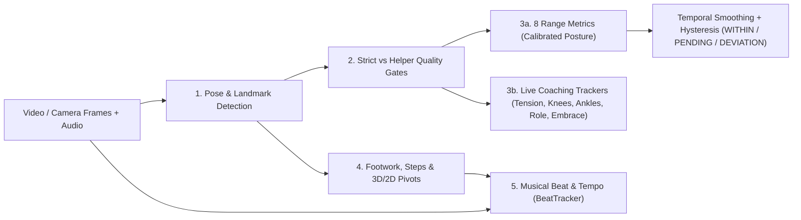
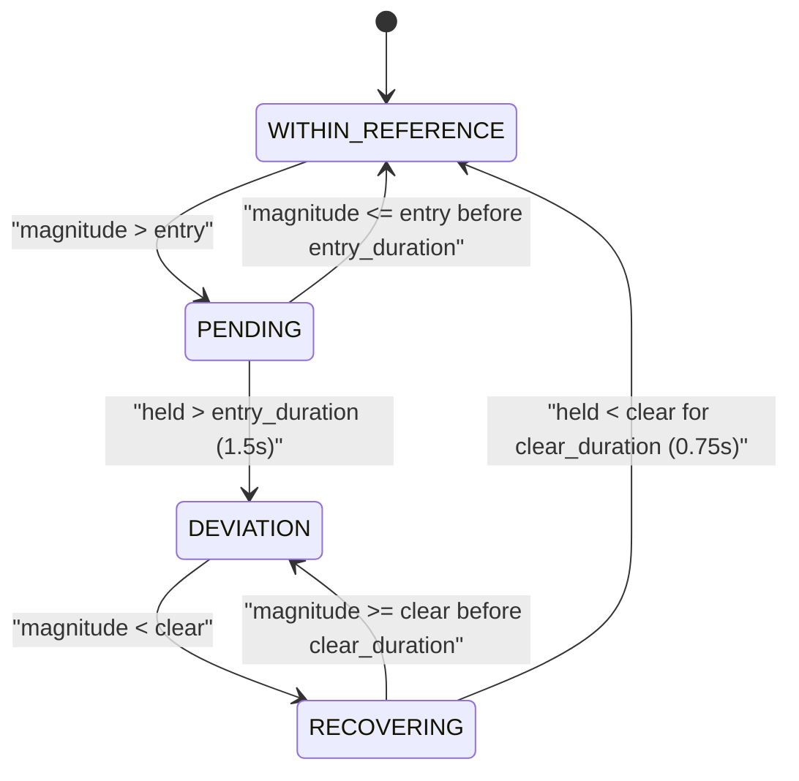

# TangoPosture Solo Dancer Metrics, Calibration & Movement Manual ("For Dummies" Edition)

> [!NOTE]
> This manual explains every metric, formula, landmark input, temporal hysteresis state machine, footwork/pivot detector, self-calibration check, and configuration parameter used in TangoPosture's **Solo Dancer Engine** (`metrics.py`, `geometry.py`, `temporal.py`, `movement.py`, `engines/solo.py`, `calibration/measurements.py`, `calibration/camera_session.py`, and `calibration/statistics.py`), written so any dancer, teacher, or analyst can understand both *what the numbers mean* and *how to interpret them*.

---

## 1. The Big Picture ("For Dummies" Mental Model)

Picture one tango dancer practising in profile (or facing the camera). Strip away styling and clothes, and TangoPosture sees **five connected physical blocks** plus **floor footprints**:

1. **The Neck & Gaze Stack (`head_pitch`, `head_forward`, `head_inclination`)**: Measures whether your chin is level, your head cranes forward in front of your spine, or your neck tilts away from your torso axis.
2. **The Floating Collarbone Check (`shoulder_clearance` & `Shoulder Elevation %`)**: Measures the vertical breathing space between your ear and shoulders, divided by a rigid body-size ruler so camera zoom does not fool it.
3. **The Plumb Line & Upright Spine (`hip_offset`, `torso_axis_tilt`, `trunk_inclination`)**: Drops a plumb line from your ankle to the back of your head (`hip_offset` checks if your pelvis pokes backward) and compares both your hip-to-shoulder spine (`trunk_inclination`) and your averaged center torso (`torso_axis_tilt`, pink line) against vertical.
4. **Soft Legs & Brushing Feet (`knee_flexion`, `ankle_lift_ratio`)**: Watches your standing/supporting knees for stiff locked legs (`0°`) and watches whether your free foot stays close to the floor during slow lyrical tangos (`≤ 115 BPM`).
5. **The Tango Frame & Floor Track (`Role`, `Embrace`, `Steps`, `Pivots`, `Beat`)**: Detects whether your arms hold a Leader or Follower frame (`Open` vs `Closed`), stamps grounded footprints (`steps`), spots `clockwise` / `counter-clockwise` turns (`pivots`), and checks step timing against the musical beat.

---

## 2. How MediaPipe Landmarks Become Solo Geometry

### 2.1 Which Landmarks Are Used for What?

MediaPipe extracts 33 normalized `[0.0, 1.0]` image landmarks (`x`, `y`, `visibility`, `presence`) plus metric 3D `world_poses`. Each Solo component uses only the landmarks needed for its joint chain:

| Sub-System | Exact Landmark Keys | How They Are Used |
| --- | --- | --- |
| **Core Torso & Head Axis** | `nose`, `left_ear`, `right_ear`, `left_shoulder`, `right_shoulder`, `left_hip`, `right_hip` | Core trunk vector $\mathbf{t} = \text{normalize}(\mathbf{s} - \mathbf{h})$, facing normal $\mathbf{n}$, `view_width`, `trunk_inclination`, `head_forward`, `head_inclination`, `torso_axis_tilt`, `head_pitch`. |
| **Plumb-Line Axis Curve** | `nose`, `left/right_ear`, `left/right_hip`, `left/right_ankle` | Connects `ankle → head_back` and measures perpendicular posterior hip protrusion (`hip_offset`). |
| **Shoulders (Rigid Scale)** | `left_ear`, `right_ear`, `left_shoulder`, `right_shoulder`, `left_hip`, `right_hip`, `nose` | Measures `shoulder.y - ear.y` normalized by shrug-invariant ear-to-hip / skull/shoulder scales. |
| **Knees & Slow-Tango Ankles** | `left/right_hip`, `left/right_knee`, `left/right_ankle` | Interior knee angle (`knee_flexion`) and vertical lifted-vs-grounded ankle height (`ankle_lift_ratio`). |
| **Offline Steps & Pivots** | `left/right_ankle`, `left/right_heel`, `left/right_foot_index`, `left/right_hip`, `left/right_shoulder`, plus `world_pose` hips | Grounded step anchors (`steps`), floor stride heading, 3D hip heading (`hip_heading_3d_deg`), and 2D shoulder/hip width envelope (`pivots`). |
| **Role & Embrace Frame** | `left/right_shoulder`, `left/right_elbow`, `left/right_wrist`, plus `left/right_hip`, `nose`, `ears` | Detects `LEADER` vs `FOLLOWER` asymmetry and `OPEN` vs `CLOSED` embrace geometry. |

### 2.2 Pixel Conversion ("Cartesian Up vs Image Down")

In image coordinates, `y = 0` is at the top of the screen and increases **downward**. Different helpers either convert directly to upward-positive Cartesian pixels (`pixel(lm, W, H) = (lm.x * W, -lm.y * H)`) or work explicitly with image `y` differences (where smaller `y` means higher in the frame, such as lifted ankles and shrugged shoulders).

### 2.3 Strict Quality Gates vs Helper Visibility Floors

Why do some Solo indicators keep working when another reads `UNKNOWN` (*Not measured*)? Because Solo distinguishes **strict core posture gates** from **limb helper floors**:

1. **Strict Core Posture Gates (`metrics.py`)**:
   - **Single person only**: `len(poses) == 1`. Two people or `0` people mark all core metrics `UNKNOWN`.
   - **Visibility floor**: Required landmarks must clear `cfg.confidence` (default `0.70`).
   - **Minimum anatomy size**:
     - Torso length $L = \|\mathbf{s} - \mathbf{h}\|_2 \ge \text{min\_torso} \cdot \min(W, H)$ (`0.12` default).
     - Shoulder-to-ear neck length $\ge \text{min\_head} \cdot \min(W, H)$ (`0.04` default; blocks head-only metrics if failed while keeping `trunk_inclination`).
   - **Side-View Cutoff (`view_width`)**: Computes projected body width $\text{width} = \frac{\max(\|\mathbf{s}_L - \mathbf{s}_R\|,\; \|\mathbf{h}_L - \mathbf{h}_R\|)}{L}$.
     - If `allow_all_angles = False` and `width > max_view_width` (`0.45` default), `measure()` returns `UNKNOWN` (*"Return to the selected side-on view"*).
     - Calibrated `.tpc` profiles override this per metric via `view_eligible(target.view, view_width, max_view_width)`: **`side`** (`<= max_view_width`), **`front`** (`> max_view_width`), or **`all`**.
2. **Helper Visibility Floors (`geometry.py`)**:
   - **Shoulders**: Uses `shoulder_visibility_floor = 0.50` so momentary profile ear/shoulder dips don't drop shoulder feedback.
   - **Knees & Ankles**: Uses `knee_visibility_floor = 0.35` (`0.45` for `axis_curve_alignment` plump line) because dark tango trousers/skirts and rapid footwork frequently lower ankle visibility into `0.35–0.65`.

### 2.4 Target Extraction, Smoothing & Gap Recovery (`engines/solo.py`, `pose/interpolation.py`)

- **Display vs Raw Measurements**: `PoseSmoother` (`overlay_smoothing = 0.20 s`) smooths skeleton lines visually and bridges tiny 1–2 frame visibility dips (`<= min(0.15s, max_gap * 0.5)`), **but posture scoring ALWAYS runs on unsmoothed raw landmarks (`measurement_poses`)** so smoothing never hides real errors or invents fake measurements!
- **Auto Gap Recovery (`replay_recovery_auto`)**: Offline analysis in Review can optionally run short-gap linear/cubic recovery across gaps up to `replay_recovery_max_gap_s` (`0.75 s`) within `replay_recovery_budget_s` (`12.0 s`), clearly styling any recovered bones with **dotted lines** instead of solid lines.

---

## 3. All Solo Metrics Explained (Math + For Dummies)

### 3.1 Group A — The 8 Range Calibration Metrics (`METRIC_DETAILS`)

These 8 metrics can be calibrated in **Self Calibration** or **Calibration Editor** (`.tpc` profiles) and scored frame-by-frame in **Review** and **Analytics**:

| Key | Plain-English Meaning | Exact Formula & Sign Convention | View & Landmarks Needed |
| --- | --- | --- | --- |
| **`head_pitch`** | **Chin up/down angle** (gaze direction relative to horizontal horizon). | $\theta_{\text{raw}} = \operatorname{atan2}((y_{\text{ear}} - y_{\text{nose}})H,\; |x_{\text{nose}} - x_{\text{ear}}|W)$, then **`head_pitch = theta_raw - head_neutral_offset`** (`degrees`, default `-12.0°` offset so anatomically level gaze reads ~`0°`). Negative = looking down! | Prefer `side`/`all`; needs reliable `nose` + ear (`left/right_ear`), or inter-ear span during 360° rotations. |
| **`head_forward`** | **Turtle-neck offset**: How far forward your head sits ahead of your spine line. | Let $\mathbf{t} = \frac{\mathbf{s} - \mathbf{h}}{\|\mathbf{s} - \mathbf{h}\|}$ be spine up-vector, $\mathbf{n} = f \cdot (t_y, -t_x)$ be forward normal (`f = +1` facing right, `-1` left), and $\mathbf{h}_{\text{vec}} = \mathbf{e} - \mathbf{s}$. Then **`head_forward = (h_vec · n) / L`** (`torso_lengths`). Positive = head protruding forward! | `side` (uses configured `side` + `facing`). |
| **`head_inclination`** | **Neck bend angle**: Angle of the ear–shoulder vector relative to the torso spine. | **`head_inclination = atan2(h_vec · n, h_vec · t)`** (`degrees`). Shares the same ear–shoulder–hip geometry as `head_forward`, expressing neck bend in degrees instead of torso lengths. | `side` (`ear`, `shoulder`, `hip`). |
| **`shoulder_clearance`** | **Neck breathing room**: Normalized vertical distance from shoulder up to ear (shrug detector). | For each visible ear–shoulder pair: $\Delta y = (y_{\text{sh}} - y_{\text{ear}})H$. Pick the *smallest* (tightest/highest) $\Delta y$ and divide by shrug-invariant reference scale $S$: **`raw_clearance = min_dy / S`** (`normalized_clearance`). Smaller = tenser/raised shoulders! | `front` or `side`; prefers `0.26 * (hip.y - ear.y)H`, falling back to rigid skull/shoulder scales. |
| **`hip_offset`** | **Pelvis curve ("bump" behind axis)**: How far your hips poke behind a straight plumb line from your ankle to the back of your head. | Connects ankle $\mathbf{a}$ to estimated back-of-head $\mathbf{b}$, with posterior unit normal $\mathbf{n}_{\text{post}}$. Computes **`(h - a) · n_post / ||b - a|| - neutral_offset`** (`axis_lengths`). Positive = pelvis curving/protruding backward (sitting back). | `side` (`ear`, `hip`, `ankle`, optional `nose`; `axis_len >= 0.20 H`). |
| **`torso_axis_tilt`** | **Pink line torso lean**: Unsigned magnitude of upper-body tilt away from straight vertical. | Uses `left/right_shoulder` midpoint $\mathbf{s}$ and `left/right_hip` midpoint $\mathbf{h}$: $\theta = |\operatorname{atan2}((s_x - h_x)(W-1),\; (h_y - s_y)(H-1))|$ (`degrees`, always $\ge 0^\circ$). Pure `0°` = plumb vertical spine. | `front` or `all` (requires ALL 4: both shoulders + both hips!). |
| **`trunk_inclination`** | **Signed torso lean forward/back** along your facing direction. | **`trunk_inclination = atan2(f * t_x, t_y)`** (`degrees`), where `f = +1` facing right, `-1` left. Positive = leaning torso **forward** (*apilado*/intention); Negative = leaning **backward**. | `side` or `all` (`shoulder`, `hip`). |
| **`knee_flexion`** | **Soft-knee bend**: How softly bent your *straightest* reliably visible leg is (`0°` = locked knee). | Interior angle $\beta = \arccos\left(\frac{\mathbf{u} \cdot \mathbf{v}}{\|\mathbf{u}\|\|\mathbf{v}\|}\right)$ between $\mathbf{u} = \text{hip} - \text{knee}$ and $\mathbf{v} = \text{ankle} - \text{knee}$. **`flexion = max(0, 180° - beta)`** (`degrees`). Picks the minimum across legs (with visibility tiebreak) so one stiff locked leg is never masked by a bent trailing knee! | `side` or `all` (segment px $\ge 10$, `vis >= 0.35`). |

---

### 3.2 Group B — Live Coaching Trackers & Tango Heuristics (`geometry.py`)

In addition to the 8 profile metrics, `engines/solo.py` runs specialized live/frame trackers:

1. **Shoulder Elevation % (`shoulder_tension_alignment` + Adaptive Baseline)**:
   - Converts `raw_clearance` into percentage elevation above your relaxed neutral baseline $B = \max(0.20,\; \text{neutral\_clearance})$:
     $$\text{elevation\_pct} = \frac{B - \text{raw\_clearance}}{B} \times 100\%$$
   - When shrugging (`raw_clearance` shrinks by 10%), `elevation_pct` jumps to `+10%`.
   - When using Settings defaults, a rolling **Adaptive Shoulder Baseline** collects up to `60` qualifying frames inside `[0.65, 2.50]` and sets effective neutral clearance from the `75th` percentile (`shoulder_adaptive_percentile`), so naturally shorter/longer necks adapt automatically without false alarms!

2. **Ankle Lift Ratio & Slow-Tango Floor Brushing (`AnkleStepTracker`)**:
   - Computes how high the free ankle lifts above the supporting ankle normalized by leg length ($\text{hip} \to \text{knee} \to \text{ankle}$):
     $$\text{lift\_ratio} = \frac{\max(0,\; y_{\text{grounded}} - y_{\text{lifted}})}{\text{leg\_length}}$$
   - Segments individual steps (`smoothed > step_start_ratio` until foot lands `<= step_end_ratio`).
   - Only active when tempo $\le \text{slow\_tango\_max\_bpm}$ (`115.0 BPM` default—like Di Sarli!).
   - Counts consecutive high-lifted steps (`peak >= ankle_high_lift_ratio`, default `0.06` = 6% of leg length). Reaching `max_consecutive_high_ankle_steps` (`2`) triggers an ankle alert; a valid low floor-skimming step (`>= 0.12 s`) resets the counter to `0`!

3. **Role Detection (`RoleTracker`: `LEADER` vs `FOLLOWER`)**:
   - Inspects asymmetric embrace arm posture:
     - **Leader**: Left wrist raised (`lw.y <= ls.y + 0.16`, higher than right wrist) and right arm held horizontally around partner (or left-arm side fallback).
     - **Follower**: Right wrist raised above shoulder height and left arm resting horizontally on Leader's shoulder (with side-profile fallback).
   - Debounced with hysteresis: requires `role_assign_ms` (`300 ms`) to adopt a new role, and holds the active role across `role_hold_ms` (`5000 ms`) of temporary arm occlusion before reverting to `NONE`.

4. **Embrace Type (`EmbraceTracker`: `CLOSED` vs `OPEN`)**:
   - Once a role is active (`LEADER` or `FOLLOWER`), `embrace_openness_score()` computes a continuous `[0.0, 1.5]` score from horizontal elbow/wrist separation, nose-to-embrace openness ratio (how far outward from torso center the closed-side elbow/wrist sits), and shoulder width scale.
   - Smooths over time: crosses `< embrace_closed_threshold` (`0.72`) sustained for `embrace_hysteresis_seconds` (`0.8 s`) → **`CLOSED`**, or `>= 0.72` → **`OPEN`**.

---

### 3.3 Group C — Temporal Smoothing & Hysteresis State Machine (`Evaluator` in `temporal.py`)

Real movement fluctuates naturally; you don't want a red alert flashing because of a 0.1 s glance down! Every posture metric passes through `Evaluator` (and `AxisCurveTracker` for `hip_offset`):

1. **Exponential Time Filter**: Computes uneven-timestamp smoothing gain $\alpha = 1 - e^{-\Delta t / \tau}$, where $\tau = \text{cfg.smoothing}$ (`0.25 s` default; or `min_filter_time_constant = 0.0001 s` if raw unfiltered checks are requested):
   $$\hat{x}_i = \hat{x}_{i-1} + \alpha \cdot \operatorname{wrapped}(x_i - \hat{x}_{i-1})$$
   Any tracking gap `> max_gap` (`0.50 s`) resets the filter so stale history never leaks across dropouts.
2. **Deviation vs Limits**:
   - **Approved `.tpc` range `[lower, upper]`**: Distance outside limits $\delta = \hat{x}_i - \text{clamp}(\hat{x}_i, \text{lower}, \text{upper})$, with `entry = 0.0` (must stay outside for `entry_duration = 1.5 s` to trigger `DEVIATION`, then return inside `[lower, upper]` for `clear_duration = 0.75 s` to clear!).
   - **Settings threshold (`entry > clear`)**: Must stay `> entry` for `entry_duration` (`1.5 s`) and drop `< clear` for `clear_duration` (`0.75 s`) — classic two-level hysteresis!

---

### 3.4 Group D — Offline Footwork, Steps, Pivots & Musical Beat (`movement.py` + `beat.py`)

When Review runs **Movement Analysis** (`analyse_movement_observations`):

1. **Footprint / Step Contact Detection (`_FootTracker`)**:
   - Tracks each foot independently using ankle, heel, and toe (`foot_index`) bottom point + smoothed centroid velocity (`step_smooth_tau_s`).
   - State machine: **`INITIAL → ANCHORED ↔ MOVING → SETTLING`**:
     - Once a foot leaves its previous floor spot (`dist >= step_min_center_travel_scale`), accelerates (`MOVING`), then slows below `step_settle_speed_scale_s` and stays inside `step_settle_radius_scale` for `step_settle_min_duration_s`, `_try_confirm_step()` stamps a new footprint!
     - **Anti-Ghost Guards**: Rejects pure heel/toe swivels in place (`step_min_both_ends_travel_scale`) AND rejects suspended/airborne *boleos* (`leg_span < step_min_leg_extension_ratio * max_leg_span` or elevated `> step_max_airborne_lift_scale` above the standing foot).
     - **Step Fade**: Replay renders recent footprints on the floor fading smoothly over `replay_step_history_seconds` (`5.0 s`).

2. **Pivot & Turn Detection (`_detect_pivot_intervals`)**:
   - Combines two cues:
     - **3D World Hip Heading (`hip_heading_3d_deg`)**: Direction of `(left_hip - right_hip)` horizontal projection in MediaPipe `world_poses` (smoothly `unwrap_angles()` across $\pm 180^\circ$ wrap boundaries with `heading_smooth_tau_s`).
     - **Supporting Foot Anchor**: `_support_side_for_slice()` checks which foot remained planted within `pivot_foot_anchor_radius_scale` (`0.18` body scales) during the rotation!
   - Scans sliding time windows `[win_min, win_max]`: triggers a `clockwise` or `counter-clockwise` pivot whenever net rotation `>= pivot_min_net_deg` and mean turn rate `>= pivot_entry_rate_deg_s` without reversing (`<= pivot_max_opposite_fraction`), trimming clean ends at `pivot_exit_rate_deg_s`.

3. **How the Beat Is Calculated (`beat.py` + `soundtrack.py`)**:
   - Same acoustic `BeatTracker` shared across the app: normalizes `0.62 * bass_flux + 0.38 * mid_flux`, subtracts a `0.40 s` moving mean + `50 ms` Hann kernel to get the onset envelope, finds tempo via **1x/2x/4x/8x Harmonic Comb Autocorrelation** centered softly on `tango_bpm` (`120.0 BPM`), aligns beat phase $\phi$, and locks Beat 1 of each 8-beat tango phrase after `beat_analysis_seconds` (`30.0 s`)!

---

### 3.5 Group E — Solo Camera Self-Calibration & Repeat Check (`camera_session.py` & `statistics.py`)

When calibrating in **Self Calibration**, TangoPosture protects you from saving noisy or unusable ranges:

1. **Readiness State Machine**: `Preview → Prompt → Wait for view and pose → Settle → Capture → Evaluate → Review`.
   - Checks **1 dancer only** + identity continuity (`jump <= 0.75` torso lengths).
   - Checks **strict view framing**: Front holds require `view_width > max_view_width + front_view_width_margin` (`0.55` default), front anatomical shoulder/hip order, and `nose` between ears; Side holds require `view_width <= max_view_width` (`0.45`) and clear ear-to-nose horizontal sign (`|dx| >= 0.015`).
   - Checks **Stillness**: Torso midpoint drift during `stable_time_s` (`0.75 s`) must stay `<= settle_drift_torso_lengths` (`0.05 tl`).
   - Checks **Coverage**: Accumulates valid duration only across adjacent non-duplicate frames within `min(max_usable_gap_s, max_gap)` (`0.20 s`), requiring `>= min_usable_hold_s` (`2.0 s` out of `2.5 s`).
2. **Range Suggestion (`summarize_examples`)**:
   - Uses **`calibration_suggest_lower_pct` (`10%`)** ($P_{10}$), **Median (`50%`)**, and **`calibration_suggest_upper_pct` (`90%`)** ($P_{90}$) over accepted passages — i.e., **the middle 80%** of your normal tango examples!
3. **Deliberate-Change Repeat Check (`repeat_check`)**:
   - To enable live camera alerts (`camera_check_passed = True`), run a 4-hold check (**neutral A → deliberate change A → neutral B → deliberate change B**, e.g., gentle shrug or gaze drop).
   - **Rule**: Both deliberate shifts $|M_{\text{chg}} - M_{\text{neu}}|$ must have the **same direction** (plus known expected sign where physically required, e.g., knee bend decreases when standing straighter, shoulder clearance decreases when shrugging) AND exceed **$2 \times$ max within-hold spread ($P_{90} - P_{10}$)**, while your return hold $M_{\text{neu,B}}$ matches $M_{\text{neu,A}}$! Weak/ambiguous tests stay safely **Comparison only**.

---

## 4. Complete Solo Settings Reference (`Single · *` & `Calibration · Solo camera`)

| Setting | Default | For Dummies Effect & When to Tune |
| --- | --- | --- |
| `side` / `facing` | `"left"` / `"right"` | Camera profile side & facing direction in the unmirrored image (auto-detected during Solo Camera Calibration). |
| `allow_all_angles` | `false` | Allows front/oblique/360° poses in scoring instead of restricting strictly to side-on (`view_width <= max_view_width`). |
| `confidence` | `0.70` | Minimum landmark confidence for core posture gates. Lower to `0.55` in low light; raise to `0.80` for strict quality. |
| `min_torso` / `min_head` | `0.12` / `0.04` | Minimum body fraction of frame height. Prevents tiny distant silhouettes from producing wild angles. |
| `max_view_width` | `0.45` | Side-on vs front-on cutoff (torso width / torso length). Below `0.45` = side-on. |
| `calibration_suggest_lower_pct` / `upper_pct` | `10.0` / `90.0` | Percentile band (`P10` to `P90` = middle 80%) suggested when creating `.tpc` profiles. |
| `smoothing` / `overlay_smoothing` | `0.25 s` / `0.20 s` | Temporal smoothing for metric evaluation vs skeleton drawing (`overlay_smoothing`). |
| `entry_duration` / `clear_duration` | `1.5 s` / `0.75 s` | How long a posture deviation must persist before turning red, and how long back in bounds to clear. |
| `max_gap` | `0.5 s` | Gaps larger than this reset smoothing filters and break calibration coverage. |
| `head_neutral_offset` / `head_down_angle` / `head_down_duration` | `-12.0°` / `-15.0°` / `3.0 s` | Neutral ear-to-nose offset, red alert pitch threshold, and persistence for looking down. |
| `shoulder_raise_threshold` / `shoulder_tension_duration` | `10.0%` / `1.0 s` | Alert when shoulders elevate ≥ `10%` closer to ears for ≥ `1.0 s`. |
| `shoulder_neutral_clearance` | `1.05` | Fallback baseline ratio before adaptive baseline (`shoulder_adaptive_min_samples = 15`) takes over. |
| `knee_visibility_floor` / `closed_embrace_min_knee_bend` / `knee_straight_duration` | `0.35` / `6.0°` / `1.5 s` | Knee detection floor (`0.35`), minimum soft-knee bend (`6°`), and locked-leg alert duration. |
| `axis_curve_entry` / `clear` / `duration` | `0.06` / `0.035` / `1.5 s` | Posterior hip bump entry (`6%` of axis length) and clear (`3.5%`) thresholds with `1.5 s` persistence. |
| `slow_tango_max_bpm` / `ankle_high_lift_ratio` / `max_consecutive_high_ankle_steps` | `115 BPM` / `0.06` / `2` | Gates slow-tango floor-brushing check (`<= 115 BPM`), flags lifts > 6% of leg length for 2 consecutive steps. |
| `role_assign_ms` / `role_hold_ms` | `300 ms` / `5000 ms` | Delay before assigning `LEADER`/`FOLLOWER` and hold window during arm occlusion. |
| `embrace_closed_threshold` / `embrace_hysteresis_seconds` | `0.72` / `0.8 s` | Openness score boundary and hysteresis separating `OPEN` vs `CLOSED` embrace. |
| `solo_camera.stable_time_s` / `settle_drift_torso_lengths` | `0.75 s` / `0.05 tl` | Settling window and max allowed torso sway before guided capture starts. |
| `solo_camera.hold_window_s` / `min_usable_hold_s` / `max_usable_gap_s` | `2.5 s` / `2.0 s` / `0.20 s` | Guided capture attempt duration, minimum usable seconds required (80%), and max valid sample gap. |
| `solo_camera.front_view_width_margin` / `walking_take_limit_s` | `0.10 tl` / `8.0 s` | Ambiguity buffer above `max_view_width` for front holds, and cap per walking take. |

---

## 5. What Can Damage Solo Calculations (and How to Fix It)

> [!WARNING]
> Solo metrics assume a **level camera**, **full body (nose to ankles/shoes) in frame**, and **consistent physical camera placement** if comparing live against an older `.tpc` calibration!

| Failure Mode | What Goes Wrong in the Math | Symptom in UI / Charts | Fix |
| --- | --- | --- | --- |
| **Wrong `facing` or `side` in Video Analysis Settings** | `trunk_inclination` and `head_forward` flip sign (`+` forward looks like `-` backward); far-side ear occlusion drops `head_pitch`. | `trunk_inclination` shows `-8°` leaning backward when you're leaning forward! | Match `side` & `facing` to the **unmirrored recorded video**, or use `Self Calibration` (auto-detects side/facing). |
| **Cropped Shoes / Ankles** | Side-on `measure()` requires `nose` AND at least one `ankle`; `hip_offset` requires ankle + ear + hip! | Core metrics read `UNKNOWN` (*"Keep nose and at least one ankle visible"*), `hip_offset` drops out. | Step back ~0.5–1 m or tilt camera down slightly (while keeping it level) so shoes stay inside `[0, 1]` Y bounds. |
| **Camera Tilted Left/Right** | `torso_axis_tilt`, `trunk_inclination`, and `head_pitch` reference true image vertical/horizontal—a tilted tripod biases all baseline angles by camera roll! | Standing straight registers `torso_axis_tilt = 5°` everywhere. | Level the camera using a bubble level or calibrate in place (`head_neutral_offset` / `.tpc` baseline compensates only if placement doesn't change!). |
| **Changed Camera Height / Zoom vs Saved `.tpc`** | Changing pitch angle alters vertical 2D knee/head projections (`hip_offset` and `head_pitch` shift). | Live Review flags false deviations even in your neutral stance! | Use **Check with camera…** to re-verify on the current setup, or configure **Measurement normalization** offsets. |
| **Heavy Dark Clothing / Loose Flowing Skirts** | MediaPipe knees/ankles bounce erratically or drop below `knee_visibility_floor = 0.35`, creating ghost steps or straight-knee spikes. | Erratic `knee_flexion` drops to `0°`, missing footprints, false `DEVIATION`s. | Wear fitted trousers/leggings with shoe contrast against the floor, and use bright even studio lighting. |
| **Oblique 3/4 Angles (`view_width ~ 0.45–0.55`)** | Outside `max_view_width` (`0.45`) with `allow_all_angles = false`, side metrics go `UNKNOWN`; inside Self Calibration's `[0.45, 0.55]` margin, guide pauses with `View uncertain`. | Dotted lines / `UNKNOWN` gray regions in Analytics; calibration prompts to turn cleanly. | Turn clearly side-on (`<= 0.45`) or front-on (`> 0.55`), or enable `allow_all_angles` / approve `all` view in `.tpc`. |

---

## 6. How to Analyze Solo Data & Build Visualizations (Distributions, Outliers, Charts)

You can inspect charts directly inside **Analytics** and **Calibration Editor**, or export `.tpc` / frame series JSON/CSV into Python (`matplotlib` / `seaborn` / `plotly`) to analyze your technique quantitatively:

### 6.1 Step-by-Step Analysis Workflow

1. **Check Coverage & Tracking Health**: Look at the fraction of `WITHIN_REFERENCE / DEVIATION` vs gray `UNKNOWN` frames (`valid_duration / selected_duration`). Never judge a metric when coverage `< 60%`.
2. **Separate Contexts (`Neutral standing` vs `Solo walking` vs `Pivot`)**: Always compare apples to apples—soft knees during a fast crossing have a totally different distribution from neutral standing posture.
3. **Compare Raw vs Smoothed Curves**: Notice whether a spike triggers `PENDING` (brief blip that self-corrects `< 1.5 s`) vs `DEVIATION` (sustained habit lasting `> 1.5 s`). Habitual posture issues appear as long horizontal `DEVIATION` blocks, not 2-frame spikes!

### 6.2 Recommended Visualizations (Metrics, Distributions & Outliers)

| Visualization Type | Best Solo Metrics to Plot | What It Reveals & How to Spot Outliers |
| --- | --- | --- |
| **1. Time-Series + Hysteresis State Shading + Reference Band** *(built into Analytics & Editor)* | All 8 `METRIC_DETAILS` + `shoulder_elev_pct` + `ankle_lift_ratio` | Shaded amber/green band shows your **`[P10, P90]`** / `[lower, upper]` target corridor; color-coded background (`green` = OK, `amber` = `PENDING` warning, `red` = confirmed `DEVIATION`, `gray` = `UNKNOWN`) pinpoints exact moments habit breaks down. |
| **2. Standing vs Walking Violin / Box Plots (with Tukey Outlier Fences)** | `knee_flexion`, `head_forward`, `trunk_inclination`, `hip_offset` | Plots side-by-side distributions across contexts (**Standing** vs **Solo walking** vs **Pivots**). Median shows typical alignment, box height shows **IQR consistency**, and points outside $[Q_1 - 1.5 \cdot \text{IQR},\; Q_3 + 1.5 \cdot \text{IQR}]$ expose either loss of grounding in specific steps or ankle occlusion glitches! |
| **3. Distribution Histogram + KDE Overlay (`inside_fraction`)** | `head_pitch`, `shoulder_clearance`, `torso_axis_tilt` | Reveals **skewness** (e.g., long left tail on `head_pitch` = frequent quick glances down at the floor) or **bimodal peaks** (e.g., `shoulder_clearance` sitting cleanly relaxed during *caminata* but bunching upward whenever preparing a turn). |
| **4. 2D Joint Phase / Scatter Plot (`Head vs Trunk`, `Knee vs Hip`)** | `trunk_inclination` (X) vs `hip_offset` (Y) or `knee_flexion` (X) vs `ankle_lift_ratio` (Y) | Shows postural compensation patterns! *Example:* if every time `trunk_inclination` leans forward (`+8°`), `hip_offset` jumps positive (`+0.08`), the dancer is "breaking at the waist" (pushing hips back) instead of moving the whole axis forward from the ankles. |
| **5. Polar Rose / Compass Plot of Pivots & Step Headings** | `pivots` (`net_deg`, `direction`, `peak_rate_deg_s`) & `steps` (`angle_deg`) | Displays turning symmetry (`clockwise` vs `counter-clockwise` *ochos* and *giros*), average turn angle (`90°` vs `180°` pivots), and peak angular velocity consistency. |
| **6. Repeat-Check Separation Chart (Guided Camera Validation)** | Box/strip plot of `[Neutral A, Changed A, Neutral B, Changed B]` | Visually confirms whether a deliberate check clearly cleared $2 \times \text{noise}$ without baseline drift before enabling live alerts (`camera_check_passed`). |

### 6.3 Quick Outlier Checklist (Real Technique Flaw vs Tracking Glitch)

Whenever a box plot, histogram tail, or Analytics peak flags an extreme value:
1. Click the timestamp on the chart to jump straight to that frame in **Review**.
2. Toggle **Skeleton (V)** and inspect if joints are missing, crossed left↔right, or rendered with **dotted interpolated bones**.
3. Check the frame's **`view_width`** (if the dancer turned `> 0.45` side-width mid-pivot while `allow_all_angles = false`, limb lengths foreshorten).
4. **Rule of thumb**: Isolated 1–3 frame outliers coinciding with occlusion/turn-boundary frames are pose jitter; multi-second `DEVIATION` plateaus or bimodal tails on clean solid skeletons represent real coaching opportunities!
