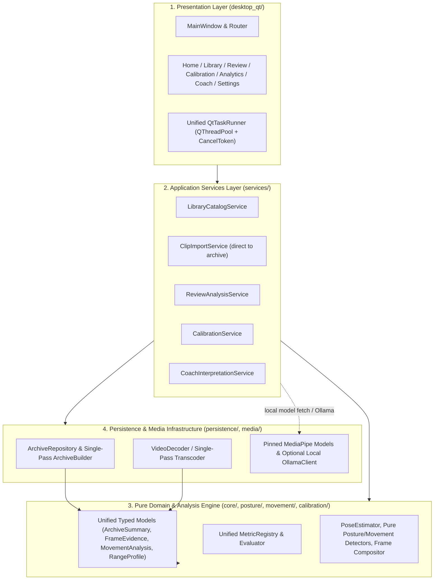
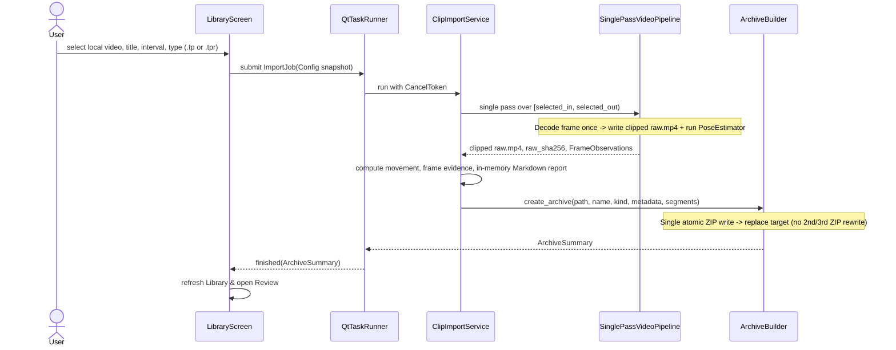

# Technical Debt Audit and Architectural Redesign Proposal

**Target branch:** `architecture-redesign`  
**Audit scope:** [`src/tango_posture/`](../src/tango_posture/) (99 Python modules, 24,720 lines) and desktop Qt shell  
**Status:** Proposed design (companion to the current-state map in [ARCHITECTURE.md](ARCHITECTURE.md))

---

## 1. Executive Summary and Scope Constraints

TangoPosture has already completed a valuable architectural pivot toward an **offline-first Qt desktop workflow** (Library local-video import, Review analysis/comparison, Calibration Editor, Analytics, and optional Ollama Coach) and decomposed several older monoliths (`calibration.py`, `range_profiles.py`, `reference_import.py`). Despite that progress, the codebase still carries substantial transition scaffolding, duplicated data models, expensive media packaging passes, and over-sized coordinator modules.

### Permanently Excluded Scope

Per product direction on the `architecture-redesign` branch, the following capabilities are **permanently out of scope** and should be treated as candidates for systematic retirement rather than preservation or abstraction:

1. **No web application development** (no HTTP server, web frontend, or browser-hosted runtime).
2. **No `.tp`, `.tpc`, or `.tpr` portability workflows** (internal workspace archives remain a local storage container, not an external exchange format exported/imported between users or devices).
3. **No YouTube or Facebook downloads** (local video files only; no `yt-dlp`, URL parsing, or clock-alignment tracking).
4. **No Live Practice and no Live/Guided Camera Calibration** (no webcam capture preview, live microphone beat triggering, live auto-recording, or guided camera repeatability UI).

Evaluating the codebase against this stricter offline-only scope exposes approximately **5,450 lines (~22% of `src/tango_posture/`)** tied directly or indirectly to retired workflows, plus a multi-pass import/packaging pipeline designed around legacy report files and standalone portability guarantees that no longer reflect primary user workflows.

---

## 2. Technical Debt Inventory

### TD-1: Retained Dead and Unreachable Subsystem Bloat

Although the desktop navigation rail and router ([shell.py](../src/tango_posture/desktop_qt/shell.py), [router.py](../src/tango_posture/desktop_qt/router.py)) no longer expose Live Practice, Guided Camera Calibration, or online video downloads, the source modules, signals, configuration fields, and dependency imports remain active in the package.

| Category | Modules | Lines | Current status & maintenance tax |
| --- | --- | ---: | --- |
| Unreachable live Qt UI & state | [screens/practice.py](../src/tango_posture/desktop_qt/screens/practice.py), [practice/worker.py](../src/tango_posture/desktop_qt/practice/worker.py), [calibration/guided.py](../src/tango_posture/desktop_qt/calibration/guided.py), [components/beat_strip.py](../src/tango_posture/desktop_qt/components/beat_strip.py), [core/session_state.py](../src/tango_posture/core/session_state.py) | 1,484 | Never instantiated by `MainWindow`; still imported by tests and coupled to `ServiceBridge` signals. |
| Online video download & URL alignment | [references/downloads.py](../src/tango_posture/references/downloads.py), [references/links.py](../src/tango_posture/references/links.py) | 679 | Hard-imported by [references/pipeline.py](../src/tango_posture/references/pipeline.py); leaks `youtube_link` / `facebook_reel` / `YouTubeClockAlignment` metadata into manifests and reports. |
| Unused contract layer | [contracts/commands.py](../src/tango_posture/contracts/commands.py), [contracts/events.py](../src/tango_posture/contracts/events.py), [contracts/models.py](../src/tango_posture/contracts/models.py), [contracts/__init__.py](../src/tango_posture/contracts/__init__.py) | 199 | **Zero runtime imports** across both `src/` and `tests/`. References `core/entities.py` and `core/session_state.py`. |
| Retained live camera, audio & capture engines | [app.py](../src/tango_posture/app.py), [beat.py](../src/tango_posture/beat.py), [references/soundtrack.py](../src/tango_posture/references/soundtrack.py), [practice.py](../src/tango_posture/practice.py), [capture.py](../src/tango_posture/capture.py), [session.py](../src/tango_posture/session.py), [display.py](../src/tango_posture/display.py) | 3,291 | Only `Session` (partially) and CLI `tango-posture run` use these modules; `analyse_soundtrack=False` is hardcoded in both Library and Review Qt workflows. |

Additional coupling inside active desktop modules:
- [`ServiceBridge`](../src/tango_posture/desktop_qt/service_bridge.py#L98-L109) declares live-only signals (`session_state_changed`, `frame_emitted`, `beat_emitted`, `practice_finished`) and stores `_active_session: SessionState` and `_running_worker` even though no active desktop screen emits or consumes them.
- [`LibraryScreen`](../src/tango_posture/desktop_qt/screens/library.py#L276-L281) constructs and hides a dead `self.open_btn` (`"Import Local Video…"`), and UI labels still describe archive outputs as portable packages ([library.py](../src/tango_posture/desktop_qt/screens/library.py#L340-L341), [library.py](../src/tango_posture/desktop_qt/screens/library.py#L748)).
- [`Config`](../src/tango_posture/config.py#L38-L95) carries camera hardware (`camera`, `width`, `height`), auto-recording delays (`auto_record_start_delay`, `auto_record_stop_delay`, `max_recordings`), beat-detection timings, and no-op replay flags (`replay_audio`, `replay_auto_analyse_movement`).

### TD-2: Monolithic "God Modules" Mixing Domain Logic, Rendering, IO, and Concurrency

Eight modules account for **9,251 lines (37.4% of the entire source tree)**, repeatedly mixing pure computation with OpenCV/Qt rendering, disk persistence, and thread orchestration:

| Module | Lines | Mixed responsibilities |
| --- | ---: | --- |
| [movement.py](../src/tango_posture/movement.py) | 1,886 | Coordinate/angle math, step & pivot state machines, OpenCV floor/ring/footprint rendering, JSON schema validation, ZIP archive read/write (`store_movement_analysis`), and `MovementAnalysisCoordinator` background worker queue. |
| [desktop_qt/screens/review.py](../src/tango_posture/desktop_qt/screens/review.py) | 1,499 | QWidget layout construction, playback transport & dual-video comparison sync, per-frame overlay compositing, report Markdown link rewriting, video stream export, manual `threading.Thread` / `Queue` / `QTimer` reanalysis polling, and archive lease locking. |
| [app.py](../src/tango_posture/app.py) | 1,491 | Retained live camera/file capture loop, pose estimation pipeline, scoring orchestration, report generation, and video recording. |
| [geometry.py](../src/tango_posture/geometry.py) | 1,035 | Pure landmark angle/ratio math interleaved with stateful temporal trackers (`RoleTracker`, `EmbraceTracker`, `AnkleStepTracker`, `AxisCurveTracker`, `PoseSmoother`) and legacy percentage-based alignment functions. |
| [references/pipeline.py](../src/tango_posture/references/pipeline.py) | 977 | Pure-ish in-memory clip analyzer (`analyze_clip`) bundled with download/URL dispatch, SQLite database creation, report generation, and companion JSON serialization (`analyse_imported_clip`). |
| [reports.py](../src/tango_posture/reports.py) | 869 | Domain statistical summarization coupled directly to Markdown formatting strings and file emission. |
| [desktop_qt/screens/library.py](../src/tango_posture/desktop_qt/screens/library.py) | 776 | Catalogue UI table/dialogs (`ProfileDetailsDialog`), worker/thread coordination (`ReferenceImportWorker` + `_package_thread`), and file-trash mutation. |
| [desktop_qt/calibration/editor.py](../src/tango_posture/desktop_qt/calibration/editor.py) | 718 | Multi-step wizard UI coupled with dancer tracking preview, timeline rendering, passage selection state, and `.tpc` persistence. |

### TD-3: Fragmented Domain Models and Stringly-Typed `dict[str, Any]` Boundaries

Data passes between core analysis, persistence, and UI through **four inconsistent modeling styles**:

1. **Legacy dataclasses in [`domain.py`](../src/tango_posture/domain.py)** (`Landmark`, `FrameObservation`, `QualityResult`, `MetricObservation`, `Calibration`, `DeviationEvent`, `SessionSummary`).
2. **Unused pure-Python domain entities in [`core/entities.py`](../src/tango_posture/core/entities.py)**: defines `CaptureSetup`, `MetricSample`, `IssueEvent`, `MovementRecord`, `Recording`, `Practice`, and `ReferenceSummary`, yet **6 of the 7 entities have zero runtime consumers** (only `ReferenceSummary` is imported).
3. **Unused Pydantic/dataclass contracts in [`contracts/`](../src/tango_posture/contracts/)**: `PreparePractice`, `LibraryPage`, `PracticeItemSummary`, and `DomainEvent` subclasses were intended to bridge UI and services but were bypassed.
4. **Pydantic v2 calibration models in [`calibration/models.py`](../src/tango_posture/calibration/models.py)** (`RangeProfile`, `ApprovedRange`, `Passage`) and dataclass manifests in [`references/results.py`](../src/tango_posture/references/results.py).

Because these layers were never reconciled:
- **Schema tunneling**: [`RangeProfile.calibration()`](../src/tango_posture/calibration/models.py#L115-L120) converts a strict Pydantic v2 `RangeProfile` into a legacy `Calibration` object and hides the serialized payload inside `Calibration.review["range_profile"]`. [`ServiceBridge.list_references()`](../src/tango_posture/desktop_qt/service_bridge.py#L204-L219) then parses `.tpc` files via `load_calibration_file` and calls `profile_from_calibration(ref)` back out.
- **Untyped dictionary contracts**: `ServiceBridge.list_library_archives()` returns raw `dict[str, Any]` entries (`"name"`, `"path"`, `"kind"`, `"segments_count"`). Likewise, `coach_data` stores frame payloads keyed by stringified integers (`"0"`, `"1"`), forcing repeated `int(key)` / `str(index)` conversions across packaging, calibration, and review playback.
- **Implicit profile discrimination**: [`LibraryScreen`](../src/tango_posture/desktop_qt/screens/library.py#L411) and [`ServiceBridge.choose_library_archive`](../src/tango_posture/desktop_qt/service_bridge.py#L292) infer whether an archive is a calibration profile by checking `segments_count == 0` rather than discriminating explicitly on archive type or schema version.

### TD-4: Redundant Video Decoding and Multi-Rewrite Archive Packaging

Importing a single local video in Library currently executes a heavy multi-stage disk and video transcoding pipeline across [`references/pipeline.py`](../src/tango_posture/references/pipeline.py) and [`desktop_qt/library/archives.py`](../src/tango_posture/desktop_qt/library/archives.py):

1. **Up to 5 full video passes per import**:
   - **Pass 1 (`analyze_clip`)**: decodes selected frames and runs MediaPipe inference.
   - **Pass 2 (`archive_report`)**: opens `VideoReader(source)` to compute frame indices and FPS.
   - **Passes 3–5 (`archive_report`, lines 94–99)**: executes three separate `save_overlay_video(...)` loops over `source` to write `raw.mp4`, `overlay.mp4`, and `lines.mp4`, even though Review renders dynamic skeletons/footprints over the raw stream and explicitly warns when viewing baked overlays ([review.py](../src/tango_posture/desktop_qt/screens/review.py#L1031-L1047)).
2. **Duplicate cryptographic hashing**: [`archive_report`](../src/tango_posture/desktop_qt/library/archives.py#L107-L111) calls `file_sha256(raw)` **twice** back-to-back for `indexed_coach["source_sha256"]` and `indexed_movement["source_sha256"]`.
3. **2×–3× full ZIP archive rewrites on creation**:
   - `append_segment(...)` creates the initial ZIP archive containing video streams and companions.
   - `rename_archive(...)` rewrites the entire multi-megabyte ZIP via `_rewrite_members` solely to set `manifest["name"]` to `record.title`.
   - When *Import as reference* is checked, `mark_reference(...)` rewrites the entire ZIP **a third time** via `_rewrite_members` to change `kind` to `"reference"` and attach `reference.json` ([desktop_qt/library/archives.py](../src/tango_posture/desktop_qt/library/archives.py#L150-L165)).
4. **Unnecessary intermediate file emission**: `analyse_imported_clip` writes loose Markdown reports, `.metadata.json`, `.movement.v1.json`, `.coach.v1.json`, and an import SQLite database into `reports/`, only for `archive_report` to read those loose artifacts back off disk immediately afterward. Note also that [`ReviewScreen`](../src/tango_posture/desktop_qt/screens/review.py#L1148-L1150) mirrors this baked-stream cost during reanalysis by encoding and re-verifying both `overlay.mp4` and `lines.mp4` inside `render_review_overlays` ([desktop_qt/review/analysis.py](../src/tango_posture/desktop_qt/review/analysis.py#L85-L124)).
5. **Misplaced module ownership**: `desktop_qt/library/archives.py` contains zero Qt code, yet core archive assembly lives inside the `desktop_qt` GUI layer.

### TD-5: Ad-Hoc Concurrency and Background Job Polling in Screens

Background job management is implemented independently across screens using inconsistent threading and synchronization idioms:

- **Library import**: `ReferenceImportWorker` ([references/worker.py](../src/tango_posture/references/worker.py)) spawns a worker thread emitting Qt signals, then `LibraryScreen._handle_import_event` hands off to a *second* raw `threading.Thread` (`_package_thread`) polled every 100 ms by `self._package_timer` (`QTimer`) over a `queue.Queue`.
- **Review reanalysis**: `ReviewScreen` manages `_analysis_thread`, `_analysis_cancel`, `_analysis_job_id`, `_analysis_events` queue, a 100 ms `_analysis_timer` (`QTimer`), and manual `PracticeArchive.acquire()` / `close()` lease lifetimes inside the widget class.
- **Database cleanup**: `DatabaseScreen` implements another `threading.Thread` + `queue.Queue` + `QTimer(100ms)` loop plus custom shutdown coordination (`_busy_reason`).
- **AI Coach**: `CoachScreen` implements a separate token-based `threading.Thread` + signal notifier.

Every screen re-implements cancellation checking, stale-job suppression, cleanup joins on `MainWindow.closeEvent`, and error marshaling.

### TD-6: Dual Posture Metric Systems

The codebase maintains two distinct metric definitions side by side:
- **Legacy v1 metrics and display alerts**: 3 baseline metrics in `domain.METRICS` (`head_forward`, `head_inclination`, `trunk_inclination`) paired with 5 thresholded overlay heuristics (`head_angle`, `shoulder_elev_pct`, `axis_curve_smoothed`, `torso_axis_tilt`, `knee_bend_deg`) configured across `Config`, `geometry.py`, `metrics.py`, `overlay.py`, and `coach.py`.
- **v2 approved-range metrics**: 8 native-unit metrics in [`calibration/models.py`](../src/tango_posture/calibration/models.py#L20-L29) (`METRIC_DETAILS`: `head_pitch`, `head_forward`, `head_inclination`, `shoulder_clearance`, `hip_offset`, `torso_axis_tilt`, `trunk_inclination`, `knee_flexion`), evaluated through [`calibration/measurements.py`](../src/tango_posture/calibration/measurements.py) and [`calibration/baseline.py`](../src/tango_posture/calibration/baseline.py).

Adding, renaming, or modifying a posture metric currently requires synchronized edits across ~7 files (`domain.py`, `config.py`, `calibration/models.py`, `calibration/measurements.py`, `geometry.py`, `references/coach.py`, and Qt UI labels/tests).

### TD-7: Split Persistence Targets and Unbounded Caches

- **Inconsistent SQLite filenames**: [`ServiceBridge`](../src/tango_posture/desktop_qt/service_bridge.py#L174) and [`DatabaseScreen`](../src/tango_posture/desktop_qt/screens/database.py) inspect `<data_dir>/tango.sqlite3`, whereas [`analyse_imported_clip`](../src/tango_posture/references/pipeline.py#L808-L814) creates `<data_dir>/tango_posture.db` (or `reports/import_sessions.sqlite3` when `data_dir == "data"`). Neither database is required by Library, Review, Calibration, or Analytics.
- **Settings file anchoring**: [`ServiceBridge.use_calibration_defaults`](../src/tango_posture/desktop_qt/service_bridge.py#L123) resolves `Path("settings.toml")` against the process working directory rather than a unified configuration path tied to the application profile.
- **Unbounded in-memory caches**: `ServiceBridge._reference_cache` and `ServiceBridge._manifest_cache` ([service_bridge.py](../src/tango_posture/desktop_qt/service_bridge.py#L108-L109)) grow monotonically over long sessions if files are repeatedly edited, renamed, or deleted.

---

## 3. Proposed Architectural Redesign

The target architecture simplifies TangoPosture around its actual desktop mission: **a single-process, offline-only video posture & movement workbench** built on four clean layers with unidirectional dependencies.



### Proposal 1: Consolidate Domain Models and Eliminate Dead Contracts

- **Remove unused `contracts/` and dead `core/entities.py` classes**: Delete `contracts/` (199 unused lines) and prune the 6 unreferenced dataclasses from `core/entities.py`, or repurpose a single cohesive `tango_posture/domain/` package for active models.
- **Typed catalog and analytics models**: Replace untyped `dict[str, Any]` returns from `ServiceBridge` and `coach_data`/`movement_data` payloads with Pydantic v2 / frozen dataclass models (`ArchiveSummary`, `ArchiveKind`, `SegmentAnalytics`, `FrameEvidence`, `MovementAnalysis`), keyed cleanly by integer frame index during in-memory execution and serialized consistently in JSON.
- **First-class `RangeProfile` evaluation**: Retire the `Calibration.review["range_profile"]` tunneling pattern so `.tpc` profiles load directly as `RangeProfile` instances (supporting version-1 legacy `.tpc` read migration at load time only).

### Proposal 2: Single-Pass, Direct-to-Archive Import and Packaging

Eliminate the loose-report disk round-trip, redundant video decodes, and triple ZIP rewrites by introducing a direct `ClipImportService` + `ArchiveBuilder`:



Key improvements in this redesign:
1. **1–2 video passes instead of 5**: Write the clipped `raw.mp4` during the same single decode loop that feeds MediaPipe (or extract raw video once), computing `raw_sha256` exactly **once**.
2. **Stop pre-baking `overlay_00.mp4` and `lines_00.mp4` on import/reanalysis**: `ReviewScreen` already composites skeletons, posture alerts, floor lines, pivot rings, and fading footprints dynamically on top of `Raw video`. Generating two full rendered `.mp4` copies per segment triples disk usage and dominates CPU import/reanalysis time. Keep `Export Video…` / `save_overlay_video` as an explicit user-triggered export path.
3. **Single atomic ZIP creation**: Add `create_archive(destination, name=..., kind=..., reference_details=..., segments=...)` in `archive.py` so `manifest.json`, `reference.json`, `video_00.mp4`, `analytics_00.json`, `movement_00.v1.json`, and `report_00.md` are written in **one pass** without calling `rename_archive()` or `mark_reference()` after creation.
4. **No loose SQLite/report side effects during Library import**: Keep `analyze_clip` strictly free of implicit SQLite files (`import_sessions.sqlite3` / `tango_posture.db`) and remove loose file clutter in `reports/` during GUI archive imports.
5. **Relocate non-Qt packaging out of `desktop_qt/`**: Move packaging orchestration out of `desktop_qt/library/archives.py` into the application service layer.

### Proposal 3: Decompose Monolithic Modules

Split the four largest offline-active modules along strict responsibility boundaries (keeping temporary re-export shims during migration so existing tests remain green while callers migrate incrementally):

| Current monolith (LOC) | Proposed package / submodules | Ownership boundary |
| --- | --- | --- |
| `movement.py` (1,886) | `movement/models.py`, `movement/geometry.py`, `movement/steps.py`, `movement/pivots.py`, `movement/renderer.py`, `movement/schema.py` | Pure angle/scale helpers, step & pivot state machines, OpenCV overlay rendering, and JSON validation separated cleanly; remove ZIP IO & standalone worker queue once Review/Library coordinate via `QtTaskRunner`. |
| `desktop_qt/screens/review.py` (1,499) | `review/screen.py`, `review/transport.py`, `review/overlay_compositor.py`, `review/comparison_sync.py`, `review/export.py` | Layout & transport widgets separated from frame compositing, comparison synchronization, and archive reanalysis orchestration. |
| `geometry.py` (1,035) | `posture/angles.py`, `posture/trackers.py`, `posture/smoother.py` | Pure landmark vector/angle math cleanly isolated from stateful sliding-window trackers (`RoleTracker`, `EmbraceTracker`, `AnkleStepTracker`, `AxisCurveTracker`). |
| `references/pipeline.py` (977) | `services/import_service.py` + `posture/clip_analyzer.py` | Pure clip frame decoding + observation analysis cleanly decoupled from persistence/delivery and retired URL downloaders. |

Similarly, extract modal dialogs (`ProfileDetailsDialog`, import dialog, promotion dialog) out of [`desktop_qt/screens/library.py`](../src/tango_posture/desktop_qt/screens/library.py) into dedicated view modules under `desktop_qt/library/`.

### Proposal 4: Unified Declarative Metric Registry

Consolidate posture metric definitions into a single authoritative `METRIC_REGISTRY`:

```python
@dataclass(frozen=True)
class MetricSpec:
    key: str
    body_part: str
    label: str
    unit: str
    supported_views: tuple[Literal["side", "front", "all"], ...]
    cyclic_wrap_deg: float | None
    extractor: Callable[[FrameObservation, str, str], MetricMeasurement]
```

With one declarative registry:
- [`calibration/models.py`](../src/tango_posture/calibration/models.py) validates metrics and units directly against `METRIC_REGISTRY`.
- `CalibrationEditor` and `ProfileDetailsDialog` render metric labels, body-part steps, and units from `METRIC_REGISTRY` rather than duplicating display dictionaries.
- [`references/coach.py`](../src/tango_posture/references/coach.py) and `calibration/measurements.py` consume the same extractors, eliminating unit drift between live/legacy alerts and approved-range measurements.

### Proposal 5: Unified Background Job Runner and Resource Lease Contexts

Replace the four custom thread + queue + `QTimer(100ms)` loops in `LibraryScreen`, `ReviewScreen`, `DatabaseScreen`, and `CoachScreen` with a single `QtTaskRunner` in `desktop_qt/async_tasks.py`:
- Uses `QThreadPool` / managed worker threads with Qt queued signals (`progress(job_id, current, total, msg)`, `succeeded(job_id, result)`, `failed(job_id, error)`, `cancelled(job_id)`) — eliminating manual `QTimer` polling loops.
- Provides a standardized `CancelToken` and active-job ID guard so stale callbacks are ignored centrally.
- Wraps `PracticeArchive.acquire()` inside a `with archive.leased():` context manager inside the worker task so cleanup cannot leak leases on exception or early return, and gives `MainWindow.closeEvent` a single registry of running jobs to cancel/join cleanly on shutdown.

### Proposal 6: Dead-Code Retirement and Configuration Cleanup

- **Isolate or remove retired code**:
  - Remove `desktop_qt/screens/practice.py`, `desktop_qt/practice/`, `desktop_qt/calibration/guided.py`, `desktop_qt/components/beat_strip.py`, `core/session_state.py`, `references/downloads.py`, and `references/links.py`.
  - Remove live-session signals (`session_state_changed`, `frame_emitted`, `beat_emitted`, `practice_finished`), hidden `LibraryScreen.open_btn`, and "portable archive" UI copy.
  - Decide explicitly whether CLI live camera capture (`tango-posture run ...`, `app.py`, `capture.py`, `beat.py`, `session.py`) stays strictly as a headless CLI subpackage or is retired as well; either way, sever its imports from `desktop_qt/` and `references/pipeline.py`.
- **Streamline `Config` and caching**:
  - Move retired compatibility keys (`replay_audio`, `replay_auto_analyse_movement`, camera/auto-record parameters) into a thin pre-validation migration helper (`migrate_legacy_toml_dict`) or explicit legacy ignore list so `Config` reflects actual runtime knobs.
  - Resolve the canonical `settings.toml` path deterministically alongside an application config root rather than relying on the current working directory.
  - Bound `ServiceBridge` manifest/reference caches (`functools.lru_cache` or `OrderedDict` with a sensible entry cap, plus explicit invalidation on rename/delete/import).
  - Unify SQLite filename resolution (`tango.sqlite3` only if legacy CLI retains it; zero implicit DB creation during Library import).

---

## 4. Phased Implementation Roadmap

Each phase should land as a small, independently testable PR series while keeping `ruff`, `mypy`, and the `pytest` suite green at every step:

| Phase | Focus | Key deliverables | Expected payoff | Verification strategy |
| --- | --- | --- | --- | --- |
| **Phase 1: Dead-Code Pruning & Quick Wins** | Remove unreachable modules & duplicated hashing | Delete `contracts/`, unused `core/entities.py` types, `downloads.py`, `links.py`, unreachable Qt live/guided screens (`practice.py`, `guided.py`, `beat_strip.py`, `session_state.py`), hidden `LibraryScreen.open_btn`, and dead signals in `ServiceBridge`. Fix duplicate `file_sha256(raw)` in `library/archives.py` and bound `ServiceBridge` caches. | Eliminates ~2,400–2,700 LOC of dead UI/download/contract code; slimmer test matrix and faster maintenance. | Migrate/prune obsolete unit/Qt tests for retired UI; run full `ruff`, `mypy`, `pytest`. |
| **Phase 2: Import & Reanalysis Pipeline Overhaul** | Eliminate multi-pass transcoding & multi-rewrite ZIPs | Implement single-pass `ArchiveBuilder.create_archive(...)`, stream clipped `raw.mp4` directly from `ClipImportService`, drop loose report/DB side effects on import, and make baked `overlay_00.mp4`/`lines_00.mp4` generation on-demand via explicit export rather than mandatory during import/reanalysis. | ~3×–5× faster Library imports and Review reanalysis; ~3× smaller archive disk footprint; cleaner `desktop_qt/` dependency boundaries. | Archive contract & hash-integrity unit tests + `test_library.py` & `test_review_playback.py` round-trips. |
| **Phase 3: God-Module Decomposition** | Split `movement.py`, `geometry.py`, `review.py`, `library.py` | Break `movement.py` and `geometry.py` into pure math, detectors, and renderers; split `ReviewScreen` into screen + controller + overlay compositor + export helper; move `ProfileDetailsDialog` and dialogs out of `library.py`. | Cuts max module size from ~1,886 LOC to <400 LOC; enables fast isolated unit testing without QWidget instantiation. | Keep temporary module re-exports during transition; run targeted movement/geometry/review suites after each split. |
| **Phase 4: Unified Models, Metric Registry & Job Runner** | Typed boundaries & single concurrency abstraction | Introduce `QtTaskRunner` + `CancelToken` across Library, Review, Database, and Coach; replace `dict[str, Any]` catalog/analytics payloads with typed models; unify `METRIC_REGISTRY` and load `RangeProfile` directly without `Calibration.review` tunneling. | Eliminates stringly-typed dicts, timer polling boilerplate, and multi-file edits per metric; enforces strict type safety end-to-end. | Strict `mypy` validation, worker cancellation & shutdown-join tests, and end-to-end calibration comparison regression tests. |
