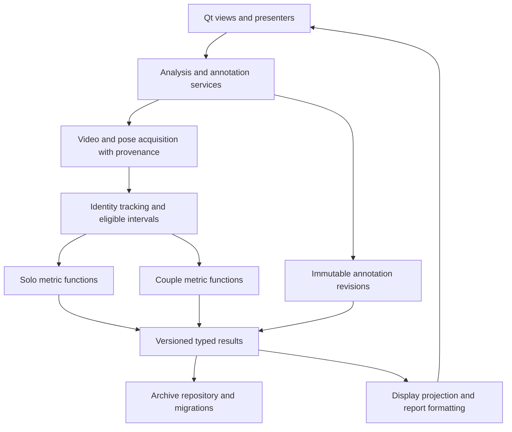

# Technical debt audit and redesign proposal

Reviewed **17 November 2026**, against the local working tree. This is a source-level audit, not a claim that every issue has been reproduced with real video. No implementation fixes are included in this documentation change. Priority means recommended order, not a measured severity score. Existing application/test edits in the working tree were left intact.

Technical debt means a design shortcut that makes correctness or future changes harder. A redesign changes responsibilities and user experience; reengineering changes the code and data structures that implement them. Fix evidence correctness before reorganizing files for appearance.

## Findings and acceptance checks

### P1 — Preserve the origin of every pose

**Observed:** `references/pipeline.py` and `engines/couple.py::_resolve_close_embrace_fallback` translate a previous split pair into later observations. In `couple/tracking.py`, the relevant construction is `TrackedDancerSample(raw_pose=dict(cand.pose), ...)`. `FrameObservation` does not carry per-landmark origin metadata. Downstream “raw” therefore means the supplied observation, not necessarily a fresh detector result on that frame.

**Risk:** propagated geometry can pass eligibility checks and look like independently measured evidence. Documentation saying all interpolation is display-only is too broad for this earlier propagation path.

**Proposal:** record `detected`, `crop_detected`, `propagated`, and `display_interpolated` origins at acquisition, preserve them through tracking and serialization, and define explicit eligibility policies for each metric. Keep drawing eligibility separate from measurement eligibility.

**Acceptance:** a synthetic clip with one split keyframe and two translated frames retains origins after archive round-trip; measured coverage excludes propagated samples unless an explicitly named estimate policy permits them. Display completion never changes measurement arrays. Owner area: pose acquisition/tracking.

### P1 — Check actual elapsed support for transition cues

**Observed:** `couple/measurements.py::_evaluate_transitions` checks secondary-rise persistence with `all(...)` over available points up to `tk + persistence_s`. It does not require a point reaching that end time. Windows can overlap, and break handling resets some state without partitioning every subsequent persistence check.

**Risk:** a rise near a window's end can be called sustained with too little time support; overlapping windows can count the same episode more than once. These are source-level edge-case findings requiring regression fixtures.

**Proposal:** partition into contiguous eligible intervals, require observed support across the full duration, and assign stable episode IDs for deduplication. Compute reversal reference per intended motion phase rather than a clip-wide majority sign.

**Acceptance:** a final-frame spike produces no sustained cue; genuine sustained rise produces one; overlapping windows do not duplicate it; no cue spans a cut or excessive gap. Owner area: couple transitions.

### P1 — Match turn markers by subject and explicit association

**Observed:** `_turn_events_from_annotations_and_candidates` sorts all starts/ends, takes the next unused end at or after each start, and chooses an exit by time. It does not require matching subjects.

**Risk:** overlapping A, B and pair annotations can assemble a turn out of unrelated markers.

**Proposal:** give a turn a persistent ID; associate start/end/exit with that ID and subject. Validate ordering and ambiguous legacy imports. Preserve unmatched marks for correction.

**Acceptance:** overlapping A/B turns keep their own ends and exits; a missing end stays unmatched; a shared pair turn is explicit. Owner area: annotations.

### P1 — Separate summary evidence status from event review status

**Observed:** step and turn summaries can say `user_confirmed` when any contributing event is confirmed, even when others are estimated. Transition summary can be `measured` with no useful inspected windows. Coordination summaries use `measured` whenever lags exist, including edited events.

**Risk:** one badge overstates what a user reviewed; zero can be mistaken for evidence of absence.

**Proposal:** expose counts by origin/status, `eligible_count`, `evaluated_window_count`, and explicit `mixed`/`insufficient_evidence` states. Show unavailable separately from zero. Explain the denominator beside coverage.

**Acceptance:** one confirmed and four estimated turns displays mixed evidence; no evaluated transition window produces unavailable rather than a clean zero verdict. Owner area: result contract and presentation.

### P2 — Bound musical-target matching

**Observed:** `_attach_beat_offsets` always chooses the nearest target when any target exists. There is no maximum offset or beat-coverage gate.

**Risk:** a contact far outside supported beat timing still counts as matched.

**Proposal:** introduce a documented matching tolerance in seconds or target-interval fraction, restrict targets to valid clip/audio intervals, and record unmatched reasons. Keep contact confidence and beat confidence separate.

**Acceptance:** a contact ten seconds beyond the last supported target is unmatched; beat subdivision and manual offset have explicit boundary tests. Owner area: soundtrack/timing.

### P2 — Make analysis reproducible

**Observed:** `run_couple_analysis` creates `CoupleAnalysisResult(config_hash="")`. Annotation rebuild increments `revision_id` using the configuration passed at edit time rather than an immutable stored effective configuration. `dict(...)` copies are shallow, so nested metadata can remain shared during rebuilds.

**Risk:** two visually similar runs may use different thresholds, and edits may alter shared nested data or silently change derived results under new settings.

**Proposal:** store a canonical effective-config snapshot/hash, detector and metric versions, timestamp basis and model hash. Make annotation revisions immutable; recompute using recorded settings unless the user explicitly requests reanalysis. Deep-copy or use immutable event models.

**Acceptance:** identical input/config gives identical content hashes excluding run IDs/timestamps; changing one threshold changes config hash; editing an annotation leaves the prior revision and automated candidates byte-equivalent. Owner area: persistence/results.

### P2 — Consolidate movement contracts without pretending engines are independent

**Observed:** `engines/couple.py` duplicates movement schema/config/fingerprint constants for an empty compatibility shell. `couple/measurements.py` imports and calls `movement.analyse_movement_observations` for each dancer's contacts and pivots. The engines are separate entry points, but share movement implementation transitively.

**Risk:** duplicated fingerprints drift; empty legacy movement lists can be mistaken for “no steps” when couple events exist elsewhere.

**Proposal:** extract a shared movement contract and detector service; give solo and couple results explicit typed payloads. Migrate archive readers to mode-aware payloads before removing compatibility shells.

**Acceptance:** legacy solo/couple archives load; new couple readers use couple events; detector fingerprints have one authoritative definition; migration retains raw media and original files. Owner area: movement/archive.

### P2 — Split responsibilities in large modules

**Observed snapshot:** `desktop_qt/screens/review.py` has 3,474 lines, `movement.py` 1,886, `couple/measurements.py` 1,657, and `desktop_qt/calibration/editor.py` 1,469. Size alone is not a bug. The stronger issue is mixed event detection, aggregation, annotation editing, rendering and orchestration responsibilities.

**Proposal:** extract pure calculation services first, then mode-specific review presenters and an archive repository. Keep Qt widgets responsible for input/display, not recomputation or archive layout. Avoid a wholesale rewrite.

**Acceptance:** calculating couple metrics requires no Qt import; annotation edits can be tested without a window; existing playback/cancellation/archive tests pass after each extraction. Owner area: desktop/domain.

### P2 — Define coordinate and unit contracts explicitly

**Observed:** solo `geometry.pixel` scales by width/height; couple `canonical_xy` uses width−1/height−1. Solo trunk is facing-relative; couple torso tilt is screen-relative. Couple `head_pitch_a/b` subtract neutral offset; solo calibration `head_pitch` is raw.

**Risk:** similarly named values can be compared despite different meanings. The pixel-scaling difference is small but complicates exact parity tests.

**Proposal:** centralize coordinate conversions and add metric metadata: unit, sign, reference frame, normalization, origin policy and version. Keep legacy names readable through adapters; do not silently change old archive meanings.

**Acceptance:** mirrored frames, different aspect ratios and neutral offsets have explicit expected results; UI labels distinguish raw pitch from adjusted pitch; export carries the same definitions. Owner area: metric contracts.

### P3 — Reduce misleading architectural guarantees and duplicate documentation

**Observed:** `CommonEngineContext` is a frozen dataclass holding mutable lists, dictionaries and configuration. Frozen prevents field rebinding, not mutation of nested contents. The architecture and UML guides repeat large class catalogs. Earlier documentation presented historical test counts as current guarantees.

**Proposal:** either use immutable payloads or document ownership clearly. Keep the detailed class catalog in the UML guide, architecture in its own guide, and audit evidence here. Date verification results and state precisely what ran.

**Acceptance:** no claim of deep immutability; documentation links and metric inventories are checked; historical test counts are not presented as current execution results. Owner area: developer experience.

## Proposed user experience

1. **Choose the question and subjects.** Offer solo posture, couple coordination, or couple turn review. Confirm A/B identities and camera setup before presenting metrics.
2. **Show evidence first.** Put coverage, sample count and origin next to each value. Offer “Why unavailable?” with the actual reason and a jump to an example frame.
3. **Explain each value in one sentence.** For +120 ms: “B started 0.12 seconds after A.” Show the formula and advanced settings only on expansion.
4. **Review events on the timeline.** Separate detected suggestions from confirmed annotations; let the reviewer inspect paired events and unmatched markers.
5. **Compare compatible passages.** Show differences in camera view, normalization and metric version before plotting results together. Avoid an overall quality score.

These are proposed changes, not a description of the current UI.

## Proposed engineering structure

A **typed result** gives each field a defined meaning instead of passing loosely structured dictionaries. A **repository** is the one place that knows how archives are stored. A **migration** translates an old saved format into a newer readable form. A **presenter** converts results into text and charts for the window.

Retain the existing common pipeline and separate engine entry points. Extract `coordination`, `beat_matching`, `transitions`, `turns`, and `summaries` from couple measurements behind stable interfaces. A shared `MetricDefinition` should drive labels, units, formulas, help text and exports, so “head pitch” cannot silently mean two different things.

## Delivery sequence and release gates

| Stage | Deliverable | Gate before moving on |
| --- | --- | --- |
| 1. Evidence correctness | Provenance, transition support, subject-safe turns, honest summary statuses | Regression fixtures for each issue; old result examples retained for comparison. |
| 2. Reproducibility | Effective settings snapshot, immutable revisions, timestamp/unit contracts | Archive round-trip and deterministic-rebuild checks; no mutation of prior revisions. |
| 3. Extract services | Pure couple calculations and shared movement contract | Same outputs on representative fixtures except intentional versioned fixes; cancellation still works. |
| 4. Simplify review | Mode-specific presenters and explanatory metric cards | Manual usability walkthrough plus existing Qt playback/review checks. |
| 5. Evolve archives | Mode-aware schema and compatibility adapters | Load old archives; write/reopen new ones; preserve originals; interrupted writes cannot replace good archives. |

No schedule or performance gain is claimed without profiling. Benchmark wall time and peak memory on short/long, solo/couple, occluded, camera-cut and variable-frame-rate clips. Compare event timing with manually reviewed labels. Use synthetic tests for exact edge cases and real clips for detector behavior; neither substitutes for the other.

## Audit limits and verification

This audit inspected source paths and existing tests; it did not run a real-camera trial, establish biomechanical validity, or measure production performance. Test execution for this documentation change is recorded below after validation. Proposed acceptance checks above are future work, not tests claimed to exist or pass.

### Checks run on 17 November 2026

- `.venv/bin/python -m pytest -q tests/unit/test_couple_analysis.py tests/unit/test_geometry_quality.py tests/unit/test_torso_axis.py tests/unit/test_movement.py`: **82 passed**.
- All five Markdown documents: relative file-link targets exist and fenced code blocks are balanced.
- `git diff --check`: passed for the unstaged patch at validation time.

These checks support the documented geometry and existing behavior; they do not disprove the edge cases identified above. Full-suite, Qt, camera, type-checking, performance and rendered-Mermaid validation were not run for this documentation-only change.
