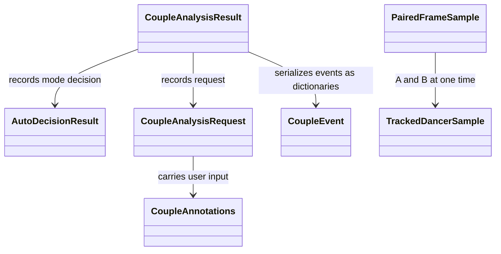
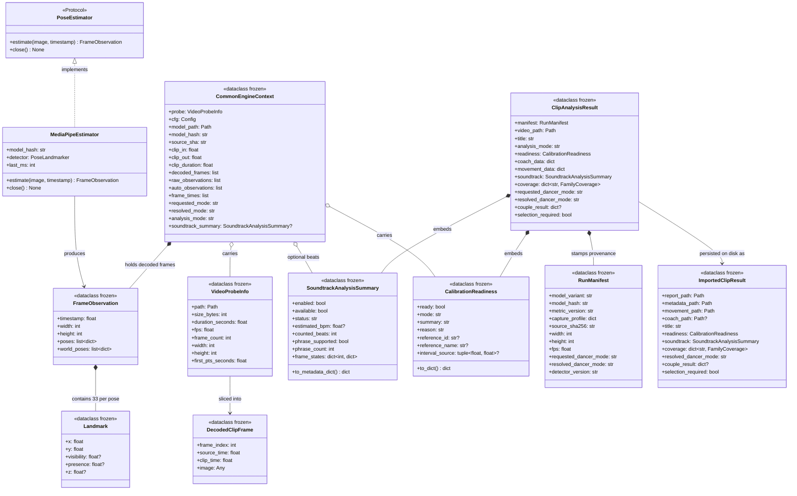
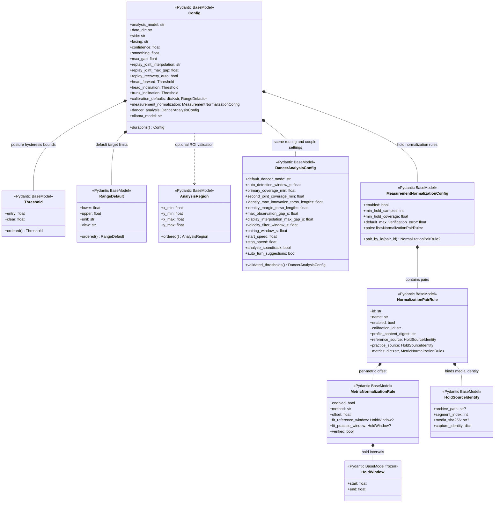
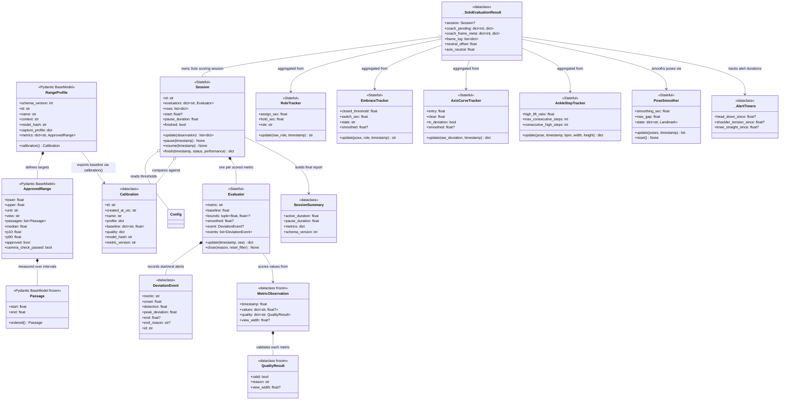
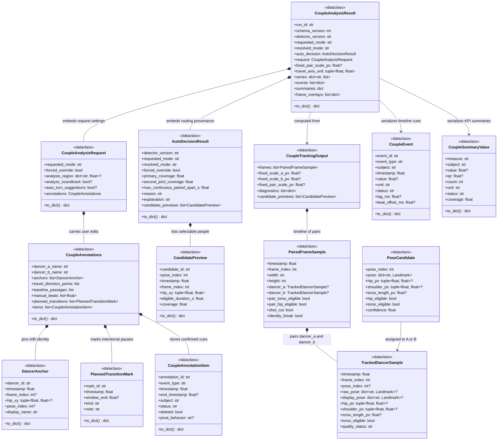
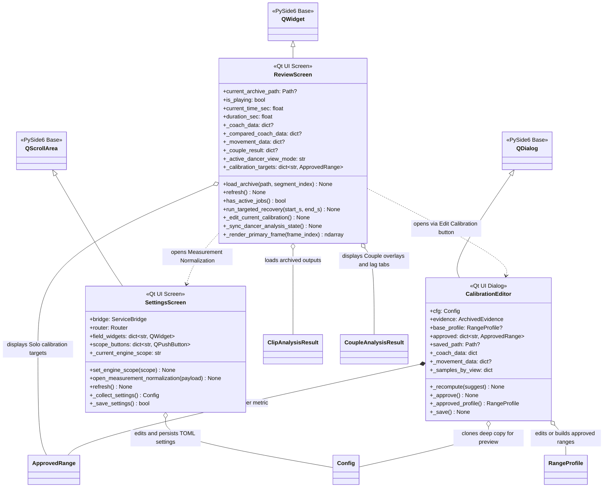

# TangoPosture UML Class Diagrams & Object Reference: The Complete Guide for Dummies

## Read this before the diagrams

Reviewed 17 November 2026 against the working tree. These diagrams are selective maps, not an exhaustive generated API specification. A class is a named container for data or behavior; an arrow tells you how containers relate. Follow the named source files when exact fields or signatures matter.

For metric meanings and numerical examples, use the [manual](TANGO_POSTURE_GUIDE.md). For current processing flow, use the [architecture guide](ARCHITECTURE_DUAL_ENGINE_REENGINEERING.md). Proposed new classes/services in the [audit](TECHNICAL_DEBT_AND_REDESIGN.md) are future work and should not be mistaken for implemented APIs.

### The couple result, in plain language



| Object | Beginner explanation | Concrete example |
| --- | --- | --- |
| `CoupleAnalysisRequest` | What to analyze and what the reviewer supplied | Couple mode plus A/B anchors and manual beat marks. |
| `AutoDecisionResult` | The routing decision and its reasons | Couple, single, or needs selection; this is not a quality score. |
| `TrackedDancerSample` | One dancer's pose and eligibility flags at one time | A's hips are usable but shoulders are hidden; travel may be possible while torso tilt is unavailable. |
| `PairedFrameSample` | A and B at the same timestamp, with break flags | A camera cut interrupts a continuous trajectory. |
| `CoupleEvent` | A timestamped observation or reviewed marker | A starts at 2.00 s; a paired B start at 2.15 s gives `lag_ms=150`. |
| `CoupleSummaryValue` | A number with count, unit, coverage and status | Median start lag 150 ms across three pairs. Many other summary groups currently remain dictionaries. |
| `CoupleAnnotations` | Reviewer edits, beats, baselines and planned transitions | Mark a deliberate reversal so it is not counted as unannotated. |
| `CoupleAnalysisResult` | Saved run evidence, derived series, events, summaries and display data | `automated_candidates` preserves detector proposals; `annotations` stores edits; `events` is their derived combination. |

The measurement functions live in `couple/measurements.py`; the model classes mainly carry data. `rebuild_couple_result_with_annotations` recalculates event-derived results and increments the revision, without rerunning pose detection. It does not recalculate raw travel series when a travel-axis annotation changes. A future revision service should make such dependencies explicit.

**Ownership caveat:** arrows explain relationships, not Python memory safety. A frozen dataclass prevents rebinding its fields but does not freeze contained lists, dictionaries or configuration. Copies made with `dict(...)` share nested objects. Existing annotation rebuilds therefore need the immutability improvements described in the audit.

**Evidence caveat:** `raw_pose` is a pipeline field name; upstream split-pose propagation can supply that field. `display_pose` is used for drawing. Neither naming nor an arrow proves fresh detector evidence; explicit origin metadata is a proposed improvement.

---


> **What is this document?**  
> If you open the TangoPosture source code and wonder *"What are all these objects (`Config`, `Landmark`, `Session`, `CommonEngineContext`, `CoupleAnalysisResult`, `ReviewScreen`...), what data sits inside each one, and how do they connect together?"*, this guide answers every question visually and in plain English — **zero Computer Science degree required**.

> **Related Architecture Guide**:  
> For the module-by-module workflow, Dual-Engine design, and Solo limb-gap repair pipeline, see `docs/ARCHITECTURE_DUAL_ENGINE_REENGINEERING.md`.

---

## Quick Primer: How to Read a UML Class Diagram (In 60 Seconds)

A **UML Class Diagram** is just an **org chart for data blueprints**. Every rectangle represents one Python **class** (a cookie-cutter blueprint for creating objects in memory):

```text
+-----------------------------------+
|         <<dataclass>>             |  <-- Stereotype: what "flavor" of Python class it is
|           ClassName               |  <-- Name of the blueprint
+-----------------------------------+
| +field_name: type                 |  <-- Attributes: data stored INSIDE the object
+-----------------------------------+
| +method_name(arg) ReturnType      |  <-- Methods: actions the object can perform
+-----------------------------------+
```

### What Do the 5 Types of Arrows Mean?

| Arrow | UML Name | Plain-English Meaning | Everyday Analogy |
| :---: | :--- | :--- | :--- |
| **`A *-- B`** | **Composition** | *"A strictly owns B inside itself."* If A is destroyed, B goes with it. | A car *owns* its engine; a `CoupleAnalysisRequest` owns its `CoupleAnnotations`. |
| **`A o-- B`** | **Aggregation** | *"A holds a reference to B, though B can exist on its own."* | A project folder references a client profile that exists independently (`CommonEngineContext` holds `Config`). |
| **`A --> B`** | **Association / Dependency** | *"A uses, produces, updates, or reads B."* | A chef (`Evaluator`) produces a ticket (`DeviationEvent`). |
| **`Parent <|-- Child`** | **Inheritance** | *"Child is a specialized kind of Parent."* | `ReviewScreen` is a kind of `QWidget`. |
| **`Protocol <|.. Impl`** | **Realization** | *"Impl fulfills every method promised by the Protocol contract."* | `MediaPipeEstimator` fulfills the `PoseEstimator` contract. |

### What Do the `<<Stereotypes>>` Mean?
- **`<<dataclass>>`**: A clean container of fields (often `frozen=True`, preventing field reassignment, while nested data can still change).
- **`<<Pydantic BaseModel>>`**: A strict form checker — automatically checks numbers, rejects typos (`extra="forbid"`), rejects `NaN`/`Infinity`, and loads/saves cleanly to JSON or TOML.
- **`<<Protocol>>`**: An interface rulebook ("I don't care *how* you detect poses, just make sure you have `.estimate()` and `.close()`").
- **`<<Tracker / Stateful>>`**: An object with memory across time — remembers previous video frames to smooth jitter and prevent flickering alerts.
- **`<<Qt UI>>`**: A desktop window, tab, or screen built with PySide6 (`QWidget`, `QScrollArea`, `QDialog`).

---

## Domain 1: Common Pre-Flight, Core Primitives & Result Envelopes

Before TangoPosture decides whether you are dancing **Solo** or as a **Couple**, a shared pre-flight pipeline inspects the video, runs the pose detector frame by frame, extracts music beats, and packs everything into envelopes that carry results safely to the UI and `.tpr` archives.



### Detailed Object-by-Object Guide (Domain 1)

1. **`Landmark`** (`src/tango_posture/domain.py`)
   - **Plain-English Analogy**: A single sticky reflective dot worn on a dancer's joint (like left knee or nose) during motion capture.
   - **Fields**: `x`, `y` (normalized screen coordinates from `0.0` top/left to `1.0` bottom/right), optional `z` (depth toward camera), `visibility` (how un-occluded MediaPipe thinks it is, `0..1`), and `presence` (chance the point actually exists in frame, `0..1`).
   - **Who Creates & Uses It**: Created inside `MediaPipeEstimator.estimate` and `display_completion.py`; read by every geometry calculator, smoother, and skeleton renderer.

2. **`FrameObservation`** (`src/tango_posture/domain.py`)
   - **Plain-English Analogy**: One frozen snapshot photograph holding *every* dancer skeleton found in a single video frame.
   - **Fields**: `timestamp` (seconds), video pixel `width`/`height`, `poses` (list of 0, 1, or 2+ dicts mapping joint names like `"left_ankle"` to `Landmark`), and `world_poses` (3D meter-scale landmarks centered at hips for true 3D yaw).
   - **Lifespan**: Produced once per decoded video frame; packed into `CommonEngineContext`.

3. **`PoseEstimator` & `MediaPipeEstimator`** (`src/tango_posture/domain.py` & `pose/mediapipe_backend.py`)
   - **Plain-English Analogy**: `PoseEstimator` is a universal electrical wall socket standard (`estimate()` + `close()`); `MediaPipeEstimator` is Google's MediaPipe AI plug built to fit that socket (and fake estimators in unit tests also plug right into the same socket!).
   - **Key Detail**: Runs MediaPipe in `RunningMode.VIDEO` (`num_poses=2`), ensuring strictly increasing timestamps (`last_ms`), and cleans up C++ detector memory on `.close()`.

4. **`VideoProbeInfo`** (`src/tango_posture/references/video.py`)
   - **Plain-English Analogy**: The passport stamped before reading a video file — checks file existence, size limits, resolution, frame count, FPS, and starting timestamp (`first_pts_seconds`).
   - **Lifecycle**: Built by `probe_import_video()` before any heavy AI work starts.

5. **`DecodedClipFrame`** (`src/tango_posture/references/video.py`)
   - **Plain-English Analogy**: A freshly sliced loaf piece of video delivered off the conveyor belt (`frame_index`, exact `source_time` in the original movie, `clip_time` relative to trim start, and the OpenCV `image` pixels).

6. **`SoundtrackAnalysisSummary`** (`src/tango_posture/references/soundtrack.py`)
   - **Plain-English Analogy**: The clip's DJ sheet — says whether audio beat tracking ran (`enabled`, `available`, `status`), how fast the tango song is (`estimated_bpm`), how many beats (`counted_beats`) and musical phrases (`phrase_count`) were found, and a per-frame map `frame_states` marking which frames sit on a beat.
   - **Key Method**: `to_metadata_dict()` shrinks it into a JSON-safe summary for saving inside `.tpr` metadata.

7. **`CalibrationReadiness`** (`src/tango_posture/calibration/readiness.py`)
   - **Plain-English Analogy**: The pre-flight green/red checklist asking *"Do we have everything needed to score posture against a reference (`existing_reference` or `clip_interval`), or are we doing calibration-free `movement` review?"*
   - **Key Method**: `to_dict()` exports JSON provenance.

8. **`CommonEngineContext`** (`src/tango_posture/engines/common.py`)
   - **Plain-English Analogy**: The **locked transfer suitcase** packed by the Control Tower (`pipeline.py`) and handed to *either* `run_solo_dancer_engine` *or* `run_couple_dancer_engine`.
   - **Why It Matters**: Because `frozen=True`, neither engine can accidentally mutate the shared raw decoded video frames or pre-flight decisions! Contains `decoded_frames`, `raw_observations`, `auto_observations` (including single-pass close-embrace couple splits!), `auto_decision`, `resolved_mode`, and `soundtrack_summary`.

9. **`RunManifest`** (`src/tango_posture/references/results.py`)
   - **Plain-English Analogy**: The tamper-proof shipping label stamped onto every completed analysis explaining *exactly* which AI model (`model_variant` + SHA-256 `model_hash`), which metric rules (`metric_version`), which requested mode (`auto`/`single`/`couple`), and which engine (`resolved_dancer_mode`) generated it.

10. **`ClipAnalysisResult`** (`src/tango_posture/references/results.py`)
    - **Plain-English Analogy**: The **in-memory master box** returned by *both* `run_solo_dancer_engine` and `run_couple_dancer_engine` (and `build_needs_selection_result`!). Holds both Solo artifacts (`coach_data`, `movement_data`, `pose_recovery`, `session_summary`) and Couple artifacts (`couple_result`, `auto_decision`) depending on which engine ran.

11. **`ImportedClipResult`** (`src/tango_posture/references/results.py`)
    - **Plain-English Analogy**: The **saved-on-disk receipt** returned once `ClipAnalysisResult` has been written into a permanent `.tpr` archive folder (`report_path`, `metadata_path`, `movement_path`, `coach_path`, optional YouTube/Facebook source links).

---

## Domain 2: Configuration & Engine-Scoped Settings

TangoPosture validates all `102` TOML configuration parameters strictly at startup using **Pydantic** models (`src/tango_posture/config.py` & `src/tango_posture/normalization_models.py`), and `Config` is organized in Settings under 3 scopes: **Common**, **Single**, and **Couple**.



### Detailed Object-by-Object Guide (Domain 2)

1. **`Config`** (`src/tango_posture/config.py`)
   - **Plain-English Analogy**: The **master control panel** of the entire app holding all 102 settings — shared model selection (`analysis_model = "lite" | "full" | "heavy"`), Solo posture/replay recovery tuning, Ollama LLM prompt settings, plus nested Couple and Normalization sections.
   - **Self-Protection**: `extra="forbid"` catches misspelled config keys immediately when reading `settings.toml`, and `durations()` validates timing constraints.

2. **`DancerAnalysisConfig`** (`src/tango_posture/config.py`)
   - **Plain-English Analogy**: The **Couple & Auto Scene Routing sub-panel** nested under `cfg.dancer_analysis`. Controls how long Auto mode watches the opening window (`auto_detection_window_s`), how tightly Dancer A and B are tracked (`identity_max_innovation_torso_lengths`), how Couple speed transitions trigger (`start_speed`, `stop_speed`, `slowing_fraction`), and lag pairing (`pairing_window_s`).
   - **Self-Protection**: `validated_thresholds()` guarantees `brief_second_max_s < second_sustained_min_s` and `stop_speed < start_speed` so intervals never invert.

3. **`Threshold`** (`src/tango_posture/config.py`)
   - **Plain-English Analogy**: A **"sticky thermostat"** pair `(entry, clear)` preventing flickering alarms! For example, `head_inclination = Threshold(entry=10, clear=6)` means an alert turns ON after passing `10°` tilt, and only turns OFF once you return comfortably below `6°`.

4. **`RangeDefault`** (`src/tango_posture/config.py`)
   - **Plain-English Analogy**: Default safe green-zone bounds `(lower, upper)` plus unit and camera view (`"side"`, `"front"`, `"all"`) used as fallback targets in the Calibration Editor (`Use Defaults`).

5. **`AnalysisRegion`** (`src/tango_posture/config.py`)
   - **Plain-English Analogy**: A rectangular crop box `(x_min, y_min, x_max, y_max)` in normalized `[0, 1]` screen space telling Solo or Couple trackers to ignore spectators outside the practice zone.

6. **`MeasurementNormalizationConfig` & Child Rule Objects** (`src/tango_posture/normalization_models.py`)
   - **Plain-English Analogy**: A **camera-angle glasses prescription**! If your calibration video was shot slightly higher or angled differently from today's practice video, `NormalizationPairRule` links that specific calibration (`profile_content_digest`, `reference_source`) to today's practice video (`practice_source`: `HoldSourceIdentity`), storing verified additive offsets (`MetricNormalizationRule`) measured over static `HoldWindow` pauses (`[start, end)`).
   - **Key Method**: `pair_by_id(pair_id)` looks up the matching rule for Review normalization banners.

---

## Domain 3: Solo Dancer Engine, Calibration, Session & Temporal Trackers

Everything inside the Solo Dancer Engine exists to turn noisy 30fps video points into **calm, reliable posture coaching without false alarms**, while keeping visual limbs whole in `pose/display_completion.py`.



### Detailed Object-by-Object Guide (Domain 3)

1. **`QualityResult` & `MetricObservation`** (`src/tango_posture/domain.py`)
   - **Plain-English Analogy**: Every frame gets a lab report (`MetricObservation`) holding numbers like `head_inclination = 4.2°` alongside a per-metric inspector stamp (`QualityResult(valid=True)` or `QualityResult(valid=False, reason="Knee occluded")`) so bad angles never trigger bogus coaching warnings.

2. **`Calibration`** (`src/tango_posture/domain.py`)
   - **Plain-English Analogy**: The dancer's **baseline ruler** — "this is what *neutral aligned posture* looks like for this dancer and camera angle", holding `baseline` numbers and `quality` metadata (including `head_neutral_offset`, `shoulder_neutral_clearance`, `axis_neutral_offset`, and optional embedded `range_profile`).

3. **`Passage`, `ApprovedRange` & `RangeProfile`** (`src/tango_posture/calibration/models.py`)
   - **Plain-English Analogy**: Modern `.tpc` green-zone calibration! Instead of one rigid single target number, `RangeProfile` collects multiple `ApprovedRange` rules (e.g., `trunk_inclination: -2° .. +6°`), each measured over real approved time `Passage` intervals (`median`, `p10`, `p90`) and checked for camera compatibility (`camera_check_passed`). Calling `.calibration()` converts it into a `Calibration` object.

4. **`Evaluator` & `DeviationEvent`** (`src/tango_posture/temporal.py` & `domain.py`)
   - **Plain-English Analogy**: A patient dance teacher watching **one metric at a time**.
     - `Evaluator` smooths jitter with an exponential filter, waits `entry_duration` (e.g., `1.5s`) before opening a **`DeviationEvent`** (so a 0.2s head glance never buzzes you!), tracks `peak_deviation`, and waits `clear_duration` inside the clear zone before closing the event.

5. **`Session` & `SessionSummary`** (`src/tango_posture/session.py` & `domain.py`)
   - **Plain-English Analogy**: The **choreographer managing all `Evaluator` teachers** during a scoring session. Hands every `MetricObservation` to every `Evaluator`, handles `pause()`/`resume()` (excluding break time), flushes rows to storage, and runs `finish()` to summarize active time, pause time, and all `DeviationEvent` streaks into a report (`SessionSummary`).

6. **`RoleTracker`** (`src/tango_posture/geometry.py`)
   - **Plain-English Analogy**: A steady badge holder deciding `LEADER`, `FOLLOWER`, or `NONE` with patience — waits `assign_ms` (`300ms`) before confirming a role and holds it across brief `hold_ms` (`5000ms`) arm movements so the badge never strobes.

7. **`EmbraceTracker`** (`src/tango_posture/geometry.py`)
   - **Plain-English Analogy**: Watches arm openness score (`CLOSED` vs. `OPEN`) using smoothing and symmetric `±0.035` hysteresis (`switch_sec`) so temporarily shifting arms doesn't flip the embrace label.

8. **`AxisCurveTracker`** (`src/tango_posture/geometry.py`)
   - **Plain-English Analogy**: Dedicated watcher for alignment along the back-of-head -> hip -> ankle line — smooths deviations and applies `entry` vs. `clear` hysteresis (`DEVIATION`, `PENDING`, `WITHIN_LIMIT`).

9. **`AnkleStepTracker`** (`src/tango_posture/geometry.py`)
   - **Plain-English Analogy**: Specifically guards smooth floor gliding during slow tangos (`bpm <= slow_tango_max_bpm`, e.g., Di Sarli `< 115 BPM`). Segments steps when ankles lift and reset, counting `consecutive_high_steps` and alerting if too many consecutive choppy steps occur.

10. **`PoseSmoother`** (`src/tango_posture/geometry.py`)
    - **Plain-English Analogy**: Shock absorbers for your visual skeleton! Exponentially smooths `x, y, visibility, presence` over `smoothing_sec` (`0.20s`), and briefly holds valid coordinates across 1–2 frame blips (`hold_sec <= 0.15s`) so bones slide like silk instead of vibrating.

11. **`_AlertTimers` & `_SoloEvaluationResult`** (`src/tango_posture/references/coach.py` & `engines/solo.py`)
    - **Plain-English Analogy**: `_AlertTimers` is the stopwatch tracking sustained head-down, shoulder-tension, and straight-knee alerts inside frame coaching entries. `_SoloEvaluationResult` is the handoff clipboard returned by Stage 3 (`_evaluate_solo_frames`) to Stage 4 (`_recover_and_complete_solo_coach_data`) containing `session`, `coach_pending`, `coach_frame_meta`, `frame_log`, and resolved neutral offsets.

---

## Domain 4: Couple Dancer Engine, Auto Scene Router & Two-Dancer Tracking

Couple Mode throws away single-person posture nagging and tracks **two interacting partners (Dancer A & Dancer B)**, focusing cleanly on torso axes, partner separation, velocity, lags, transitions, and turns.



### Detailed Object-by-Object Guide (Domain 4)

1. **`CoupleAnalysisRequest` & `CoupleAnnotations`** (`src/tango_posture/couple/models.py`)
   - **Plain-English Analogy**: Your **order form** sent into analysis — specifies `"auto"`, `"single"`, or `"couple"` (`requested_mode`), optional `analysis_region`, soundtrack toggle, plus everything you manually annotated on the timeline (`CoupleAnnotations`: custom names for Dancer A/B, travel arrow points, manual beats).

2. **`DancerAnchor`, `PlannedTransitionMark` & `CoupleAnnotationItem`** (`src/tango_posture/couple/models.py`)
   - **Plain-English Analogy**: Sticky notes placed by a human teacher on specific frames:
     - `DancerAnchor`: *"Hey tracker, person at `(x, y)` on frame `42` is definitely Dancer A!"*
     - `PlannedTransitionMark`: *"Don't penalize speed dropping at `8.5s` — that's an intentional `planned_pause` / `planned_reversal`!"*
     - `CoupleAnnotationItem`: Confirmed or edited event (`start`, `slow`, `settle`, `turn_start`, `exit`) with provenance (`"user_confirmed"`).

3. **`AutoDecisionResult` & `CandidatePreview`** (`src/tango_posture/couple/models.py`)
   - **Plain-English Analogy**: The Traffic Controller's written **verdict receipt** explaining *why* Auto chose `"single"`, `"couple"`, or `"needs_selection"`. Reports coverage stats (`primary_coverage`, `second_joint_coverage`, `max_continuous_paired_span_s`), human-readable `reason` & `explanation`, plus thumbnail `CandidatePreview` cards if user disambiguation is needed.

4. **`PoseCandidate` (`src/tango_posture/couple/tracking.py`)**
   - **Plain-English Analogy**: An **anonymous lineup suspect** extracted from a raw pose on one frame before we know whether they are Dancer A or Dancer B — holds pixel `hip_px`, `shoulder_px`, `torso_length_px`, `bbox`, and eligibility flags.

5. **`TrackedDancerSample` & `PairedFrameSample`** (`src/tango_posture/couple/models.py`)
   - **Plain-English Analogy**: Once `_TrackMemory` solves 1-to-1 matching (`pose A` vs `pose B`), each person gets a **`TrackedDancerSample`** badge containing raw & display poses, pixel centers, and `quality_status`. **`PairedFrameSample`** puts Dancer A and Dancer B side-by-side on that exact timestamp, flagging camera `shot_cut` or `identity_break` if someone swapped unexpectedly.

6. **`CoupleTrackingOutput`** (`src/tango_posture/couple/tracking.py`)
   - **Plain-English Analogy**: The complete tracked flipbook (`frames: list[PairedFrameSample]`) plus each dancer's **median fixed torso ruler** (`fixed_scale_a_px`, `fixed_scale_b_px`, `fixed_pair_scale_px`) so movements across the whole dance are measured in consistent torso lengths!

7. **`CoupleEvent`, `CoupleSummaryValue` & `CoupleAnalysisResult`** (`src/tango_posture/couple/models.py`)
   - **Plain-English Analogy**:
     - `CoupleEvent`: One discrete coordination cue on the timeline — e.g. Dancer A starts walking at `t=2.10s`, Dancer B starts `110ms` later (`lag_ms = 110.0`), or a turn starts/ends.
     - `CoupleSummaryValue`: One headline KPI card (median value, IQR spread, valid coverage `0..1`, status `"measured" | "estimated" | "user_confirmed" | "unavailable"`).
     - **`CoupleAnalysisResult`**: The master output box from `run_couple_analysis` holding timeseries (`tilt_a_deg`, `tilt_b_deg`, `couple_midpoint_tilt_deg`, `torso_separation_deg`, velocities), events, summaries, and lightweight per-frame overlay instructions (`frame_overlays`) serialized straight into `analytics_XX.json`.

---

## Domain 5: Desktop Qt UI & Presentation Classes

These PySide6 desktop classes bridge user clicks, video playback, settings editing, and calibration intervals to the Python engines without putting business math inside buttons.



### Detailed Object-by-Object Guide (Domain 5)

1. **`ReviewScreen`** (`src/tango_posture/desktop_qt/screens/review.py` — `3,411` lines)
   - **Plain-English Analogy**: The **command theater** where dancers watch `.tpr` replays!
   - **Dual-Engine Awareness**: `load_archive()` inspects `dancer_analysis.runs` and switches adapters via `_sync_dancer_analysis_state()` / `_sync_mode_specific_controls()`:
     - In **Single mode**, draws the 33-landmark green/interpolated skeleton (`_coach_data` / `_compared_coach_data`), Solo posture alerts, calibration comparisons, and `Edit Calibration` / `Targeted Recovery` buttons.
     - In **Couple mode**, swaps in `render_couple_frame_overlay` using `_couple_result`, showing Dancer A / Dancer B / Midpoint axis toggles, transition marks, and editable coordination event annotations with an undo stack (`_annotation_undo_stack`).

2. **`SettingsScreen`** (`src/tango_posture/desktop_qt/screens/settings.py` — `825` lines)
   - **Plain-English Analogy**: The **interactive switchboard** mapping every field on `Config` into Qt spinboxes, dropdowns, and collapsible plain-English Parameter Guides.
   - **3-Scope Filter (`set_engine_scope`)**: Switches between `"All"`, `"Common (Both Engines)"`, `"Single Dancer Engine"`, and `"Couple Dancer Engine"`, showing only relevant tabs across the 15 tabs (`Measurement normalization` and `Calibration defaults` included under Single), and validates/saves cleanly via `_collect_settings()` -> `Config`.

3. **`CalibrationEditor`** (`src/tango_posture/desktop_qt/calibration/editor.py` — `1,367` lines)
   - **Plain-English Analogy**: The **calibration workshop modal** launched either on a new `.tpr` clip or when clicking `Edit Calibration` on a `.tpc` profile from Review.
   - **Single Limb Parity Fix**: Loads `self._movement_data` *before* running `interpolate_coach_data(coach, self.cfg, pose_recovery=coach.get("pose_recovery"), movement_data=self._movement_data)` so its preview video displays the exact same completed skeleton as `ReviewScreen`. Lets you highlight clean reference `Passage` windows per body area (`Head`, `Shoulders`, `Hips`, `Torso`, `Knees`) and save an immutable `RangeProfile` (`.tpc`).
